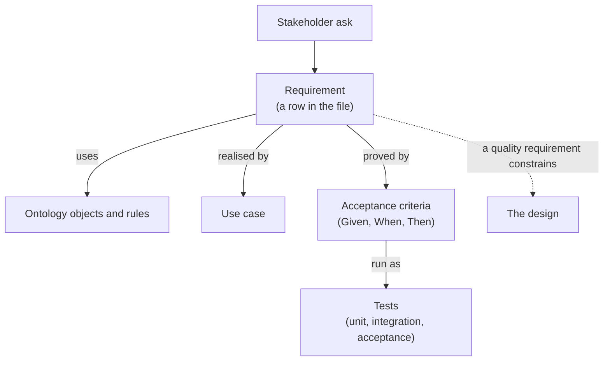

# Requirements

The requirements of the product are one markdown file: `requirements.md` (default
`docs/requirements/requirements.md`). It holds tables, and each row is one requirement. This page says
how to read it and how a row is written. `req_tool.py` searches, checks and edits it.

## How the file is laid out

A person reads this file, so it is markdown tables, not a spreadsheet.

- **Two parts.** *Functional requirements* (`FR-`) have one table. *Quality, constraint and process
  requirements* (`NFR-`) have another, which adds the scenario columns (stimulus, environment, response,
  measure) and a `Kind` column.
- **Split by area.** Under each part, a heading `### Area A` starts the rows of that area, so `area` is
  the heading and not a column. The `group` is not a column either: it is `process` for a process row
  and `product` otherwise.
- **Long notes under the table.** The `notes` of a row sit under its table as a bullet,
  `- **FR-1:** text`, so a wide cell does not stretch the table.
- **Empty columns are left out.** A column that no row in the table uses (for example `Rules`) is not
  drawn, and it comes back when a row uses it.
- **`Built`** is `yes` or `no` (the `today` field is `built` or `not built`).
- A `|` inside a cell is written `\|`, and a line break is `<br>`.

```markdown
## Functional requirements

### Area A

| ID | Name | Statement | Verified by | Release | Built | Status | Objects | Sources |
|---|---|---|---|---|---|---|---|---|
| FR-1 | Approve an account | The system shall let an administrator approve a pending account. | acceptance test | R1 | no | draft | OBJ-A1 | ADR 0019 |

**Notes**

- **FR-1:** Approval is a status change in Playground only.
```

The tools see the same flat rows as before (the field names below), whatever the layout. A person may
fix a cell by hand: `req_tool.py` reads it back.

## What a requirement is

One sentence that says **one verifiable thing** the product shall do or be, with a stable id. It
says what and not how. How a person does it is a use case, and that is a later step.

## Four kinds, in two groups

**Product requirements** say what the system shall do or be:
- **Functional** (`FR-<n>`): what the system shall do, in the form "The system shall ...".
- **Quality** (`NFR-<n>`): how well it shall do it, written as a **scenario** with a stimulus, an
  environment, a response and a **measure**. Where no target is known, the measure says
  `not decided`, and the check reports it as an open gap instead of leaving it silent.
- **Constraint** (`NFR-<n>`): a limit the business or the environment imposes, such as where data
  may be stored. A technical choice we made ourselves is a decision, not a constraint.

**Process requirements** say what the team shall do:
- **Process** (`NFR-<n>`): what the team shall do to build, verify or release, such as testing a
  restore before launch. Worded "The team shall ...".

Only the functional kind has the `FR-` prefix. The other three are non-functional, so they share
`NFR-`, and the `kind` column says which one it is.

## Wording

- A statement starts with "The system shall" or "The team shall". The check enforces this.
- **shall** is mandatory. **should** is a goal. **may** is optional. The check flags a statement
  that uses should, may, will or can without shall.
- One verb and one thing in each statement. If it needs "and" to join two things, make two rows.
  The check notes each "and" so you can confirm it says one thing.
- Use the project's words (see the ontology and the vocabulary file).
- Say what is measurable. "Fast" is not a requirement. "Within 200 milliseconds" is.

## The columns

- `id`: `FR-<n>` or `NFR-<n>`, one global sequence for each, append only (see
  [naming-conventions.md](naming-conventions.md)).
- `kind`: `functional`, `quality`, `constraint` or `process`.
- `group`: `product`, or `process` for the process kind.
- `area`: a letter or short code for the part of the product it belongs to (for example P projects,
  O orders). It is for grouping and is not part of the id. The check does not restrict it.
- `name`: a few words. `statement`: the sentence, worded with "shall".
- `quality`, `stimulus`, `environment`, `response`, `measure`: the scenario, filled only for a
  quality row. All five are required for a quality row.
- `verification`: how it is proved. One of `acceptance test`, `integration test`, `unit test`,
  `inspection` (a review), `demonstration` or `analysis`.
- `release`: where it is planned: `R1`, `R2`, `R3`, `backlog`, `parked` (kept but not planned), or
  empty when no release is stated.
- `today`: `built` if it exists now, or `not built`.
- `status`: `draft`, `accepted` or `retired`. Every row is a draft until it has been read and
  agreed.
- `objects` and `rules`: the ontology items it uses, as ids separated by semicolons. A row that
  needs an object that is not an ontology file yet says so in `notes`.
- `satisfies`: the stakeholder ask it serves, if you track those.
- `sources`: where it was taken from, by id.
- `notes`: what is unclear or decided. A change to `notes` does not make a use case suspect.

## How it links



The glossary and the business rules are the ontology and the `RULE-` files. A row points at them
with `objects` and `rules`. Do not keep a second glossary or a second list of rules.

## What the check does

`req_tool.py validate` checks:
- unique ids, in the form `FR-<n>` or `NFR-<n>`, with `FR-` only for the functional kind,
- every statement in "shall" form,
- every quality row complete,
- every value of `kind`, `group`, `verification`, `release`, `today` and `status` in its list,
- every criterion proves at least one requirement that exists, and has given, when and then.

It also reports warnings: a Release 1 requirement with no acceptance criteria, and a quality
requirement whose measure is `not decided`.

## Acceptance criteria

A requirement is only verifiable when something can confirm it. The conditions that prove a
requirement are its **acceptance criteria**, written as scenarios in `acceptance-criteria.md`: one
row of its table for each scenario, with an id (`AC-<n>`). The table columns are `ID`, `Proves`, `Given`,
`When`, `Then`, `Level`, `Status`, and `Notes` (left out while no row has one).

- `id`: `AC-<n>`, one global sequence, append only.
- `requirements`: the requirement ids it proves, separated by semicolons. One scenario may serve
  more than one requirement.
- `given`, `when`, `then`: the scenario, in the project's words.
- `test_level`: `unit`, `integration`, `acceptance`, `manual`, `inspection` or `future` (cannot be
  tested yet).
- `status`: `draft`, `accepted`, `open` (waiting on a decision) or `retired`.
- `notes`: what is assumed or unclear.

A requirement can have several scenarios, including the edge cases (zero is allowed, a duplicate is
refused). The `verification` column of a requirement keeps the main method, and each scenario names
its own level.

A test is tagged `Verifies AC-12` to say which criterion it runs (see
[naming-conventions.md](naming-conventions.md), section 6).

## What comes next

A requirement and its criteria are the first link in a chain of three skills. **vbench-req** writes
them, **vbench-uc** writes the use case that runs them (see [usecases.md](usecases.md)), and
**vbench-at** turns each acceptance criterion into an acceptance test tagged `Verifies AC-<n>` and
reports where a criterion has no test or a test is stale. A criterion that cannot be tested as
written comes back here to be fixed. `vbench-req` is the only skill that edits the two requirements files.

## Beside it

Optional CSV files sit beside the two markdown files: a permissions matrix, a rule inventory, a
vocabulary and a list of retired ids. They are explained in [csv-files.md](csv-files.md).
