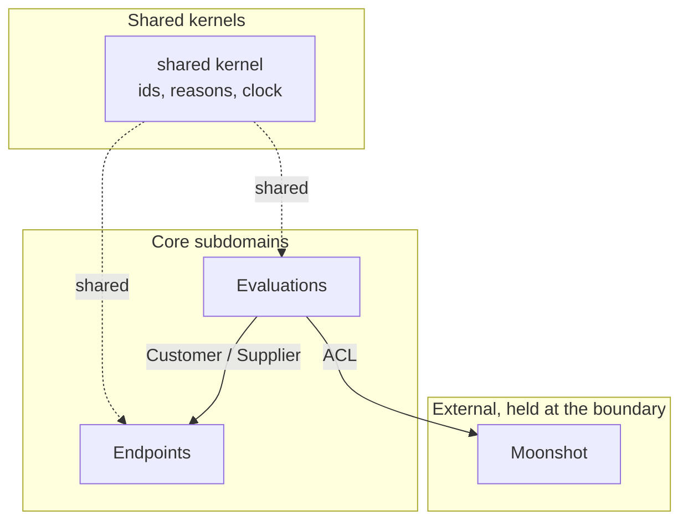
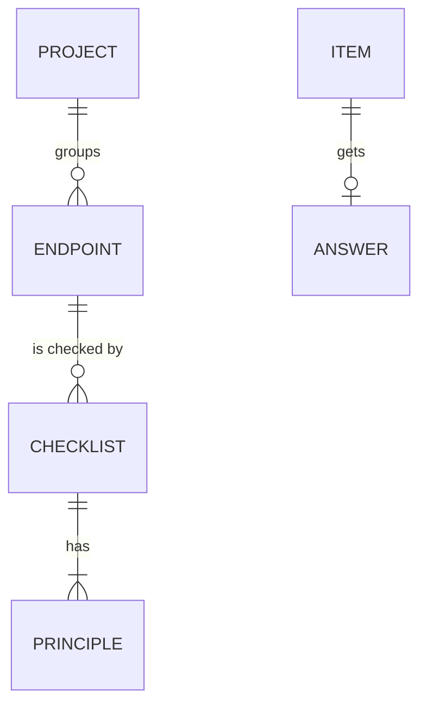

# vbench-mermaid

Small diagrams that sit next to the words they explain. GitHub and VS Code draw them with no
tools, so a reader sees the picture in the document. If the diagram is too big for Mermaid,
or someone will open, print or quote it on its own, it is a PlantUML file: use `vbench-puml`.

The standard is in `_vbench/standards/diagrams.md`. If a rule changes, change that, not this file.

## The style is no style

**Write plain Mermaid. Add no config block, no theme, no colours, no `style` or `classDef`
lines, and no white card.** The viewer draws it in its own theme, and that is the point.

Why: this repo tried a config block (ELK layout, neo look, a serif font), a forced light
theme, a white card and colour zones. On GitHub the diagram sits in a frame that can be
black even when the page is white. A forced light theme then drew dark lines on black, and
the result was hard to read. Left alone, GitHub picks matching colours (light lines on a dark
frame, dark on a light one) and the diagram stays readable in either mode. Do not bring the
extras back to fix a look. If a diagram must look the same everywhere, or be printed, make it
a `.puml` (see `vbench-puml`), which has its own white background.

## Step 1: Is Mermaid the right format?

Ask two questions in order:

1. **Can Mermaid draw it properly?** If it comes out cramped or tangled, or you cannot
   control the layout, it is not a Mermaid diagram.
2. **Would anyone open it on its own?** A reference we keep, print or quote is a `.puml`.
   A picture that only helps one paragraph stays inline.

A reference diagram (a context map, an object map) may keep an inline Mermaid copy as the
reading version beside its `.puml`, which is the printable A4 source. Link each to the other
and change both in the same commit. Anything else lives in one form.

## Step 2: One idea, small, and narrow

Write one sentence: "This shows ___". If it needs "and", make two diagrams. Aim for 12 nodes
or fewer. Put a one or two line reading guide under it. A diagram that renders wider than
the page is a sign it needs to be split or moved to a `.puml`.

Prefer the types that read well in a document: `flowchart` (`TB` for a context map, `LR` for
a short flow), `sequenceDiagram`, `stateDiagram-v2`, `erDiagram`.

Use the project's words (the names in the ontology, `docs/domain/ontology/`). No em or en dashes in labels or
text. Do not invent terms.

## Step 3: What to write on a line

Say how two things relate, in DDD words, not just an arrow:

| Write | Means |
| ----- | ----- |
| `Customer / Supplier` | The downstream side asks and the upstream side plans for it |
| `Conformist` | The downstream side takes what upstream gives |
| `Open Host Service` | The upstream side offers a published interface to many |
| `ACL` | An anti-corruption layer: we translate an outside system |
| `shared` | A shared kernel |
| `post-commit`, `async` | When it happens, if that matters |

A solid arrow is a direct call or dependency. A dotted arrow (`-.->`) is something shared,
optional or after the fact. Put a label in quotes when it has spaces or punctuation:
`A -->|"Customer / Supplier"| B`.

Group related things with `subgraph` and give the group a title that says what kind of thing
is inside (for example "Core subdomains", "Supporting subdomains", "External, held at the
boundary"). The title carries the meaning, so no colour is needed.

## Step 4: Examples

A context map:

````

````

An ER map: entity names in capitals, one line per relationship, and a short label that reads
as a sentence ("a project groups many endpoints"). The marks mean: `||` exactly one, `o|` zero
or one, `}o` zero or many, `}|` one or many. Keep it to about 12 entities. The full object map
is too big for one Mermaid diagram, so it also has portrait `.puml` versions.

````

````

A state machine: use a composite `state "Active stages" as Active { ... }` and one
`Active --> Retired` arrow, instead of repeating an arrow from every state.

A sequence diagram: name the participants in the project's words and show the permission
check, the domain rule and the save as separate steps. This is for a small inline sequence only. The analysis and
design sequence diagrams of a use case are `.puml` files (decision 9, `vbench-puml`).

## Step 5: Check it

Mermaid cannot be rendered by a script here, so say so: "not rendered". Read it for syntax
mistakes (labels in quotes, every `subgraph` closed with `end`) and ask the user to look at
the preview in VS Code or on GitHub, in light and in dark mode if they can. Look for:

- Lines running through a group title or a label. Reorder nodes, or drop a repeating line.
- Text cut off or crowded. Shorten labels (about 20 characters a line, `<br/>` to wrap).

## Step 6: Finish

- Keep the diagram next to the paragraph it explains, with a short reading guide.
- Do not commit unasked. Offer a `docs` commit through `vbench-commit`.
