# UC-A1 Concepts: how sign in works, and why

**Read before:** [[UC-A1-Sign-In]] (the lesson that builds it). **Builds on:** [[00-Keycloak-Crash-Course]], [[02-Setup-Identity-Stack]].

> [!abstract] What this note is
> The lesson says **what** to type. This note says **why** each piece is there. Seven ideas, each one building on the one before. Every section ends with a question: answer it in your own words before you open the folded answer.

| # | Idea | The question it answers |
|---|---|---|
| 1 | [[#1. Who is who]] | who talks to whom, and who holds what? |
| 2 | [[#2. The authorization code flow]] | why does Keycloak send a code, not the tokens? |
| 3 | [[#3. state and PKCE]] | how do we know the code coming back is ours? |
| 4 | [[#4. Tokens and the session cookie]] | what does the browser keep, if not the tokens? |
| 5 | [[#5. Open redirect and returnTo]] | why check where we send people after sign in? |
| 6 | [[#6. The hexagon in the frontend]] | why ports, adapters and a fake Keycloak? |
| 7 | [[#7. Where the code lives in Next.js]] | route handlers, `proxy.ts`, `<Suspense>` |

At the end: [[#8. The whole flow, one more time]], a [[#Glossary]], and [[#Check your understanding]].

---

## 1. Who is who

There are three players. Think of Singpass: the government site, Singpass, and you.

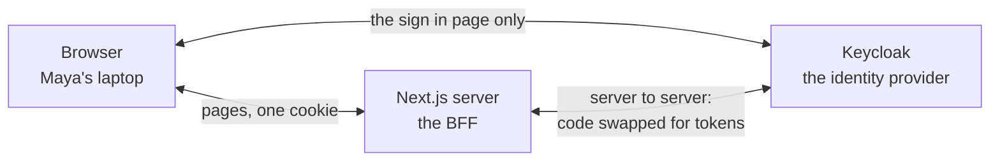

How to read it: three conversations.
- **Browser and Keycloak** meet only on the sign in page. Maya types her password there, never on an aiaas page.
- **Browser and Next.js server** exchange pages and one cookie. That is all.
- **Next.js server and Keycloak** talk directly. The browser never sees this line, and the **tokens travel only on it**.

### Why not keep the tokens in the browser?

Many single page apps do. The problem is that an access token is a **bearer token**: like a cinema ticket, whoever holds it gets in. No name check.

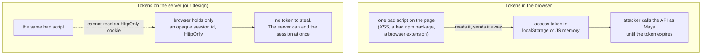

How to read it: on the left, any script that runs in the page can read the token and carry it off. On the right, the browser holds an id that JavaScript cannot read, that means nothing outside aiaas, and that the server can cancel in one line.

**BFF** (backend for frontend) is the name for this pattern: a server that belongs to the frontend and does the security work for it. In aiaas, the Next.js server is the BFF.

> [!question] Your turn
> The session id cookie still lets someone in, if they get it. So what did we gain by not giving the browser the access token? Name two things.

> [!example]- Answer
> 1. **JavaScript cannot read it** (`HttpOnly`), so the most common theft, a malicious script, cannot take it.
> 2. **It is useless outside aiaas and can be killed on the server.** An access token works against the API directly until it expires, and nobody can take it back. A session id only works through our Next.js server, which can forget it at once (sign out, UC-A2) or refuse it.
>
> A third: the access token never appears in browser history, developer tools or logs on the user's machine.

---

## 2. The authorization code flow

OAuth 2.0 has several ways to get tokens, called **grants**. For a person signing in through a browser, the right one is the **authorization code grant**. It works in two halves:

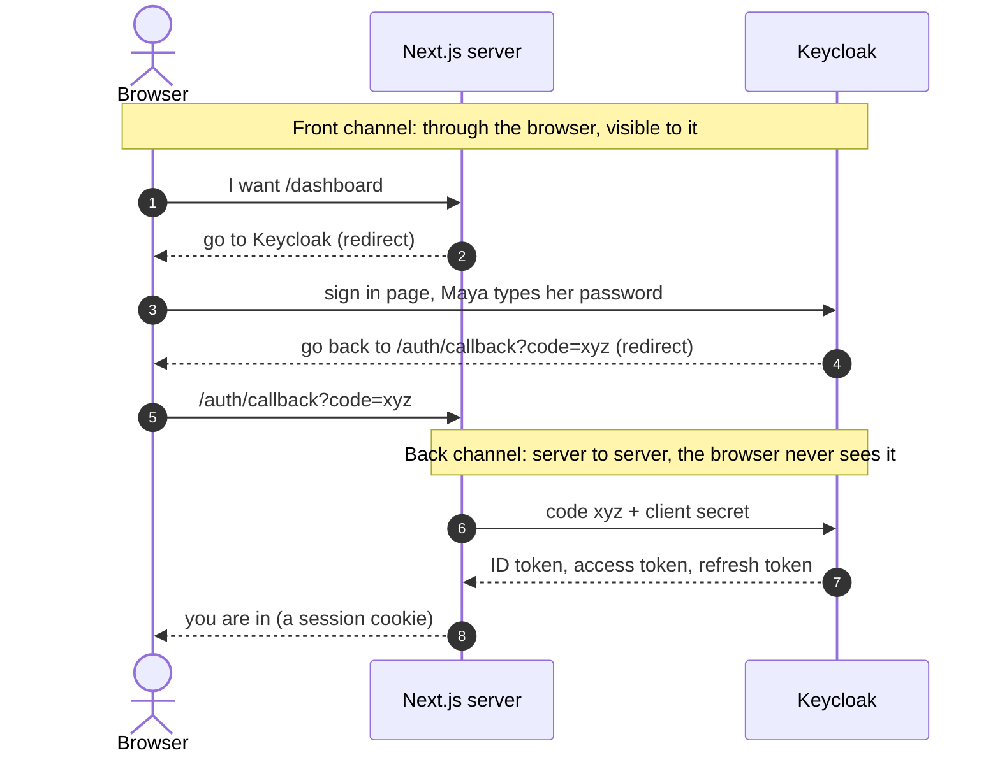

How to read it: steps 1 to 5 go **through the browser** (the front channel), so anything there can leak: browser history, server logs, a screenshot. Steps 6 and 7 go **directly** between two servers (the back channel). The valuable things, the tokens, only ever travel in the back channel.

### Why a code, and not the tokens straight away?

Because the redirect in step 4 is a URL, and URLs leak. So Keycloak puts the least valuable thing possible in it: a **code** that is

| Property | Why it matters |
|---|---|
| short lived (about 1 minute) | a code found in a log tomorrow is dead |
| single use | a code that was already swapped is dead |
| useless alone | swapping it needs the **client secret**, which only our server has (and the PKCE verifier, section 3) |

> [!note] Confidential client
> `aiaas-web` has **Client authentication on**: it has a secret, because it runs on a server that can keep one. A browser app cannot keep a secret (anyone can read its code), so it would be a **public** client. Being confidential is one more reason the BFF is safer.

> [!question] Your turn
> Someone copies the URL from step 5, `/auth/callback?code=xyz`, out of Maya's browser history an hour later and opens it. What happens, and which property in the table stops them?

> [!example]- Answer
> Nothing useful. The code expired after about a minute, and it was already used once, by our server, in step 6. Two properties stop it: **short lived** and **single use**. Even a fresh code would need the client secret, which never left the server.

---

## 3. state and PKCE

The code flow has two holes that two small random values plug. Both are made at the start, kept on our server, and checked at the end.

### state: "is this the sign in I started?"

Without `state`, an attacker could start a sign in with **their own** account, stop before the callback, and trick Maya into opening their callback link. Maya would then be signed in to aiaas **as the attacker**, and anything she uploads goes into the attacker's account. This is called **login CSRF** (cross-site request forgery).

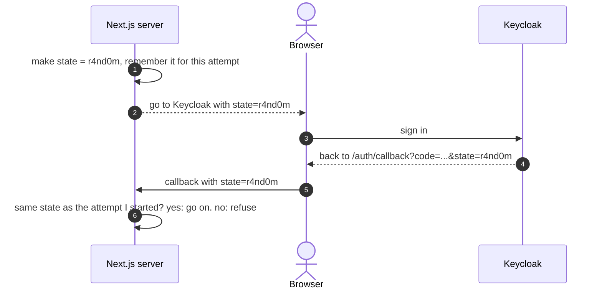

How to read it: Keycloak hands `state` back unchanged. An attacker's link carries a `state` our server never made for this browser, so it is refused.

### PKCE: "is the one swapping the code the one who asked?"

**PKCE** (Proof Key for Code Exchange, say "pixie") protects the code itself. If someone steals the code on its way back (step 4 or 5), they still cannot swap it.

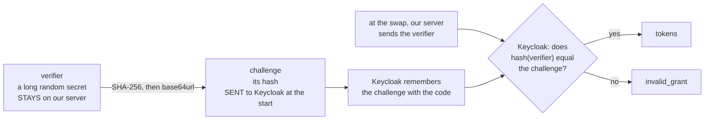

How to read it: a hash works one way. Anyone can see the challenge, but nobody can work back from it to the verifier. Only the party that made the verifier can finish the swap.

| | `state` | PKCE |
|---|---|---|
| Stops | being signed in to someone else's account (login CSRF) | a stolen code being swapped |
| Where it travels | to Keycloak and back, in the URL | the challenge goes out, the verifier only in the back channel |
| Who checks | our server | Keycloak |
| In our code | `oidc.randomState()`, `expectedState` | `randomPKCECodeVerifier()`, `calculatePKCECodeChallenge()`, `pkceCodeVerifier` |

Both live in the **LoginAttempt**, which our server stores until the browser comes back, and uses **once**.

> [!question] Your turn
> Our server also has a client secret. If the secret already stops strangers from swapping a code, why bother with PKCE as well?

> [!example]- Answer
> Defence in depth: two locks, so one mistake is not enough. A client secret is shared by every sign in and lives for months: if it ever leaks (a log, a config file in git), it protects nothing. A PKCE verifier is new for **each** sign in, lives about a minute, and never leaves the server. OAuth 2.1, the next version of the standard, makes PKCE required for every client for this reason.

---

## 4. Tokens and the session cookie

### The three tokens

| Token | What it is | Who reads it | Lifetime here |
|---|---|---|---|
| ID token | "who signed in": `sub`, name, email | our Next.js server, once, to make the session | minutes |
| Access token | "may call the API", `aud: aiaas-api` | the FastAPI API (UC-A4) | 5 minutes |
| Refresh token | "may get a new access token" | only Keycloak (UC-A3) | as long as the Keycloak session |

All three stay in the **session store** on our server. Right now that is an in-memory `Map`, which forgets everything when the server restarts (see [[UC-A1-Sign-In]] section 9).

### Two cookies

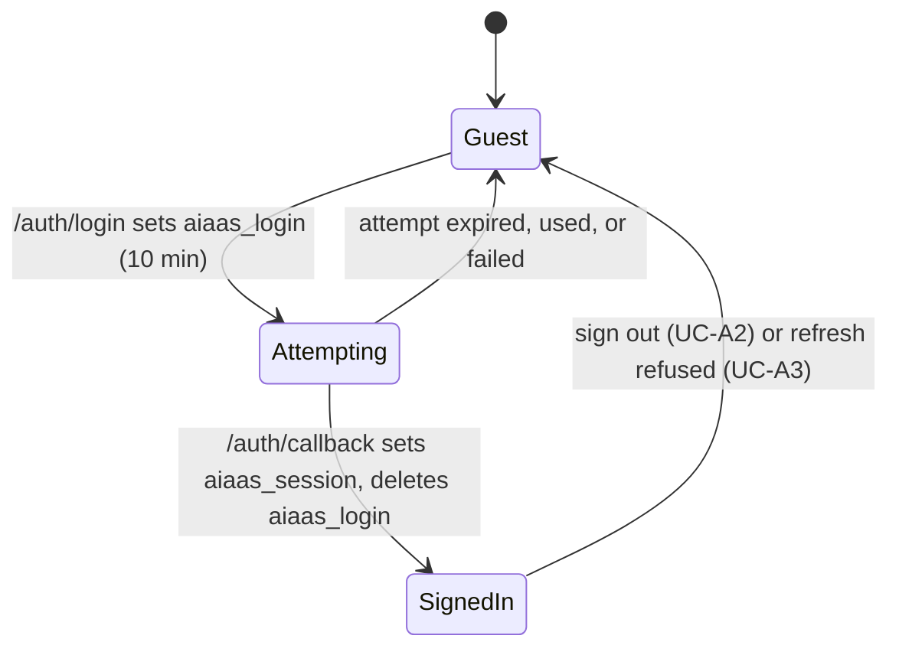

How to read it: the browser carries at most one small cookie at each moment. `aiaas_login` holds the id of the sign in attempt, for the trip to Keycloak and back. `aiaas_session` holds the id of the session afterwards. Both are random strings that mean nothing outside our server.

### The cookie settings, and why

| Setting | Meaning | Why |
|---|---|---|
| `HttpOnly` | JavaScript in the page cannot read the cookie | a malicious script cannot steal it (section 1) |
| `Secure` | sent only over https | nobody on the network can read it. Off on localhost, which is http |
| `SameSite=Lax` | sent when the person **navigates** to our site, even from another site. Not sent on another site's background requests (forms posted, images, frames) | the callback is a navigation **from Keycloak's site**: it needs the cookie |
| `Path=/` | sent for every page | the shell and the auth routes both need it |

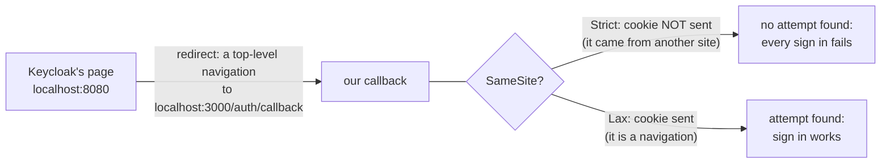

> [!question] Your turn
> `Strict` sounds safer than `Lax`. Explain in one sentence why it would break our sign in, and in another why `Lax` is still safe enough.

> [!example]- Answer
> `Strict` never sends a cookie on a request that started on another site, and the callback starts on Keycloak's page, so `aiaas_login` would never arrive and every sign in would fail (AC-4). `Lax` only adds plain navigations, where a person follows a link or redirect. It still refuses the background requests that cross-site attacks use, such as a hidden form posting to our server.

---

## 5. Open redirect and returnTo

Maya opens `/dashboard/reports`. She has to sign in first, and afterwards she should land on `/dashboard/reports`, not the home page (NFR-2). So the address travels along as `returnTo`. That convenience is also a classic hole:

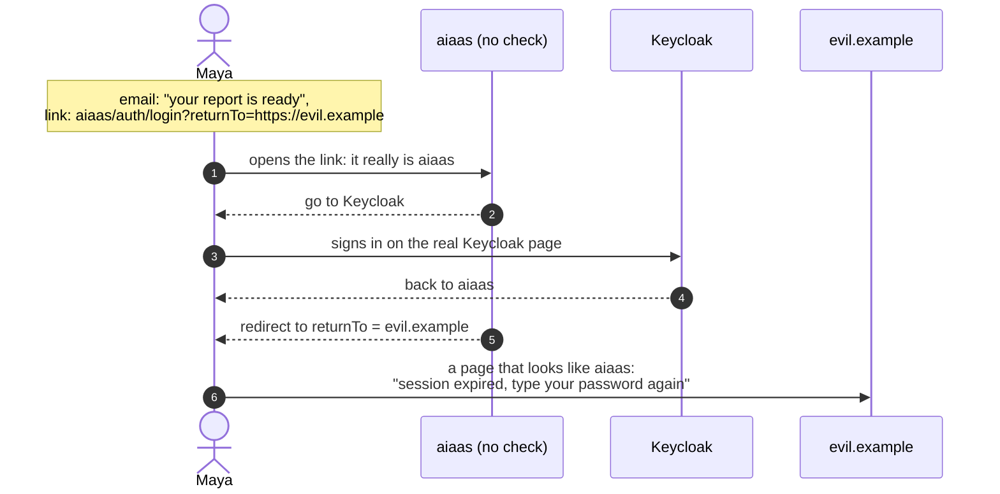

How to read it: every step looks real to Maya, because steps 1 to 4 **are** real. Only the last redirect is wrong, and by then she trusts it. This is an **open redirect**: a trusted site that forwards people to any address it is handed.

The rule, in `safeReturnTo`: a return address must be a **local path**.

| `returnTo` | Result | Why |
|---|---|---|
| `/dashboard/reports?tab=2` | kept | starts with one `/` |
| `https://evil.example` | `/dashboard` | a full address |
| `//evil.example` | `/dashboard` | browsers read `//` as "same scheme, **other site**" |
| `/\evil.example` | `/dashboard` | some browsers treat `/\` like `//` |
| `dashboard` | `/dashboard` | not a path |
| nothing | `/dashboard` | the default |

> [!question] Your turn
> Why is `safeReturnTo` in `domain/`, and not in the route handler that reads the query string?

> [!example]- Answer
> Because it is a **rule of the product** ("we only ever send people to our own pages"), not a detail of HTTP. In the domain it is a plain function with no imports, tested in milliseconds with every tricky input. Any part of the app that ever needs a return address (sign in, sign up in UC-A5, sign out) uses the same rule, so it cannot be forgotten in one of them.

---

## 6. The hexagon in the frontend

The frontend's server has real rules, so it gets the same shape as the backend.

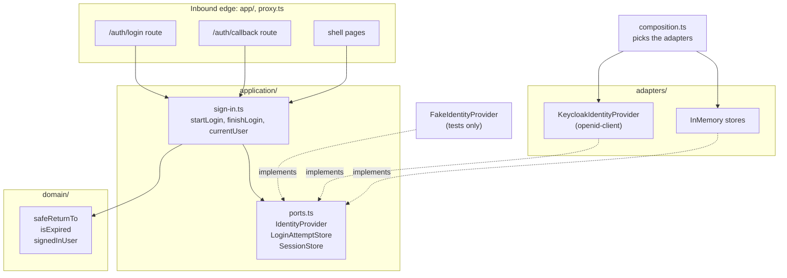

How to read it: arrows point **inward**. The use cases know the ports, never the adapters. `composition.ts` is the only file that says "use Keycloak and memory". The tests say "use the fake and memory" instead, and nothing else changes.

| Layer | In UC-A1 | Knows about |
|---|---|---|
| Domain | `safeReturnTo`, `isExpired`, `signedInUser`, the `Session` and `LoginAttempt` types | nothing outside itself |
| Application | `startLogin`, `finishLogin`, `currentUser`, and the three **ports** | the domain |
| Adapters | `KeycloakIdentityProvider`, `InMemoryLoginAttemptStore`, `InMemorySessionStore` | the ports, and their technology (openid-client, `node:crypto`) |
| Inbound edge | route handlers, `proxy.ts`, pages | the use cases and `composition.ts` |

### Three design choices worth noticing

1. **The port speaks the use case's language.** `IdentityProvider` has `beginLogin()` and `completeLogin()`. It says nothing about discovery documents, `code_challenge` or HTTP. Those are Keycloak's business, inside the adapter.
2. **`take()`, not `get()` then `delete()`.** "Read and forget in one step" makes **once only** part of the port's promise. Every adapter must keep it, and a use case cannot forget the second call.
3. **The fake is strict.** `FakeIdentityProvider` checks the `state` and refuses a reused code, like Keycloak does. A fake that always said yes would let a careless use case pass its tests.

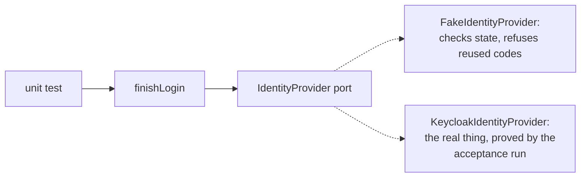

> [!question] Your turn
> In two years aiaas moves from Keycloak to another identity provider that also speaks OIDC. Which files change, and which do not?

> [!example]- Answer
> **Change:** a new adapter (or the settings of `KeycloakIdentityProvider`, since the protocol is the same), and `composition.ts`, which picks it. **Unchanged:** the domain, `sign-in.ts`, the ports, the route handlers, the pages and every unit test. If a move like that forces a change in the use cases, the port knew too much about Keycloak.

---

## 7. Where the code lives in Next.js

Next.js gives three places for code to run on the server. UC-A1 uses all three, for different jobs.

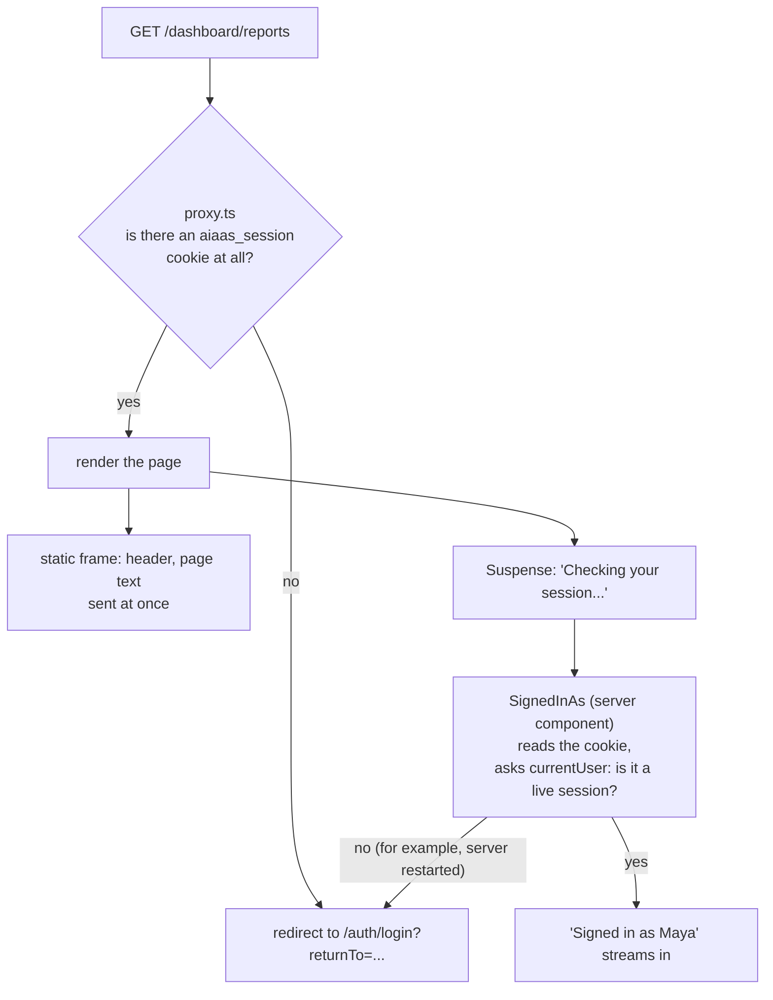

How to read it: two checks, on purpose.

| Place | Job here | Why there |
|---|---|---|
| **Route handlers** (`app/auth/login/route.ts`, `app/auth/callback/route.ts`) | the sign in steps: redirects and cookies, then call a use case | they are plain HTTP endpoints, no page |
| **`proxy.ts`** | the **quick** check: is there a session cookie at all? | runs before every matching request, so it must be cheap: it reads no store |
| **A server component in `<Suspense>`** | the **real** check: is that cookie a live session? | it can read the store, and the rest of the page does not wait for it |

### Why two checks?

`proxy.ts` is an **optimistic** check: it trusts that a cookie means a session. Usually that is true, and it turns every guest away in a few microseconds. But a cookie can be stale (the server restarted, the session ended). The real check reads the session store and catches those.

### Why `<Suspense>`?

With **Cache Components** on, Next.js splits each page into a **static shell**, ready at once and the same for everyone, and **dynamic parts** that depend on this request. Reading `cookies()` is request data, so it must sit inside a `<Suspense>` boundary. The frame shows instantly with "Checking your session...", and the name streams in a moment later. Reading cookies outside a boundary is a **build error** in this setup.

### Why a route group, `(shell)`?

A folder in brackets groups pages under one layout **without** adding to the address. `app/(shell)/dashboard/page.tsx` is `/dashboard`, and it gets the shell's header and session check.

> [!warning] The proxy is not a lock
> Never rely on `proxy.ts` alone to protect data. It only checks that a cookie exists. Any page that shows **private data** must read it through a use case that checks the session itself (UC-A4 does this for the profile).

> [!question] Your turn
> Maya signs in, then the Next.js dev server restarts. She reloads `/dashboard`. Walk through the diagram above: which check lets her through, which one stops her, and where does she end up?

> [!example]- Answer
> The browser still sends the old `aiaas_session` cookie, so **`proxy.ts` lets her through**: a cookie exists. The page's frame renders. Then `SignedInAs` asks the session store, which is in memory and was emptied by the restart, so `currentUser` returns null and it **redirects to `/auth/login`**. She signs in again (with Keycloak's own session still alive, perhaps without even typing her password) and lands on `/dashboard`.

---

## 8. The whole flow, one more time

Every idea above, in order, in one picture.

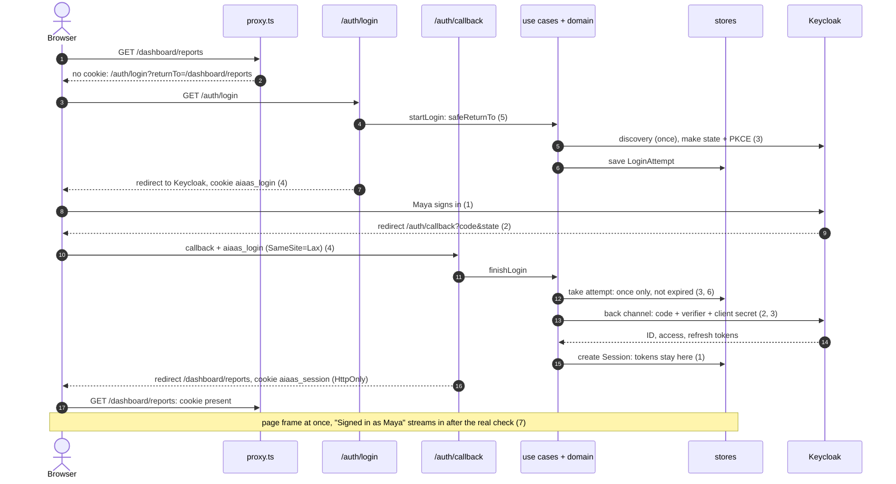

The numbers in brackets point back to the sections of this note.

---

## Glossary

| Word | Meaning |
|---|---|
| OAuth 2.0 | a standard for giving an app a token to call an API |
| OIDC | OpenID Connect: OAuth 2.0 plus a standard way to say who signed in (the ID token) |
| Grant | a way to get tokens. Ours is the authorization code grant |
| Front channel | messages that pass through the browser, as redirects |
| Back channel | messages straight between two servers |
| Authorization code | a short lived, single use value that the server swaps for tokens |
| Confidential client | a client that can keep a secret, because it runs on a server |
| `state` | a random value that ties the callback to the sign in this browser started |
| PKCE | a per sign in secret (the verifier) and its hash (the challenge), so only the starter can swap the code |
| Bearer token | a token that works for whoever holds it, like a cinema ticket |
| BFF | backend for frontend: a server that does the security work for a frontend and keeps its tokens |
| Session | one browser being signed in, held on our server behind an opaque id |
| `HttpOnly`, `Secure`, `SameSite` | cookie settings: no JavaScript access, https only, limits on cross-site sending |
| Login CSRF | tricking someone into being signed in to the attacker's account |
| Open redirect | a trusted site that forwards people to any address it is handed |
| Optimistic check | a fast check that trusts a hint (a cookie exists), backed by a real check later |
| Static shell | the part of a page that is the same for everyone and is sent at once |

---

## Check your understanding

Answer each in your own words, then compare with the section in brackets. When you can answer all eight without looking, you are ready for [[UC-A1-Sign-In]].

1. Why do the tokens stay on the Next.js server and not in the browser? Name two reasons. ([[#1. Who is who]])
2. Why does Keycloak send back a code instead of the tokens? ([[#2. The authorization code flow]])
3. What attack does `state` stop, and what attack does PKCE stop? ([[#3. state and PKCE]])
4. Why can a hacker who sees the PKCE challenge still not swap the code? ([[#3. state and PKCE]])
5. What would break with `SameSite=Strict`, and why? ([[#4. Tokens and the session cookie]])
6. Give two `returnTo` values that look local but are not. ([[#5. Open redirect and returnTo]])
7. Why does the store have `take()` instead of `get()` and `delete()`? ([[#6. The hexagon in the frontend]])
8. Why do we check the session twice, once in `proxy.ts` and once in the page? ([[#7. Where the code lives in Next.js]])

> [!tip] Seeing it by hand
> The archived [[03-OIDC-By-Hand]] section 10 walks this exact flow with `curl` and a browser: make the PKCE values, open the Keycloak URL, copy the code, swap it. Doing it once by hand makes `openid-client` feel like what it is: a careful helper, not magic.


---
title: "UC-A1 Sign in (test first, vertical slice)"
tags: [use-case, tdd, ddd, ports-and-adapters, nextjs, oidc, pkce]
---

# UC-A1 Sign in

**Requirements:** FR-1, FR-2, FR-3, NFR-2, NFR-3. **Acceptance criteria:** AC-1 to AC-5. **Prerequisites:** [[05-Setup-Workspace]] done, Keycloak running ([[02-Setup-Identity-Stack]]), a user `maya@example.com` with a non temporary password and a verified email.

> [!tip] Read first
> [[UC-A1-Concepts]] explains every idea in this lesson (the code flow, `state`, PKCE, cookies, open redirect, the hexagon, the Next.js parts), with diagrams and questions.

> [!abstract] Outcome
> Open `/dashboard` as a guest, get sent to Keycloak, sign in as Maya, and land back on `/dashboard` with "Signed in as Maya" on screen. The tokens stay on the Next.js server. The browser holds one opaque cookie. Built test first: the domain and use cases are tested with fakes in milliseconds, without Keycloak. Only the frontend changes in this use case. The backend joins in [[UC-A4-View-Profile]].

> [!info] Status
> Written on 13 Nov 2026, **not yet run**. The `openid-client` calls were checked against its type definitions (version 6.8.9). The Next.js patterns follow the docs shipped with Next.js 16.4.6: `proxy.ts` for a quick cookie check, and the session read inside `<Suspense>` because Cache Components is on. Where a step does not match what you see, fix the note.

---

## 1. Use case specification

| Field | Value |
|---|---|
| Actor | Guest |
| Trigger | opens a shell page, for example `/dashboard/reports` |
| Precondition | Keycloak runs. The person has a Keycloak user |
| Main flow | no session, so start a sign in attempt and go to Keycloak. Sign in there. Come back with a code. Swap the code for tokens. Store a session. Go back to the page |
| Alternative A | wrong password: Keycloak shows its error. aiaas sees nothing |
| Alternative B | unknown, used or expired attempt: no session, "start again" page (AC-4) |
| Alternative C | return address outside aiaas: go to `/dashboard` (AC-3) |
| Postcondition | a session on the server, an `HttpOnly` cookie in the browser, no token in the browser |

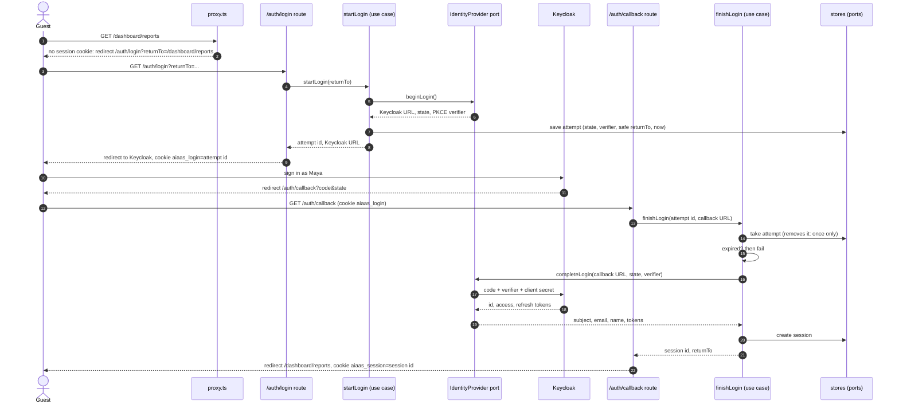

How to read it: the route handlers (`/auth/login`, `/auth/callback`) only deal with HTTP: query strings, cookies, redirects. All decisions are in the two use cases. The use cases reach Keycloak and the stores only through ports, so a test can swap in fakes.

## 2. The slice in the hexagon

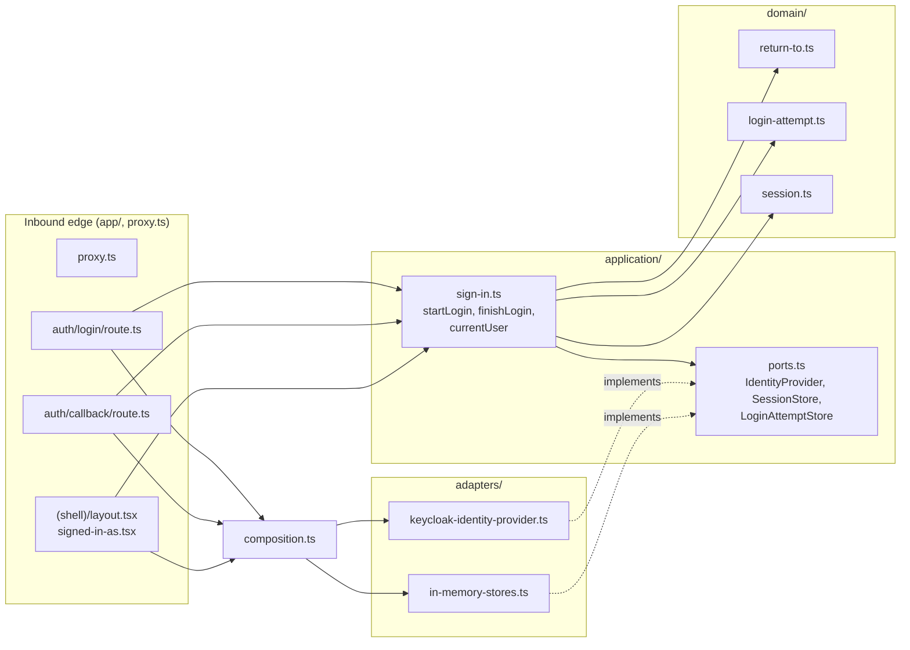

How to read it: the inbound edge asks `composition.ts` for the use case's helpers (the adapters), then calls the use case. `composition.ts` is the only file that knows `KeycloakIdentityProvider` exists. Change it to a fake, and the whole app runs without Keycloak.

The build order in this lesson follows the arrows from the inside out: domain, then ports, then use cases with fakes, then adapters, then the inbound edge.

---

## 3. Get Keycloak ready

### 3a. Point `aiaas-web` at Next.js

Lesson 02 set the `aiaas-web` client up for a Python BFF on port 8001. Now the Next.js server on port 3000 is the BFF.

In the admin console (http://localhost:8080/admin), realm **aiaas**, **Clients > aiaas-web > Settings**:

| Field | Value |
|---|---|
| Valid redirect URIs | `http://localhost:3000/auth/callback` |
| Valid post logout redirect URIs | `http://localhost:3000/` |
| Web origins | `http://localhost:3000` |

**Save.** Also check: **Client authentication** on (it has a secret), **Standard flow** on, **Direct access grants** off. Under **Advanced**, "Proof Key for Code Exchange Code Challenge Method" set to `S256` makes PKCE compulsory.

Why exact addresses? Keycloak sends the code only to a redirect address on this list. A loose pattern like `http://localhost:3000/*` would let any page on the site receive codes.

### 3b. Check Maya

**Users > maya@example.com**: email verified **on**, no required actions, and a password set with **Temporary off**. If she does not exist, create her that way.

### 3c. `frontend/.env.local`

Copy the client secret from **Clients > aiaas-web > Credentials**. Create `frontend/.env.local`:

```text
KEYCLOAK_ISSUER=http://localhost:8080/realms/aiaas
KEYCLOAK_CLIENT_ID=aiaas-web
KEYCLOAK_CLIENT_SECRET=paste-the-secret-here
APP_URL=http://localhost:3000
```

The scaffold's `frontend/.gitignore` ignores `.env*`, so this file is never committed. Also make a `frontend/.env.example` with the same names and no real secret, and add the line `!.env.example` to `frontend/.gitignore` so that one file **is** committed.

### 3d. Two packages

From `frontend/`:

```powershell
npm install openid-client server-only
```

| Package | Why |
|---|---|
| `openid-client` | does the OIDC protocol: discovery, PKCE, the code swap, checking the ID token. Certified, small, no other dependencies to speak of |
| `server-only` | a guard: if a browser file ever imports `composition.ts`, the build fails. The client secret can never reach the browser by accident |

---

## 4. RED: the return address rule

The first rule (AC-3): after sign in, go back only to a **local** page. Otherwise a link like `/auth/login?returnTo=https://evil.example` would sign you in and then hand you to an attacker's site that looks like aiaas. This is called an **open redirect**.

Create `frontend/tests/unit/return-to.test.ts`:

```ts
import { describe, expect, it } from "vitest";
import { DEFAULT_RETURN_TO, safeReturnTo } from "@/domain/return-to";

describe("safeReturnTo", () => {
  it("keeps a local path", () => {
    expect(safeReturnTo("/dashboard/reports?tab=2")).toBe("/dashboard/reports?tab=2");
  });

  it.each([
    [null],
    [""],
    ["https://evil.example"],
    ["//evil.example"],
    ["/\\evil.example"],
    ["dashboard"],
  ])("turns %j into the default", (raw) => {
    expect(safeReturnTo(raw)).toBe(DEFAULT_RETURN_TO);
  });
});
```

Why `//evil.example`? A browser reads an address that starts with `//` as "same scheme, **other site**". And some browsers treat `/\` like `//`. Both look local and are not.

Run `npm test`. Expected **RED**: the test cannot import `@/domain/return-to`, because it does not exist.

## 5. GREEN: `domain/return-to.ts`

```ts
// Where to go after sign in. Only a local path is allowed (no open redirect).
export const DEFAULT_RETURN_TO = "/dashboard";

export function safeReturnTo(raw: string | null | undefined): string {
  if (!raw || !raw.startsWith("/")) return DEFAULT_RETURN_TO;
  if (raw.startsWith("//") || raw.startsWith("/\\")) return DEFAULT_RETURN_TO;
  return raw;
}
```

Run `npm test`. Expected: the return address tests pass, and the architecture test still passes (the file imports nothing).

## 6. RED, then GREEN: the sign in attempt and the session

Two more domain rules: an attempt lasts 10 minutes (AC-4), and a page sees only a name and an email, never the tokens (NFR-3).

`frontend/tests/unit/login-attempt.test.ts`:

```ts
import { describe, expect, it } from "vitest";
import { LOGIN_ATTEMPT_LIFETIME_MS, isExpired, type LoginAttempt } from "@/domain/login-attempt";

const attempt: LoginAttempt = {
  state: "s1",
  codeVerifier: "v1",
  returnTo: "/dashboard",
  startedAt: 1_000_000,
};

describe("a sign in attempt", () => {
  it("is fresh at the edge of its lifetime", () => {
    expect(isExpired(attempt, attempt.startedAt + LOGIN_ATTEMPT_LIFETIME_MS)).toBe(false);
  });

  it("has expired one millisecond later", () => {
    expect(isExpired(attempt, attempt.startedAt + LOGIN_ATTEMPT_LIFETIME_MS + 1)).toBe(true);
  });
});
```

`frontend/tests/unit/session.test.ts`:

```ts
import { describe, expect, it } from "vitest";
import { signedInUser, type Session } from "@/domain/session";

function session(name: string): Session {
  return {
    subject: "maya-sub",
    email: "maya@example.com",
    name,
    tokens: { accessToken: "a", refreshToken: "r", idToken: "i", accessTokenExpiresAt: 0 },
    startedAt: 0,
  };
}

describe("signedInUser", () => {
  it("shows the name and email, and nothing else", () => {
    expect(signedInUser(session("Maya"))).toEqual({ name: "Maya", email: "maya@example.com" });
  });

  it("falls back to the email when there is no name", () => {
    expect(signedInUser(session("")).name).toBe("maya@example.com");
  });
});
```

`toEqual` with exactly two fields is the real check here: if someone later adds the tokens to `SignedInUser`, this test goes red.

Run `npm test`: **RED**. Now the code.

`frontend/src/domain/login-attempt.ts`:

```ts
// A sign in that has started but not finished. It is used once, within 10 minutes.
export const LOGIN_ATTEMPT_LIFETIME_MS = 10 * 60 * 1000;

export type LoginAttempt = {
  state: string; // a random value Keycloak sends back, to tie the callback to this attempt
  codeVerifier: string; // the PKCE secret. Only its hash went to Keycloak
  returnTo: string; // already checked by safeReturnTo
  startedAt: number; // milliseconds since 1970
};

export function isExpired(attempt: LoginAttempt, now: number): boolean {
  return now - attempt.startedAt > LOGIN_ATTEMPT_LIFETIME_MS;
}
```

`frontend/src/domain/session.ts`:

```ts
// One browser being signed in. The tokens stay on the server.
export type Tokens = {
  accessToken: string;
  refreshToken: string;
  idToken: string;
  accessTokenExpiresAt: number; // milliseconds since 1970
};

export type Session = {
  subject: string; // the Keycloak user id (sub)
  email: string;
  name: string;
  tokens: Tokens;
  startedAt: number;
};

// What a page may show about the person. Never the tokens.
export type SignedInUser = { name: string; email: string };

export function signedInUser(session: Session): SignedInUser {
  return { name: session.name || session.email, email: session.email };
}
```

Run `npm test`. Expected: all domain tests and both architecture tests pass.

> [!question] Your turn
> Why is `now` a parameter of `isExpired`, instead of calling `Date.now()` inside?

> [!example]- Answer
> So the test controls time. With `Date.now()` inside, the "one millisecond later" test would need to wait 10 minutes, or fake the clock. Passing `now` keeps the domain a plain function: same input, same output. The edge of the app (the route handler) is the one place that reads the real clock.

---

## 7. The ports

A port is what the use case **needs** from outside, written in the use case's own words. Create `frontend/src/application/ports.ts`:

```ts
import type { LoginAttempt } from "@/domain/login-attempt";
import type { Session, Tokens } from "@/domain/session";

// Where to send the browser, and the two secrets to remember until it comes back.
export type AuthorizationRequest = { url: string; state: string; codeVerifier: string };

// Who signed in, as the identity provider proved it.
export type SignedInIdentity = { subject: string; email: string; name: string; tokens: Tokens };

export interface IdentityProvider {
  beginLogin(): Promise<AuthorizationRequest>;
  completeLogin(
    callbackUrl: URL,
    attempt: Pick<LoginAttempt, "state" | "codeVerifier">,
  ): Promise<SignedInIdentity>;
}

export interface LoginAttemptStore {
  create(attempt: LoginAttempt): Promise<string>; // returns a new opaque id
  take(id: string): Promise<LoginAttempt | undefined>; // returns it AND forgets it
}

export interface SessionStore {
  create(session: Session): Promise<string>; // returns a new opaque id
  get(id: string): Promise<Session | undefined>;
}
```

Look at what is **not** here: no `discovery`, no `code_challenge`, no `fetch`, no cookie. Those are how Keycloak and Next.js work, not what sign in needs. `take` instead of `get` plus `delete` makes "once only" (AC-4) part of the port's promise, so every adapter must keep it.

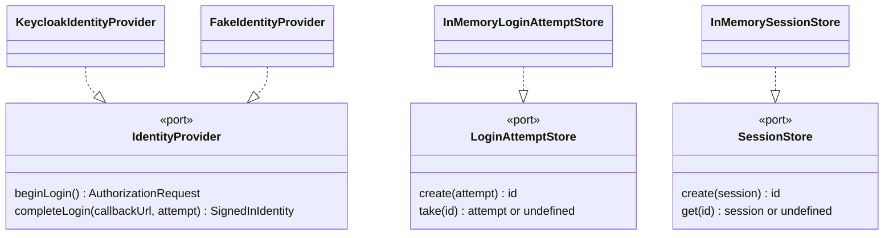

How to read it: each port has more than one adapter. The fake one is for tests. Later, a Redis or Postgres session store can replace the in-memory one without touching the use case.

---

## 8. RED: the use case tests

### 8a. A strict fake

Create `frontend/tests/support/fakes.ts`:

```ts
import type { AuthorizationRequest, IdentityProvider, SignedInIdentity } from "@/application/ports";
import type { LoginAttempt } from "@/domain/login-attempt";

// Behaves like Keycloak in the ways that matter: it checks the state, and a code works once.
export class FakeIdentityProvider implements IdentityProvider {
  private usedCodes = new Set<string>();

  async beginLogin(): Promise<AuthorizationRequest> {
    return { url: "https://keycloak.test/auth?state=s1", state: "s1", codeVerifier: "v1" };
  }

  async completeLogin(
    callbackUrl: URL,
    attempt: Pick<LoginAttempt, "state" | "codeVerifier">,
  ): Promise<SignedInIdentity> {
    const code = callbackUrl.searchParams.get("code") ?? "";
    if (callbackUrl.searchParams.get("state") !== attempt.state) throw new Error("state mismatch");
    if (this.usedCodes.has(code)) throw new Error("code already used");
    this.usedCodes.add(code);
    return {
      subject: "maya-sub",
      email: "maya@example.com",
      name: "Maya",
      tokens: { accessToken: "a", refreshToken: "r", idToken: "i", accessTokenExpiresAt: 0 },
    };
  }
}
```

Why strict? A fake that always says yes would let a use case pass that never checks anything. This one fails the same way Keycloak does, so the tests mean something.

### 8b. The tests, one per acceptance criterion

Create `frontend/tests/unit/sign-in.test.ts`:

```ts
import { beforeEach, describe, expect, it } from "vitest";
import { InMemoryLoginAttemptStore, InMemorySessionStore } from "@/adapters/in-memory-stores";
import { currentUser, finishLogin, LoginFailed, type SignInDeps, startLogin } from "@/application/sign-in";
import { LOGIN_ATTEMPT_LIFETIME_MS } from "@/domain/login-attempt";
import { FakeIdentityProvider } from "../support/fakes";

const NOW = 1_000_000;
const callback = (state = "s1", code = "c1") =>
  new URL(`http://localhost:3000/auth/callback?code=${code}&state=${state}`);

let deps: SignInDeps;
beforeEach(() => {
  deps = {
    identity: new FakeIdentityProvider(),
    attempts: new InMemoryLoginAttemptStore(),
    sessions: new InMemorySessionStore(),
  };
});

describe("UC-A1 sign in", () => {
  it("AC-2: comes back to the page the person asked for, signed in", async () => {
    const { attemptId, redirectTo } = await startLogin(deps, "/dashboard/reports", NOW);
    expect(redirectTo).toContain("keycloak.test");

    const { sessionId, returnTo } = await finishLogin(deps, attemptId, callback(), NOW);

    expect(returnTo).toBe("/dashboard/reports");
    expect(await currentUser(deps, sessionId)).toEqual({ name: "Maya", email: "maya@example.com" });
  });

  it("AC-3: an outside return address becomes the default", async () => {
    const { attemptId } = await startLogin(deps, "https://evil.example", NOW);
    const { returnTo } = await finishLogin(deps, attemptId, callback(), NOW);
    expect(returnTo).toBe("/dashboard");
  });

  it("AC-4: an unknown attempt fails", async () => {
    await expect(finishLogin(deps, "no-such-attempt", callback(), NOW)).rejects.toThrow(LoginFailed);
  });

  it("AC-4: a missing attempt cookie fails", async () => {
    await expect(finishLogin(deps, undefined, callback(), NOW)).rejects.toThrow(LoginFailed);
  });

  it("AC-4: an attempt works once", async () => {
    const { attemptId } = await startLogin(deps, null, NOW);
    await finishLogin(deps, attemptId, callback(), NOW);
    await expect(finishLogin(deps, attemptId, callback(), NOW)).rejects.toThrow(LoginFailed);
  });

  it("AC-4: an attempt older than 10 minutes fails", async () => {
    const { attemptId } = await startLogin(deps, null, NOW);
    const later = NOW + LOGIN_ATTEMPT_LIFETIME_MS + 1;
    await expect(finishLogin(deps, attemptId, callback(), later)).rejects.toThrow(LoginFailed);
  });

  it("AC-4: a callback with the wrong state fails", async () => {
    const { attemptId } = await startLogin(deps, null, NOW);
    await expect(finishLogin(deps, attemptId, callback("forged"), NOW)).rejects.toThrow(LoginFailed);
  });

  it("no session id means a guest", async () => {
    expect(await currentUser(deps, undefined)).toBeNull();
    expect(await currentUser(deps, "unknown")).toBeNull();
  });
});
```

Each test name starts with the acceptance criterion it proves. That is the traceability from [[04-Architecture-and-Traceability]], written where it cannot get lost.

Run `npm test`. Expected **RED**: `@/application/sign-in` and `@/adapters/in-memory-stores` do not exist.

## 9. GREEN: the in-memory adapters

Create `frontend/src/adapters/in-memory-stores.ts`:

```ts
import { randomBytes } from "node:crypto";
import type { LoginAttemptStore, SessionStore } from "@/application/ports";
import type { LoginAttempt } from "@/domain/login-attempt";
import type { Session } from "@/domain/session";

// 32 random bytes: impossible to guess, so the id alone proves nothing about the person.
function newId(): string {
  return randomBytes(32).toString("base64url");
}

// Keeps attempts in memory. Forgets everything when the server restarts.
export class InMemoryLoginAttemptStore implements LoginAttemptStore {
  private attempts = new Map<string, LoginAttempt>();

  async create(attempt: LoginAttempt): Promise<string> {
    const id = newId();
    this.attempts.set(id, attempt);
    return id;
  }

  async take(id: string): Promise<LoginAttempt | undefined> {
    const attempt = this.attempts.get(id);
    this.attempts.delete(id); // once only, even if it turns out to be expired
    return attempt;
  }
}

// Keeps sessions in memory. Forgets everything when the server restarts.
export class InMemorySessionStore implements SessionStore {
  private sessions = new Map<string, Session>();

  async create(session: Session): Promise<string> {
    const id = newId();
    this.sessions.set(id, session);
    return id;
  }

  async get(id: string): Promise<Session | undefined> {
    return this.sessions.get(id);
  }
}
```

An adapter may use `node:crypto`: adapters are the outside of the hexagon. The architecture test only guards `domain/` and `application/`.

## 10. GREEN: the use cases

Create `frontend/src/application/sign-in.ts`:

```ts
import { isExpired } from "@/domain/login-attempt";
import { safeReturnTo } from "@/domain/return-to";
import { type SignedInUser, signedInUser } from "@/domain/session";
import type { IdentityProvider, LoginAttemptStore, SessionStore, SignedInIdentity } from "./ports";

export class LoginFailed extends Error {}

export type SignInDeps = {
  identity: IdentityProvider;
  attempts: LoginAttemptStore;
  sessions: SessionStore;
};

// Step 1: remember the attempt, and say where to send the browser.
export async function startLogin(
  deps: SignInDeps,
  rawReturnTo: string | null,
  now: number,
): Promise<{ attemptId: string; redirectTo: string }> {
  const request = await deps.identity.beginLogin();
  const attemptId = await deps.attempts.create({
    state: request.state,
    codeVerifier: request.codeVerifier,
    returnTo: safeReturnTo(rawReturnTo),
    startedAt: now,
  });
  return { attemptId, redirectTo: request.url };
}

// Step 2: the browser is back. Check the attempt, swap the code, make a session.
export async function finishLogin(
  deps: SignInDeps,
  attemptId: string | undefined,
  callbackUrl: URL,
  now: number,
): Promise<{ sessionId: string; returnTo: string }> {
  const attempt = attemptId ? await deps.attempts.take(attemptId) : undefined;
  if (!attempt || isExpired(attempt, now)) throw new LoginFailed("no valid sign in attempt");

  let identity: SignedInIdentity;
  try {
    identity = await deps.identity.completeLogin(callbackUrl, attempt);
  } catch (cause) {
    throw new LoginFailed("the identity provider refused the sign in", { cause });
  }

  const sessionId = await deps.sessions.create({ ...identity, startedAt: now });
  return { sessionId, returnTo: attempt.returnTo };
}

// Who is signed in on this browser, as a page may show it. Null means a guest.
export async function currentUser(
  deps: Pick<SignInDeps, "sessions">,
  sessionId: string | undefined,
): Promise<SignedInUser | null> {
  const session = sessionId ? await deps.sessions.get(sessionId) : undefined;
  return session ? signedInUser(session) : null;
}
```

Run `npm test`. Expected: every test passes, including both architecture tests.

> [!question] Your turn
> Why does `finishLogin` turn every `completeLogin` error into one `LoginFailed`, instead of passing the real reason up?

> [!example]- Answer
> Two reasons. The route handler then needs to know only one error, whatever the identity provider is. And the person should see one calm "start again" message: telling a visitor "state mismatch" or "code already used" helps an attacker more than a user. The real reason is kept in `cause`, for the server log.

> [!danger] Break it
> In `in-memory-stores.ts`, change `take` so it no longer deletes (remove the `delete` line). Run `npm test`. Which test goes red, and which attack does it stop? Put the line back.

---

## 11. The real adapter: Keycloak

Now the adapter that speaks OIDC. Create `frontend/src/adapters/keycloak-identity-provider.ts`:

```ts
import * as oidc from "openid-client";
import type { AuthorizationRequest, IdentityProvider, SignedInIdentity } from "@/application/ports";
import type { LoginAttempt } from "@/domain/login-attempt";

export type KeycloakSettings = {
  issuer: string; // http://localhost:8080/realms/aiaas
  clientId: string;
  clientSecret: string;
  redirectUri: string; // http://localhost:3000/auth/callback
};

export class KeycloakIdentityProvider implements IdentityProvider {
  private readonly settings: KeycloakSettings;
  private config?: Promise<oidc.Configuration>;

  constructor(settings: KeycloakSettings) {
    this.settings = settings;
  }

  // Reads Keycloak's discovery document once, then reuses it.
  private configuration(): Promise<oidc.Configuration> {
    const { issuer, clientId, clientSecret } = this.settings;
    // Local Keycloak is plain http. openid-client refuses that unless told otherwise.
    const options = issuer.startsWith("http://") ? { execute: [oidc.allowInsecureRequests] } : undefined;
    this.config ??= oidc.discovery(new URL(issuer), clientId, clientSecret, undefined, options);
    return this.config;
  }

  async beginLogin(): Promise<AuthorizationRequest> {
    const config = await this.configuration();
    const codeVerifier = oidc.randomPKCECodeVerifier();
    const state = oidc.randomState();
    const url = oidc.buildAuthorizationUrl(config, {
      redirect_uri: this.settings.redirectUri,
      scope: "openid email profile",
      code_challenge: await oidc.calculatePKCECodeChallenge(codeVerifier),
      code_challenge_method: "S256",
      state,
    });
    return { url: url.href, state, codeVerifier };
  }

  async completeLogin(
    callbackUrl: URL,
    attempt: Pick<LoginAttempt, "state" | "codeVerifier">,
  ): Promise<SignedInIdentity> {
    const config = await this.configuration();
    // Checks the state, swaps the code (with the verifier and the client secret),
    // and checks the ID token's signature, issuer, audience and expiry.
    const tokens = await oidc.authorizationCodeGrant(config, callbackUrl, {
      pkceCodeVerifier: attempt.codeVerifier,
      expectedState: attempt.state,
    });
    const claims = tokens.claims();
    if (!claims || !tokens.refresh_token || !tokens.id_token) {
      throw new Error("Keycloak's answer is missing the ID token or the refresh token");
    }
    return {
      subject: claims.sub,
      email: String(claims.email ?? ""),
      name: String(claims.name ?? claims.preferred_username ?? ""),
      tokens: {
        accessToken: tokens.access_token,
        refreshToken: tokens.refresh_token,
        idToken: tokens.id_token,
        accessTokenExpiresAt: Date.now() + (tokens.expiresIn() ?? 0) * 1000,
      },
    };
  }
}
```

What each part does, mapped to what you would do by hand (archived [[03-OIDC-By-Hand]] section 10):

| By hand with curl | Here |
|---|---|
| read `/.well-known/openid-configuration` | `oidc.discovery(...)` |
| make a verifier, hash it to a challenge, make a state | `randomPKCECodeVerifier`, `calculatePKCECodeChallenge`, `randomState` |
| build the long `/auth?client_id=...` URL | `buildAuthorizationUrl` |
| check `state`, POST the code with `-u aiaas-web:secret` and the verifier | `authorizationCodeGrant` |
| `jwt_peek.py` on the ID token (without checking it) | `tokens.claims()`, **after** the library checked the signature |

> [!note] No unit test for this file
> It is a thin wrapper around a library, and it needs a real Keycloak. It is proved by the acceptance run in section 14. If it grows any logic of its own, that logic moves into the domain or the use case, where it can be unit tested.

---

## 12. The composition root

Create `frontend/src/composition.ts`. It is the **only** file that picks adapters:

```ts
import "server-only";
import { InMemoryLoginAttemptStore, InMemorySessionStore } from "@/adapters/in-memory-stores";
import { KeycloakIdentityProvider } from "@/adapters/keycloak-identity-provider";
import type { SignInDeps } from "@/application/sign-in";

function required(name: string): string {
  const value = process.env[name];
  if (!value) throw new Error(`Set ${name} in frontend/.env.local`);
  return value;
}

function build(): SignInDeps {
  return {
    identity: new KeycloakIdentityProvider({
      issuer: required("KEYCLOAK_ISSUER"),
      clientId: required("KEYCLOAK_CLIENT_ID"),
      clientSecret: required("KEYCLOAK_CLIENT_SECRET"),
      redirectUri: `${required("APP_URL")}/auth/callback`,
    }),
    attempts: new InMemoryLoginAttemptStore(),
    sessions: new InMemorySessionStore(),
  };
}

// One set of adapters for the whole server. Kept on globalThis because the dev server
// reloads changed modules, and the in-memory stores would otherwise be emptied.
const shared = globalThis as typeof globalThis & { aiaasServices?: SignInDeps };

export function services(): SignInDeps {
  shared.aiaasServices ??= build();
  return shared.aiaasServices;
}
```

`services()` builds on first use, not when the file is loaded, so `npm run build` does not need the secret.

---

## 13. The inbound edge: routes, proxy and shell

### 13a. Cookie names in one place

`frontend/src/app/auth/cookies.ts`:

```ts
export const SESSION_COOKIE = "aiaas_session";
export const LOGIN_COOKIE = "aiaas_login";

export const cookieOptions = {
  httpOnly: true, // JavaScript in the page cannot read it (NFR-3)
  sameSite: "lax" as const, // sent on the redirect back from Keycloak, not on cross-site posts
  secure: process.env.NODE_ENV === "production", // https only, except on localhost
  path: "/",
};
```

Why `lax` and not `strict`? The callback is a redirect **from Keycloak's site**. With `strict`, the browser would not send the `aiaas_login` cookie on that redirect, and every sign in would fail with AC-4.

### 13b. `/auth/login`

`frontend/src/app/auth/login/route.ts`:

```ts
import { type NextRequest, NextResponse } from "next/server";
import { startLogin } from "@/application/sign-in";
import { services } from "@/composition";
import { cookieOptions, LOGIN_COOKIE } from "../cookies";

export async function GET(request: NextRequest) {
  const returnTo = request.nextUrl.searchParams.get("returnTo");
  const { attemptId, redirectTo } = await startLogin(services(), returnTo, Date.now());

  const response = NextResponse.redirect(redirectTo);
  response.cookies.set(LOGIN_COOKIE, attemptId, { ...cookieOptions, maxAge: 600 });
  return response;
}
```

### 13c. `/auth/callback`

`frontend/src/app/auth/callback/route.ts`:

```ts
import { type NextRequest, NextResponse } from "next/server";
import { finishLogin, LoginFailed } from "@/application/sign-in";
import { services } from "@/composition";
import { cookieOptions, LOGIN_COOKIE, SESSION_COOKIE } from "../cookies";

export async function GET(request: NextRequest) {
  const attemptId = request.cookies.get(LOGIN_COOKIE)?.value;
  try {
    const { sessionId, returnTo } = await finishLogin(services(), attemptId, new URL(request.url), Date.now());
    const response = NextResponse.redirect(new URL(returnTo, request.url));
    response.cookies.set(SESSION_COOKIE, sessionId, cookieOptions);
    response.cookies.delete(LOGIN_COOKIE);
    return response;
  } catch (error) {
    if (!(error instanceof LoginFailed)) throw error;
    console.warn("sign in failed", error.cause ?? error.message);
    const response = NextResponse.redirect(new URL("/auth/failed", request.url));
    response.cookies.delete(LOGIN_COOKIE);
    return response;
  }
}
```

### 13d. `/auth/failed`

`frontend/src/app/auth/failed/page.tsx`:

```tsx
export default function SignInFailed() {
  return (
    <main className="mx-auto max-w-md p-8">
      <h1 className="text-xl font-semibold">Sign in did not finish</h1>
      <p className="mt-2 text-sm text-muted-foreground">
        The sign in link was old or had already been used. This is safe to retry.
      </p>
      <a className="mt-4 inline-block underline" href="/auth/login">
        Sign in again
      </a>
    </main>
  );
}
```

### 13e. `proxy.ts`: the quick check

`frontend/src/proxy.ts` (next to `app/`, because the project uses `src/`):

```ts
import { type NextRequest, NextResponse } from "next/server";

// A quick, optimistic check: is there a session cookie at all? It reads no store,
// because Next.js runs this on every matching request. The real check is in the page.
export function proxy(request: NextRequest) {
  if (request.cookies.has("aiaas_session")) return NextResponse.next();

  const login = new URL("/auth/login", request.url);
  login.searchParams.set("returnTo", request.nextUrl.pathname + request.nextUrl.search);
  return NextResponse.redirect(login);
}

export const config = { matcher: ["/dashboard/:path*"] };
```

The cookie name is repeated here on purpose: the Next.js docs warn against relying on shared modules in the proxy.

### 13f. The shell: a frame, and the user streamed in

Cache Components is on, so reading cookies must happen **inside a `<Suspense>` boundary**. The frame of the page renders at once, and the "Signed in as" part streams in after the session is read.

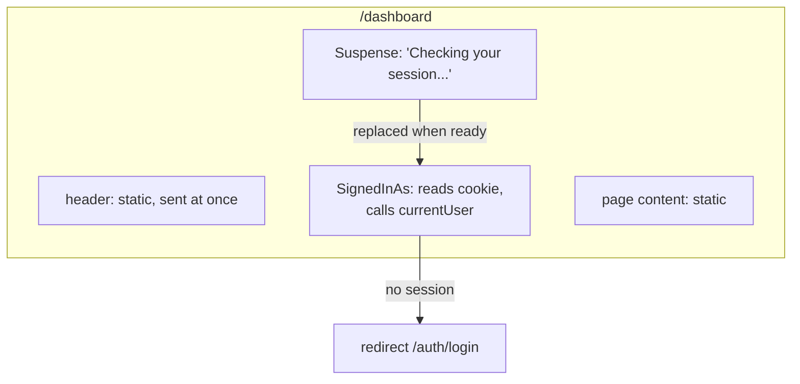

`frontend/src/app/(shell)/signed-in-as.tsx`:

```tsx
import { cookies } from "next/headers";
import { redirect } from "next/navigation";
import { SESSION_COOKIE } from "@/app/auth/cookies";
import { currentUser } from "@/application/sign-in";
import { services } from "@/composition";

// The real check: is this cookie a live session on the server?
export async function SignedInAs() {
  const sessionId = (await cookies()).get(SESSION_COOKIE)?.value;
  const user = await currentUser(services(), sessionId);
  if (!user) redirect("/auth/login");
  return <span className="text-sm">Signed in as {user.name}</span>;
}
```

`frontend/src/app/(shell)/layout.tsx`:

```tsx
import { Suspense } from "react";
import { SignedInAs } from "./signed-in-as";

export default function ShellLayout({ children }: { children: React.ReactNode }) {
  return (
    <div className="min-h-screen">
      <header className="flex items-center justify-between border-b px-6 py-3">
        <span className="font-semibold">aiaas</span>
        <Suspense fallback={<span className="text-sm text-muted-foreground">Checking your session...</span>}>
          <SignedInAs />
        </Suspense>
      </header>
      <main className="p-6">{children}</main>
    </div>
  );
}
```

`frontend/src/app/(shell)/dashboard/page.tsx`:

```tsx
export default function Dashboard() {
  return (
    <>
      <h1 className="text-2xl font-semibold">Dashboard</h1>
      <p className="mt-2 text-muted-foreground">You are in. Your aiaas profile arrives in UC-A4.</p>
    </>
  );
}
```

`(shell)` in brackets is a **route group**: it shares the layout without adding `/shell` to the address. The page is still `/dashboard`.

> [!warning] The page content is not protected by itself
> The dashboard text above is static and public-safe, so it does not matter that it renders before the check finishes. From UC-A4 on, any page that shows **private data** reads it through a use case that checks the session itself. Never rely on the proxy or the header's redirect alone.

Finally, a Sign in button on the home page `frontend/src/app/page.tsx` (Base UI has no `asChild`: render the button as a link with `render`):

```tsx
import { Button } from "@/components/ui/button";

export default function Home() {
  return (
    <main className="mx-auto max-w-md p-8">
      <h1 className="text-2xl font-semibold">aiaas</h1>
      <Button className="mt-4" render={<a href="/auth/login" />} nativeButton={false}>
        Sign in
      </Button>
    </main>
  );
}
```

Run `npm run lint`, `npm test` and `npm run build`. All should pass.

---

## 14. Acceptance run

```powershell
npm run dev
```

Use a **private** browser window, so no old Keycloak session interferes, and always `localhost`, never `127.0.0.1` (cookies and redirect addresses must match exactly).

| AC | Do this | Expect |
|---|---|---|
| AC-1 | open http://localhost:3000/dashboard/reports | sent to Keycloak's sign in page |
| AC-2 | sign in as Maya | back on `/dashboard/reports` (a 404 page in the frame is fine: that page does not exist yet), "Signed in as ..." in the header |
| AC-3 | sign out by deleting the cookies, then open http://localhost:3000/auth/login?returnTo=https://example.com and sign in | land on `/dashboard`, not example.com |
| AC-4 | after a sign in, press Back until you reach the `/auth/callback?...` address, and load it again | the "Sign in did not finish" page |
| AC-5 | developer tools, Application, Cookies | one `aiaas_session` cookie, `HttpOnly` ticked, its value a random string, no `eyJ...` token anywhere |

Also check the Network tab during sign in: the request to Keycloak's `/token` endpoint does **not** appear. It happened server to server.

> [!danger] Break it
> 1. Restart `npm run dev` while signed in, then reload `/dashboard`. What happens, and why? (Hint: section 9's comment.)
> 2. Change Keycloak's valid redirect URI to `http://localhost:3000/auth/callbackX` and sign in. Who refuses, and at which arrow of the sequence diagram in section 1? Put it back.

## 15. Architecture check

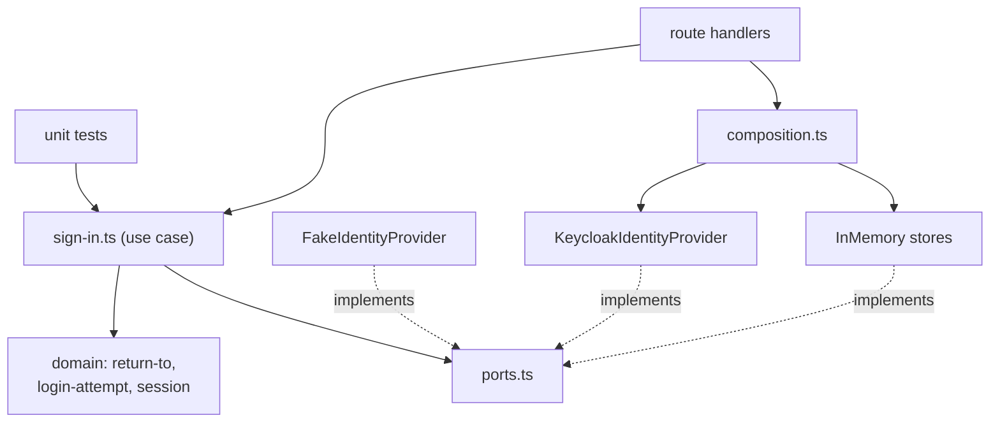

Explain aloud, then compare with section 2:
1. Why does `sign-in.ts` not import `openid-client`?
2. Why do the tests use the in-memory stores but a **fake** identity provider?
3. What would change to keep sessions in Redis instead of memory? Which files, and which not?

## Definition of done

- [ ] AC-1 to AC-5 checked by hand, and AC-2, AC-3, AC-4 also by unit tests.
- [ ] `npm test`: return-to, login-attempt, session, sign-in and both architecture tests pass.
- [ ] `npm run lint` and `npm run build` pass.
- [ ] `application/` imports only `domain/` and itself. `composition.ts` is the only file that names an adapter.
- [ ] `.env.local` is not in `git status`. `.env.example` is.
- [ ] Commit with `vbench-commit` on a `feat/UC-A1-sign-in` branch: a `test(UC-A1)` commit for the failing tests, then `feat(UC-A1)` for the code that passes them.

**Known gaps:** the in-memory stores forget everything on restart, and sessions never end (UC-A2 and UC-A3 fix that). The session's lifetime is not tied to Keycloak's yet.

Next: [[UC-A4-View-Profile]].


Let's build it up from the ground: first cookies, then sessions, then the three tokens, then the BFF, and finally the journey of each token through time.

## 1. Cookies: how a website remembers you

HTTP, the language browsers and servers speak, **forgets everything between requests**. Each request arrives as if from a stranger. A **cookie** fixes that: it's a small note the server asks the browser to keep and **show again on every later request** to that site.

```mermaid
sequenceDiagram
    participant B as Browser
    participant S as Server (localhost:3000)
    B->>S: GET /auth/callback?code=...
    S-->>B: response + Set-Cookie: aiaas_session=kq3Xv9; HttpOnly; SameSite=Lax
    Note over B: the browser stores the note for localhost:3000
    B->>S: GET /dashboard + Cookie: aiaas_session=kq3Xv9
    B->>S: GET /dashboard/reports + Cookie: aiaas_session=kq3Xv9
```

How to read it: the server sets the cookie once, with `Set-Cookie`. From then on the **browser attaches it by itself** to every request to that site, with `Cookie:`. Nobody's code has to remember to send it.

The settings on a cookie are rules **the browser** enforces:

| Setting | The browser's rule |
|---|---|
| `HttpOnly` | page JavaScript can't read it, but the browser still sends it |
| `Secure` | only sent over https |
| `SameSite=Lax` | when another site sends someone here, only sent if they're navigating (following a link or redirect), not on that site's background requests |
| `Max-Age` | delete it after this many seconds. Without it, it goes when the browser closes |

## 2. Sessions: the cookie is a ticket, the server keeps the coat

A cookie is small (about 4 KB at most) and lives on someone else's computer. So you don't put valuable things in it. You put a **random ticket number** in the cookie and keep the valuables on the server, in a table:

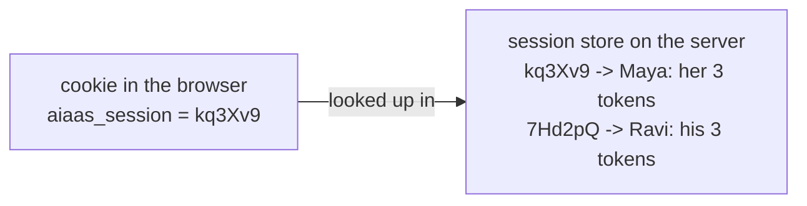

That pair, a ticket in the browser and a row on the server, is a **session**. The **session id** is the ticket number. It's random, holds no information, and only means something to the server that made it.

## 3. The three tokens: three different jobs

When Maya signs in, Keycloak gives our server three tokens at once:

| Token | Its one job | Who it's shown to | Lives |
|---|---|---|---|
| **ID token** | "this is who signed in": name, email, `sub` | read once by our server, to fill the session | minutes |
| **Access token** | a **pass for the API**: "Maya may call aiaas-api" | the aiaas API, on every call | **5 minutes** |
| **Refresh token** | a **voucher for new passes**: "give me a fresh access token" | only Keycloak | as long as Maya's Keycloak session |

Why such a short access token? Because nobody can cancel it early (the API only checks its signature and expiry). So it's kept short, and the refresh token renews it. The refresh token *can* be cancelled, at Keycloak, so it's safe to let it live longer.

## 4. The BFF: who holds the tokens

There are two ways to build this. The difference is **where the three tokens live**.

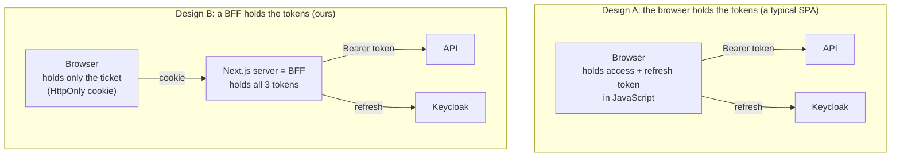

How to read it: in design A, the browser talks to the API and to Keycloak itself, so it must hold the tokens, where page scripts can reach them. In design B, the browser only ever talks to **our own server**, which does all the token work for it. That server is the **BFF**, the "backend for frontend": a backend that exists only to serve this one frontend.

## 5. The journeys, through time

### a. Sign in: the tokens are born and stored

```mermaid
sequenceDiagram
    autonumber
    actor B as Browser
    participant N as BFF (Next.js server)
    participant ST as Session store
    participant K as Keycloak
    B->>K: Maya signs in on Keycloak's page
    K-->>B: redirect to the BFF with a one-time code
    B->>N: /auth/callback?code=...
    N->>K: code + secret + PKCE verifier (server to server)
    K-->>N: ID token, access token, refresh token
    N->>ST: new row: kq3Xv9 -> the 3 tokens
    N-->>B: Set-Cookie: aiaas_session=kq3Xv9 (HttpOnly)
```

The tokens go from Keycloak **straight to the BFF** (step 5) and into the store (step 6). The browser only gets the ticket (step 7).

### b. Opening a page that needs aiaas data (from UC-A4)

```mermaid
sequenceDiagram
    autonumber
    actor B as Browser
    participant N as BFF
    participant ST as Session store
    participant API as aiaas API
    B->>N: GET /dashboard + Cookie: aiaas_session=kq3Xv9
    N->>ST: row kq3Xv9?
    ST-->>N: Maya's tokens
    N->>API: GET /api/v1/auth/me + Authorization: Bearer <access token>
    API->>API: check the signature with Keycloak's public key, check the expiry
    API-->>N: {email, status: active}
    N-->>B: the dashboard HTML, showing Maya's profile
```

The browser sent a **ticket** and got back a **page**. The access token moved only between the BFF and the API (step 4).

### c. Five minutes later: the access token has expired (UC-A3)

```mermaid
sequenceDiagram
    autonumber
    actor B as Browser
    participant N as BFF
    participant ST as Session store
    participant K as Keycloak
    participant API as aiaas API
    B->>N: GET /dashboard + same cookie
    N->>ST: row kq3Xv9: access token expires in under 30 s
    N->>K: refresh token + secret
    K-->>N: NEW access token + NEW refresh token (the old refresh token is now dead)
    N->>ST: update row kq3Xv9 with the new tokens
    N->>API: Bearer <new access token>
    API-->>N: profile
    N-->>B: the page
```

The browser **noticed nothing**: same cookie, same ticket. Only the coat on the rack was swapped for a fresh one.

### d. Sign out (UC-A2)

```mermaid
sequenceDiagram
    autonumber
    actor B as Browser
    participant N as BFF
    participant ST as Session store
    participant K as Keycloak
    B->>N: Sign out + cookie kq3Xv9
    N->>ST: delete row kq3Xv9
    N-->>B: Set-Cookie: aiaas_session= (expired: the browser deletes it)
    B->>K: end the Keycloak session (redirect)
    K->>K: Maya's refresh token is dead
```

After step 2, the ticket `kq3Xv9` points at nothing, **even if someone copied it**. After step 5, the refresh token can't make new access tokens. The last access token dies on its own within 5 minutes, and it never left the server anyway.

## 6. Everything on one page

| Thing | Made by | Lives where | Seen by the browser? | Can be cancelled early? |
|---|---|---|---|---|
| Session id | BFF | browser cookie (`HttpOnly`) + session store row | yes, but JavaScript can't read it | **yes**: delete the row |
| ID token | Keycloak | session store | no | not needed |
| Access token | Keycloak | session store | no | **no**: it just expires (5 min) |
| Refresh token | Keycloak | session store | no | **yes**: at Keycloak (sign out, disable the user) |

This table is what my three points meant:
1. **JavaScript can't read the ticket** (`HttpOnly`, enforced by the browser).
2. **The ticket works only at our counter, and we can cancel it.** The access token works at the API for anyone holding it, and nobody can cancel it.
3. **The tokens never reach the laptop**, so nothing on it (developer tools, extensions, logs) can leak them.

**Check, using the journeys:** in journey **c**, why does the BFF get a *new refresh token* along with the new access token, and what would go wrong if two browser tabs triggered step 3 at the same moment with the same old refresh token?
