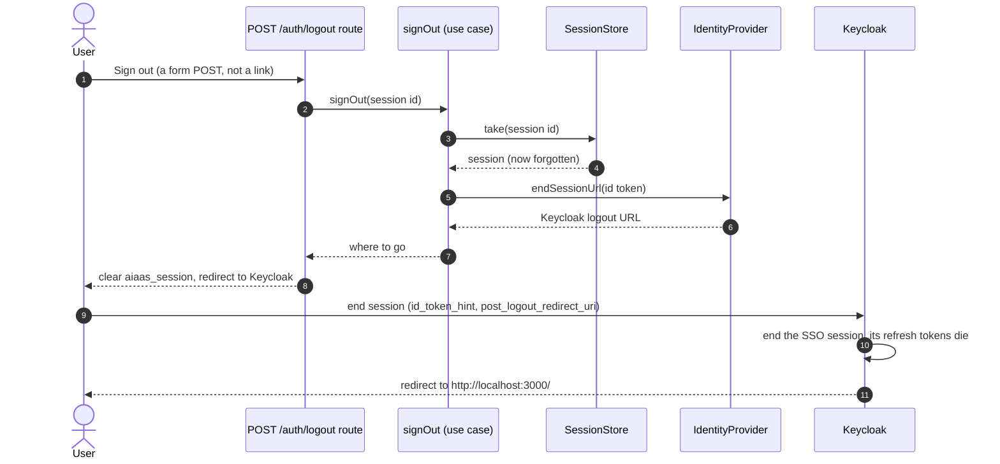
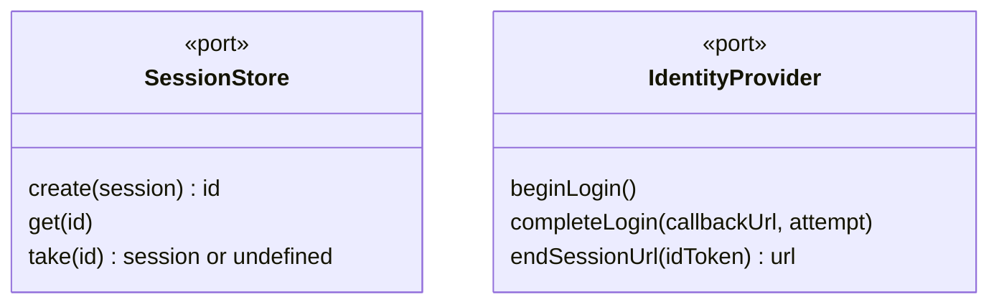

# UC-A2 Sign out

**Requirements:** FR-7. **Acceptance criteria:** AC-12, AC-13. **Prerequisite:** [[UC-A4-View-Profile]].

> [!info] Status: plan
> The specification, diagrams, tests and steps are here. The step by step code is written when we build it, so it matches what really happens.

## 1. Specification

| Field | Value |
|---|---|
| Actor | User |
| Trigger | chooses Sign out in the shell's header |
| Main flow | the server forgets the session, clears the cookie, and sends the browser to Keycloak's end session address with the ID token as a hint. Keycloak ends its own session and sends the browser back to `/` |
| Alternative | no session (already signed out): just go home |
| Postcondition | the old session id opens nothing (AC-13). Keycloak asks for the password again on the next sign in |

How to read it: two sessions end. Ours (step 3) ends at once, so the old cookie is useless. Keycloak's (step 8) ends when the browser visits it, which is why the browser is sent there instead of the server calling Keycloak quietly.

## 2. Why a POST, not a link

A link (`GET /auth/logout`) can be fired by any other site with an ``, signing people out against their will. A form POST from our own page, with `SameSite=Lax` cookies, cannot be sent from another site with the cookie attached. Small thing, but it is the habit to build.

## 3. Ports change

`take` (read and forget in one step) again, for the same reason as the sign in attempt: once only.

## 4. Tests to write first

`frontend/tests/unit/sign-out.test.ts`:
- AC-12: after `signOut`, `currentUser(sessionId)` is null, and the answer is the Keycloak URL with the session's ID token.
- AC-13: signing out twice with the same id is harmless and goes home.
- a sign out with no cookie goes home and calls no identity provider.

The fake identity provider gets `endSessionUrl` returning a fake URL that contains the hint, so the test can check it.

## 5. Steps

1. RED: the three tests. GREEN: `take` in `InMemorySessionStore`, `application/sign-out.ts`.
2. `KeycloakIdentityProvider.endSessionUrl`: `oidc.buildEndSessionUrl(config, { id_token_hint, post_logout_redirect_uri })`. The post logout address must be on `aiaas-web`'s list (set in [[UC-A1-Sign-In]] section 3a).
3. `app/auth/logout/route.ts` with a `POST` handler: clears the cookie, redirects with status 303 (so the browser follows with a GET).
4. A Sign out form in the shell header, next to "Signed in as".
5. Acceptance: sign out, press Back, reload `/dashboard`: sent to Keycloak, which asks for the password (AC-12). Copy the cookie before signing out, put it back in the developer tools, reload: still signed out (AC-13).

> [!question] Think first
> After sign out, Maya's access token is still valid at Keycloak for up to five minutes. Does that matter here? Who holds it?

Next: [[UC-A3-Refresh]].
