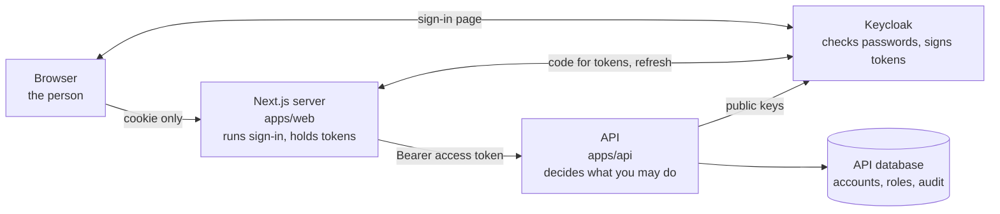
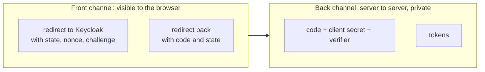
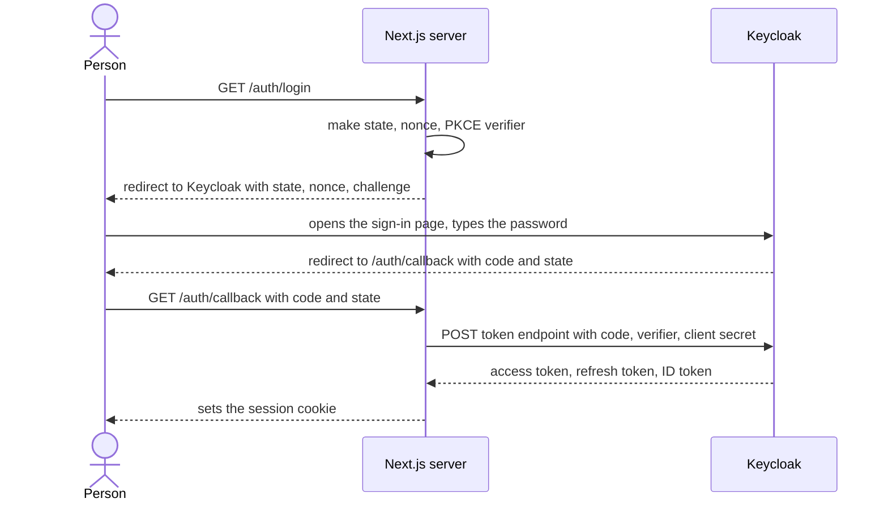
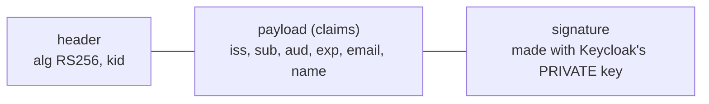
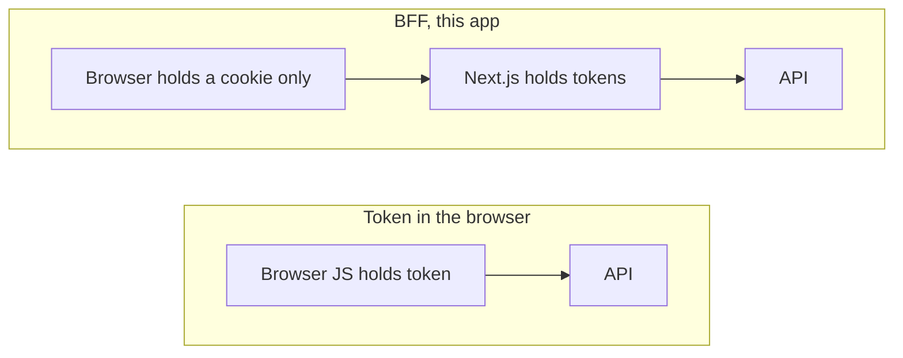
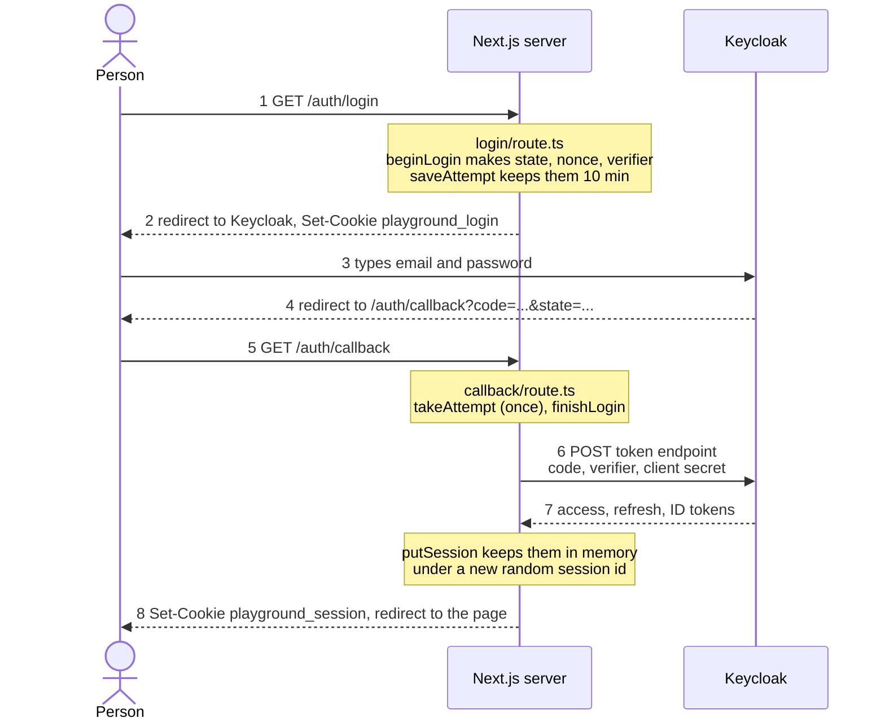
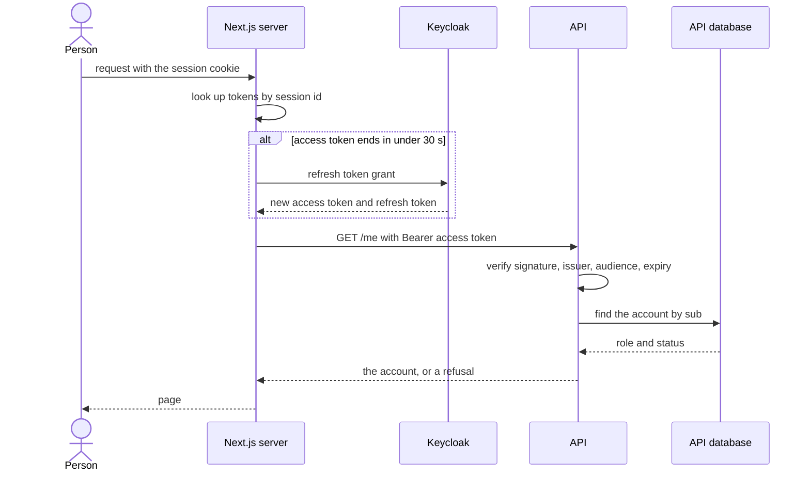
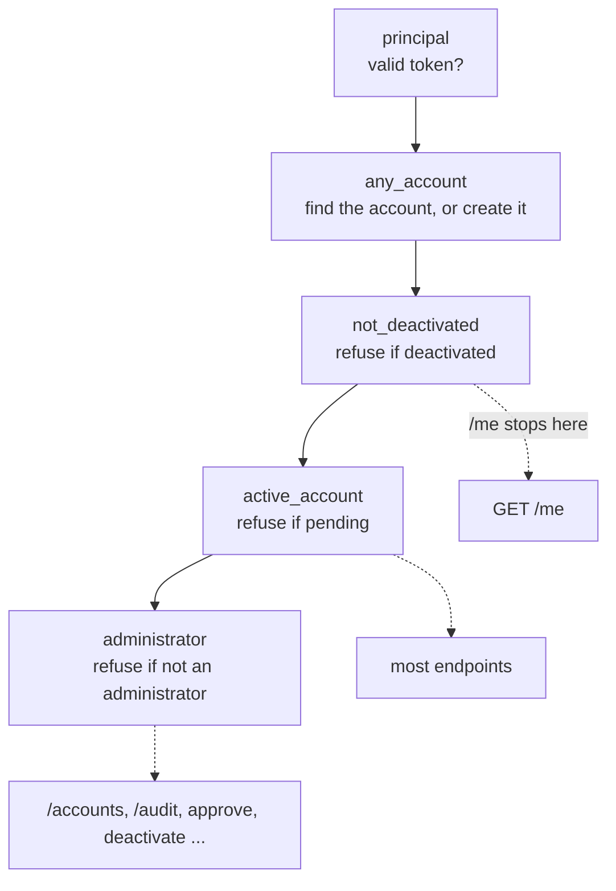
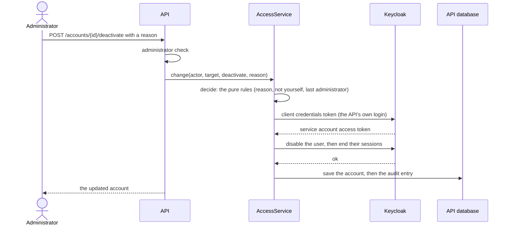
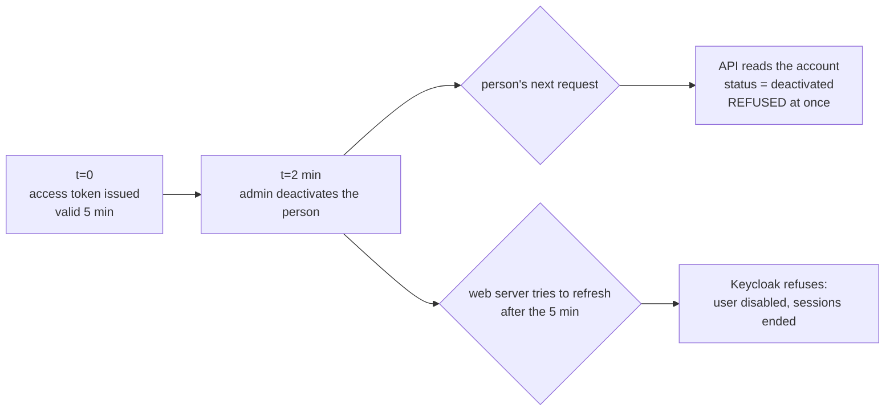

# How sign-in works here: a study guide

Read this with the app running. Every claim points at a file you can open or a command you can run. By the end you should be able to explain the whole mechanism without notes, and know what to check before you deploy it.

**How to use it.** Read Part 1 once for the ideas. Then run the app (Part 2) and follow Part 3 with the code open next to it. Part 6 is a set of experiments: do them, because seeing the real values is what makes this stick. Part 8 is the pre-deploy checklist.

**You will know:** what each of code, access token, ID token, refresh token, session cookie, `state`, `nonce` and PKCE is for, who creates it, who holds it, and what breaks without it.

---

## Contents

0. [The map](#0-the-map)
1. [The theory, in small pieces](#1-the-theory-in-small-pieces)
2. [Run it and look around](#2-run-it-and-look-around)
3. [The code, one flow at a time](#3-the-code-one-flow-at-a-time)
4. [Keycloak, the other half](#4-keycloak-the-other-half)
5. [What lives where, and what an attacker gets](#5-what-lives-where-and-what-an-attacker-gets)
6. [Experiments](#6-experiments)
7. [When it breaks](#7-when-it-breaks)
8. [Before you deploy](#8-before-you-deploy)
9. [Test yourself](#9-test-yourself)
10. [Glossary](#10-glossary)

---

## 0. The map

Four parties are involved. Learn their jobs and the rest follows.



The one rule that explains the design:

> **Keycloak says who you are. Our API says what you may do.**

- **Keycloak** knows your password and proves your identity by signing a token. It knows nothing about roles or projects in this product.
- **The API** trusts Keycloak's signature, then looks you up in its own database to see your role and status.
- **The browser never holds a token.** Next.js holds them and gives the browser one random cookie. This is called the BFF pattern (backend for frontend). Part 1.11 explains why.

Two records describe one person, linked by Keycloak's user id (`sub`), never by email:

| Record | Lives in | Holds |
|---|---|---|
| Keycloak user | Keycloak's database | password, name, email, sessions |
| API account | the API's PostgreSQL | role, status, audit trail |

---

## 1. The theory, in small pieces

Eleven short ideas. Each says what the thing is, then why it exists.

### 1.1 Authentication and authorization

- **Authentication** answers *who are you?* A password, a fingerprint, a company login.
- **Authorization** answers *what may you do?* A role, a membership, a permission.

They are different problems, and this app keeps them in different places on purpose. Keycloak authenticates. The API authorizes. If you ever catch yourself putting a business rule in Keycloak, or a password check in the API, stop and re-read the rule above.

### 1.2 Why you do not write sign-in yourself

Passwords, hashing, brute-force limits, password reset, second factors, sessions and single sign-on are a product of their own, and getting them wrong is a security hole. An earlier prototype (MK3) built its own: about 1,500 lines for passwords, two token kinds and a Redis list of live refresh tokens. It also had a real bug: people were logged out when they switched windows, because replacing a refresh token raced with itself. Here Keycloak does all of that, and our code is about 580 lines.

### 1.3 OAuth 2.0 and OpenID Connect, in one paragraph

**OAuth 2.0** is a standard way for one program to be given limited access on behalf of a person, without ever seeing the person's password. **OpenID Connect (OIDC)** sits on top of it and adds *identity*: "this person just logged in, and here is who they are". When people say "sign in with X", they usually mean OIDC.

Four roles appear in the standards. Here is who plays each:

| OAuth role | Meaning | Here |
|---|---|---|
| Resource owner | the person | you |
| Authorization server | issues tokens after checking the person | Keycloak |
| Client | the app asking for tokens | the Next.js server (`playground-web`) |
| Resource server | the thing that accepts tokens | the API |

### 1.4 Two channels: why a "code" exists at all

This is the idea most people miss, so take your time.

- The **front channel** is the browser's address bar. Anything in a URL can be seen by the person, browser extensions, history and logs. It is public.
- The **back channel** is a direct call from our server to Keycloak. The person's browser is not involved. It can carry secrets.

If Keycloak put the tokens in the redirect URL (the front channel), they would leak. So it hands the browser a **code**: a short-lived, one-use ticket that is useless alone. Our server then takes the code to Keycloak over the back channel and swaps it for the tokens.



### 1.5 The authorization code flow

Everything in this app hangs off this one flow. Here it is end to end. You will meet each step again in the code.



### 1.6 Confidential and public clients, and the client secret

A **client** is registered in Keycloak. It is *confidential* if it can keep a secret (a server), and *public* if it cannot (a phone app, a browser app). Our `playground-web` client is confidential, so at the token exchange it proves itself with a **client secret** as well as the PKCE verifier. The secret lives only in the Next.js server's environment, never in the browser.

### 1.7 PKCE (say "pixie")

PKCE protects the code. Suppose someone steals the code from the address bar. Without PKCE, they could swap it for tokens. With PKCE:

1. At the start, Next.js makes a random secret, the **verifier**, and keeps it on the server.
2. It sends Keycloak only the **challenge**, which is a hash of the verifier (method `S256`). A hash cannot be reversed.
3. At the exchange it sends the verifier. Keycloak hashes it and compares to the challenge it saw in step 2.

A thief with the code but without the verifier gets nothing. The realm enforces it with `pkce.code.challenge.method: S256`.

### 1.8 `state` and `nonce`

Two more random values made at the start. They stop two different attacks.

- **`state`** ties the return trip to the outgoing trip. When the browser comes back to `/auth/callback`, Next.js checks that `state` matches an attempt *it* started. Otherwise an attacker could trick your browser into completing *their* login on your session (login CSRF).
- **`nonce`** is placed inside the **ID token** by Keycloak. Next.js checks that the token carries the nonce it sent. This proves the token was issued for this very attempt and is not a replay of an older one.

All three values (`state`, `nonce`, verifier) are stored together as a **login attempt**, under a random id kept in the `playground_login` cookie. The attempt is used once and expires in 10 minutes.

### 1.9 Tokens

Keycloak returns three tokens. They are different things.

| | Access token | ID token | Refresh token |
|---|---|---|---|
| Question it answers | what may the holder ask the API for? | who just logged in? | can I have a new access token? |
| Sent to | the API, on every request | nobody (kept for logout) | Keycloak only |
| Lifetime here | **5 minutes** | short | up to the Keycloak session: **30 min idle, 8 h max** |
| Format | JWT | JWT | opaque to us |

**What a JWT is.** Three base64 parts joined by dots: `header.payload.signature`.



The payload is **not secret**, anyone can decode it. What makes it trustworthy is the **signature**. Keycloak signs with a private key it never shares. The API fetches Keycloak's **public keys** (the JWKS, a list of keys at a known URL) and verifies the signature. If one byte of the payload changed, verification fails. Anyone can read a token, nobody can forge one.

**The claims the API checks** ([auth.py](../apps/api/app/auth.py)):

| Claim | Meaning | The API requires |
|---|---|---|
| `iss` | issuer: who signed it | exactly `http://localhost:8080/realms/playground` |
| `aud` | audience: who it is meant for | `playground-api` (a Keycloak mapper adds it) |
| `exp` | expiry time | not in the past |
| `sub` | subject: the user's id, stable forever | present. This becomes `identity`, the link to the account |
| `email` | the person's email | present (the API refuses tokens without one) |

Illustrative shape of a person's access token payload (an example, not a real token):

```json
{
  "iss": "http://localhost:8080/realms/playground",
  "sub": "efa6b0f0-a007-40f4-8b46-af3000d05b27",
  "aud": "playground-api",
  "azp": "playground-web",
  "exp": 1794871883,
  "email": "maya@example.test",
  "email_verified": true,
  "name": "Maya Rao"
}
```

**Why the access token is so short.** A JWT cannot be recalled once issued: the API checks only the signature and expiry. A 5 minute life limits how long a stolen or stale one is useful. The refresh token is how the person stays signed in without typing the password every 5 minutes.

**Refresh tokens can rotate, and here they do not.** Keycloak has a realm setting, *Revoke Refresh Token*. When it is **on**, every refresh retires the old refresh token and issues a new one, and using an old one a second time looks like theft, so Keycloak can end the session. In this realm it is **off** (`revokeRefreshToken = false`, checked against the running realm), so the same refresh token keeps working until the Keycloak session ends. The code is written to be safe either way: it refreshes one at a time per session (Part 3, Flow B), so you can switch rotation on for production without a rewrite. Turning it on is a good hardening step (Part 8).

### 1.10 Sessions and cookies

Be careful: there are **two** sessions with similar names.

- **Keycloak's session.** Keycloak sets its own cookies on `localhost:8080` after you type your password. That is why signing in a second time often skips the password: Keycloak still remembers you (single sign-on).
- **Our session.** The Next.js server keeps your tokens in memory under a random id, and sets that id as the `playground_session` cookie on `localhost:3000`.

Signing out has to end both (Flow D). Cookie flags you will see:

| Flag | Meaning | Why |
|---|---|---|
| `HttpOnly` | JavaScript cannot read the cookie | a script injected into the page (XSS) cannot steal it |
| `SameSite=Lax` | not sent on cross-site POSTs, but sent when you follow a link or a redirect | blocks cross-site request forgery, yet survives the redirect back from Keycloak |
| `Secure` | only sent over HTTPS | set automatically when `APP_URL` starts with `https://` |

### 1.11 The BFF pattern: why the browser holds no token

You could let the browser's JavaScript hold the access token and call the API directly. Many apps do. The risk: any script running in the page (an XSS bug, a compromised dependency) can read the token and use it anywhere.

In the **BFF** (backend for frontend) pattern the website's server does the OAuth work and keeps the tokens. The browser holds only an opaque `HttpOnly` cookie that means nothing on its own. The server adds the token when it talks to the API.



The trade-off: the server must remember sessions (here, in memory, which Part 8 returns to), and your frontend and its server are one deployable thing.

### 1.12 Service accounts: the API has its own login too

Sometimes a program, not a person, needs a token. The API calls Keycloak's admin API to disable a person. For that it signs in as a *machine*, using the **client credentials** grant: it sends its own client id and secret and receives an access token. No browser, no code, no person. The Keycloak client for this is `playground-backend`, and its service account has only three rights: `view-users`, `query-users`, `manage-users`.

---

## 2. Run it and look around

You need Docker. From the repo root:

```bash
docker compose up -d --build        # first build takes a few minutes
docker compose ps                   # five services should be Up
```

| URL | What |
|---|---|
| http://localhost:3000 | the app |
| http://localhost:8000/docs | the API's Swagger page (it needs a token to do much) |
| http://localhost:8080 | Keycloak admin console. `admin` / `admin`, then switch to the realm **playground** |

People you can sign in as:

| Email | Password | What they are |
|---|---|---|
| `admin@example.test` | `Admin123!` | the first administrator (the API makes the first account an administrator because this email is in `BOOTSTRAP_ADMIN_EMAILS` and Keycloak says it is verified) |
| `maya@example.test` | `Maya123!` | an ordinary person, who starts **pending** until approved |

Four things to keep open while you read:

1. **Browser DevTools, Network tab**, with **Preserve log** ticked. You will watch the redirects.
2. **DevTools, Application tab, Cookies.** You will watch the two cookies appear.
3. **The Keycloak admin console.** You will look at the client, the sessions and the tokens it would issue.
4. **A terminal** for `curl` and `docker compose logs -f web api keycloak`.

---

## 3. The code, one flow at a time

First, where things live:

| Piece | File | Job |
|---|---|---|
| Start a login | [auth/login/route.ts](../apps/web/src/app/auth/login/route.ts) | makes the login attempt, redirects to Keycloak |
| Finish a login | [auth/callback/route.ts](../apps/web/src/app/auth/callback/route.ts) | checks the return, gets the tokens, sets the cookie |
| OIDC calls | [lib/auth/oidc.ts](../apps/web/src/lib/auth/oidc.ts) | `beginLogin`, `finishLogin`, `refresh`, `endSessionUrl` (uses the `openid-client` library) |
| Sessions | [lib/auth/session.ts](../apps/web/src/lib/auth/session.ts) | cookie options, `accessToken()` with the refresh |
| Memory store | [lib/auth/store.ts](../apps/web/src/lib/auth/store.ts) | login attempts and sessions, in memory |
| Gate | [proxy.ts](../apps/web/src/proxy.ts) | no cookie, no protected page |
| Forwarder | [api/backend/[...path]/route.ts](../apps/web/src/app/api/backend/[...path]/route.ts) | adds `Bearer` and calls the API |
| Server calls | [lib/api.ts](../apps/web/src/lib/api.ts) | the same, for pages rendered on the server |
| Sign out | [auth/logout/route.ts](../apps/web/src/app/auth/logout/route.ts) | ends both sessions |
| Token check | [auth.py](../apps/api/app/auth.py) | verifies the token |
| Endpoints | [main.py](../apps/api/app/main.py) | one check chain per request |
| Use cases | [service.py](../apps/api/app/service.py) | `account_for`, `change` |
| Rules | [domain/account.py](../apps/api/app/domain/account.py) | pure rules, no framework |
| Keycloak admin | [adapters/keycloak_admin.py](../apps/api/app/adapters/keycloak_admin.py) | the API's own login, then enable and disable people |

### Flow A: the first sign-in

The sequence with the real file for each step:



**Step 1 to 2: starting.** [login/route.ts](../apps/web/src/app/auth/login/route.ts) does this:

```ts
const returnTo = safeReturnTo(params.get("returnTo"));
const { url, ...attempt } = await beginLogin({ register: params.get("register") === "1" });
const id = newSessionId();
saveAttempt(id, { ...attempt, returnTo });
const res = NextResponse.redirect(url);
res.cookies.set(LOGIN_COOKIE, id, cookieOptions(LOGIN_ATTEMPT_TTL_MS / 1000));
```

- `safeReturnTo` ([safe-return-to.ts](../apps/web/src/lib/auth/safe-return-to.ts)) only allows a path that starts with a single `/`. Otherwise `/auth/login?returnTo=https://evil.com` would become an *open redirect*: after login, send the person to an attacker's site.
- `beginLogin` ([oidc.ts](../apps/web/src/lib/auth/oidc.ts)) makes the three secrets and builds the Keycloak URL:

```ts
const state = client.randomState();
const nonce = client.randomNonce();
const pkceVerifier = client.randomPKCECodeVerifier();
const params = {
  redirect_uri: redirectUri(),
  scope: "openid profile email",
  state, nonce,
  code_challenge: await client.calculatePKCECodeChallenge(pkceVerifier),
  code_challenge_method: "S256",
};
if (opts.register) params.prompt = "create"; // Keycloak shows the registration form first
```

- `scope: "openid profile email"`: `openid` makes it OIDC and brings the ID token. `profile` and `email` put name and email into the tokens.
- `prompt=create` is how "Create account" sends you straight to Keycloak's registration form.

**What you can observe.** Run this and read the headers (this is real output, with the random values hidden):

```bash
curl -si http://localhost:3000/auth/login
```

```text
HTTP/1.1 307 Temporary Redirect
location: http://localhost:8080/realms/playground/protocol/openid-connect/auth?redirect_uri=http%3A%2F%2Flocalhost%3A3000%2Fauth%2Fcallback&scope=openid+profile+email&state=<random>&nonce=<random>&code_challenge=<hash>&code_challenge_method=S256&client_id=playground-web&response_type=code
set-cookie: playground_login=<id>; Path=/; Max-Age=600; HttpOnly; SameSite=lax
```

Find every piece from the theory in that output: `response_type=code` (code flow), `state`, `nonce`, `code_challenge` (PKCE hash), `redirect_uri` (the callback), and a 10 minute (`Max-Age=600`) `HttpOnly` cookie for the attempt.

**Step 3 to 4: Keycloak.** You type the password **into Keycloak's page on `localhost:8080`**. Our code never sees it. Keycloak then redirects you to the callback address, which must exactly match the realm's `redirectUris` (`http://localhost:3000/auth/callback`). Keycloak refuses any other address, so an attacker cannot redirect your code to their own server.

**Step 5 to 8: the callback.** [callback/route.ts](../apps/web/src/app/auth/callback/route.ts):

```ts
const attempt = takeAttempt(request.cookies.get(LOGIN_COOKIE)?.value);
if (!attempt) return fail("login_expired");
if (request.nextUrl.searchParams.has("error")) return fail("login_refused");
...
const session = await finishLogin(callbackUrl, attempt); // checks state, nonce and PKCE
const id = newSessionId();
putSession(id, session);
const res = NextResponse.redirect(new URL(attempt.returnTo, env.appUrl));
res.cookies.set(SESSION_COOKIE, id, cookieOptions());
res.cookies.delete(LOGIN_COOKIE);
```

- `takeAttempt` returns the saved attempt **and deletes it**, so a replayed callback finds nothing (`login_expired`).
- `finishLogin` calls the library's `authorizationCodeGrant`, passing the saved `state`, `nonce` and verifier:

```ts
const tokens = await client.authorizationCodeGrant(cfg, callbackUrl, {
  pkceCodeVerifier: attempt.pkceVerifier,
  expectedState: attempt.state,
  expectedNonce: attempt.nonce,
});
```

  The library sends the code, verifier and client secret to Keycloak, checks that `state` matches, and checks the ID token's claims, including the `nonce`. Any failure throws, and the person lands on `/?error=login_failed`.
- The tokens are stored by [store.ts](../apps/web/src/lib/auth/store.ts):

```ts
export type Session = {
  idToken: string; accessToken: string;
  refreshToken: string | undefined;
  accessExpiresAt: number; // ms since epoch
};
// In memory, kept on globalThis so dev hot reloads do not drop it. A restart signs everyone out.
```

- The cookie `playground_session` is a random 32-byte id with no `Max-Age`, so it is a *session cookie* the browser drops when closed. The tokens themselves never leave the server.

**What you can observe.** Sign in with DevTools open (Network, Preserve log). You should see, in order: `/auth/login` (307), Keycloak's `auth` page, the form POST, then `/auth/callback?...code=...&state=...` (307), then your page. Click the callback request and read `code` and `state` in the URL. Then open Application, Cookies, `localhost:3000`: `playground_session` is there, flagged `HttpOnly`, and `playground_login` is gone. In the console, type `document.cookie` and notice the session cookie is **not** listed: scripts cannot read it.

### Flow B: an ordinary request

After signing in, every page and API call goes through the same three hops.



**Hop 1: the gate.** [proxy.ts](../apps/web/src/proxy.ts) runs before `/dashboard` and `/admin`:

```ts
if (!request.cookies.has("playground_session")) {
  const login = new URL("/auth/login", request.url);
  login.searchParams.set("returnTo", request.nextUrl.pathname + request.nextUrl.search);
  return NextResponse.redirect(login);
}
```

It only checks that a cookie *exists*. It is a quick bounce, not a security check. The real check is that the page then asks the API, which verifies the token.

**Hop 2: getting a usable access token.** [session.ts](../apps/web/src/lib/auth/session.ts) `accessToken()`:

```ts
if (session.accessExpiresAt - Date.now() > 30_000) return session.accessToken;
let pending = refreshing.get(id);
if (!pending) {
  pending = refresh(session)
    .then((fresh) => (putSession(id, fresh), fresh))
    .catch(() => (dropSession(id), null))   // Keycloak refused: session ended or person disabled
    .finally(() => refreshing.delete(id));
  refreshing.set(id, pending);
}
return (await pending)?.accessToken ?? null;
```

Read it as three cases:

1. More than 30 seconds left: use the token as is.
2. Under 30 seconds: refresh. The `refreshing` map holds *one refresh in flight per session*. If two requests arrive together, the second **waits for the first** instead of sending a second refresh. Why it matters: if the realm rotates refresh tokens (it does not today, but production should consider it), sending the old one twice looks like theft and kills the session. Even without rotation, two refreshes at once are wasted calls. This lock is the fix for the log-out-when-switching-windows bug MK3 had, which came from exactly that race.
3. Keycloak refuses (session ended, user disabled, token already used): drop our session. The person is asked to sign in again.

**Hop 3: the forwarder.** [api/backend/[...path]/route.ts](../apps/web/src/app/api/backend/[...path]/route.ts) adds the token and goes no further:

```ts
const token = await accessToken();
if (!token) return NextResponse.json({ code: "no_session", ... }, { status: 401 });
const upstream = await fetch(`${env.apiUrl}/${...}`, {
  headers: { Authorization: `Bearer ${token}`, ... }, ...
});
```

Pages rendered on the server use [lib/api.ts](../apps/web/src/lib/api.ts) (`getMe()`), which does the same thing directly.

**Hop 4: the API verifies the token.** [auth.py](../apps/api/app/auth.py):

```python
claims = jwt.decode(
    token,
    self._signing_key(token),          # Keycloak's public key, found by the token's kid
    algorithms=["RS256"],              # only this algorithm is accepted
    audience=self.audience,            # must be "playground-api"
    issuer=self.issuer,                # must be our realm
    options={"require": ["exp", "iss", "aud", "sub"]},
)
```

- The key is found by the `kid` in the token header, from Keycloak's JWKS (`/protocol/openid-connect/certs`), which the library caches.
- `algorithms=["RS256"]` matters: it blocks the classic trick of a token that claims `alg: none` or a weaker algorithm.
- A token with no `email` is refused too.

**Hop 5: the account, then the permission.** [main.py](../apps/api/app/main.py) builds a chain of checks. Each layer depends on the one before:



- `GET /me` stops at `not_deactivated`, so a **pending** person can ask for their own status and nothing else.
- Admin endpoints need `administrator`, which needs `active_account`, which needs `not_deactivated`.
- **The account is read from the database on every request.** That is why deactivating someone, or changing a role, takes effect on their very next request, not when their token expires.

**First sight creates an account.** `any_account` calls `AccessService.account_for` ([service.py](../apps/api/app/service.py)):

```python
existing = self.accounts.by_identity(identity)       # identity is the token's sub
if existing:
    ... refresh name and email from the token, return it
first_admin = email_verified and email.lower() in self.bootstrap_admins
account = Account(..., role=administrator if first_admin else user,
                       status=active if first_admin else pending, ...)
```

- A new person gets a **pending** account on their first request. Registering was Keycloak's job; becoming known to *our* system happens here, silently.
- The first administrator comes from setup: an email in `BOOTSTRAP_ADMIN_EMAILS` **and** verified by Keycloak, so nobody can claim it by registering with someone else's address.

### Flow C: an administrator changes an account

This is where the API becomes a *client* of Keycloak.



[service.py](../apps/api/app/service.py) `change`:

```python
updated = decide(action, actor, target, self.accounts.count_active_administrators())
# Keycloak first. If it fails nothing changes on our side (BC-ACCESS question 6).
try:
    if action is Action.deactivate:
        self.idp.disable_user(target.identity)
        self.idp.end_sessions(target.identity)
    elif action is Action.reinstate:
        self.idp.enable_user(target.identity)
except Exception as exc:
    raise IdentityProviderUnavailable("Keycloak could not be reached. Nothing was changed.") from exc
self.accounts.save(updated)
self.audit.record(actor.id, action.value, target.id, cleaned, _now())
```

- `decide` ([domain/account.py](../apps/api/app/domain/account.py)) is **pure**: no database, no HTTP. It enforces the rules (a reason of at least three letters, nobody deactivates themselves, there is always an administrator).
- **Keycloak is called first.** Two systems cannot change in one transaction. If Keycloak succeeds and our database then fails, a person is disabled but our record still says active. If we did it the other way and Keycloak failed, we would say deactivated while they could still sign in. Calling Keycloak first means a failure leaves *nothing* changed. (Open: a failure between the two steps. Decision 26 lists it.)
- **Approve does not call Keycloak.** A pending person already has a Keycloak login. Approving is only a status change in our database.
- The API proves itself to Keycloak in [keycloak_admin.py](../apps/api/app/adapters/keycloak_admin.py) with the **client credentials** grant (Part 1.12), caching the token until 10 seconds before it expires:

```python
r = self._http.post(f"{...}/protocol/openid-connect/token", data={
    "grant_type": "client_credentials",
    "client_id": self._s.keycloak_backend_client_id,
    "client_secret": self._s.keycloak_backend_client_secret,
})
```

### Flow D: sign out, and what happens to tokens you already issued

[auth/logout/route.ts](../apps/web/src/app/auth/logout/route.ts) is a **POST** only, so a link or an image on another site cannot sign you out.

```ts
const session = await endSession();                   // forget our session and its tokens
target = await endSessionUrl(session?.idToken);       // Keycloak's end-session address
const res = NextResponse.redirect(target, 303);
res.cookies.delete(SESSION_COOKIE);
```

Two sessions end: ours (memory plus cookie) and Keycloak's (by sending you to its end-session address with the ID token as `id_token_hint`, which is the one real use the app makes of the ID token). If Keycloak's session stayed alive, the next "Sign in" would log you straight back in.

Now a harder question: **what if a token is already out there when something changes?**



- The token itself would still pass the *signature* check until it expires. What refuses the person immediately is the API reading the **account** on every request.
- Keycloak also disabled them and ended their sessions, so they cannot refresh or sign in again.

Both are needed. Keycloak alone would leave up to 5 minutes. The account check alone would leave them able to log in again. This is the practical reason roles and status live in our database and not inside the token.

### Flow E: registering

"Create account" goes to `/auth/login?register=1`, which adds `prompt=create` so Keycloak opens its registration form. The realm has `registrationAllowed: true`. After registering, Keycloak signs the person in, and the flow continues exactly as Flow A. They arrive with a Keycloak user and no API account, and their first request creates a **pending** one (Flow B). That is the whole reason there is no "sign up" code in this repo.

---

## 4. Keycloak, the other half

Everything Keycloak does here is configured in one file: [playground-realm.json](../keycloak-config/realm/playground-realm.json). It is imported once, when Keycloak first starts (`start-dev --import-realm`). If the realm already exists it is **not** re-read. To re-import, wipe the data: `docker compose down -v`.

**Concepts first.**

- A **realm** is one isolated world of users, clients and settings. Ours is `playground`.
- A **client** is an app registered to use the realm for login.
- A **scope** is a bundle of claims a client may ask for (`profile`, `email`).
- A **protocol mapper** adds or shapes claims in a token.

**The settings that matter** (open the file next to this table):

| Setting | Value | What it does |
|---|---|---|
| `accessTokenLifespan` | 300 | the access token lives 5 minutes |
| `ssoSessionIdleTimeout` | 1800 | a Keycloak session ends after 30 min idle |
| `ssoSessionMaxLifespan` | 28800 | and after 8 hours regardless |
| `registrationAllowed` | true | the "Create account" page exists |
| `bruteForceProtected` | true | repeated wrong passwords lock the user for a while |
| `verifyEmail` | false | no email check (a dev shortcut: `email_verified` is set by hand) |
| `sslRequired` | none | HTTP is accepted. **Dev only.** |

**Client `playground-web`** (the Next.js server):

| Setting | Value | Why |
|---|---|---|
| `publicClient` | false | it is confidential: it has a secret |
| `standardFlowEnabled` | true | the authorization code flow is allowed |
| `directAccessGrantsEnabled` | false | the password grant is switched off, so nobody can post a password to the token endpoint |
| `implicitFlowEnabled` | false | the old, leaky flow that put tokens in URLs |
| `redirectUris` | `http://localhost:3000/auth/callback` | the only address Keycloak will send a code to |
| `pkce.code.challenge.method` | S256 | PKCE is required |
| mapper `playground-api-audience` | adds `aud: playground-api` | without it the API would refuse the token |

**Client `playground-backend`** (the API's own login): `serviceAccountsEnabled: true`, no browser flows. Its service account holds only `view-users`, `query-users`, `manage-users`.

**The tokens it can issue, and how to see one.** The browser never has a token, so you cannot scrape it from DevTools. Two ways to see real ones:

- The admin console can generate the exact access token it would issue for a user. See experiment 6.
- You can fetch the backend's own token with `curl` and decode it. See experiment 3.

**Endpoints Keycloak publishes.** Everything the code needs is discoverable from one URL (real output):

```bash
curl -s http://localhost:8080/realms/playground/.well-known/openid-configuration
```

```text
issuer                 = http://localhost:8080/realms/playground
authorization_endpoint = .../protocol/openid-connect/auth      (where the browser goes)
token_endpoint         = .../protocol/openid-connect/token     (where the server swaps the code)
jwks_uri               = .../protocol/openid-connect/certs     (the public keys)
end_session_endpoint   = .../protocol/openid-connect/logout    (sign out)
```

**A Docker wrinkle that confuses everyone.** Tokens carry `iss=http://localhost:8080/...` because that is the address the *browser* uses. But inside Docker, the web and API containers reach Keycloak at `http://keycloak:8080`. So two addresses exist for one server. The code handles this on purpose: `KEYCLOAK_ISSUER` is the public one (what to *expect* in tokens), `KEYCLOAK_INTERNAL_ISSUER` is where to *call*, and Keycloak runs with `KC_HOSTNAME_BACKCHANNEL_DYNAMIC=true`. The web app reads Keycloak's discovery document by hand ([oidc.ts](../apps/web/src/lib/auth/oidc.ts)) because the library would otherwise reject the mismatch. If you ever see "issuer mismatch" or "invalid_token" in Docker, start here.

---

## 5. What lives where, and what an attacker gets

| Thing | Created by | Held by | Visible to the browser? |
|---|---|---|---|
| Password | the person | Keycloak (hashed) | typed into Keycloak's page only |
| Keycloak session cookies | Keycloak | the browser, for `localhost:8080` | yes, but only Keycloak uses them |
| `state`, `nonce`, verifier | Next.js | Next.js memory | no |
| `playground_login` cookie | Next.js | the browser | yes (an opaque id, 10 min) |
| Authorization code | Keycloak | passes through the URL | yes, but one use and needs the verifier |
| Access, refresh, ID tokens | Keycloak | Next.js memory | **no** |
| `playground_session` cookie | Next.js | the browser | yes (an opaque id, `HttpOnly`) |
| Client secret `playground-web` | realm file | Next.js environment | no |
| Backend client secret | realm file | API environment | no |
| Role, status, audit | the API | the API's PostgreSQL | no |

**What does an attacker get with...**

| They have | What they can do | What limits them |
|---|---|---|
| the authorization code from the URL | nothing alone | it is one use, short, and needs the PKCE verifier |
| your `playground_session` cookie | act as you on this site until you sign out or the session ends | `HttpOnly` stops scripts reading it, `Secure` (on HTTPS) stops sniffing, but a stolen cookie is a stolen session. Keep sessions short |
| an access token | call the API as you until it expires | 5 minutes, and the API still reads your account each time |
| a refresh token | mint new access tokens as you | it only works at Keycloak and dies with the session. Rotation (off today) would also let Keycloak detect reuse |
| the client secret | impersonate our app to Keycloak | they still need a valid code and verifier, and the redirect URI is fixed |
| the backend client secret | disable or enable users | only the three rights it holds, nothing else. Rotate it |
| a forged token | nothing | the signature check fails |
| a valid token for another app | nothing | `aud` is not `playground-api` |
| script injected into the page (XSS) | act as you while the page is open | tokens are not in the page, and the cookie is `HttpOnly` |

---

## 6. Experiments

Do these in order. Each takes a minute and shows one idea with real values. Run them from the repo root with the stack up.

### 1. Watch the redirect

```bash
curl -si http://localhost:3000/auth/login | head -5
```

Find `state`, `nonce`, `code_challenge`, `client_id=playground-web`, and the `playground_login` cookie. This is the front channel. (Part 3, Flow A.)

### 2. Hit the API with nothing, then with rubbish

```bash
curl -si http://localhost:8000/me
curl -s  -H "Authorization: Bearer abc.def.ghi" http://localhost:8000/me
```

You should get, real output:

```text
HTTP/1.1 401 Unauthorized
www-authenticate: Bearer
{"detail":{"code":"missing_token","message":"Sign in first."}}

{"detail":{"code":"invalid_token","message":"The token is not valid."}}
```

Two different refusals: no token, and a token that does not verify. Nothing reaches the database in either case.

### 3. Get a real, valid token, decode it, and watch the API reject it

The backend has its own login (client credentials). Use it to get a genuine Keycloak token:

```bash
curl -s -d grant_type=client_credentials \
        -d client_id=playground-backend \
        -d client_secret=playground-backend-dev-secret \
        http://localhost:8080/realms/playground/protocol/openid-connect/token > /tmp/tok.json

python3 - <<'EOF'
import json, base64
t = json.load(open('/tmp/tok.json'))['access_token']
dec = lambda p: json.loads(base64.urlsafe_b64decode(p + '=' * (-len(p) % 4)))
h, p, s = t.split('.')
print('HEADER ', dec(h))
for k, v in dec(p).items(): print(f'  {k}: {v}')
EOF
```

Real output (values differ per run):

```text
HEADER  {'alg': 'RS256', 'typ': 'JWT', 'kid': 'CdLHpIsQVTMSB4ZnSnlCGz9jNP_IAw23bkYEVaSntHI'}
  iss: http://localhost:8080/realms/playground
  sub: f453885d-c354-4e5c-ba6b-cd69c8dcf259
  aud: realm-management
  azp: playground-backend
  exp: ...        (300 seconds after iat)
  preferred_username: service-account-playground-backend
  scope: email profile
```

Notice: it has no refresh token (machines just ask again), `exp` is 300 seconds out, and the **header carries a `kid`**. Now offer it to the API:

```bash
curl -s -H "Authorization: Bearer $(python3 -c "import json;print(json.load(open('/tmp/tok.json'))['access_token'])")" http://localhost:8000/me
```

```text
{"detail":{"code":"invalid_token","message":"The token is not valid."}}
```

**Why?** The signature is valid and the issuer is right, but `aud` is `realm-management`, not `playground-api`, and there is no `email`. Signature checking is only the first of several checks. Delete `/tmp/tok.json` when done.

### 4. Match the token's `kid` to Keycloak's public keys

```bash
curl -s http://localhost:8080/realms/playground/protocol/openid-connect/certs
```

You will see two keys. The one with `"use": "sig"` and `"alg": "RS256"` has the same `kid` as the token's header in experiment 3. That is how the API picks the right key. The other (`"use": "enc"`) is for encryption and is not used here.

### 5. See what the browser can and cannot see

1. Sign in at http://localhost:3000.
2. DevTools, Application, Cookies, `localhost:3000`: find `playground_session`. It has `HttpOnly` ticked and no expiry (a session cookie).
3. DevTools console: type `document.cookie`. `playground_session` is not in the output.
4. Search the Network tab for any request header or response body containing `eyJ` (every JWT starts with those characters). You will not find one.

That is the BFF at work.

### 6. Read a real person's access token in the admin console

1. http://localhost:8080, sign in `admin` / `admin`, choose realm **playground**.
2. Clients, `playground-web`, the **Client scopes** tab, then **Evaluate**.
3. Pick a user (for example `maya@example.test`) and open **Generated access token**.

You will see her `sub`, `email`, `name` and `aud: playground-api`. This is what the API receives for her. (Menu names are from Keycloak 26. If a label differs, use the console's search box.)

### 7. Deactivate someone who is signed in

1. Sign in as Maya in a private window and open the dashboard.
2. As the administrator, open Accounts and deactivate Maya, with a reason.
3. In Maya's window, reload. She is refused immediately, though her token has minutes left.
4. In the admin console, Sessions: Maya's session is gone.
5. Reinstate her. She must sign in again (her sessions were ended).

This shows *both* defences from Flow D: the account check on every request, and Keycloak ending her sessions.

### 8. Restart the web server and see why sessions are in memory

```bash
docker compose restart web
```

Reload your signed-in tab. You are bounced to sign in, though your cookie is unchanged. The cookie is only an id, and the table it pointed to (in the server's memory) is gone. This is the weakness the AWS plan fixes with a shared store (Part 8).

### 9. Tamper with the cookie

In DevTools, edit `playground_session`'s value to anything else and reload. You are treated as signed out. The gate ([proxy.ts](../apps/web/src/proxy.ts)) only checks that *a* cookie exists, so you pass it, but the page asks for the account, the lookup by that id finds nothing, and you are redirected to sign in. This is the difference between the quick gate and the real check.

### 10. Shorten the access token and read the refresh (optional)

1. Admin console, Realm settings, **Tokens**, set **Access Token Lifespan** to 1 minute, save.
2. Sign in, wait over a minute, click around. You stay signed in: the web server refreshed silently.
3. Optional: turn on **Events** (Realm settings, Events, save events) and look at the user events for refresh activity.

---

## 7. When it breaks

| What you see | Most likely cause | Where to look |
|---|---|---|
| `Invalid redirect_uri` on Keycloak's page | the URL the app sent is not in the client's `redirectUris` | realm file, `playground-web` |
| back on `/?error=login_expired` | the `playground_login` cookie is missing or used (a second tab, an old tab, cookies blocked) | callback route, `takeAttempt` |
| back on `/?error=login_failed` | the exchange or the `state`, `nonce` or PKCE check failed | `docker compose logs web` |
| endless redirect to sign in | the cookie is set but the lookup fails (the web server restarted) | experiment 8 |
| API says `invalid_token` for a real token | wrong `iss` (a localhost vs `keycloak:8080` mix), missing `aud` mapper, or no `email` | experiment 3, the Docker wrinkle in Part 4 |
| "Waiting for approval" for a long time | the account is pending, an administrator must approve | the Accounts page |
| `identity_provider_unavailable` on deactivate | the API cannot reach Keycloak, nothing was changed | `docker compose logs api` |
| everything fails after `docker compose down -v` | the database is empty and Keycloak re-imported: accounts start again | Maya is pending again |
| tokens rejected suddenly | the clock on a machine is wrong (`exp` and `iat` are times) | check the system clock |

---

## 8. Before you deploy

The playground cuts corners on purpose. Here is each corner, why it is safe locally, and what to do for AWS.

| Item | Today | Before production |
|---|---|---|
| **HTTPS** | plain HTTP, `sslRequired: none` | HTTPS everywhere (an Application Load Balancer with a certificate). Set `sslRequired` to external or all. `Secure` cookies turn on automatically when `APP_URL` is `https://` |
| **Client secrets** | `playground-web-dev-secret` and `playground-backend-dev-secret` in a file in git | generate new ones, keep them in AWS Secrets Manager, never in git, rotate them |
| **Keycloak mode** | `start-dev` (no caching, dev database settings, admin console open) | run in production mode (`start`) with a proper hostname, proxy header settings behind the load balancer, and the admin console not exposed to the internet |
| **Keycloak bootstrap admin** | `admin` / `admin` | a strong, unique password, and remove the bootstrap account after creating a real one |
| **Session store** | web server memory: a restart signs everyone out, and you cannot run two copies | a shared store (ElastiCache). The code is ready: [store.ts](../apps/web/src/lib/auth/store.ts) is the only file to change |
| **Realm import** | a file read once, with sample users | no sample users or passwords. Manage the realm through a controlled process |
| **Redirect URIs** | one localhost address | exactly your production callback, no wildcards |
| **Email** | `verifyEmail: false` | turn it on, and configure SMTP (Amazon SES), so `email_verified` means something. The first-administrator rule relies on it |
| **Administrator MFA** | none | require a second factor for administrators (Keycloak flow, no code) |
| **Brute force and rate limits** | Keycloak's brute-force lock only | also rate-limit registration and the login route at the edge (AWS WAF) |
| **Token lifetimes** | 5 minutes, 30 min idle, 8 h max | decide deliberately: shorter is safer, longer is friendlier |
| **Refresh token rotation** | off (`revokeRefreshToken = false`) | consider turning on *Revoke Refresh Token*, so a stolen refresh token is detected when reused. The one-at-a-time refresh lock in `session.ts` already copes with it |
| **Database** | Keycloak and the API on local PostgreSQL | Amazon RDS (or Aurora) PostgreSQL, backups on, encrypted |
| **Schema changes** | tables created at start-up | migrations (for example Alembic) as a deploy step |
| **Logging and audit** | container logs | CloudWatch, with a retention policy. Never log tokens or cookies |
| **Cookie and CSRF** | `SameSite=Lax`, logout is POST only | keep POST for any state change. Do not add GET routes that change anything |

Questions to answer before go-live: who runs Keycloak and how it is patched, how a compromised client secret is rotated, what happens when Keycloak is down (sign-in fails, but already signed-in people continue until their tokens expire, since the API only needs Keycloak's public keys, which it caches), and how you would revoke every session at once.

---

## 9. Test yourself

Try each before opening the answer.

<details>
<summary>1. Why does Keycloak send a <em>code</em> instead of the tokens directly?</summary>
The redirect travels through the browser's address bar, which is visible to the person, extensions and logs. A code is short, one use and worthless without the verifier and client secret, and the server swaps it for tokens over a private back channel.
</details>

<details>
<summary>2. What does PKCE protect, and what is stored where?</summary>
It protects a stolen code. The verifier stays on our server. Only its hash goes to Keycloak at the start. At the exchange the verifier is sent, and Keycloak checks it hashes to what it saw. A thief with only the code cannot complete the exchange.
</details>

<details>
<summary>3. What is the difference between <code>state</code> and <code>nonce</code>?</summary>
<code>state</code> ties the callback to the attempt our server started (stops login CSRF) and travels in the URL. <code>nonce</code> is placed inside the ID token and proves that token was issued for this attempt (stops replay).
</details>

<details>
<summary>4. The payload of a JWT is readable by anyone. Why is that safe?</summary>
It contains nothing secret, and the signature, made with Keycloak's private key, means any change is detected. Readable is not forgeable.
</details>

<details>
<summary>5. Why can the browser hold a cookie but not the access token?</summary>
Any script in the page can read an access token held there. The cookie is an opaque, <code>HttpOnly</code> id that scripts cannot read, and means nothing without the server's memory behind it.
</details>

<details>
<summary>6. An administrator deactivates Maya. Her access token has 4 minutes left. What stops her?</summary>
The API reads her account from the database on every request and refuses a deactivated one. Keycloak also disabled her and ended her sessions, so she cannot refresh or sign in again.
</details>

<details>
<summary>7. Why does the API reject a genuinely signed Keycloak token in experiment 3?</summary>
A valid signature is only one check. The audience is <code>realm-management</code>, not <code>playground-api</code>, and there is no email claim.
</details>

<details>
<summary>8. Why is Keycloak called <em>before</em> the database when deactivating?</summary>
Two systems cannot change atomically. If Keycloak fails first, nothing has changed. The other order could leave our record saying deactivated while the person can still sign in.
</details>

<details>
<summary>9. Why are two requests refreshing at once a problem, and what prevents it?</summary>
If the realm rotates refresh tokens, sending the old one twice looks like theft and can end the session. This realm does not rotate today, but the code is safe either way: the <code>refreshing</code> map makes the second request wait for the first refresh's result.
</details>

<details>
<summary>10. What breaks if you restart the web server, and what is the fix for AWS?</summary>
Sessions live in memory, so the cookie's id no longer matches anything and everyone is signed out. Move the session store to ElastiCache by changing only <code>store.ts</code>.
</details>

---

## 10. Glossary

| Term | Meaning |
|---|---|
| **Access token** | a short-lived signed JWT sent to the API as `Bearer`. It says who, not what they may do |
| **Audience (`aud`)** | who a token is meant for. The API requires `playground-api` |
| **Authorization code** | a one-use ticket in the redirect URL, swapped for tokens by the server |
| **Back channel** | a direct server to server call, private |
| **BFF** | backend for frontend: the website's server holds the tokens and the browser gets a cookie |
| **Callback / redirect URI** | the address Keycloak sends the browser back to (`/auth/callback`), pre-registered in the client |
| **Claim** | one fact inside a token (`sub`, `email`, `exp`) |
| **Client** | an app registered in Keycloak (`playground-web`, `playground-backend`) |
| **Client credentials** | a grant where a program logs in as itself with an id and secret |
| **Client secret** | a password for a confidential client |
| **Confidential client** | a client that can keep a secret (a server) |
| **Front channel** | the browser's address bar: visible, not for secrets |
| **ID token** | a JWT saying who just logged in. Here it is kept for the logout hint |
| **Issuer (`iss`)** | who signed the token. The API requires our realm's address |
| **JWKS** | Keycloak's list of public keys, at `/protocol/openid-connect/certs` |
| **JWT** | `header.payload.signature`, a signed, readable token |
| **`kid`** | key id: which of Keycloak's keys signed the token |
| **Login attempt** | our record of one sign-in in progress: `state`, `nonce`, verifier |
| **Nonce** | a random value inside the ID token, proving it belongs to this attempt |
| **OAuth 2.0** | the standard for delegated access |
| **OIDC** | OpenID Connect: identity on top of OAuth |
| **PKCE** | a hashed secret that makes a stolen code useless |
| **Realm** | an isolated world of users and clients in Keycloak |
| **Refresh token** | a voucher for a new access token. Only Keycloak accepts it. It can rotate (a realm setting, off here) |
| **Scope** | a bundle of claims a client may request (`openid`, `profile`, `email`) |
| **Service account** | a Keycloak identity for a program, not a person |
| **Session cookie** | `playground_session`: an opaque id pointing at the tokens in server memory |
| **SSO session** | Keycloak's own memory that you are signed in |
| **State** | a random value tying the callback to our attempt |
| **`sub`** | the user's stable Keycloak id. Our link to the account |
| **XSS** | cross-site scripting: attacker script running in your page |
