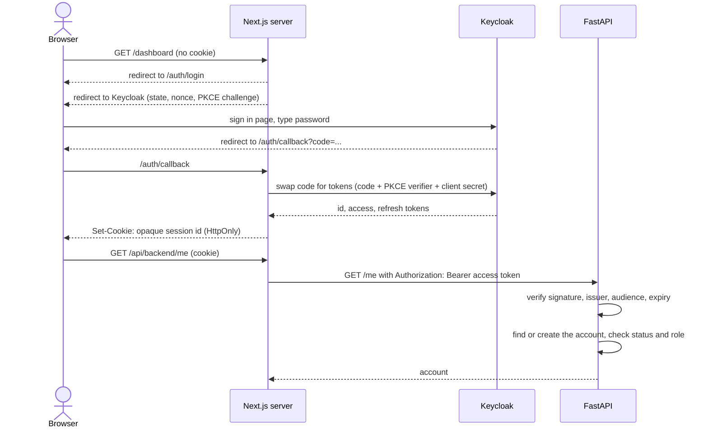

# Getting started

A guide for understanding this playground before you change it. Read it once top to bottom, run the stack, then follow the code tour.

## 1. What this is

A small app where people sign in with **Keycloak**, and an **API** decides what they may do.

| Piece | Tech | One line |
|---|---|---|
| Keycloak | Keycloak 26 + Postgres | Knows who you are. Holds passwords, the sign-in page, sessions |
| `apps/web` | Next.js 16, shadcn, TypeScript | The website. Also the "BFF": the server part runs sign-in and holds your tokens |
| `apps/api` | FastAPI, PostgreSQL | Checks every request, keeps your **account** (role, status) and the audit trail |

The key idea, in one sentence: **Keycloak says who you are. Our API says what you may do.**

That is why there are two records of a person: a Keycloak user (password, name, email) and an API **account** (role, status, audit). They are linked by the Keycloak user id (`sub`), never by email.

## 2. Run it

You need Docker. Everything starts with one command:

```bash
docker compose up -d --build     # first build takes a few minutes
```

| URL | What |
|---|---|
| http://localhost:3000 | the app |
| http://localhost:8000/docs | the API (Swagger UI, needs a token to do much) |
| http://localhost:8080 | Keycloak admin console. `admin` / `admin`, switch to realm **playground** |

The API keeps its data in its own PostgreSQL (`api-db`), the engine Amazon RDS runs on AWS.

Stop: `docker compose down`. Wipe all data and re-import the realm: `docker compose down -v`.
Logs: `docker compose logs -f web api keycloak`.

### Working on the code (faster loop)

Run Keycloak in Docker and the app on your machine, so code changes reload:

```bash
docker compose up -d keycloak keycloak-db api-db
cd apps/api && cp .env.example .env && uv sync && uv run uvicorn app.main:create_app --factory --reload --port 8000
cd apps/web && npm install && npm run dev        # .env.example has the values
```

Do not run both the Docker `api`/`web` and the local ones: they fight over ports 8000 and 3000.

## 3. Try it (20 minutes)

Do these in order. Each one teaches one idea.

1. **Sign in as the administrator.** `admin@example.test` / `Admin123!`. You land on the dashboard and see an "Accounts" link. Why are you an administrator? Not because of Keycloak: the API makes the first account an administrator because that email is in `BOOTSTRAP_ADMIN_EMAILS` (and Keycloak says it is verified).
2. **Sign in as someone ordinary**, in a private window. `maya@example.test` / `Maya123!`. You see "Waiting for approval". The API created a **pending** account on your first request and refuses everything but "show me my own status".
3. **Approve her.** Back as admin, open Accounts, click *approve* on Maya. Reload Maya's window: she is in. Approving did not touch Keycloak.
4. **Deactivate her**, with a reason. Reload Maya's window without signing out: refused at once, though her token is still valid. The API reads the account on **every** request. Keycloak also disabled her and ended her sessions, so she cannot sign in again.
5. **Reinstate her**, and see the audit trail at the bottom of the Accounts page.
6. **Create a brand new person.** Sign out, choose *Create account*, register. Keycloak makes the user, you come back as *pending*. Sign in as admin to approve.
7. **Try to break a rule.** As admin, try to deactivate yourself (no button, and the API refuses it too). Try a reason of `?`. Both are refused.

## 4. The model

### Who holds what

| Fact | Kept by |
|---|---|
| Password, login page, sign-up, sessions | Keycloak |
| Name, email | Keycloak first. The API copies them at each request |
| Role (`user`, `administrator`), status (`pending`, `active`, `deactivated`) | API database |
| Audit trail (who did what, why) | API database |
| Tokens | Next.js server memory. **Never the browser** |

### The sign-in, step by step



Why this shape:

- **Code, not tokens, in the redirect.** URLs leak (history, logs). The code is short lived, single use and useless without the client secret and PKCE verifier.
- **`state`** stops someone signing you in as them. **PKCE** stops a stolen code being swapped. **`nonce`** ties the ID token to this attempt.
- **Tokens stay on the server.** A script injected into the page cannot steal what the browser never has. The server can also end a session at once.
- **Access tokens last 5 minutes.** The server refreshes them quietly, one refresh at a time per session (refresh tokens rotate, so two at once would log you out).

### What the API checks on every request

1. A bearer token is present, signed by Keycloak (public keys from the JWKS endpoint), not expired, issued by our realm, meant for `playground-api`. Otherwise `401`.
2. The account exists (made as *pending* if this is the first time).
3. The account is not *deactivated* (`403 account_deactivated`) and not *pending* (`403 account_pending`, except `/me`).
4. The role allows the action (`403 forbidden`).

The rules about accounts (reasons, last administrator, no self-changes) live in `apps/api/app/domain/account.py`, as plain Python with no framework.

## 5. Code tour

Read in this order. Each file is short.

**API** (`apps/api`)

| File | What to learn |
|---|---|
| `app/domain/account.py` | The `Account`, its statuses and roles, and every rule (`decide`). Start here |
| `tests/test_domain.py` | The rules as examples |
| `app/ports.py` | The three things the domain needs from outside |
| `app/auth.py` | Token check, about 50 lines |
| `app/service.py` | The use cases: first sight of a person, approve, deactivate. Keycloak is called **before** our database changes |
| `app/adapters/keycloak_admin.py` | How the API enables or disables a person in Keycloak |
| `app/main.py` | Routes and the chain of dependencies: `principal` → `any_account` → `not_deactivated` → `active_account` → `administrator` |
| `tests/test_api.py` | Whole flows, with a fake Keycloak and a test signing key |

**Web** (`apps/web/src`)

| File | What to learn |
|---|---|
| `lib/auth/oidc.ts` | The OIDC calls (`openid-client`): begin login, finish login, refresh, end session |
| `lib/auth/store.ts` | Where login attempts and sessions live (memory) |
| `app/auth/login/route.ts`, `callback/route.ts`, `logout/route.ts` | The sign-in, step by step |
| `lib/auth/session.ts` | Cookie settings, and the single-flight token refresh |
| `app/api/backend/[...path]/route.ts` | The only door from the browser to the API. Adds the token |
| `proxy.ts` | A quick "no cookie, no page" gate |
| `app/dashboard/page.tsx`, `app/admin/accounts/page.tsx`, `components/accounts-table.tsx` | The screens |

**Keycloak** (`keycloak-config`)

| File | What to learn |
|---|---|
| `realm/playground-realm.json` | The whole realm as code: clients, the service account, seeded users, token lifetimes |
| `docker-compose.yml` | Keycloak + Postgres. `--import-realm` loads the JSON on first start |

## 6. Look around Keycloak

Open http://localhost:8080, sign in as `admin` / `admin`, pick realm **playground**:

- **Clients → playground-web**: the redirect URI, "Client authentication on" (confidential), PKCE S256 in Advanced.
- **Clients → playground-web → Client scopes → dedicated**: the mapper that puts `playground-api` into the access token's `aud`. Without it the API refuses the token.
- **Clients → playground-backend → Service account roles**: what the API may do in Keycloak (`manage-users`, to disable people).
- **Users**: Maya after you deactivate her: *Enabled* is off.
- **Sessions**: your sign-ins. End one and watch the app sign you out within 5 minutes (the next refresh fails).
- **Realm settings → Login**: user registration is on, that is what *Create account* uses.

Paste an access token into https://jwt.io to read it. You can get one from the Next.js server's memory only, so use a **local** run, and log it in `lib/auth/session.ts` temporarily. Look for `iss`, `aud`, `sub`, `exp`.

## 7. Things to try changing

| Idea | Where |
|---|---|
| Add a new action, say "suspend" | `Action` and `decide` in `domain/account.py`, a test, a button in `accounts-table.tsx` |
| Add a role | `Role` in `account.py`, then check `administrator` in `main.py` |
| Make deactivated people see their own page | `dashboard/page.tsx` already handles `account_deactivated` |
| Shorten the access token to 1 minute | `accessTokenLifespan` in the realm JSON, `docker compose down -v`, up again |
| Add MFA for administrators | Keycloak: Authentication → flows (no code change) |
| Point the API at Amazon RDS | `DATABASE_URL` only: it is already PostgreSQL, so the adapter does not change |
| Keep sessions across restarts | Implement `store.ts` against Redis |

## 8. When things go wrong

| Symptom | Cause |
|---|---|
| "Keycloak is not reachable" on the home page | Keycloak is still starting (about 30 s) or not running: `docker compose ps` |
| Signed out after restarting the web server | Sessions are in memory, by design for now |
| `invalid_token` from the API | The token's `iss` must be exactly `http://localhost:8080/realms/playground`. Open Keycloak only at `localhost`, not `127.0.0.1` |
| You edited the realm JSON and nothing changed | `--import-realm` skips a realm that exists. `docker compose down -v` first |
| Port already in use | A local `npm run dev` or `uvicorn` is still running |
| "login expired" | The sign-in attempt lasts 10 minutes and works once. Start again |

### Why does Docker need two Keycloak addresses?

The browser reaches Keycloak at `localhost:8080`. Inside Docker, `localhost` is the container itself, so the web and API containers use `keycloak:8080`. Tokens must carry one stable issuer, so Keycloak is told its public name (`KC_HOSTNAME`) and to answer server-to-server calls on the address they used (`KC_HOSTNAME_BACKCHANNEL_DYNAMIC`). The apps take `KEYCLOAK_INTERNAL_URL` / `KEYCLOAK_INTERNAL_ISSUER` for the second address.

## 9. Glossary

| Term | Meaning |
|---|---|
| **OIDC** | OpenID Connect: sign-in on top of OAuth 2.0 |
| **Realm** | An isolated set of users, clients and settings in Keycloak |
| **Client** | An app that Keycloak signs people into (`playground-web`) |
| **Service account** | A client acting as itself, not as a person (`playground-backend`) |
| **BFF** | Backend for frontend: a server that does the security work for the website |
| **PKCE** | Proof that whoever swaps the code is who asked for it |
| **Access token** | A short lived, signed note: "this person may call the API" |
| **Refresh token** | Gets a new access token without signing in again |
| **ID token** | Says who signed in. Read once, by the web server |
| **JWKS** | The public keys Keycloak publishes so the API can check signatures |
| **`sub`** | The stable id of a Keycloak user. The link to our account |
| **`aud` / `iss`** | Who a token is for / who issued it |

## 10. Where the rules come from

`docs/specs/keycloak-auth-module.md` is the spec this was built from, with the places where the source documents disagreed and what was chosen. The documents it came from are under `docs/`: `requirements/`, `domain/` and `usecases/`.
