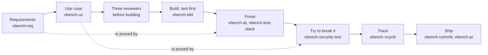

# The harness: an agentic V-cycle

This repo is built with a small harness that keeps AI-assisted work on a traceable path from a requirement to a tested,
reviewed use case. It is made of **standards** (what good looks like), **tools** (scripts that check, with no model),
**skills** (procedures a person runs in the chat) and **agents** (workers with one narrow job). One rule holds it together:

> **Tools and tests decide. Agents advise. People approve.**

## What it proves, and what it does not

Read this first, because the rest is only as good as these limits.

- **The trace says a test exists, and, when results are configured, whether it passed.** With no results file it checks
  existence only and says so on every run. A test that asserts nothing is a warning, not a proof, and a green row on a
  weak test is still green: the trace cannot judge whether a test is any good.
- **A pass, fail or "is this traced" comes from a script or a test.** The reviewers and the security tester are agents: they
  read, reason and report, and never gate. Their findings are advice that a person settles.
- **A stamp is a person's claim.** It records a hash of what they read. It does not make the reading careful.
- **Not covered yet:** a log of review findings and defects, release and baseline, change requests, integration tests as a
  level, results from the fresh-stack (integration and acceptance) run, and an independent quality owner. The honest list is
  [in the map](standards/skills-and-agents.md#known-gaps-against-the-yardstick-not-built).

## Where to start

Type `/vbench-next`. It reads the trace and says where each use case is, in three moments, and the one next step:

1. **Say what:** the requirement and its criteria (`vbench-req`).
2. **Say the shape:** the use case, its flow and design, then the three reviewers (`vbench-uc`).
3. **Build:** one slice at a time, test first (`vbench-tdd`), then prove it, try to break it, and read the trace.

Everything else runs underneath. It never runs a stamp or a freeze for you.

## Inspired by ASPICE and AUTOSAR, not conforming to either

- **From Automotive SPICE** we take the shape of the process: a left arm that specifies, a vertex that builds, a right
  arm that proves what the left arm said, and **forward and backward links between ids** from requirement to test. Review,
  configuration and change management are only partly covered (see above). We make no conformance claim, and the process
  names in the [map](standards/skills-and-agents.md) are a loose mapping, not an assessment.
- **AUTOSAR is an analogy** for how the harness is organised: layers, parts with one job and a declared hand-off, and
  configuration kept apart from the parts. Our "interfaces" are file conventions that tests check (ids, tags, report
  shapes), not typed contracts, and the "runtime" is a model following instructions.

## The layers

| Layer | What it is here | Where |
|---|---|---|
| Standards | what good looks like: naming, use case and requirement form, diagrams, security checklists, ADRs, decisions | `.claude/skills/_vbench/standards/`, `docs/standards/`, `docs/adr/`, `docs/domain/decisions.md` |
| Configuration | the one file that adapts the harness to a project: areas, stacks, packs, adoption, where tests and results live | `vbench.json` |
| Tools | deterministic scripts; no model, same answer every run | `req_tool.py`, `uc_tool.py`, `at_tool.py`, `vcycle.py`, `next_tool.py`, `scripts/check.sh`, `scripts/test-results.sh`, `scripts/test-stack.sh` |
| Components | skills and agents, each with one job, one pack and a declared hand-off | `.claude/skills/vbench-*`, `.claude/agents/` |
| Learning | term cards that explain an idea next to the real code that uses it, checked so they cannot rot | `docs/learn/terms/`, `vbench-explain` |
| Application | the product being built | `apps/api`, `apps/web`, `keycloak-config` |

## The interfaces

Components do not call each other's internals. They meet at a small set of contracts, all plain files:

| Contract | Form | Used by |
|---|---|---|
| Ids | `UC-A1`, `FR-1`, `NFR-1`, `AC-1`, `RULE-A6`, `OBJ-A1`; append only, a retired id is never reused | every skill |
| Test tags | `@pytest.mark.ac("AC-n")`, `Verifies AC-n`, `Realises UC-x`; read with `ast` for Python, and only on a test that really runs | `at_tool`, `vcycle`, the TDD agents |
| Test results | JUnit XML named in `vbench.json` `results` | `vcycle` |
| Review stamps | a hash recorded by a person when they have read a link | `uc_tool stamp`, `at_tool stamp`, `vcycle` |
| Security Notes | a criterion whose Notes start `security`, or name a `SEC-` check | `vbench-security-test`, `vcycle` Security row |
| Machine output | `vcycle.py --json`, `uc_tool` and `at_tool` reports | CI, `vbench-next`, the status card |
| Report shape | finding, why it matters, up to three options, "Advisory only" | the reviewers and the tester |

## One use case through the V

| Step | Who does it | What decides | The person's part |
|---|---|---|---|
| Write the requirement and its criteria | `vbench-req` with `req_tool` | `req_tool validate` | accepts or changes each row |
| Write the use case | `vbench-uc` with `uc_tool` | `uc_tool validate` | accepts the shape; for a full change, freezes and stamps the analysis |
| Review before building | the spec challenger, design reviewer and security reviewer, together, started once by `vbench-uc` | nothing: they advise | settles every finding before the build starts |
| Build one slice | `vbench-tdd` runs red, green and refactor as three agents | the failing test, then the passing suite | two decisions for each behaviour: the failing test, then the finished diff |
| Link tests to criteria | `vbench-at` | `at_tool report` | stamps a test they have checked |
| Run the gate | `scripts/check.sh`, and `vbench-test-stack` on a fresh stack | the tests | reads the counts |
| Try to break it | `vbench-security-tester` through `vbench-security-test` | a reviewed test, never the agent | approves each proposed criterion |
| Trace | `vbench-vcycle` (and `vbench-status` as a table) | `vcycle.py` and its exit code | reads what it does not prove, reads one review summary, then stamps |
| Ship | `vbench-commit`, `vbench-pr` | `scripts/check.sh`, CI | merges |

**Small and full.** A change that adds no object, port, role or outside system and no new flow can be marked `tier: small`
by a person: one combined sequence, no freeze, one review pass. Anything else, and any doubt, is full.

## How strict, area by area

`vbench.json` `adoption` marks each area of the code `legacy` (observed only), `adopting` (a failure shows as a warning) or
`adopted` (as is); the default is `adopted`. `vcycle.py --baseline write` records today's failures so only new or changed
ones fail. `packs` switches off whole groups of rows for a project that does not use them. This is how the harness enters a
project that already exists, one area at a time (`vbench-adopt`, [ADR 0019](adr/0019-adopt-by-strangling-not-rewriting.md)).

## What each kind of part may do

| Kind | May | May not |
|---|---|---|
| Tool or test | decide pass or fail; read files; run a check | judge whether a test is good; edit what a person owns |
| Reviewer agent | read, challenge, teach, give options | edit anything, decide, gate |
| Tester agent | probe the local stack with development accounts | leave the machine, flood, edit, decide |
| TDD agent | write one test, or the minimum code, with a pause for review | edit the test in green, commit, touch the app's own database |
| Skill | run a procedure and stop for a yes | stamp or freeze to clear a warning, push, merge |
| Person | approve, stamp, freeze, choose the tier, decide scope, people, permissions and risk | |

## Adding to the harness

1. Give the new skill or agent one job, a pack and a row in [skills-and-agents.md](standards/skills-and-agents.md): what it
   owns, what it does not, who it hands off to.
2. Add its commands and guards to [the ledger](standards/skills-and-agents-ledger.md).
3. Run `python3 -m unittest discover -s .claude/skills/_vbench -p "test_*.py"`. It fails if a row is missing, a hand-off
   names something that does not exist, a pack is unknown, or a ledger item has gone.
4. Write the decision in an ADR if it changes who owns what (see ADR 0017 and 0020).
