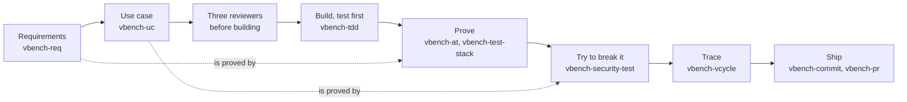

# The harness: an agentic V-cycle

This repo is built with a small harness that keeps AI-assisted work on a traceable path from a requirement to a proved,
reviewed, shipped use case. It is made of **standards** (what good looks like), **tools** (scripts that check, with no
model), **skills** (procedures a person runs in the chat) and **agents** (workers with one narrow job). One rule holds
it together:

> **Tools and tests decide. Agents advise. People approve.**

A verdict (pass, fail, "is this traced") always comes from a script or a test that gives the same answer every run. An
agent reads, reasons and reports, and never gates. A person stamps, freezes, accepts and decides.

## Inspired by ASPICE and AUTOSAR, not conforming to either

- **From Automotive SPICE** we take the shape of the process: a left arm that specifies, a vertex that builds, a right
  arm that proves what the left arm said, support processes around it (review, configuration, change), and
  bidirectional traceability between the levels. Process names are from memory and no conformance is claimed. The
  mapping is written once, in [skills-and-agents.md](standards/skills-and-agents.md).
- **From AUTOSAR** we take the architecture of the harness itself: layers, components that talk only through declared
  interfaces, and configuration kept apart from the parts. No part knows how another is built; it knows what it reads,
  what it writes and who it hands off to.

## The layers

| Layer | What it is here | Where |
|---|---|---|
| Standards | what good looks like: naming, use case and requirement form, diagrams, security checklists, ADRs, decisions | `.claude/skills/_vbench/standards/`, `docs/standards/`, `docs/adr/`, `docs/domain/decisions.md` |
| Configuration | the one file that adapts the harness to a project: areas, stacks, where tests live | `vbench.json` |
| Tools | deterministic scripts; no model, same answer every run | `req_tool.py`, `uc_tool.py`, `at_tool.py`, `vcycle.py`, `scripts/check.sh`, `scripts/test-stack.sh` |
| Components | skills and agents, each with one job and a declared hand-off | `.claude/skills/vbench-*`, `.claude/agents/` |
| Learning | term cards that explain an idea next to the real code that uses it, checked so they cannot rot, and a record of what the learner has met | `docs/learn/terms/`, `vbench-explain` |
| Application | the product being built | `apps/api`, `apps/web`, `keycloak-config` |

## The interfaces

Components do not call each other's internals. They meet at a small set of contracts, all plain files:

| Contract | Form | Used by |
|---|---|---|
| Ids | `UC-A1`, `FR-1`, `NFR-1`, `AC-1`, `RULE-A6`, `OBJ-A1`; append only, a retired id is never reused | every skill |
| Test tags | `@pytest.mark.ac("AC-n")`, `Verifies AC-n`, `Realises UC-x` | `at_tool`, `vcycle`, the TDD agents |
| Review stamps | a hash recorded by a person when they have read a link | `uc_tool stamp`, `at_tool stamp`, `vcycle` |
| Security Notes | a criterion whose Notes start `security SEC-…` | `vbench-security-test`, `vcycle` Security row |
| Machine output | `vcycle.py --json`, `uc_tool` and `at_tool` reports | CI, the status card |
| Report shape | finding, why it matters, up to three options, "Advisory only" | the reviewers and the tester |

## One use case through the V

| Step | Who does it | What decides | The person's part |
|---|---|---|---|
| Write the requirement and its criteria | `vbench-req` with `req_tool` | `req_tool validate` | accepts or changes each row |
| Write the use case | `vbench-uc` with `uc_tool` | `uc_tool validate` | accepts the analysis, then freezes and stamps it |
| Review before building | the spec challenger, design reviewer and security reviewer, together | nothing: they advise | settles every finding before the build starts |
| Build one slice | `vbench-tdd` runs red, green and refactor as three agents | the failing test, then the passing suite | reads and approves after each step |
| Link tests to criteria | `vbench-at` | `at_tool report` | stamps a test they have checked |
| Run the whole gate | `vbench-test-stack` on a fresh stack | the tests | reads the counts |
| Try to break it | `vbench-security-tester` through `vbench-security-test` | a reviewed test, never the agent | approves each proposed criterion |
| Trace | `vbench-vcycle` (and `vbench-status` as a table) | `vcycle.py` and its exit code | reads what it does not prove |
| Ship | `vbench-commit`, `vbench-pr` | `scripts/check.sh`, CI | merges |

## What each kind of part may do

| Kind | May | May not |
|---|---|---|
| Tool or test | decide pass or fail; read files; run a check | judge whether a test is good; edit what a person owns |
| Reviewer agent | read, challenge, teach, give options | edit anything, decide, gate |
| Tester agent | probe the local stack with development accounts | leave the machine, flood, edit, decide |
| TDD agent | write one test, or the minimum code, with a pause for review | edit the test in green, commit, touch the app's own database |
| Skill | run a procedure and stop for a yes | stamp or freeze to clear a warning, push, merge |
| Person | approve, stamp, freeze, decide scope, people, permissions and risk | |

## Adopting it in an existing project

Nothing is rewritten. `vbench-adopt` reads the project and proposes a `vbench.json`; each area is marked `legacy`,
`adopting` or `adopted`; new work follows the V one change at a time; an area is tightened when it is ready. The first
two steps work today (`adopt_tool.py discover`, and writing the config). Holding today's gaps as a baseline and reading
the adoption states in the trace are not built yet.

## Adding to the harness

1. Give the new skill or agent one job and a row in [skills-and-agents.md](standards/skills-and-agents.md): what it
   owns, what it does not, who it hands off to.
2. Add its commands and guards to [the ledger](standards/skills-and-agents-ledger.md).
3. Run `python3 -m unittest discover -s .claude/skills/_vbench -p "test_*.py"`. It fails if a row is missing, a hand-off
   names something that does not exist, or a ledger item has gone.
4. Write the decision in an ADR if it changes who owns what (see ADR 0017).

## What it does not do yet

The honest list is in [skills-and-agents.md](standards/skills-and-agents.md#known-gaps-against-the-yardstick-not-built).
The biggest: the trace says a test exists, not that it passed, and nothing stores pass or fail per criterion; a broken
check or a review finding has no log; there is no release or baseline step; integration is not tracked.
