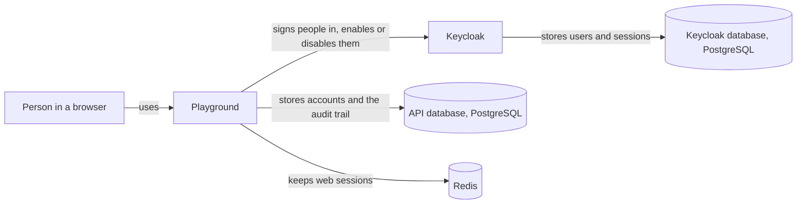
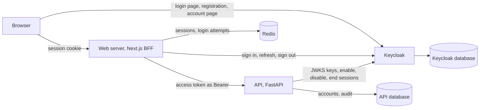
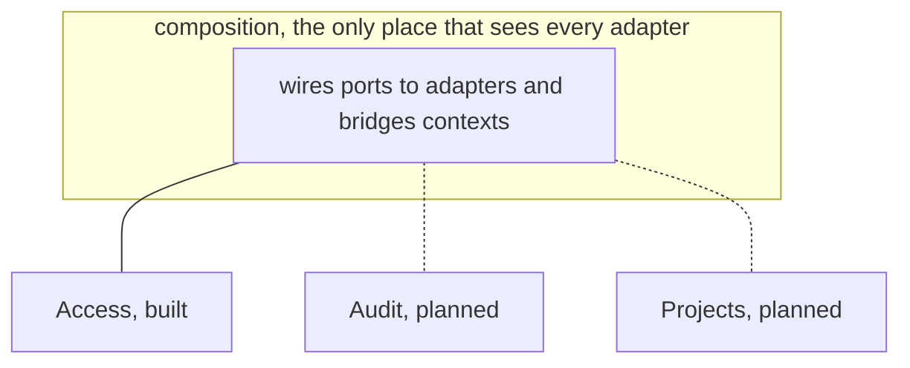
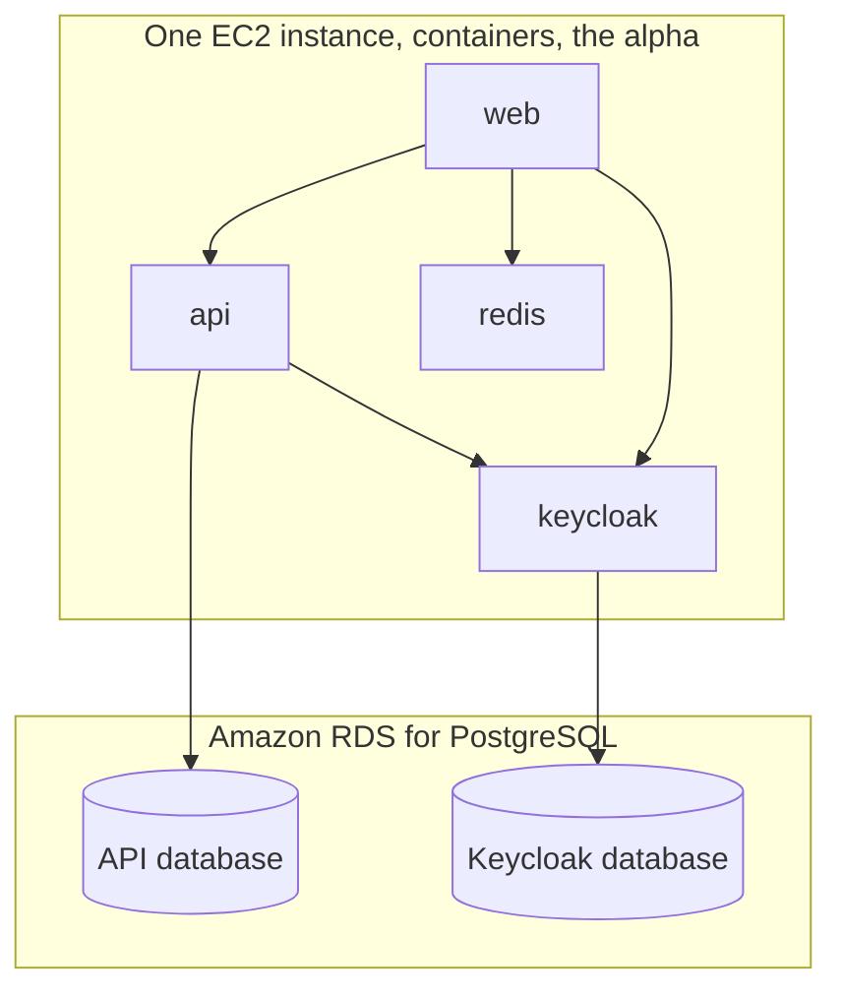

# Architecture overview

One page that shows how the parts fit, where each decision lives, and what is not built yet. It does not repeat the
decisions: each row points to its ADR (technical) or decision (owner). If this page and an ADR disagree, the ADR wins and
this page is wrong.

Status words: **built** (in the code and tested), **planned** (decided, not built), **open** (not decided).

## 1. The system and what is around it

Keycloak says who a person is. Playground says what they may do (decision 8). The browser never holds a token: it holds
one opaque session cookie.

## 2. The containers

The browser talks to Keycloak directly for the login, registration and account pages (decision 19), so Keycloak's public
address is the second public endpoint besides the web server. The API checks every token itself and only fetches Keycloak's
signing keys (JWKS); it reaches Keycloak on an internal address in Docker while tokens carry the public one as issuer.

| Container | Holds | Built |
|---|---|---|
| Web server (apps/web) | The OpenID Connect flow, the session, thin pages. Ports and adapters (ADR 0001). | built |
| API (apps/api) | The business rules per bounded context, the database, the Keycloak admin calls. | built |
| Keycloak | Passwords, login page, tokens, sessions. Realm in `keycloak-config/`. | built |
| Redis | Web sessions and login attempts, with expiry. Chosen by `REDIS_URL`; in memory otherwise. | built |
| API database | Accounts, audit entries. | built (tables made by `create_all`) |
| Keycloak database | Keycloak's own data. | built |

## 3. Inside the API: bounded contexts

Dotted lines are planned. **Today** the composition root wires Access's own audit adapter and table straight in, with no
bridge and no Audit context; the move to Audit (ADR 0003, 0011) and the ports Projects needs (`AccountStatus`, `AuditLog`
and a `People` port answered by Access) are not built.

Every context has the same folders (ADR 0010): `domain/`, `application/`, `adapters/inbound`, `adapters/outbound`. A
context never imports another. Where one needs the other, the composition root answers the port. This is enforced by
`tests/test_architecture.py`.

| Context | Owns | Status |
|---|---|---|
| Access (BC-ACCESS) | Accounts, roles, statuses, who may do what, Keycloak enable and disable | built |
| Audit (BC-AUDIT) | The append only audit trail and its read (decisions 21, 22; ADR 0011) | planned, UC-L1 |
| Projects (BC-PROJECTS) | Projects and members (decision 13) | planned, UC-P1 to UC-P3 |

## 4. Where it runs

Dashed in the target and not built: a proxy or load balancer in front (where TLS ends), a one-off migration container
with the owner database role, Secrets Manager, CloudWatch for stdout logs, and Keycloak running `start` instead of
`start-dev`. Redis is not persisted to disk (sessions hold tokens).

Decision 20: the alpha has no scalability. One set of containers on one EC2 instance, only the data on RDS, so one web
container. Moving later is configuration, not a rewrite (decision 4): Redis becomes ElastiCache, the containers move to
ECS Fargate, and a second web container needs a Redis lock around the token refresh (accepted risk until then).

### Who may reach what (proposed, not built, for the owner to accept)

| Container | Port | Reached by | Rule |
|---|---|---|---|
| Proxy or load balancer | 443 | the corporate network | The only public entry. Serves the web server and Keycloak's `/realms` (login, registration, account), and nothing else. |
| Web server | 3000 | the proxy | Not public itself. |
| API | 8000 | the web server only | Not public. Today compose publishes it on the host: that must not be copied to EC2. |
| Keycloak admin console | 8080 `/admin` | an administrator, by SSM port forwarding only | Not served by the proxy. The bootstrap `admin/admin` is replaced at setup. |
| Redis | 6379 | the web server only | Not published. No password today: either bound to the container network only, or AUTH enabled. |
| API and Keycloak databases | 5432 | the API and Keycloak only | RDS in a private subnet, TLS to RDS (sslmode), encrypted snapshots. |

TLS ends at the proxy. Hops inside the instance are plain HTTP in the alpha. Without TLS the `Secure` session cookie is not
sent, so the public address must be https. The test stack (`scripts/test-stack.sh`, project `playground-test`) uses the same
ports as the dev stack and the database `playground_test`; ADR 0011 adds a second database role to it.

## 5. Rules that cut across use cases

| Concern | Rule | Where | Status |
|---|---|---|---|
| Who decides | Keycloak authenticates; our database decides role and status on every request | decision 8 | built |
| Tokens | The browser never sees a token; the web server holds them | UC-A1, ADR 0001 | built |
| Hexagon | Domain imports nothing; outside things sit behind ports; one architecture test per side | ADR 0001, 0010 | built |
| Transactions | A deactivation commits before Keycloak is called; the last administrator is protected by a lock | ADR 0009 | built |
| Audit | Append only; the database refuses update, delete, truncate, alter, drop to the API role; the database sets the time | decisions 21, 22; ADR 0003, 0011 | planned |
| Caller | Projects receives a `Caller` and never looks a role up | ADR 0002 | planned |
| Migrations | Alembic in `apps/api/migrations/`, run as an owner role in a separate step; the API role owns nothing; `create_all` goes | ADR 0004, 0011, 0012 | planned |
| Logging | One JSON line per security event on stdout, for CloudWatch; never a token or a code | decision 17; its ADR is on branch `feat/UC-A1-basic-logging` and is renumbered 0013 when it merges | planned, built on a branch |
| Sessions | Redis with expiry; one web container for the alpha | decision 20 (the Redis adapter has no ADR of its own yet) | built |
| Secrets | Today: environment variables and development defaults. Target: Secrets Manager (decision 4), two database secrets (owner, API, ADR 0011) | decision 4; ADR 0011 | target decided, mechanism on EC2 open |
| Tests | Unit, use case, adapter, integration, acceptance on a fresh stack; the V cycle report; CI on GitHub Actions | ADR 0005, 0006, 0007, 0008 | built |

## 6. Open architectural questions

1. **Secrets.** Development defaults sit in compose files (the Keycloak client secret, the admin password). The production
   source (Secrets Manager or SSM Parameter Store) and how containers on EC2 read it are not decided.
2. **Who runs migrations on EC2.** A one-off container with the owner credentials is the plan; where those credentials
   are kept apart from the API's is not written down. Decided so far: the owner secret exists only in the migration container (ADR 0011 amendments, ADR 0012).
3. **TLS and the public address.** Keycloak in production mode needs a fixed hostname and TLS in front (a load balancer or
   a proxy on the instance), and the realm's redirect addresses are `localhost` today.
4. **Backups and upgrades.** Keycloak and Redis on EC2 are ours to patch and back up. Only RDS snapshots are covered.
5. **Retention of the audit trail** (decision 22 left it open).
   Also open: the admin console of Keycloak and its bootstrap admin (the rule above is proposed), Redis authentication, and how
   the EC2 instance is kept off the internet, which is the reason every "inside the corporate network" acceptance relies on.
6. **Evaluations and endpoints.** The brief keeps them as the structure of the product, but no requirement or use case
   exists for them, so they have no architectural home yet.

## 7. Where to read more

- Decisions of the owner: [domain/decisions.md](domain/decisions.md). Technical decisions: [adr/](adr/README.md).
- Contexts: [domain/contexts/](domain/contexts/). Diagrams per context: [domain/diagrams/](domain/diagrams/).
- Requirements and criteria: [requirements/](requirements/). Use cases: [usecases/](usecases/README.md).
- Security checklist and accepted risks: [standards/security-checklist.md](standards/security-checklist.md).
- How to run and test: [GETTING-STARTED.md](GETTING-STARTED.md), [TESTING.md](TESTING.md).
