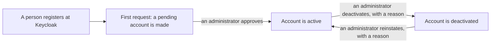
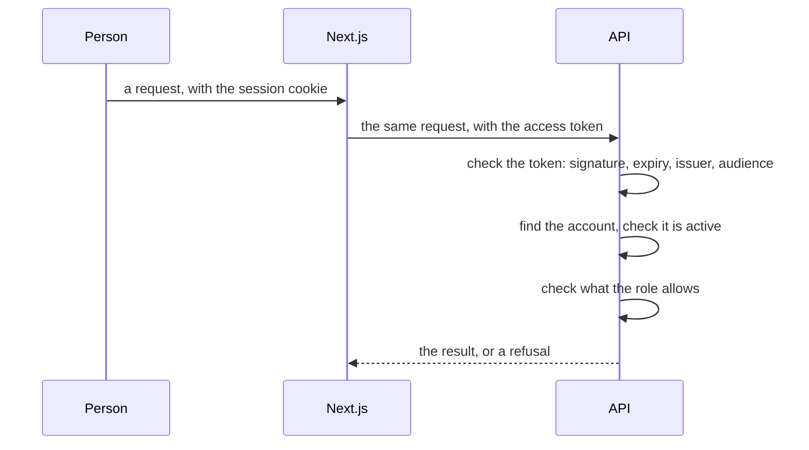

```yaml
id: BC-ACCESS
type: context
name: Access
status: draft
kind: generic
owns:
  - OBJ-A1
  - SET-1
  - SET-2
refers_to:
  - context: BC-PROJECTS
    how: answers one question for it, through the AccountStatus port (is this account active?)
  - context: BC-AUDIT
    how: writes every account change to it, through the AuditLog port, which the Audit context answers
ports_needed:
  - name: AccountRepository
    answers: Find, add, save and list accounts.
    status: built
  - name: AuditLog
    answers: Record who did what and why. Answered by the Audit context (BC-AUDIT), which owns the audit table and its read. Access no longer owns it.
    status: built, to be moved to the Audit context (decision 14)
  - name: IdentityProvider
    answers: Enable or disable a person in Keycloak, and end their sessions.
    status: built
must_not:
  - Store a password, issue a token or run a sign-in screen. Keycloak does that (decision 1).
  - Hold a person's project membership. That is Projects (decision 2).
  - Import another context. It answers through a port.
questions:
  - Who is this person, and what may they do?
  - Is this account active?
satisfies:
  - id: FR-1
  - id: FR-2
  - id: FR-3
  - id: FR-4
  - id: FR-5
  - id: NFR-1
```

# Access context

## What it is

It decides **who may use the product, and with what role**. Keycloak proves who a person is. Access keeps what Keycloak
cannot know: the person's **account**, its **role** (user or administrator) and its **status** (pending, active or
deactivated). Every change is written to the audit trail, which the Audit context (BC-AUDIT) keeps (decision 14).

Roles are kept in Playground, not in Keycloak. The token carries who the person is, and the account says what they hold.
This holds for any way of signing in: Keycloak's own login now, or a company single sign-on later only proves who the
person is, and no company group is mapped to a role. There are no project roles in the alpha (decision 13). A project membership is held by
[Projects](BC-PROJECTS.md).

## Its boundary

It owns the [account](../ontology/OBJ-A1-account.md), with its value sets
[roles](../ontology/SET-1-account-roles.md) and [statuses](../ontology/SET-2-account-statuses.md).

Other contexts refer to an account **by id** and ask it one question: *is this account active?* Project membership is
not kept here (decision 2).

## The life of an account



Registering is Keycloak's. Playground makes the account on the person's first request and keeps it **pending** until an
administrator approves (decision 2). The first administrator comes from setup.

## Who does what

| Keycloak | Playground (Access) |
| -------- | ------------------ |
| Holds the password and the sign-in | Holds the account, the role and the status |
| Signs the person in and out, and ends sessions | Checks the token, then finds the account, on every request |
| Can require a second factor for administrators | Decides what each role may do |
| Disables a person when told to | Tells it to, only with a reason and an audit entry sent to the Audit context |

## The rules it holds

- [RULE-A1](../ontology/RULE-A1-always-an-administrator.md) There is always an administrator.
- [RULE-A2](../ontology/RULE-A2-administrator-cannot-change-themselves.md) An administrator cannot change themselves.
- [RULE-A3](../ontology/RULE-A3-account-change-needs-a-reason.md) An account change needs a reason.
- [RULE-A4](../ontology/RULE-A4-deactivation-removes-nothing.md) Deactivation removes nothing.

## How a request is checked



The browser never talks to the API directly: the Next.js side holds the tokens. The account is read on every request,
so a deactivation does not wait for a token to expire. How the tokens, cookies and sessions work is in the
[auth study guide](../../AUTH-STUDY-GUIDE.md).

## The use cases

[UC-A1](../../usecases/UC-A1-sign-in.md) sign in, [UC-A2](../../usecases/UC-A2-sign-out.md) sign out,
[UC-A3](../../usecases/UC-A3-register-and-wait-for-approval.md) register and wait for approval,
[UC-A4](../../usecases/UC-A4-approve-deactivate-and-reinstate-an-account.md) approve, deactivate and reinstate,
[UC-A5](../../usecases/UC-A5-view-my-name-and-role.md) view my name and role,
[UC-A6](../../usecases/UC-A6-keep-the-session-alive.md) keep the session alive and
[UC-A7](../../usecases/UC-A7-sign-in-through-company-single-sign-on.md) company single sign-on.

## Open questions

For the product owner to decide.

1. Should an administrator need a second factor, set up in Keycloak?
2. Decided: the Keycloak single sign-on session lasts 30 minutes idle and 8 hours at most (as the build spec states). The web session ends with it.
3. Decided (decision 10): a person is matched by the Keycloak `sub`, never by email, which is an attribute. A new `sub`
   with a known email becomes a second pending account. If an administrator's action changes Keycloak but not our
   database: for a deactivation our database changes first and the deactivation stands if Keycloak fails, for a
   reinstatement Keycloak is first, so a failure locks the person out.

## Built, and not yet built

Built: the account with its role and status, the pending account made on first sight, approve, deactivate and reinstate
with a reason, the audit entry, the token check, and the session kept on the web server.

Planned for the alpha, not built (decision 14): the audit entry moving to the Audit context (BC-AUDIT), a deactivation
that changes our database first and then Keycloak, and the last administrator check and the change as one step.

Not built: time-limited access and company single sign-on. Promoting and demoting an account is built, in the API and
in the admin accounts table (UC-A4).
