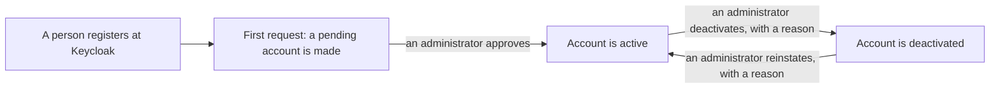
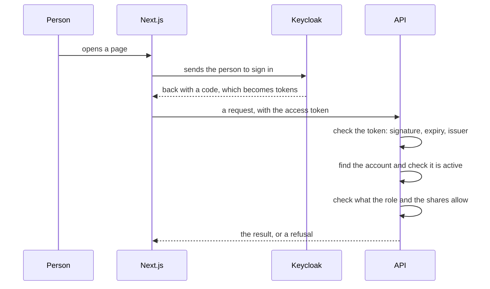

```yaml
id: BC-ACCESS
type: context
name: Access
status: draft
kind: generic
owns:
  - OBJ-A1
  - OBJ-A2
  - OBJ-A3
  - SET-5
  - SET-6
  - SET-7
refers_to:
  - context: BC-EVALUATIONS
    how: by evaluation id, for who started it and for shares
  - context: BC-ENDPOINTS
    how: by endpoint id, so a person sees only their own
ports_needed:
  - name: IdentityProvider
    answers: Who is calling? Create a person in Keycloak with a temporary password, disable or enable them, end their sessions.
    status: planned
  - name: AuditLog
    answers: Record who did what and why.
    status: planned
must_not:
  - Store a password, issue a token or run a sign-in screen. Keycloak does that (decision 23).
  - Let an administrator read anyone else's work. They see it only if it is shared with them.
  - Import another context. It asks through a port, and the others ask it who may do what.
questions:
  - Who is this person, and what may they do?
  - Is this account active?
  - What can this person see?
  - How many account requests are waiting?
satisfies: []
```

# Access context

## What it is

It decides **who may do what**. A generic context: any product needs it. Keycloak proves who a person is. Access keeps
what Keycloak cannot know: the person's **account**, their **role**, the **requests** for accounts, and the **shares**
that let someone read another person's evaluation.

This page describes the model proposed for the first release, where people only sign in and start evaluations. Roles are
kept in Playground and not in Keycloak. The token carries who the person is, and the account says what role they hold.
This amends decision 23, which put roles in the token.

The same holds for any way of signing in. Keycloak's own login now, or a company single sign-on later, only proves who
the person is. It never decides a role, and no company group is mapped to one. The application decides who is a user
or an administrator. A project manager is a role inside one project, held by [Projects](BC-PROJECTS.md).

## Its boundary

It owns the [account](../ontology/OBJ-A1-account.md), the [account request](../ontology/OBJ-A2-account-request.md)
and the [share](../ontology/OBJ-A3-share.md), with their value sets
[roles](../ontology/SET-5-account-roles.md), [statuses](../ontology/SET-6-account-statuses.md) and
[request statuses](../ontology/SET-7-request-statuses.md).

Project membership is not kept here: it moved to [Projects](BC-PROJECTS.md) (decision 24).

Other contexts refer to an account **by id** and ask it one question through the `Permissions` port: *may this person
do this?* They never look at a role name. See [the context map](../context-map.md).

## The life of an account



Registering is Keycloak's. Playground makes the account on the person's first request and keeps it **pending** until an
administrator approves (decision 24). The account request queue and shares in the earlier model
([OBJ-A2](../ontology/OBJ-A2-account-request.md), [OBJ-A3](../ontology/OBJ-A3-share.md)) are not part of the first release.

## Who does what

| Keycloak | Playground (Access) |
| -------- | ------------------ |
| Holds the password and the sign-in | Holds the account, the role and the status. Changes a role only with its rules and an audit entry |
| Signs the person in and out, and ends sessions | Checks the token, then finds the account, on every request |
| Can require a second factor for administrators | Decides what each role may do (the permission matrix) |
| Is run by the people who run Keycloak, who also make the very first administrator | Makes every later account and every promotion |

## The rules it holds

- [RULE-A1](../ontology/RULE-A1-always-an-administrator.md) There is always an administrator.
- [RULE-A2](../ontology/RULE-A2-administrator-cannot-change-themselves.md) An administrator cannot change themselves.
- [RULE-A3](../ontology/RULE-A3-account-change-needs-a-reason.md) An account change needs a reason.
- [RULE-A4](../ontology/RULE-A4-see-own-work-and-what-is-shared.md) A person sees their own work and what is shared.
- [RULE-A5](../ontology/RULE-A5-only-the-starter-shares-and-only-to-read.md) Only the person who started an evaluation
  shares it, and only to read.
- [RULE-A6](../ontology/RULE-A6-deactivation-removes-nothing.md) Deactivation removes nothing.

## How a request is checked (design intent, nothing built yet)



The browser never talks to the API directly: the Next.js side holds the tokens. The account is read on every request,
so a deactivation does not wait for a token to expire.

## Tokens and sessions

Three different things, and we build only two.

| Thing | Who | What it is |
| ----- | --- | ---------- |
| Proof of identity | Keycloak | A signed token that says who the person is |
| The session | The Next.js layer | An opaque cookie. The browser never sees a token. The Next.js side keeps the Keycloak tokens. |
| Authorization | The API | On every request: check the token, find the account, read its role and status, check the permission |

**Playground issues no tokens of its own.** MK3 did, with its own access and refresh tokens and a list of live refresh
tokens in Redis. That was most of its sign-in code, and it caused a real fault: people were logged out when they switched
windows, because of a race when a refresh token was replaced. A token that carries a role also goes stale until it
expires. Here the role is read from the account on every request, so a change takes effect at once.

A machine that needs to call the API, for example a script starting an evaluation (FR-107), will need a credential of
its own later. That could be a personal API key kept hashed in our database. It is not part of the first release.

A person who signs in correctly but has **no account** is refused and offered the account request page. Signing in
proves who they are, not that they may use the product.

## What came from MK3's authentication

MK3 built its own sign-in: 1,473 lines in `app/iam` for passwords, two kinds of token, a list of live refresh tokens,
cookies and an approval screen. Keycloak takes most of it. What MK3 had, and where it went:

| MK3 | Now |
| --- | --- |
| Log in, log out, refresh the token, sign up, SSO | Keycloak |
| View profile | The token, and Keycloak's own account page |
| Approve, deactivate and reinstate an account | Our screens, calling Keycloak to disable or enable |
| The administrator as a role on an ordinary account | Kept: [SET-5](../ontology/SET-5-account-roles.md) |
| Only a command on the server could make an administrator | Dropped: an administrator promotes with a reason, which is audited |
| A deactivated person is refused on their next request, and nothing is deleted | Kept: [RULE-A6](../ontology/RULE-A6-deactivation-removes-nothing.md) |

## The use cases

[UC-A2](../../usecases/UC-A2-approve-deactivate-and-reinstate-an-account.md) approves, deactivates and reinstates an account.
Sign in, sign out, refreshing the session, viewing the profile, registering and company single sign-on are
[UC-A10](../../usecases/UC-A10-sign-in.md) to [UC-A15](../../usecases/UC-A15-sign-in-through-company-single-sign-on.md),
where Keycloak does most of the work. UC-A3 (membership) is retired and is
[UC-P4](../../usecases/UC-P4-manage-project-members.md) in [Projects](BC-PROJECTS.md). UC-A4 (time-limited access) is
undecided.

## Questions this context leaves open

1. Decision 23 says roles are Keycloak roles in the token. It is amended to say roles are kept in Playground. A
   promotion or a demotion takes effect at the person's next request, because the account is read on every request.
2. The public request page does not check the email. Should it limit how fast one place can send requests?
3. Should an administrator need a second factor, set up in Keycloak?
4. How long does a session last? The proposal is 30 minutes idle and 8 hours at most.
5. Time-limited access for an administrator is not part of the first release.
6. How is an account matched to a person who signs in for the first time through a company login: by email, and then
   the Keycloak id is stored? An account made by an administrator is created in Keycloak and in Playground together,
   so what happens if only one of the two succeeds?

## Built, and not yet built

Built in Phase 1 (`apps/api`, `apps/web`, `keycloak-config`): the account with its role and status, the pending account made on
first sight, approve, deactivate and reinstate with a reason, the audit entry, the token check, and the session kept on
the web server. The `IdentityProvider` port has a Keycloak adapter.

Not built: the account request queue and shares from the earlier model, an administrator promoting or demoting with a
reason, time-limited access, and company single sign-on.
