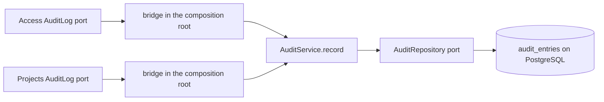

```yaml
id: BC-AUDIT
type: context
name: Audit
status: draft
kind: generic
owns:
  - OBJ-L1
refers_to:
  - context: BC-ACCESS
    how: by account id only. Access writes its account changes here, through its own AuditLog port and a bridge in the composition root
  - context: BC-PROJECTS
    how: by project id and account id only. Projects writes its project changes here, through its own AuditLog port and a bridge in the composition root
ports_needed:
  - name: AuditRepository
    answers: Add an audit entry, and list the entries newest first.
    status: planned
    # Built today as Access's AuditLog port (record, entries and set_outcome). Audit's own port has add and list_newest_first only (decision 21, ADR 0011).
must_not:
  - Write to Access or Projects data. It holds entries about them, and never changes an account, a role, a project or a member.
  - Import another context. Access and Projects call it through the bridge that the composition root wires, never directly.
  - Decide who may read it by looking up a role. It takes a Caller (decision 14) and checks is administrator.
  - Edit or delete an entry. The trail is append only.
questions:
  - What happened, who did it, to what, and why?
  - Which account and project changes has an administrator made?
satisfies:
  - id: FR-13
  - id: FR-17
```

# Audit context

## What it is

It keeps **the trail of what people changed**: every change to an account (UC-A4) and every project creation and
member change (UC-P1, UC-P2), in one place, so an administrator reads one list and not two. It was part of Access
until decision 14 made it a context of its own, so that Projects can write to the same trail without Access and
Projects knowing about each other.

It records. It never decides. Whether a change is allowed is for Access or Projects. By the time Audit is called, the
change is done.

## Its boundary

It owns the audit table (`audit_entries`) and the administrator's read of it. It does not own any account or project
data and never writes to it.

An **entry** holds:

- the **actor**: who did it (account id, with their name and email at that time), or nobody for a system action such as the
  first administrator being set up,
- the **action**: what was done (approve, deactivate, reinstate, promote, demote, register, create a project, add a
  member, remove a member),
- the **kind** of thing it was done to (account or project) and **which one** (its id, with its name, and its email for an
  account, at that time),
- the **people involved** (the details): for a project creation the first members, for a member change the member,
- the **reason**, where one was asked (RULE-A3 for accounts, not for adding a member, decision 14),
- the **time**.

Names and emails are **copied into the entry when the event happens**. A person can rename themselves in Keycloak, and
a trail that follows the live name would rewrite history. Copying also keeps an entry readable if an account or a
project is later changed. This is a plain correction of the present name, not a history of names: the trail says
what the person was called when it happened.

## How the other contexts write to it

Access and Projects each keep their **own `AuditLog` port**, written in their own words. The **composition root**
(`composition/`, which builds the adapter on the request's one session) wires, for each, a small adapter (a bridge) that turns the call into Audit's use case,
`AuditService.record(entry)`. So Access never imports Audit and Projects never imports Audit, and the architecture
test that forbids one context importing another still holds. Only the composition root knows all three.



The administrator reads the trail through `AuditService.read(caller)`. A person who is not an administrator is refused.

## Who does what

| Access and Projects | Audit |
| ------------------- | ----- |
| Decide whether a change is allowed, and make it | Records that it happened, once it has |
| Know the people and the project by id, and look up their names | Keeps the names and emails as they were |
| Ask for a reason where the rule needs one | Stores the reason, and never asks for one |
| Say who is the caller | Lets only an administrator read |

## What an entry records

The people and things are copied in with their name and email at that moment. "Names come from" says who supplies them. The database sets the time.

| Action | Actor | Target | Details | Reason | Names come from |
|---|---|---|---|---|---|
| register | nobody (the person had no account yet, AC-83) | the new account | none | none | Access, from the token claims, in its AuditLog call |
| approve | the administrator | the account | none | none | Access, from the two accounts it holds |
| deactivate | the administrator | the account | outcome: done | required | Access |
| deactivate, Keycloak not updated | the administrator | the account | outcome: keycloak_not_updated (a second entry, the first is not touched) | the same reason | Access |
| retry (deactivate again, AC-77) | the administrator | the account | outcome: done, or a second entry keycloak_not_updated | the reason given for the retry | Access |
| reinstate | the administrator | the account | none | required | Access |
| promote | the administrator | the account | none | required | Access |
| demote | the administrator | the account | none | required | Access |
| project created (later, UC-P1) | the administrator | the project (id, name) | the first members | none | Projects, through its `People` port answered by Access in composition/ |
| member added or removed (later, UC-P2) | the administrator | the project | the member | none | Projects, through its `People` port answered by Access in composition/ |

A reason is plain text of at most 500 characters, with no control or bidirectional override characters (AC-81).
The entries hold personal data (names, emails, free text reasons). The alpha keeps them, and retention is open (decision 22).

## The rules it holds

Its own, on [OBJ-L1](../ontology/OBJ-L1-audit-entry.md): [RULE-L1](../ontology/RULE-L1-an-audit-entry-is-never-changed-or-deleted.md) an entry is never changed or deleted, [RULE-L2](../ontology/RULE-L2-the-database-sets-the-time-of-an-entry.md) the database sets the time, [RULE-L3](../ontology/RULE-L3-each-fact-is-its-own-entry.md) each fact is its own entry, and [RULE-L4](../ontology/RULE-L4-people-are-shown-as-they-were-at-the-time.md) people are shown as they were at the time. The rules that make an entry necessary are in the other contexts:
[RULE-A3](../ontology/RULE-A3-account-change-needs-a-reason.md) an account change needs a reason, and decision 14 for
project member changes (an audit entry, no reason).

## The use cases

[UC-L1](../../usecases/UC-L1-view-the-audit-trail.md) view the audit trail. Writing an entry is not a use case of its own: it is the
last step of UC-A4, UC-P1 and UC-P2.

## Open questions

For the product owner to decide.

1. Decided (decisions 21 and 22): only changes that happened are recorded. A read and a refused change write a line to the security log (decision 17), never an entry. A repeated deactivation is a change and adds an entry. `register` writes an entry.
2. How long is the trail kept, personal data included, and can it be exported? Open. The alpha keeps every entry and its names, emails and reasons (decision 22). Revisit before the beta.
3. Should the list be paged and filtered by kind, person or date? Today it returns everything, newest first.

## Built, and not yet built

Built: the audit table, written by Access for each account change (`audit_entries`: time, actor id, action, target id,
reason), and the administrator's `GET /audit` and the table on the admin accounts page. They still live in
Access's code.

Not built: the Audit context itself (its own folder, `AuditService`, `AuditRepository`, `SqlAudit`), the `kind` and
`details` columns and the names and emails at the time, the bridges, the Alembic migration that moves the table
(decision 14), project entries, and the read that returns both kinds.
