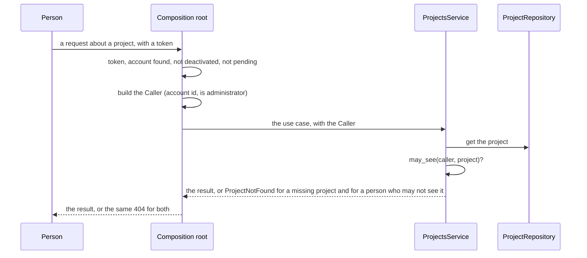

```yaml
id: BC-PROJECTS
type: context
name: Projects
status: draft
kind: supporting
owns:
  - OBJ-P1
  - OBJ-P2
  # SET-3 is parked by decision 13: it is not used in the alpha, and returns with role based access
refers_to:
  - context: BC-ACCESS
    how: by account id, for who a member is
  - context: BC-AUDIT
    how: Projects writes its audit entries through the AuditLog port, and composition/ wires a bridge from the port to Audit (decision 14)
  - context: BC-FILES
    how: files carry a project id and are shown to a project's members and administrators only
  - context: BC-ENDPOINTS
    how: endpoints carry a project id and are shown to a project's members and administrators only
  - context: BC-EVALUATIONS
    how: evaluations carry a project id and are shown to a project's members and administrators only
ports_needed:
  - name: ProjectRepository
    answers: Find a project, list the projects of a member or all of them, and save a project with its memberships (the row difference). Answered by the SQL adapter (SqlProjects) over the API database, Amazon RDS on AWS.
    status: planned
  - name: AccountStatus
    answers: Of this set of account ids, which are active? An id that is unknown or not active is left out (`active_among`). Answered by a new Access use case, through a bridge wired in composition/.
    status: planned
  - name: People
    answers: Of this set of account ids, the name and email of each (`names_of`). An unknown id is left out. Answered by Access, through a bridge wired in composition/. Used for the names in the audit entry, as they are at that time.
    status: planned
  - name: AuditLog
    answers: Record who created a project or changed its members, with the project id and name and the people's names. Answered by Audit (BC-AUDIT), through a bridge wired in composition/, on the same session.
    status: planned
  - name: SecurityLog
    answers: One line for each refusal and each read (AC-48, ADR 0013). Answered by the JSON stdout adapter built in composition/.
    status: planned
must_not:
  - Hold an account, a role of an account, a password or a token. That is Access (decision 1).
  - Show a project's contents or members to anyone but its members and the administrators (RULE-P4).
  - Look a role up. It receives the Caller, which says who is asking and whether they are an administrator, and never asks Access for either.
  - Import another context. It asks through a port, and the others ask it who is a member.
questions:
  - Who is in this project?
  - May this person see inside this project?
  - Which projects does this person belong to?
satisfies:
  - id: FR-7
  - id: FR-9
  - id: FR-12
  - id: FR-13
  - id: FR-16
```

# Projects context

## What it is

It decides **who is in a project, and so who may see inside it**. Access says who a person is and whether their
account is active. Projects says which projects they belong to. Files, endpoints and evaluations live
in other contexts. They carry a project id, and they are shown only to the project's members.

Decision 2 moved membership here from Access: it is an invariant of the project, so it belongs with the project.
Decision 13 sets the alpha scope: no project roles, and the administrator is a superuser.

## Its boundary

It owns the [project](../ontology/OBJ-P1-project.md) and the [membership](../ontology/OBJ-P2-membership.md). A
membership has no role in the alpha.

It refers to an account **by id**. It asks Access two questions, each through its own port. `AccountStatus`: *of these
account ids, which are active?* `People`: *of these account ids, what are their names and emails?*, for the audit entry.
It asks for a set at once, so a project created with several first members costs one question of each. It never reads
an account role, and it never looks at what Keycloak holds.

Its class diagram is [projects-design.puml](../diagrams/projects-design.puml) (planned, not built): the aggregate
`Project` with its `Membership`s (an entity inside it), the value objects `ProjectName` and `Caller`, the rules in
`ProjectRules`, `ProjectsService`, the five ports and their adapters and bridges. The folders follow ADR 0010 and the
choices are in ADR 0015.

A project carries the empty placeholder lists `files`, `endpoints` and `evaluations` in the API from the start
(decision 23). They have no requirement behind them yet.

## What an administrator and a member can do

- An **administrator** is an account role and a superuser. Only an administrator creates a project, naming its first
  members (active accounts only), and only an administrator adds or removes members. They see inside every project.
- A **member** is a user who is in the project. Every member has the same rights: they run evaluations. A member
  does not change the members.
- Anyone else gets the same answer as for a project that does not exist.
- A project may be empty.

## The Caller

Projects never looks a role up. The guard chain runs the same full check as for the account
routes (the token, the account found, not deactivated, not pending), and only then `projects_caller(account)` builds a `Caller`: a value
object holding the **account id** and **is administrator**. Every use case of `ProjectsService` takes it as its
first argument. So a project route never sees a token, and a rule never reads a role from anywhere but the Caller.

## The rules it holds

- [RULE-P4](../ontology/RULE-P4-only-members-see-inside-a-project.md) Members and administrators see inside a
  project. Anyone else gets the same answer as for a project that does not exist. In code: `may_see(caller, project)`.
- Only an administrator changes members (decision 13). In code: `may_change_members(caller)`.
- A project name is trimmed and has 1 to 100 characters (`ProjectName`).
- A first member named at creation gets `added by` the creator. An administrator may name themselves, and a project may
  have none.

## Parked by decision 13

Beta, not current. Not in the alpha, kept with their text, and brought back with role based access in a later release: the project
roles [SET-3](../ontology/SET-3-project-roles.md) (manager and engineer), [RULE-P1](../ontology/RULE-P1-a-project-always-has-a-manager.md)
(a project always has a manager), [RULE-P2](../ontology/RULE-P2-an-administrator-never-joins-by-role.md) (an
administrator never joins by role) and [RULE-P3](../ontology/RULE-P3-administrator-only-restores-a-manager.md) (an
administrator only restores a manager), and the role of a membership.

## How a request for a project is checked



The account is read on every request (by the check) and the membership is read on every request (by the use case).
Removing a member, or deactivating an account, takes effect at their very next request.

## The bridge to Access and Audit

Projects imports neither. `AccountStatus`, `People` and `AuditLog` are ports of Projects, and `composition/` wires a
bridge to each: one that asks a new Access use case which accounts are active, one that asks Access for names and
emails, and one that writes to Audit ([BC-AUDIT](BC-AUDIT.md), decision 14). The architecture test forbids a context importing another. The audit write
and the change to the project share one database session, so they are one transaction.

## What each refusal answers (decision 14)

Authorisation is checked before the input is validated. Every project route first passes the full check, with the
answers of the account routes (401 for a bad token, 403 for an account that is deactivated or pending).

| Case | Error | Answer |
|---|---|---|
| A project that does not exist, or a person who is neither a member nor an administrator, on any project route | `ProjectNotFound` | 404, the same for both |
| A member who is not an administrator adds or removes a member | `NotAnAdministrator` | 403 |
| A user who is not an administrator creates a project | `NotAnAdministrator` | 403 |
| A first member or an added person who is inactive or unknown | `MemberNotEligible` | 422, one answer for every reason |
| A name that is empty, only spaces, or over 100 characters | `InvalidProjectName` | 422 |
| A person to remove who is not a member (an administrator asks) | `MemberNotEligible` | 422, decided by decision 23, nothing is written |
| A body with a field the route does not know, or more than 50 first members | `InvalidRequest` | 422 |

## The use cases

[UC-P1](../../usecases/UC-P1-create-a-project.md) creates a project.
[UC-P2](../../usecases/UC-P2-manage-project-members.md) manages its members.
[UC-P3](../../usecases/UC-P3-list-and-open-a-project.md) lists and opens projects.

## Questions this context leaves open

1. Must a project name be unique, and within what?
2. Does removing a member need a reason?
3. What does a removed member's earlier work show as: their name, or "removed member"?
4. Can a project be archived or deleted?

Decided: an administrator who removes a person who is not a member gets `MemberNotEligible`, 422, and nothing is
written (decision 23). A refused creation or change leaves no audit entry: it writes a line to the security log
(decision 22). The project list and the member lists have no paging in the alpha (decision 23).

## Not yet built

All of it. The API has no project code (`apps/api/app/projects/` does not exist), and the class diagram is planned. Files, endpoints and evaluations are not yet ontology objects here, so they
are empty placeholder lists in the first cut (decision 23). The build order is in ADR 0015: the Access question first, then the migration, then UC-P1, UC-P3 and UC-P2.
