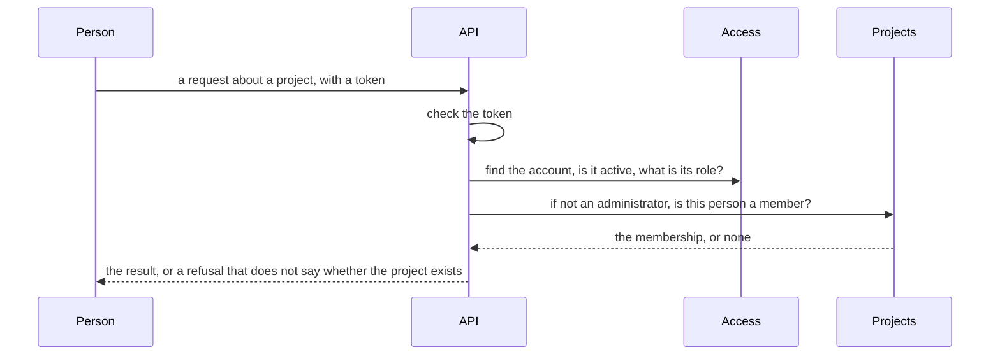

```yaml
id: BC-PROJECTS
type: context
name: Projects
status: draft
kind: supporting
owns:
  - OBJ-P1
  - OBJ-P2
  # SET-3 is parked by decision 13: it is not used in the alpha, and returns with role based access
refers_to:
  - context: BC-ACCESS
    how: by account id, for who a member is
  - context: BC-FILES
    how: files carry a project id and are shown to a project's members and administrators only
  - context: BC-ENDPOINTS
    how: endpoints carry a project id and are shown to a project's members and administrators only
  - context: BC-EVALUATIONS
    how: evaluations carry a project id and are shown to a project's members and administrators only
ports_needed:
  - name: AccountStatus
    answers: Does this account exist, and is it active? Answered by Access.
    status: planned
  - name: AuditLog
    answers: Record who created a project or changed its members.
    status: planned
must_not:
  - Hold an account, a role of an account, a password or a token. That is Access (decision 1).
  - Show a project's contents or members to anyone but its members and the administrators (RULE-P4).
  - Import another context. It asks through a port, and the others ask it who is a member.
questions:
  - Who is in this project?
  - May this person see inside this project?
  - Which projects does this person belong to?
satisfies:
  - id: FR-7
  - id: FR-9
  - id: FR-12
  - id: FR-13
```

# Projects context

## What it is

It decides **who is in a project, and so who may see inside it**. Access says who a person is and whether their
account is active. Projects says which projects they belong to. Files, endpoints and evaluations live
in other contexts. They carry a project id, and they are shown only to the project's members.

Decision 2 moved membership here from Access: it is an invariant of the project, so it belongs with the project.
Decision 13 sets the alpha scope: no project roles, and the administrator is a superuser.

## Its boundary

It owns the [project](../ontology/OBJ-P1-project.md) and the [membership](../ontology/OBJ-P2-membership.md). A
membership has no role in the alpha.

It refers to an account **by id**. It asks Access one question through the `AccountStatus` port: *is this account
active?* It never reads an account role, and it never looks at what Keycloak holds.

## What an administrator and a member can do

- An **administrator** is an account role and a superuser. Only an administrator creates a project, naming its first
  members (active accounts only), and only an administrator adds or removes members. They see inside every project.
- A **member** is a user who is in the project. Every member has the same rights: they run evaluations. A member
  does not change the members.
- Anyone else gets the same answer as for a project that does not exist.
- A project may be empty.

## The rules it holds

- [RULE-P4](../ontology/RULE-P4-only-members-see-inside-a-project.md) Members and administrators see inside a
  project. Anyone else gets the same answer as for a project that does not exist.

## Parked by decision 13

Not in the alpha, kept with their text, and brought back with role based access in a later release: the project
roles [SET-3](../ontology/SET-3-project-roles.md) (manager and engineer), [RULE-P1](../ontology/RULE-P1-a-project-always-has-a-manager.md)
(a project always has a manager), [RULE-P2](../ontology/RULE-P2-an-administrator-never-joins-by-role.md) (an
administrator never joins by role) and [RULE-P3](../ontology/RULE-P3-administrator-only-restores-a-manager.md) (an
administrator only restores a manager), and the role of a membership.

## How a request for a project is checked



The account and the membership are read on every request. Removing a member, or deactivating an account, takes
effect at their very next request.

## The use cases

[UC-P1](../../usecases/UC-P1-create-a-project.md) creates a project.
[UC-P2](../../usecases/UC-P2-manage-project-members.md) manages its members.

## Questions this context leaves open

1. Must a project name be unique, and within what?
2. Does removing a member need a reason?
3. What does a removed member's earlier work show as: their name, or "removed member"?
4. Can a project be archived or deleted?

## Not yet built

All of it. The API has no project code. Files, endpoints and evaluations are not yet ontology objects here, so they
are empty containers in the first cut.
