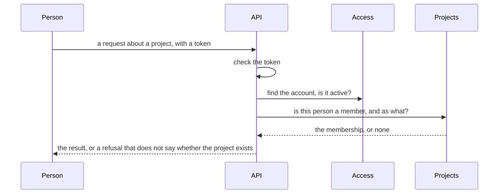

```yaml
id: BC-PROJECTS
type: context
name: Projects
status: draft
kind: supporting
owns:
  - OBJ-P1
  - OBJ-P2
  - SET-8
refers_to:
  - context: BC-ACCESS
    how: by account id, for who a member is
  - context: BC-FILES
    how: files carry a project id and are shown to a project's members only
  - context: BC-ENDPOINTS
    how: endpoints carry a project id and are shown to a project's members only
  - context: BC-EVALUATIONS
    how: evaluations carry a project id and are shown to a project's members only
ports_needed:
  - name: AccountStatus
    answers: Does this account exist, and is it active? Answered by Access.
    status: planned
  - name: AuditLog
    answers: Record who created a project or changed its members.
    status: planned
must_not:
  - Hold an account, a role of an account, a password or a token. That is Access (decision 23).
  - Let an administrator into a project's contents because they are an administrator (RULE-P2).
  - Import another context. It asks through a port, and the others ask it who is a member.
questions:
  - Who is in this project, and as what?
  - Does this project have a manager?
  - May this person see inside this project?
  - Which projects does this person belong to?
satisfies:
  - id: FR-129
  - id: FR-130
  - id: FR-131
  - id: FR-132
  - id: FR-133
  - id: FR-134
  - id: FR-135
  - id: FR-136
  - id: FR-137
  - id: FR-138
  - id: FR-139
  - id: FR-140
  - id: FR-141
  - id: FR-142
  - id: FR-143
```

# Projects context

## What it is

It decides **who is in a project, and so who may see inside it**. Access says who a person is and whether their
account is active. Projects says which projects they belong to and as what. Files, endpoints and evaluations live
in other contexts. They carry a project id, and they are shown only to the project's members.

Decision 24 moved membership here from Access: it is an invariant of the project (a project always has a manager),
so it belongs with the project.

## Its boundary

It owns the [project](../ontology/OBJ-P1-project.md) and the [membership](../ontology/OBJ-P2-membership.md), with the
value set [project roles](../ontology/SET-8-project-roles.md).

It refers to an account **by id**. It asks Access one question through the `AccountStatus` port: *is this account
active?* It never reads an account role, and it never looks at what Keycloak holds.

## What an administrator and a project manager can do

- A **project manager** is a role inside one project. A manager adds and removes members and changes their roles.
  A person who manages at least one project can create more projects, and becomes the manager of each.
- An **administrator** is an account role. They create a project by naming its manager, and they see every
  project's name and members. They do not join a project, and see no contents.
  If every manager of a project has a deactivated account, they may add a new manager, and nothing else.
- An **engineer** works with the project's contents, as a manager does. The two differ only in who keeps the members.

## The rules it holds

- [RULE-P1](../ontology/RULE-P1-a-project-always-has-a-manager.md) A project always has a manager.
- [RULE-P2](../ontology/RULE-P2-an-administrator-never-joins-by-role.md) An administrator never joins a project by
  being an administrator.
- [RULE-P3](../ontology/RULE-P3-administrator-only-restores-a-manager.md) An administrator only restores a manager.
- [RULE-P4](../ontology/RULE-P4-only-members-see-inside-a-project.md) Only members see inside a project.

## How a request for a project is checked



The account and the membership are read on every request. Removing a member, or deactivating an account, takes
effect at their very next request.

## The use cases

[UC-P1](../../usecases/UC-P1-create-a-project.md) creates a project.
[UC-P4](../../usecases/UC-P4-manage-project-members.md) manages its members.

## Questions this context leaves open

1. Must a project name be unique, and within what?
2. Can a manager name a second manager when creating a project?
3. Does removing a member need a reason?
4. What does a removed member's earlier work show as: their name, or "removed member"?
5. Can a project be archived or deleted?

## Not yet built

All of it. The API has no project code. Files, endpoints and evaluations are not yet ontology objects here, so they
are empty containers in the first cut.
