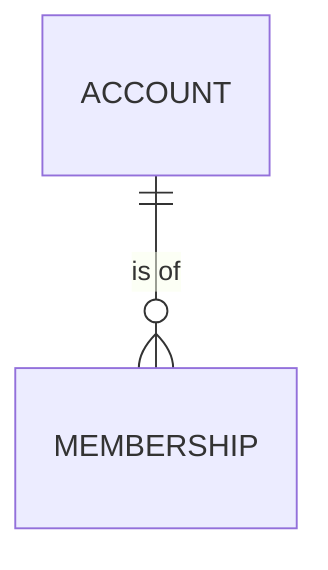
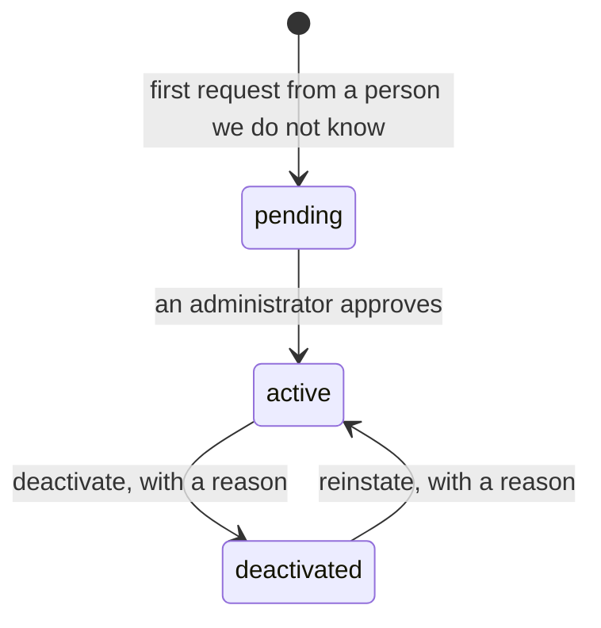

```yaml
id: OBJ-A1
type: object
name: Account
status: draft
context: BC-ACCESS
id_prefix: ACCT-
comment: >-
  A person who can use Playground. Keycloak proves who they are. The account says what they may do.
properties:
  - name: name
    type: text
    required: true
    comment: How the person is shown to others, for example in a project's member list. Copied from Keycloak at each sign-in.
  - name: email
    type: text
    required: true
    comment: Also the person's sign-in name in Keycloak. Copied from Keycloak at each sign-in. One account for each email.
  - name: identity
    type: text
    required: true
    comment: The person's id in Keycloak. The stable link between the person and the account. Never shown, and never replaced by the email, which can change.
  - name: role
    type: SET-1
    required: true
    comment: User or administrator. Kept here, not in Keycloak.
  - name: status
    type: SET-2
    required: true
    comment: Pending, active or deactivated. A new account starts pending, except the first administrator.
  - name: created
    type: date
    required: true
  - name: created by
    type: Account
    required: false
    comment: The administrator who created it. Empty for the first administrator, who comes from the Keycloak setup.
links:
  - domain: Membership
    property: is of
    range: Account
    cardinality: one-to-many
    kind: reference
    defined_in: OBJ-P2
rules:
  - RULE-A1
  - RULE-A2
  - RULE-A3
  - RULE-A4
questions:
  - Who is this person, and what may they do?
  - Is this account active?
  - Which accounts are administrators?
  - Who created this account, and when?
satisfies:
  - id: FR-3
  - id: FR-4
```

# Account

## What it is

An account is **a person's place in Playground**. When a person signs in, Keycloak proves who they are. The
account says what they may do once they are in: their role, user or administrator, and whether they are
pending, active or deactivated. It holds no password.

## Why it exists

Keycloak does not know our rules. It cannot say who administers this product, or which projects a person belongs to. So Playground keeps one small record for each person, tied to their identity in Keycloak.

## Where each fact of a person is kept

| Fact | Kept by |
| ---- | ------- |
| Password, sign-in, second factor, sessions | Keycloak. We never hold them. |
| Name and email | Keycloak first. Our account keeps a copy, refreshed at each sign-in. |
| The link between the two | The Keycloak id, never the email |
| Role, status, who created the account, when | Playground, in this account |
| Which projects they are in, and as what | Playground, in Projects, by account id |

If Keycloak is ever replaced, only the link and one adapter change. The people and their history stay ours. Because personal data sits in two places, a request to erase a person has to cover both.

## In context



Other contexts refer to an account **by id**: a project's membership says who is in it.

## How an account changes



An account is never deleted. It is made the first time Playground sees a person who has signed in at Keycloak,
and it waits as **pending** until an administrator approves it (decision 2). Registering is Keycloak's. The first
administrator comes from the setup and starts active.

## Good to know

- The **role lives here**, not in Keycloak. Promotion, its reason and its guardrails are in one place, and nobody can
  change a role behind the product's back ([RULE-A1](RULE-A1-always-an-administrator.md),
  [RULE-A2](RULE-A2-administrator-cannot-change-themselves.md),
  [RULE-A3](RULE-A3-account-change-needs-a-reason.md)). It is still role based access: what each role may do is
  our permission matrix.
- An **administrator is also a user**. They keep the accounts, and they see no project's contents by role
  ([RULE-P2](RULE-P2-an-administrator-never-joins-by-role.md)).
- The value sets are [SET-1](SET-1-account-roles.md) and [SET-2](SET-2-account-statuses.md).
- Which projects a person is in, and as what, is not kept here. [Projects](../contexts/BC-PROJECTS.md) holds the
  [membership](OBJ-P2-membership.md) and asks Access only whether the account is active.
