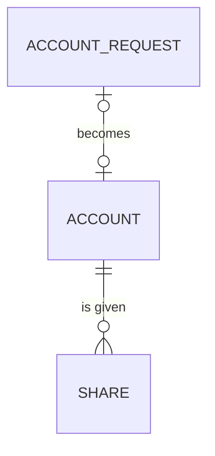
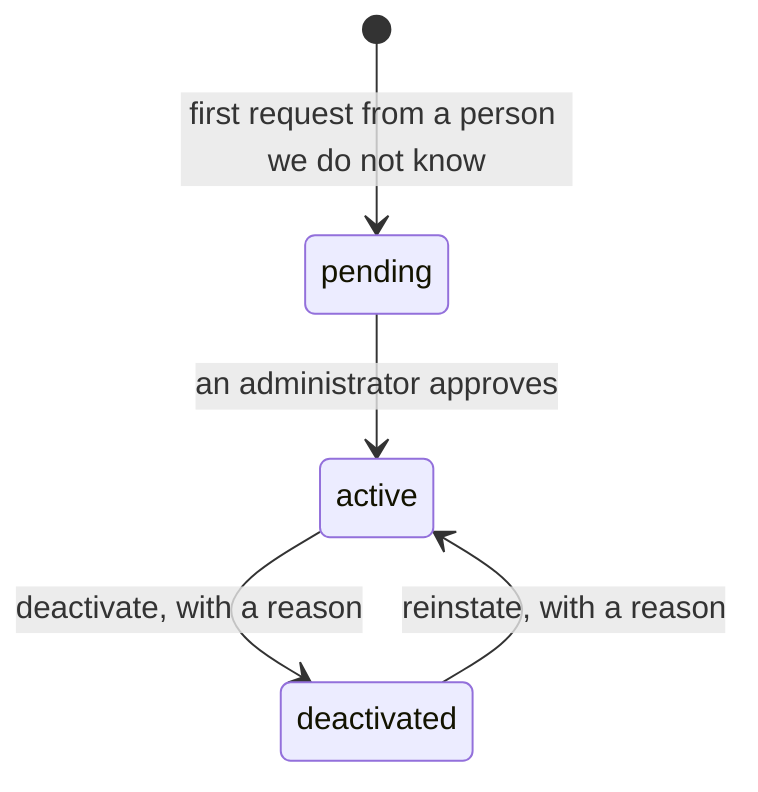

```yaml
id: OBJ-A1
type: object
name: Account
status: draft
context: BC-ACCESS
id_prefix: ACCT-
comment: >-
  A person who can use Playground. Keycloak proves who they are. The account says what they may do.
properties:
  - name: name
    type: text
    required: true
    comment: How the person is shown to others, for example when something is shared with them. Copied from Keycloak at each sign-in.
  - name: email
    type: text
    required: true
    comment: Also the person's sign-in name in Keycloak. Copied from Keycloak at each sign-in. One account for each email.
  - name: identity
    type: text
    required: true
    comment: The person's id in Keycloak. The stable link between the person and the account. Never shown, and never replaced by the email, which can change.
  - name: role
    type: SET-5
    required: true
    comment: User or administrator. Kept here, not in Keycloak.
  - name: status
    type: SET-6
    required: true
    comment: Pending, active or deactivated. A new account starts pending, except the first administrator.
  - name: created
    type: date
    required: true
  - name: created by
    type: Account
    required: false
    comment: The administrator who created it. Empty for the first administrator, who comes from the Keycloak setup.
links:
  - domain: Membership
    property: is of
    range: Account
    cardinality: one-to-many
    kind: reference
    defined_in: OBJ-P2
  - domain: Account request
    property: becomes
    range: Account
    cardinality: zero-or-one
    kind: reference
    defined_in: OBJ-A2
  - domain: Share
    property: is given to
    range: Account
    cardinality: many-to-one
    kind: reference
    defined_in: OBJ-A3
rules:
  - RULE-A1
  - RULE-A2
  - RULE-A3
  - RULE-A4
  - RULE-A6
questions:
  - Who is this person, and what may they do?
  - Is this account active?
  - Which accounts are administrators?
  - Who created this account, and when?
satisfies: []
```

# Account

## What it is

An account is **a person's place in Playground**. When a person signs in, Keycloak proves who they are. The
account says what they may do once they are in: their role, user or administrator, and whether they are
pending, active or deactivated. It holds no password.

## Why it exists

Keycloak does not know our rules. It cannot say who administers this product, whose work a person may see, or what
has been shared with them. So Playground keeps one small record for each person, tied to their identity in Keycloak.

## Where each fact of a person is kept

| Fact | Kept by |
| ---- | ------- |
| Password, sign-in, second factor, sessions | Keycloak. We never hold them. |
| Name and email | Keycloak first. Our account keeps a copy, refreshed at each sign-in. |
| The link between the two | The Keycloak id, never the email |
| Role, status, who created the account, when | Playground, in this account |
| Their endpoints, evaluations and shares | Playground, in other contexts, by account id |

If Keycloak is ever replaced, only the link and one adapter change. The people, their history and what was shared with
them stay ours. Because personal data sits in two places, a request to erase a person has to cover both.

## In context



Other contexts refer to an account **by id**: an evaluation says who started it, and a share says who it is
given to and by.

## How an account changes



An account is never deleted. It is made the first time Playground sees a person who has signed in at Keycloak,
and it waits as **pending** until an administrator approves it (decision 24). Registering is Keycloak's. The first
administrator comes from the setup and starts active.

## Good to know

- The **role lives here**, not in Keycloak. Promotion, its reason and its guardrails are in one place, and nobody can
  change a role behind the product's back ([RULE-A1](RULE-A1-always-an-administrator.md),
  [RULE-A2](RULE-A2-administrator-cannot-change-themselves.md),
  [RULE-A3](RULE-A3-account-change-needs-a-reason.md)). It is still role based access: what each role may do is
  our permission matrix.
- An **administrator is also a user**. They start evaluations like anyone, and they also keep the accounts.
  They read none of anyone else's work ([RULE-A4](RULE-A4-see-own-work-and-what-is-shared.md)).
- The value sets are [SET-5](SET-5-account-roles.md) and [SET-6](SET-6-account-statuses.md).
- Which projects a person is in, and as what, is not kept here. [Projects](../contexts/BC-PROJECTS.md) holds the
  [membership](OBJ-P2-membership.md) and asks Access only whether the account is active.

## Not yet a file

[OBJ-V1](OBJ-V1-evaluation.md) says an evaluation is started by a `Person`. That should now say Account.
