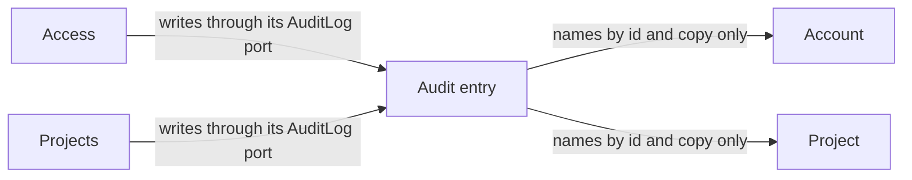

```yaml
id: OBJ-L1
type: object
name: Audit entry
status: draft
context: BC-AUDIT
id_prefix: AUD-
comment: >-
  One line of the trail of what people changed: who did what, to which account or project, why, and when, as they were at the time. Once written it is never changed.
properties:
  - name: time
    type: date
    required: true
    comment: When it happened. Set by the database when the entry is added, never by the API (RULE-L2).
  - name: actor
    type: text
    required: false
    comment: Who did it, as the account id with the name and email they had at the time. Empty for a system action, such as the registration of a new person or the first administrator being set up.
  - name: action
    type: text
    required: true
    comment: What was done, for example register, approve, deactivate, reinstate, promote, demote, create a project, add a member, remove a member.
  - name: kind
    type: text
    required: true
    comment: What kind of thing it was done to, account or project.
  - name: target
    type: text
    required: true
    comment: The account or project it was done to, as its id with its name, and for an account its email, as they were at the time.
  - name: details
    type: text
    required: false
    many: true
    comment: The people involved, as they were at the time. For a project creation the first members, for a member change the member.
  - name: reason
    type: text
    required: false
    comment: Why, where one was asked (RULE-A3). Plain text of at most 500 characters. Audit stores it and never asks for one.
  - name: outcome
    type: text
    required: false
    comment: A note on how it ended, for example done or keycloak_not_updated for a deactivation. A failed Keycloak call adds a second entry and does not change the first (RULE-L3).
links: []
rules:
  - RULE-L1
  - RULE-L2
  - RULE-L3
  - RULE-L4
questions:
  - What happened, who did it, to what, and why?
  - Which account and project changes has an administrator made?
  - What was a person called when they did it?
satisfies:
  - id: FR-17
```

# Audit entry

## What it is

An audit entry is **one fact that happened**, written down at the moment it happened. The administrator reads the entries as one list, newest first (UC-L1).

## Why it exists

A committee or an auditor must be able to ask who changed what, and why, and trust the answer. That works only if an entry cannot be rewritten, shows the time the database saw, and shows people as they were then.

## In context



An entry holds the ids and a **copy** of the names and emails. It has no link that follows the live account or project, on purpose (RULE-L4).

## How it behaves

It has no states. It is added once and read many times. There is no update and no delete (RULE-L1).

## Example

On 20 November at 10:42 (database time) an administrator, then called "Asha Rao", deactivated the account of "Ben Lee" with the reason "Left the team". Asha is later renamed. The entry still says "Asha Rao".

## Not yet a file

Retention and export of the trail are open (decision 22). The entry is not yet built as its own context (BC-AUDIT is partly built inside Access, decision 14).
