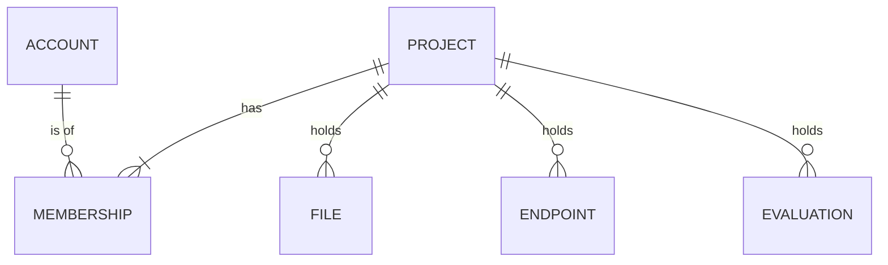
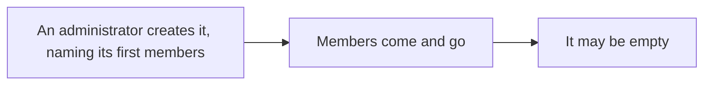

```yaml
id: OBJ-P1
type: object
name: Project
status: draft
context: BC-PROJECTS
id_prefix: none  # the id is a random UUID, not a counter with a prefix
comment: >-
  A place where a team keeps its files, endpoints and evaluations. Only its members and the administrators can see inside it.
properties:
  - name: id
    type: text
    required: true
    comment: A random UUID made in the domain, so an id reveals nothing about how many projects exist or in what order (ADR 0015).
  - name: name
    type: text
    required: true
    comment: Trimmed, 1 to 100 Unicode characters, no control or bidirectional override character (AC-12, AC-91). Open whether it must be unique, and within what.
  - name: created
    type: date
    required: true
  - name: created by
    type: Account
    required: true
    comment: The administrator who created it. Not a member because of that, unless they named themselves.
links:
  - domain: Membership
    property: is in
    range: Project
    cardinality: many-to-one
    kind: part
    defined_in: OBJ-P2
rules:
  - RULE-P4
questions:
  - Who is in this project?
  - May this person see inside this project?
  - Which projects does this person belong to?
satisfies:
  - id: FR-7
  - id: FR-12
  - id: FR-13
```

# Project

## What it is

A project is **the unit that people share work in**. It holds files, endpoints and evaluations, which other
contexts keep and which refer to the project by its id. The project itself holds only its name and who is in
it.

## Why it exists

Access says who a person is and whether their account is active. It cannot say which work they may see. That is
a fact about a project and its members, so Projects owns it, and asks Access only whether an account is active.

## In context



Files, endpoints and evaluations are other contexts. They carry a project id and nothing else about it.

## How it behaves



- Only an **administrator** creates a project, naming its first members (active accounts only). The administrator
  is a superuser: they see inside every project and are not made a member by creating it.
- Only an administrator adds and removes members ([UC-P2](../../usecases/UC-P2-manage-project-members.md)).
- A project may be empty: it has no manager, because there are no project roles in the alpha (decision 13).

## Good to know

- The contents and the members of a project are shown to its members and to administrators. Anyone else gets the
  same answer as for a project that does not exist ([RULE-P4](RULE-P4-only-members-see-inside-a-project.md)).
- Every member has the same rights in it: they run evaluations.
- Nothing is deleted when a member is removed or an account is deactivated.
- Beta, not current (parked by decision 13): the project manager and the rule that a project always has one
  ([RULE-P1](RULE-P1-a-project-always-has-a-manager.md)). They return with role based access in a later release.

## Not yet a file

Files, endpoints and evaluations are not ontology objects in this repo yet. In the first cut they are **empty
placeholder lists** (`files`, `endpoints`, `evaluations`) that the API carries from the start, so they are part of the
contract (decision 23). No requirement is behind them yet: a functional requirement for them is a later extension,
written when those contexts are built. Whether a project can be archived or deleted is not decided.
