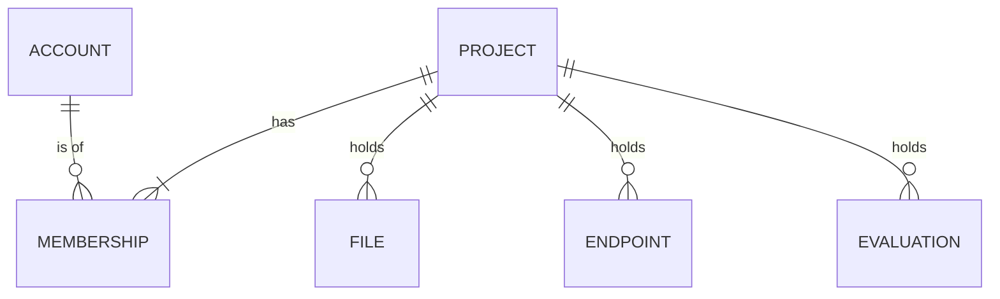
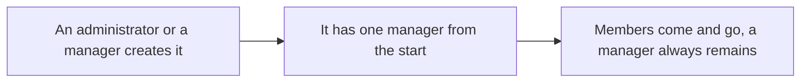

```yaml
id: OBJ-P1
type: object
name: Project
status: draft
context: BC-PROJECTS
id_prefix: PROJ-
comment: >-
  A place where a team keeps its files, endpoints and evaluations. Only its members can see inside it.
properties:
  - name: name
    type: text
    required: true
    comment: Not empty. Open whether it must be unique, and within what.
  - name: created
    type: date
    required: true
  - name: created by
    type: Account
    required: true
    comment: The administrator or project manager who created it. Not a member because of that, unless they are its manager.
links:
  - domain: Membership
    property: is in
    range: Project
    cardinality: many-to-one
    kind: part
    defined_in: OBJ-P2
rules:
  - RULE-P1
  - RULE-P4
questions:
  - Who is in this project, and who manages it?
  - Does this project still have a manager?
  - May this person see inside this project?
  - Which projects does this person belong to?
satisfies:
  - id: FR-129
  - id: FR-140
  - id: FR-141
  - id: FR-143
```

# Project

## What it is

A project is **the unit that people share work in**. It holds files, endpoints and evaluations, which other
contexts keep and which refer to the project by its id. The project itself holds only its name and who is in
it.

## Why it exists

Access says who a person is and whether their account is active. It cannot say which work they may see. That is
a fact about a project and its members, so Projects owns it, and asks Access only whether an account is active.

## In context



Files, endpoints and evaluations are other contexts. They carry a project id and nothing else about it.

## How it behaves



- An **administrator** creates a project by naming its manager. They do not join it, so they see its name and
  members and never its contents.
- A **project manager** who creates a project becomes its manager.
- Members are added and removed by a manager ([UC-P4](../../usecases/UC-P4-manage-project-members.md)).

## Good to know

- The contents of a project are shown only to its members, and a person who is not a member cannot tell whether
  a project exists ([RULE-P4](RULE-P4-only-members-see-inside-a-project.md)).
- A project always has a manager ([RULE-P1](RULE-P1-a-project-always-has-a-manager.md)).
- Nothing is deleted when a member is removed or an account is deactivated.

## Not yet a file

Files, endpoints and evaluations are not ontology objects in this repo yet. In the first cut they are empty
containers. Whether a project can be archived or deleted is not decided.
