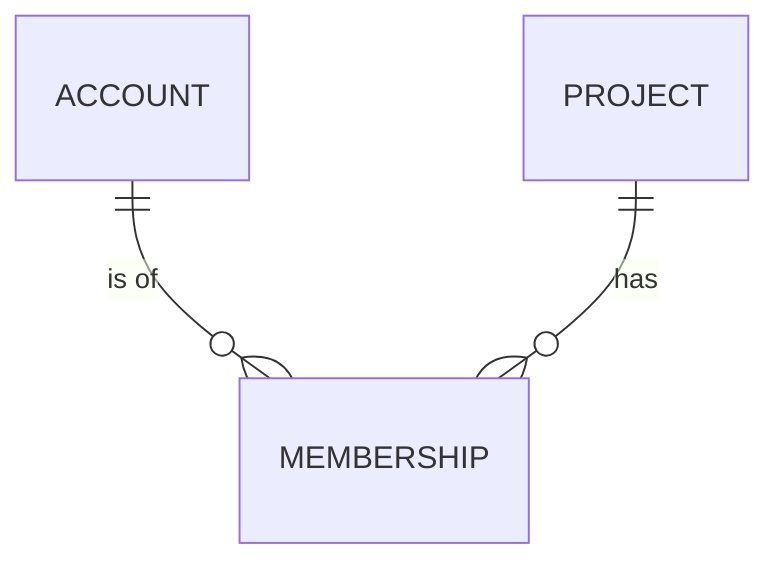
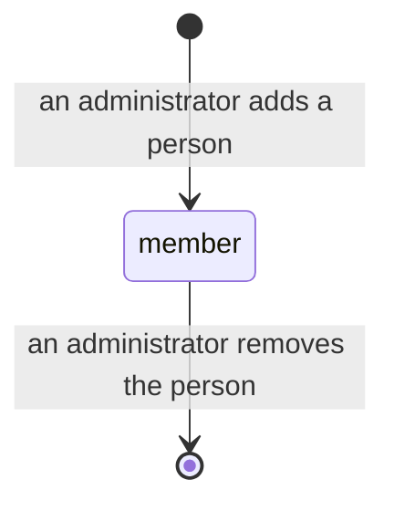

```yaml
id: OBJ-P2
type: object
name: Membership
status: draft
context: BC-PROJECTS
id_prefix: none
comment: >-
  The fact that an account is in a project. It has no role in the alpha: every member has the same rights. It
  exists as an object because it has a history of its own (when it was added, and by whom).
properties:
  # Parked by decision 13: project role (SET-3, manager or engineer), brought back with role based access.
  - name: added
    type: date
    required: true
  - name: added by
    type: Account
    required: true
    comment: The administrator who added them. For a first member named when the project is created it is the creator (decision 14).
links:
  - domain: Membership
    property: is of
    range: Account
    cardinality: many-to-one
    kind: reference
  - domain: Membership
    property: is in
    range: Project
    cardinality: many-to-one
    kind: part
rules: []
questions:
  - Is this person a member of this project?
  - Who added them?
  - Which projects does this person belong to?
satisfies:
  - id: FR-7
  - id: FR-9
  - id: FR-12
  - id: FR-13
```

# Membership

## What it is

A membership says **this account is in this project**. In the alpha it has no role: every member has the same
rights, which is to run evaluations (decision 13). It is the way a user gets to see inside a project (an
administrator sees inside every project without one). Access holds the account. Projects holds the membership, and
refers to the account by id.

The **project role** it used to carry (project manager or engineer, [SET-3](SET-3-project-roles.md)) is parked, not
deleted. It returns with role based access in a later release.

## Why it exists

One person can be in many projects and a project has many people. That is a relation with facts of its own (when,
and by whom), so it is an object and not a property of either side.

## In context



## How it changes



The change takes effect at the person's next request, because membership is read on every request.

## Good to know

- Only an **active** account can be added. An account that is pending, deactivated or unknown cannot.
- A member whose account is later deactivated **stays** on the project, and nothing they made is removed. They
  are refused at the account check, so they cannot use it.
- Every addition and removal is audited: who, what and who it affected.
- Only an administrator adds or removes members. A project may end up with none.
- Parked by decision 13: the role, [RULE-P1](RULE-P1-a-project-always-has-a-manager.md),
  [RULE-P2](RULE-P2-an-administrator-never-joins-by-role.md) and
  [RULE-P3](RULE-P3-administrator-only-restores-a-manager.md).

## Not yet a file

Removing or adding a member needs no reason, only an audit entry (decision 14). For a first member named when a project is created, `added by` is the creator.
