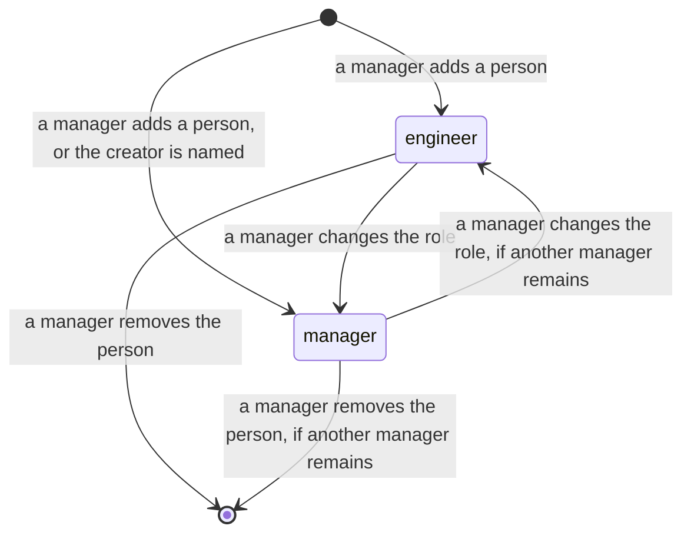

```yaml
id: OBJ-P2
type: object
name: Membership
status: draft
context: BC-PROJECTS
id_prefix: none
comment: >-
  The fact that an account is in a project, with a project role. It exists as an object because it has a
  role and a history of its own.
properties:
  - name: project role
    type: SET-8
    required: true
    comment: Project manager or engineer.
  - name: added
    type: date
    required: true
  - name: added by
    type: Account
    required: true
    comment: The project manager who added them, or the administrator who restored a manager.
links:
  - domain: Membership
    property: is of
    range: Account
    cardinality: many-to-one
    kind: reference
  - domain: Membership
    property: is in
    range: Project
    cardinality: many-to-one
    kind: part
rules:
  - RULE-P1
  - RULE-P2
  - RULE-P3
questions:
  - Is this person a member of this project, and as what?
  - Who added them?
  - Which projects does this person manage?
satisfies:
  - id: FR-132
  - id: FR-133
  - id: FR-134
  - id: FR-136
  - id: FR-137
  - id: FR-138
  - id: FR-139
  - id: FR-143
```

# Membership

## What it is

A membership says **this account is in this project, as a project manager or an engineer**. It is the only way a
person gets to see inside a project. Access holds the account. Projects holds the membership, and refers to the
account by id.

## Why it exists

Two people can be in the same project with different roles, and one person can be in many projects. That is a
relation with an attribute of its own (the role), so it is an object and not a property of either side.

## In context


## How it changes



The change takes effect at the person's next request, because membership is read on every request.

## Good to know

- Only an **active** account can be added. An account that is pending, deactivated or unknown cannot.
- A member whose account is later deactivated **stays** on the project, and nothing they made is removed. They
  are refused at the account check, so they cannot use it. They still count as a manager for the last-manager
  rule while they are on the project.
- Every addition, change and removal is audited: who, what and who it affected.
- An administrator is never a member because they are an administrator
  ([RULE-P2](RULE-P2-an-administrator-never-joins-by-role.md)), and may only restore a manager
  ([RULE-P3](RULE-P3-administrator-only-restores-a-manager.md)).

## Not yet a file

Whether removing a member needs a reason is open. For now only an audit entry is required.
