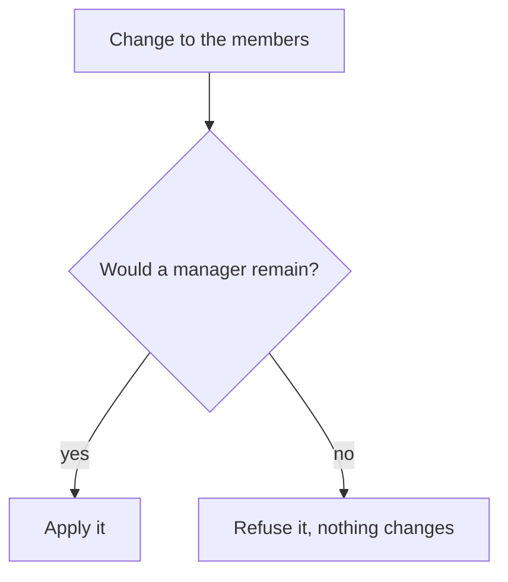

```yaml
id: RULE-P1
type: rule
name: A project always has a manager
status: draft
object: OBJ-P1
statement: "A change that would leave a project with no project manager is refused."
proved_by: []
satisfies:
  - id: FR-130
  - id: FR-132
  - id: FR-135
```

# A project always has a manager

## In plain words

Every project has at least one project manager, from the moment it is created. The last manager cannot be removed
or changed to an engineer.

## Why it exists

Only a manager adds or removes members. A project with no manager could never gain a member again, and nobody
else (not even an administrator) could get into it. This is the same guardrail as
[RULE-A1](RULE-A1-always-an-administrator.md), at the level of a project.

## Allowed and refused

Allowed: removing or demoting a manager when another manager remains.

Refused: removing or demoting the **only** manager, by anyone.

A manager whose account is deactivated is still a member, so they still count here. If no manager has an active
account, an administrator can add a new one ([RULE-P3](RULE-P3-administrator-only-restores-a-manager.md)). The
old manager is not removed.

## How it works



## How a test would prove it

- Given a project with one manager, when anyone tries to remove them, then it is refused (AC-99).
- Given a project with one manager, when anyone tries to change them to an engineer, then it is refused (AC-100).
- Given an administrator creates a project and names no manager, then it is refused (AC-91).

## Related

The protected object is the [project](OBJ-P1-project.md). The [membership](OBJ-P2-membership.md) is what changes.
