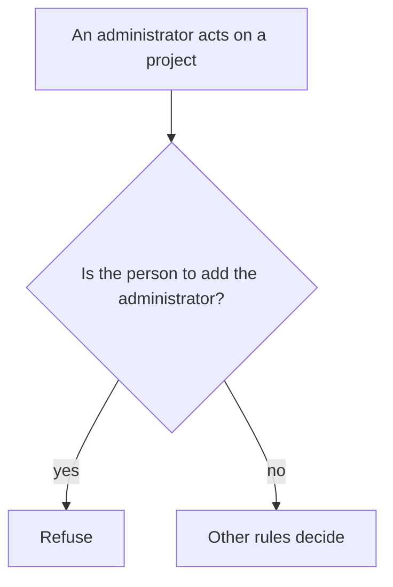

```yaml
id: RULE-P2
type: rule
name: An administrator never joins a project by being an administrator
status: draft  # parked by decision 13: not in the alpha
object: OBJ-P2
statement: "An administrator does not become a member of a project they create, and cannot add themselves to one."
proved_by: []
satisfies:
  - id: FR-8
```

> Beta, not current. Parked by decision 13: not in the alpha. Brought back with role based access in a later release.

# An administrator never joins a project by being an administrator

## In plain words

An administrator manages access. They are not given a way into a project's work. They do not join a project they
create, and they cannot add themselves to any project.

## Why it exists

Administrators have high level access: they decide who has an account and who manages a project, but they do not
see inside what teams are working on. If an administrator could add themselves, that boundary would hold only as
long as nobody used the button. The rule closes it, in the same spirit as
[RULE-A2](RULE-A2-administrator-cannot-change-themselves.md).

## Allowed and refused

Allowed: an administrator creates a project and names someone else as its manager. A project manager adds an
administrator like any other person, as a member, if the administrator has an active account.

Refused: an administrator adds themselves, as a manager or as an engineer, and an administrator creating a
project is never made a member of it.

## How it works



## How a test would prove it

- Given a project created by an administrator, when that administrator asks for its contents, then it is
  refused (AC-14).
- Given an administrator and a project with no active manager, when they try to add themselves, then it is
  refused (AC-15).

## Related

[RULE-P3](RULE-P3-administrator-only-restores-a-manager.md) says what an administrator may do to members.
The protected object is the [membership](OBJ-P2-membership.md).
