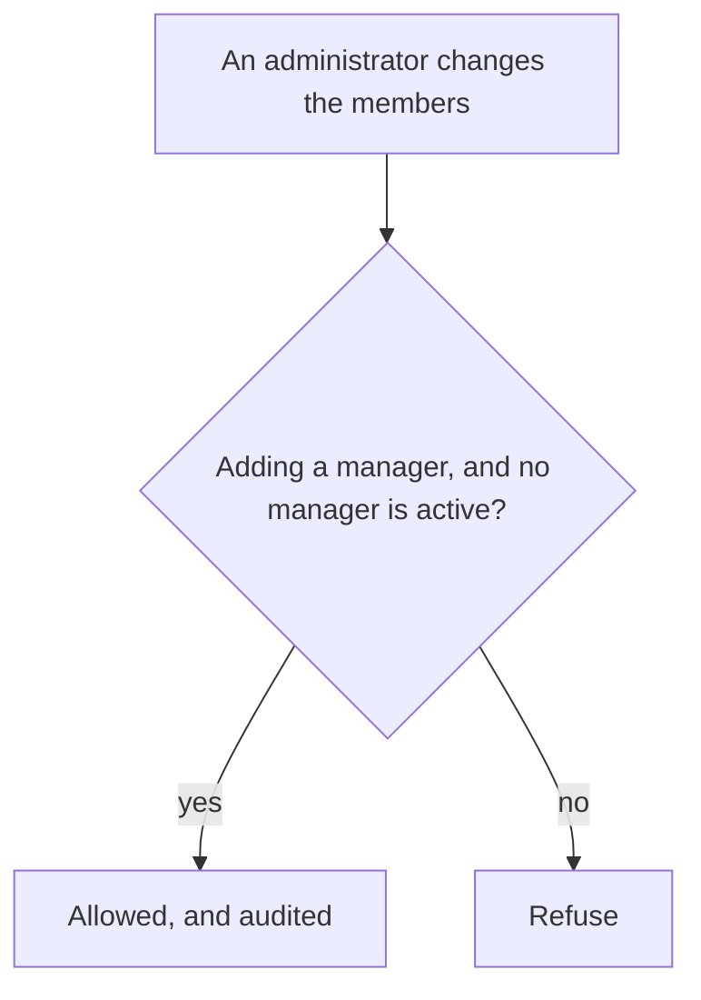

```yaml
id: RULE-P3
type: rule
name: An administrator only restores a manager
status: draft  # parked by decision 13: not in the alpha
object: OBJ-P2
statement: "An administrator may add a project manager to a project that has no active project manager, and may change its members in no other way."
proved_by: []
satisfies:
  - id: FR-8
  - id: FR-11
```

> Beta, not current. Parked by decision 13: not in the alpha. Brought back with role based access in a later release.

# An administrator only restores a manager

## In plain words

An administrator's one power over a project's members is to restore a manager. If every manager of a project has
a deactivated account, an administrator can add a new manager. They cannot add an engineer, change a role, or
remove anyone, and they cannot do it while the project still has an active manager.

## Why it exists

Without it, a project whose manager is deactivated is stuck: nobody can add members. With more power than this,
an administrator could manage every project from the side. The rule is the smallest fix that unsticks a project.

## Allowed and refused

Allowed: an administrator adds a project manager to a project whose managers all have deactivated accounts.

Refused: an administrator adds a manager when one is active. An administrator adds an engineer, changes a role or
removes a member. An administrator adds themselves ([RULE-P2](RULE-P2-an-administrator-never-joins-by-role.md)).

## How it works



## How a test would prove it

- Given a project whose only manager is deactivated, when an administrator adds another active person as a
  manager, then that person is a manager (AC-23).
- Given a project with an active manager, when an administrator tries to add a manager, then it is refused (AC-25).
- Given an administrator and a project, when they try to add an engineer, change a role or remove a member, then it
  is refused.

## Related

The protected object is the [membership](OBJ-P2-membership.md). The last-manager guardrail is
[RULE-P1](RULE-P1-a-project-always-has-a-manager.md).
