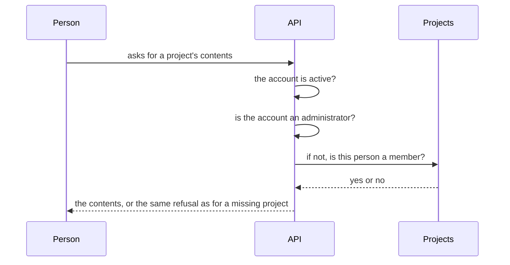

```yaml
id: RULE-P4
type: rule
name: Only members see inside a project
status: draft
object: OBJ-P1
statement: "The contents and member list of a project are shown only to its members and to administrators, and anyone else gets the same answer as for a project that does not exist."
proved_by: []
satisfies:
  - id: NFR-1
  - id: FR-12
```

# Only members see inside a project

## In plain words

A project's contents and its member list are shown only to its members and to administrators. Anyone else is
refused, and the refusal is the same whether the project exists or not.

Changed by decision 13: in the first cut an administrator saw only names and members. In the alpha the
administrator is a superuser and sees inside every project.

## Why it exists

A governance product cannot let access follow a job title, except for the one superuser role. Everyone else gets in
through membership. The same answer for "no such project" and "not yours" means a person cannot find out what other
teams are working on by asking.

## Allowed and refused

Allowed: a member, or an administrator, sees the contents and the members.

Refused: anyone else asking for the contents or the members, with the same answer as for a project that does not
exist. The server refuses, even if the screen hides the button (NFR-1).

## How it works



## How a test would prove it

- Given a project, a member, an administrator and a user who is neither, when each asks for the contents, then the
  member and the administrator see them and the other is refused (AC-26).
- Given a project that exists and one that does not, when a non-member asks about each, then the answer is the
  same (AC-27).

## Related

The protected object is the [project](OBJ-P1-project.md). The parked
[RULE-P2](RULE-P2-an-administrator-never-joins-by-role.md) kept an administrator out of the member list and out of
the contents.
