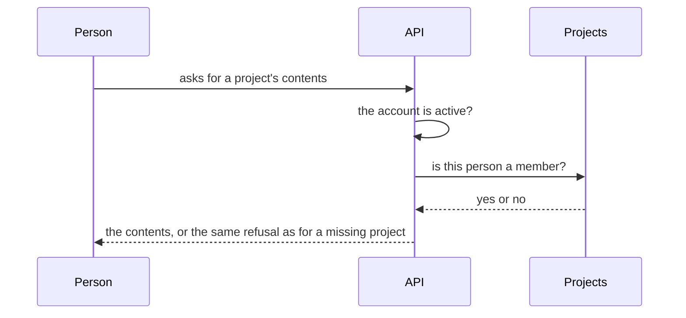

```yaml
id: RULE-P4
type: rule
name: Only members see inside a project
status: draft
object: OBJ-P1
statement: "The contents of a project are shown only to its members, and a refusal does not reveal whether the project exists."
proved_by: []
satisfies:
  - id: FR-140
  - id: FR-141
  - id: FR-142
  - id: NFR-1
```

# Only members see inside a project

## In plain words

A project's files, endpoints and evaluations are shown only to the people who are members of it. Anyone else is
refused, and the refusal is the same whether the project exists or not.

An administrator is the one exception to the list: they can see every project's **name and members**, but not
its contents.

## Why it exists

A governance product cannot let access follow a job title. Access follows membership, and only membership. The
same answer for "no such project" and "not yours" means a person cannot find out what other teams are working on
by asking.

## Allowed and refused

Allowed: a member sees the contents. An administrator sees names and members.

Refused: anyone else asking for the contents. The server refuses, even if the screen hides the button (NFR-1).

## How it works



## How a test would prove it

- Given a member and a person who is not a member, when each asks for the contents, then the member sees them and
  the other is refused (AC-106).
- Given a project that exists and one that does not, when a non-member asks for each, then the answer is the same
  (AC-108).
- Given an administrator who is not a member, when they list projects, then they see names and members and no
  contents (AC-107).

## Related

The protected object is the [project](OBJ-P1-project.md). [RULE-P2](RULE-P2-an-administrator-never-joins-by-role.md)
keeps an administrator out of the member list.
