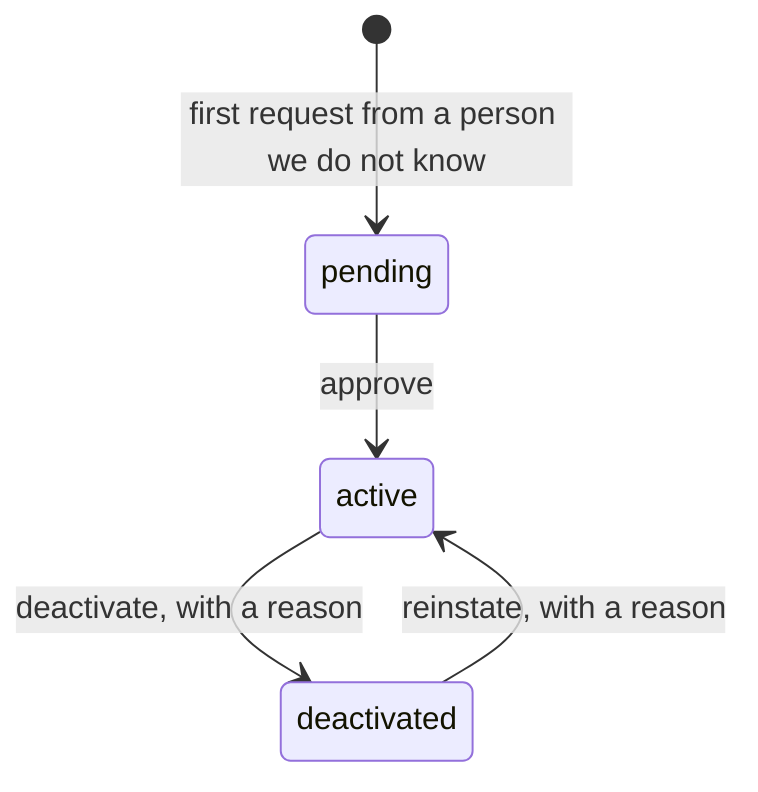

```yaml
id: SET-2
type: set
name: Account statuses
status: draft
ordered: false
comment: Whether an account can be used.
values:
  - pending
  - active
  - deactivated
meanings:
  pending: The person has signed in at Keycloak and has an account, but an administrator has not approved it. They see only their own status.
  active: The person can sign in and use Playground.
  deactivated: The person can no longer sign in. Everything they made is kept.
used_by:
  - OBJ-A1
questions:
  - Can this person use Playground right now?
satisfies: []
```

# Account statuses

## What it is

Three statuses. A **pending** account is waiting for an administrator. An **active** account can be used. A **deactivated** account cannot, and nothing it made is removed.

## How it changes



The first administrator is the exception: an email named in the setup becomes an **active** administrator on its
first request, if Keycloak says the email is verified, and only while no active administrator exists (decision 14). Once one exists, the same email makes a pending account.

A reinstatement needs a reason, like a deactivation (RULE-A3). An approval does not.

Deactivating also disables the person in Keycloak and ends their sessions, so a token they already hold stops
working at their very next request. What deactivation leaves alone is in
[RULE-A4](RULE-A4-deactivation-removes-nothing.md).

Approving only changes the status in Playground. Keycloak is not called (decision 2). A pending person can sign in
at Keycloak and holds a token, but the API refuses every request except their own status.

Used by the [account](OBJ-A1-account.md).
