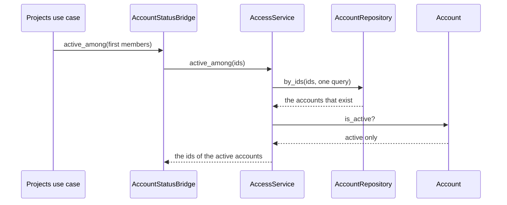
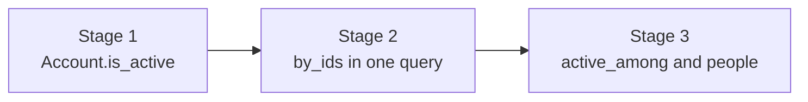

# Task P1.1: Access answers which accounts are active

**Task ID:** TSK-P1.1  
**Use Case:** UC-P1  
**Design Reference:** the design sequence, step 4 (`active_among(first_members)` answered by Access), and the Access context page  
**Criteria:** AC-13 and AC-18 (afterwards): this task builds the question they ask and carries no criterion marker of its own  
**Status:** Built. Plan is a draft  
**Matches the code at:** `7481263`  
**Reviewer:** Pending

Ground rules, the layout and the commands are in the [chapter summary](summary.md).

This is the plan someone follows to build this task. It was written by working backwards from the code that exists, so each
block marked `# file` is a copy of that file at the commit above. All paths in the stage text are relative to `apps/api/`.

---

## 1. Objective

Projects must know whether a first member has an active account (AC-13), and later whether a person being added is one
(AC-18). Projects never reads an account, so Access answers. This task is the Access side only, built before Projects.

| AC | Given | Then | Why it exists |
|---|---|---|---|
| AC-13 (afterwards, TSK-P1.6) | an administrator creates a project naming a first member who is not active or does not exist | it is refused, with one answer for an account that cannot be a member | A project member is someone who can sign in. Access owns "active", so Projects asks it and never reads a status itself. |
| AC-18 (afterwards, UC-P2) | an administrator adds an account that is pending, deactivated or unknown | it is refused, with one answer for all three | The same question, asked when a member is added later. One answer for three cases so the refusal does not tell which account exists. |

This task has no criterion of its own to prove: it builds the question both will ask. Its tests prove the question (which of
these ids are active), and the two criteria get their markers when the refusal is built.

### Expected Behaviour

Given some account ids, when Access is asked which are active, it answers the ids of the active accounts only. An unknown,
pending or deactivated id is left out, and nothing in the answer tells the three apart. A duplicate id counts once, and an
empty list asks nothing. Asked for the names of some ids, Access answers id, name and email as they are now, for the known ids.

## 2. Architecture and Reasoning

### Where does this logic belong?

- "Active": the `Account` entity in the Access domain (`is_active`).
- Finding many accounts at once: the `AccountRepository` port and its SQL adapter, in Access.
- Answering another context: an Access use case, `AccessService.active_among` (and `people`), returning plain values.

### Why?

Projects and Access are two bounded contexts. Projects must not import an Access type (ADR 0015), so Access answers with a use
case that gives back strings and a small summary, never an `Account`. The rule "active" is a rule of the account, so it sits on
`Account`, and the one place that decides what active means is the domain. Everything stays inside Access (ADR 0010).



*Reading guide:* Projects asks through a bridge, Access reads once and keeps only the accounts that are active. The bridge
itself is built in TSK-P1.6, so this task builds the part from `AccessService` down.

### The logic, decision by decision

1. **"Active" is a rule of the account, so it sits on `Account`.** `is_active` is true only for status `active`; pending
   and deactivated are not (AC-13, AC-18). `is_active_administrator` already tested the same status, so it now reuses it.
2. **Unknown, pending and deactivated ids are all left out of the answer.** The caller gets the active ones and nothing
   that tells the three apart (AC-13, AC-18).
3. **A duplicate id counts once, and an empty list asks nothing.** The service removes duplicates before it asks; the
   repository answers `[]` for no ids without running a query.
4. **One query for any number of ids.** `by_ids` is a single `IN` query, never one query per id.
5. **Plain values cross the boundary.** `active_among` returns a list of id strings, and `people` returns
   `AccountSummary` (id, name, email), never an `Account`. So Projects imports nothing from Access (ADR 0015); the bridge
   that connects them is `AccountStatusBridge`, built in TSK-P1.6 (the `people` bridge comes in TSK-P1.7).
6. **`people` rides along.** The slice text asks only for `active_among`. The commit also built `people(ids)` (name and
   email now, unknown ids left out) from the same query, for the audit entry of TSK-P1.7 and the member names of ADR 0016.
   It is shown here because it is in the code and shares `by_ids`.

### Relevant Design

- Entity: `Account` (Access), with the new property `is_active`
- Port: `AccountRepository.by_ids`; the summary type `AccountSummary`
- Use cases: `AccessService.active_among` and `AccessService.people`
- Verification: unit tests of the entity, the SQL adapter and the service (SQLite)

## 3. Implementation Plan

1. An account knows it is active: test, then `Account.is_active`.
2. The repository finds many accounts in one query: tests, then `by_ids` on the port, the SQL adapter and the fake.
3. The service answers: tests, then `AccountSummary`, `active_among` and `people`.



*Reading guide:* the stages are a work order, bottom up: the rule, then the query, then the use case that answers.

### Target Files

- `apps/api/app/access/domain/account.py`
- `apps/api/app/access/application/ports.py`
- `apps/api/app/access/application/service.py`
- `apps/api/app/access/adapters/outbound/sql.py`
- `apps/api/tests/fakes.py`
- `apps/api/tests/test_domain.py`
- `apps/api/tests/test_adapters_sql.py`
- `apps/api/tests/test_service.py`

---

## 4. RED: Write the Failing Test

Each stage writes its tests first. The commands run from `apps/api/`.

### Stage 1: an account knows it is active

#### Test

```python
# apps/api/tests/test_domain.py
def test_only_an_active_account_is_active():
    assert acct("a", status=Status.active).is_active
    assert not acct("p", status=Status.pending).is_active
    assert not acct("d", status=Status.deactivated).is_active
```

#### Why this test?

It pins the rule on the entity: active is true, pending and deactivated are false.

#### Expected Result

The test fails because `Account` has no `is_active`.

#### Actual Execution Evidence

**Status:** Executed at `5b3dd94`  
**Test run:** `uv run pytest tests/test_domain.py -q`  
**Failure reason:** `1 failed, 8 passed`, the failure an `AttributeError` because `Account` has no `is_active` (the full suite read `1 failed, 184 passed, 29 skipped`)

### Stage 2: the repository finds many accounts in one query

#### Test

```python
# apps/api/tests/test_adapters_sql.py
def test_by_ids_gives_the_accounts_asked_for_and_skips_unknown_ids(accounts):
    for n in (1, 2, 3):
        accounts.add(acct(n))
    got = accounts.by_ids(["id-3", "id-1", "nope"])
    assert sorted(a.id for a in got) == ["id-1", "id-3"]
    assert {a.id: a for a in got}["id-1"] == acct(1)
```

```python
# apps/api/tests/test_adapters_sql.py
def test_by_ids_with_no_ids_answers_empty_without_a_query(accounts, session):
    from sqlalchemy import event

    seen = []
    event.listen(session.get_bind(), "before_cursor_execute", lambda *a: seen.append(a[2]))
    assert accounts.by_ids([]) == []
    assert seen == []
```

```python
# apps/api/tests/test_adapters_sql.py
def test_by_ids_is_one_query(accounts, session):
    from sqlalchemy import event

    for n in (1, 2, 3):
        accounts.add(acct(n))
    seen = []
    event.listen(session.get_bind(), "before_cursor_execute", lambda *a: seen.append(a[2]))
    accounts.by_ids(["id-1", "id-2", "id-3"])
    assert len(seen) == 1
```

#### Why this test?

The first test pins the answer: the accounts that exist, and unknown ids skipped. The second pins that an empty list runs no
statement. The third pins that three ids run one statement, so the cost does not grow with the number of members.

#### Expected Result

All three fail with an `AttributeError`, because the repository has no `by_ids`.

#### Actual Execution Evidence

**Status:** Executed at `5b3dd94`  
**Test run:** `uv run pytest tests/test_adapters_sql.py -q`  
**Failure reason:** `3 failed, 10 passed`, each an `AttributeError`

### Stage 3: the service answers

#### Test

```python
# apps/api/tests/test_service.py
def _three_people():
    svc, accounts, _, _ = make()
    ids = {}
    for status in (Status.active, Status.pending, Status.deactivated):
        a = svc.account_for(f"sub-{status.value}", status.value.title(), f"{status.value}@x.test", True)
        accounts.save(a.with_(status=status))
        ids[status] = a.id
    return svc, accounts, ids
```

```python
# apps/api/tests/test_service.py
def test_active_among_returns_only_the_active_accounts():
    svc, _, ids = _three_people()
    got = svc.active_among([ids[Status.active], ids[Status.pending], ids[Status.deactivated], "unknown"])
    assert set(got) == {ids[Status.active]}
```

```python
# apps/api/tests/test_service.py
def test_active_among_counts_a_duplicate_once_and_an_empty_list_answers_empty():
    svc, _, ids = _three_people()
    got = svc.active_among([ids[Status.active], ids[Status.active]])
    assert list(got) == [ids[Status.active]]
    assert list(svc.active_among([])) == []
```

```python
# apps/api/tests/test_service.py
def test_people_gives_id_name_and_email_as_they_are_now_and_omits_unknown_ids():
    svc, accounts, ids = _three_people()
    accounts.save(accounts.by_id(ids[Status.pending]).with_(name="Renamed", email="new@x.test"))
    got = svc.people([ids[Status.pending], ids[Status.active], "unknown"])
    assert {p.id: (p.name, p.email) for p in got} == {
        ids[Status.pending]: ("Renamed", "new@x.test"),
        ids[Status.active]: ("Active", "active@x.test"),
    }
    assert svc.people([]) == []
```

#### Why this test?

The helper makes one active, one pending and one deactivated account. The first test pins that only the active id comes back,
with an unknown id added. The second pins duplicates and the empty list. The third pins `people`: the name and email as they
are now (a renamed account shows its new values), an unknown id absent, and an empty list giving `[]`.

#### Expected Result

The three tests fail because the service has neither `active_among` nor `people`.

#### Actual Execution Evidence

**Status:** Executed at `5b3dd94`  
**Test run:** `uv run pytest tests/test_service.py -q`  
**Failure reason:** `3 failed, 21 passed`

---

## 5. GREEN: Implement the Behaviour

### Stage 1: an account knows it is active

#### Implementation

```python
# apps/api/app/access/domain/account.py
    @property
    def is_active(self) -> bool:
        return self.status is Status.active
```

```python
# apps/api/app/access/domain/account.py
    @property
    def is_active_administrator(self) -> bool:
        return self.is_active and self.role is Role.administrator
```

#### Explanation

`is_active` is the one place that says what active means. `is_active_administrator` reuses it instead of testing the status
again.

#### Actual Execution Evidence

**Status:** Executed at `5b3dd94`  
**Test run:** `uv run pytest tests/test_domain.py -q`  
**Result:** `9 passed`

### Stage 2: the repository finds many accounts in one query

#### Implementation

```python
# apps/api/app/access/application/ports.py
class AccountRepository(Protocol):
    def by_identity(self, identity: str) -> Account | None: ...
    def by_id(self, account_id: str) -> Account | None: ...
    def by_ids(self, account_ids: list[str]) -> list[Account]: ...
    def add(self, account: Account) -> None: ...
    def save(self, account: Account) -> None: ...
    def list(self, status: str | None = None) -> list[Account]: ...
    def count_active_administrators(self) -> int: ...
    def lock_active_administrators(self) -> "list[Account]": ...
```

```python
# apps/api/app/access/adapters/outbound/sql.py, inside class SqlAccounts
    def by_ids(self, account_ids: list[str]) -> list[Account]:
        if not account_ids:
            return []
        return [_to_domain(r) for r in self._s.scalars(select(AccountRow).where(AccountRow.id.in_(account_ids)))]
```

The fake lives in `tests/fakes.py` and serves the service tests of stage 3; its duplicate removal mirrors the service:

```python
# apps/api/tests/fakes.py, inside class FakeAccounts
    def by_ids(self, account_ids):
        return [self.rows[i] for i in dict.fromkeys(account_ids) if i in self.rows]
```

#### Explanation

The port block is the whole `AccountRepository` protocol at the final commit, so it holds other methods that belong to other
tasks; `by_ids` is the one this task adds. An empty list returns before any query, and the rest is one `IN` query.

#### Actual Execution Evidence

**Status:** Executed at `5b3dd94`  
**Test run:** `uv run pytest tests/test_adapters_sql.py -q`  
**Result:** `13 passed`

### Stage 3: the service answers

#### Implementation

```python
# apps/api/app/access/application/ports.py
@dataclass(frozen=True)
class AccountSummary:
    """Who an account is now, as Access tells another context (never the entity itself)."""

    id: str
    name: str
    email: str
```

```python
# apps/api/app/access/application/service.py, inside class AccessService
    def active_among(self, ids: list[str]) -> list[str]:
        """Of these account ids, the ones that belong to active accounts (for another context)."""
        return [a.id for a in self.accounts.by_ids(list(set(ids))) if a.is_active]
```

```python
# apps/api/app/access/application/service.py, inside class AccessService
    def people(self, ids: list[str]) -> list[AccountSummary]:
        """Id, name and email as they are now, for the known ids (for another context)."""
        return [AccountSummary(a.id, a.name, a.email) for a in self.accounts.by_ids(list(set(ids)))]
```

`AccountSummary` is also added to the `from app.access.application.ports import (...)` list at the top of `service.py`.

#### Explanation

`set(ids)` removes duplicates before the one query. `active_among` keeps the accounts whose `is_active` is true, so an unknown,
pending and deactivated id all vanish the same way. `people` skips the filter and returns the summary of each known id.

#### Actual Execution Evidence

**Status:** Executed at `5b3dd94`  
**Test run:** `uv run pytest tests/test_service.py -q`, then `uv run pytest -q`  
**Result:** `24 passed` in `tests/test_service.py`, and the whole suite `191 passed, 29 skipped`

---

## 6. REFACTOR: Improve the Design

### Planned Improvements

None identified in this task.

### Actual Changes

None recorded. The commit built the task in one go. The only reuse, `is_active_administrator` calling `is_active`, was part
of stage 1.

### Regression Verification

**Status:** Executed on 2026-11-24 at `7481263`, from `apps/api/` (SQLite)

```
uv run pytest tests/test_domain.py tests/test_adapters_sql.py tests/test_service.py -q -k "only_an_active or by_ids or active_among or test_people"   # the 7 tests of this task: 7 passed
uv run pytest tests/test_domain.py tests/test_adapters_sql.py tests/test_service.py -q   # the three files whole: 71 passed
uv run pytest -q   # the whole suite, which includes everything built after this task: 468 passed, 47 skipped
```

---

## 7. Architecture Review

- [x] Domain has no infrastructure dependency. `tests/test_architecture.py`: 21 passed on 2026-11-24 at `7481263`.
- [x] Business invariant remains inside the aggregate. "Active" is `Account.is_active` in `domain/account.py`.
- [x] Application service does not duplicate the rule. `AccessService.active_among` calls `is_active`. A search of `app/` for `Status.active` and `is_active` outside `app/access/domain` finds the service call and two SQL `where` clauses in `sql.py` (lines 89 and 100), which belong to other queries, not to this task.
- [x] Plain values cross the boundary. `active_among` returns id strings and `people` returns `AccountSummary`; the Projects port `AccountStatus` asks for and gets a set of ids, through `AccountStatusBridge` in `composition/bridges.py`.
- [ ] Implementation matches the design model. The design sequence draws `active_among(first_members)` going straight from the Projects use case to Access. The code has an `AccountStatusBridge` in between (TSK-P1.6) and Access answers a list, not a set. Decide whether the design should show the bridge.

**Design reviewer findings:** Not run for this task.

---

## 8. Decisions and Learnings

### Decisions

- ADR 0015: Access answers through a new use case that returns plain values, so Projects imports nothing from Access. No new ADR in this task.
- ADR 0010: where the code goes, inside the Access context.
- ADR 0016: the member names the `people` use case serves.

### Learnings

**Plain values at a boundary:** a context gives another context ids and small summaries, never its own entity, so neither side depends on the other's types.

**One answer for three cases:** leaving unknown, pending and deactivated ids out the same way means the caller cannot tell which account exists.

### Open Questions

- `people` was built here although the slice text names only `active_among`. Should its own task or criterion say so?
- The design sequence does not show the bridge between Projects and Access. Should it?

---

## 9. Implementation Evidence

**Source files:** `apps/api/app/access/domain/account.py`, `apps/api/app/access/application/ports.py`, `apps/api/app/access/application/service.py`, `apps/api/app/access/adapters/outbound/sql.py`  
**Test files:** `apps/api/tests/test_domain.py`, `apps/api/tests/test_adapters_sql.py`, `apps/api/tests/test_service.py`; the fake in `apps/api/tests/fakes.py`  
**Git commits:** `5b3dd94` built the task. The code is matched at `7481263`  
**Architecture checks:** `tests/test_architecture.py`, 21 passed on 2026-11-24 at `7481263`  
**Related ADRs:** 0015 (Access answers through a new use case), 0010; no new ADR

### Where the real build differs from this plan

- One commit, `5b3dd94`, built the task. It also built `people` (decision 6), which the slice text does not name.
- The commit message says tests were also run on PostgreSQL (220). That was not run for this plan: `TEST_DATABASE_URL` was not set, so only SQLite counts are given. No test of this task needs PostgreSQL.
- No test here has an `@pytest.mark.ac` marker, because the criteria belong to TSK-P1.6 and UC-P2.
- Not here: the bridge in `composition/` that calls `active_among` for Projects (`AccountStatusBridge`, first added in TSK-P1.6, commit `c5c6f64`), the refusal itself (TSK-P1.6, AC-13), and the bridge for `people` (TSK-P1.7, `58dc0f1`).

---

## 10. Developer Review

**Implementation status:** Built at `5b3dd94`  
**Review status:** Pending

### Reviewer Feedback

No feedback recorded. A read-only agent checked this plan's accuracy against the code on 2026-11-24, which is not a review by a person.

### Approval

**Approved by:** Pending  
**Approved revision:** Pending  
**Approval date:** Pending

Approval confirms review of the implementation explanation and associated evidence, not a guarantee that the software is defect-free.
