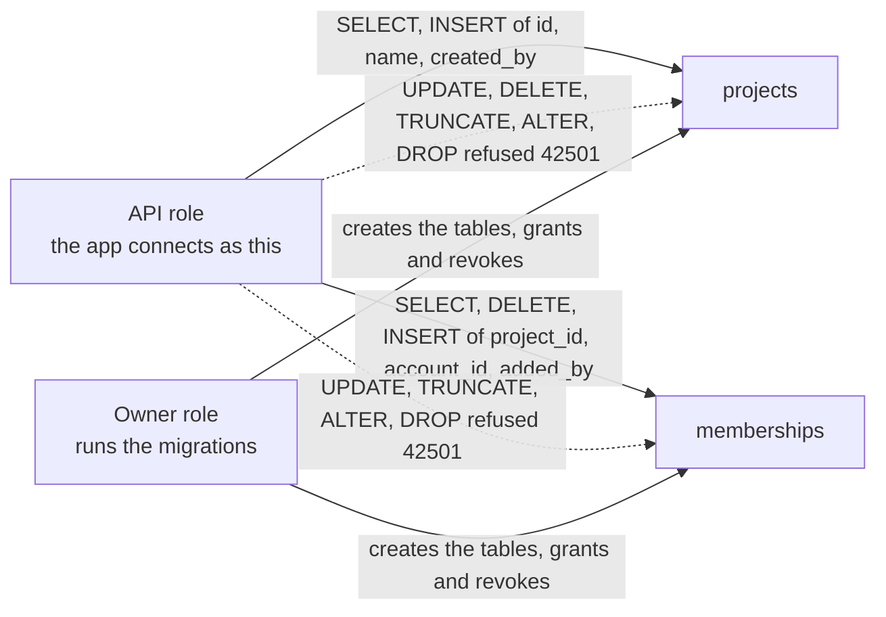
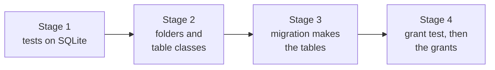

# Task P1.2: The projects and memberships tables, with grants

**Task ID:** TSK-P1.2  
**Use Case:** UC-P1  
**Design Reference:** ADR 0015 (tables and grants) and the Projects context page `docs/domain/contexts/BC-PROJECTS.md`  
**Criteria:** AC-95  
**Status:** Built. Plan is a draft  
**Matches the code at:** `7481263`  
**Reviewer:** Pending

Ground rules, the layout and the commands are in the [chapter summary](summary.md).

This is the plan someone follows to build this task. It was written by working backwards from the code that exists, so each
block marked `# file` is a copy of that file at the commit above. Commands run from `apps/api/`.

---

## 1. Objective

Two tables, owned by the owner role that runs the migrations, and a database role for the API that can do only what
Projects needs. Nothing here creates a project yet (TSK-P1.3).

| AC | Given | Then | Why |
|---|---|---|---|
| AC-95 | the database role the API connects with (not the owner role that runs the migrations) | it tries to update or delete a project, update a membership, or truncate, alter or drop either table: the database refuses each one (42501), while adding and reading projects and memberships, and deleting a membership, still work | A project and its membership history must not be rewritable by a bug or by stolen API credentials. The rule is enforced by permissions in PostgreSQL, like the audit table (AC-80, FR-7, FR-9). |

### Expected Behaviour

Given the API role, when it adds or reads a project or a membership, or removes a membership, the database accepts it. When
it updates or deletes a project, updates a membership, names `created_at` or `added_at` in an insert, or truncates, alters or
drops either table, the database refuses with `42501`, and the owner role, running the same statement, is accepted.

## 2. Architecture and Reasoning

### Where does this logic belong?

- The two tables: the Projects outbound adapter (`app/projects/adapters/outbound/sql.py`), on the shared `Base`.
- The grants: one Alembic migration, `migrations/versions/0004_projects.py`, run by the owner role outside the app (ADR 0012).
- The proof: a PostgreSQL grant test, `tests/test_projects_permissions.py`.
- The Projects folders (`domain/`, `application/`, `adapters/inbound/`, `adapters/outbound/`) exist so the architecture test sees
  the context (ADR 0010).

### Why?

A project and its membership history must not be rewritable by a bug or by stolen API credentials, so the database itself
refuses the change, not the application code. A permission is a fact about the database, so it lives in a migration and is
tested against PostgreSQL, the engine of Amazon RDS on AWS (ADR 0015, decision 4). No rule of the domain is involved here, and
`GRANT` and `REVOKE` appear only in migrations (checked by search at `7481263`).



*Reading guide:* solid arrows are what the API role may do, dotted arrows are what the database refuses it, and the owner role is the only one that shapes the tables.

### The logic, decision by decision

1. **The API role holds an allow list, from nothing.** The migration revokes everything first, then grants: on `projects`
   SELECT and INSERT of `id, name, created_by` (no UPDATE, no DELETE, no TRUNCATE); on `memberships` SELECT, DELETE and
   INSERT of `project_id, account_id, added_by` (no UPDATE). No default privileges. A second run ends in the same place
   (AC-95).
2. **Only the columns the application sets are insertable.** `created_at` and `added_at` are set by the database, so an
   insert that names one is refused too (the same idea as RULE-L2, which says it for an audit entry).
3. **A membership can be removed but never edited.** Removing is a DELETE of one row; an UPDATE is refused. So history
   is the difference between the rows before and after (ADR 0015).
4. **Ids are random UUID strings made by the application,** so there is no sequence, and an id reveals neither count nor
   order (ADR 0015).
5. **A person is in a project once.** A unique key on (project, account) is the identity of a membership, and a foreign
   key ties it to an existing project (AC-90, built on in the later slices).
6. **The control.** Each forbidden statement runs as the API role in its own transaction and fails with `42501`; then
   the owner runs the very same statement and it is accepted (rolled back), so a typo cannot make a refusal pass.
7. **PostgreSQL only.** SQLite has no roles, so there the migration makes the tables and stops; the grant test is skipped
   unless `TEST_DATABASE_URL` is set.

### Relevant Design

- Tables: `projects` (`id, name, created_by, created_at`) and `memberships` (`project_id, account_id, added_by, added_at`)
- Rule of access: the API role's column level grants, and no default privileges (ADR 0015)
- Migration: `0004` after `0003` (ADR 0012)
- Verification: SQLite tests of the schema, and a PostgreSQL grant test with an owner role control

## 3. Implementation Plan

1. Write the tests that name the new context and tables, on SQLite (they fail: there is no `app.projects` yet).
2. Make the context folders and the two table classes, and show Alembic the tables in `migrations/env.py`.
3. Write the migration so it makes the tables, and stops on SQLite.
4. Write the PostgreSQL grant test, then add the grants to the migration (AC-95).



*Reading guide:* the stages are a work order. Stages 1 to 3 run on SQLite. Stage 4 needs PostgreSQL and was not run for this plan.

### Target Files

- `apps/api/migrations/versions/0004_projects.py`
- `apps/api/migrations/env.py`
- `apps/api/app/projects/adapters/outbound/sql.py` (the `ProjectRow` and `MembershipRow` classes)
- the empty `__init__.py` files of the `apps/api/app/projects/` folders
- `apps/api/tests/test_projects_permissions.py`
- `apps/api/tests/test_migrations.py`
- `apps/api/tests/test_audit_permissions.py`
- `apps/api/tests/test_architecture.py`
- `apps/api/tests/migrations_support.py`

---

## 4. RED: Write the Failing Test

Each stage writes its tests first. A stage with PostgreSQL in its title was not run for this file.

### Stage 1: the tests that name the new context and tables (SQLite)

#### Test

- `tests/migrations_support.py` and `tests/test_migrations.py`: import `app.projects.adapters.outbound.sql` so the tables
  register on `Base`, as `access` and `audit` already do.
- `tests/test_architecture.py`: the contexts test now expects `projects` as well, and the migration-imports test accepts
  `app.projects.adapters.outbound.sql`.
- `tests/test_migrations.py`: `test_migrations_create_todays_schema` expects the tables `accounts`, `audit_entries`,
  `projects`, `memberships`; the new tests are below. The head-revision assertion (`at == "0004"`) sits at the end of the
  existing `test_the_roles_migration_can_run_twice`, which then fails too, as does `test_migrations_match_the_models` (the
  models now have tables that no migration makes).

```python
# apps/api/tests/test_migrations.py
def test_the_project_tables_have_the_columns_of_the_ontology(engine):
    upgrade(as_owner(engine))
    assert columns(engine, "projects") == {"id", "name", "created_by", "created_at"}
    assert columns(engine, "memberships") == {"project_id", "account_id", "added_by", "added_at"}
```

```python
# apps/api/tests/test_migrations.py
def test_the_project_migration_can_run_twice(engine):
    owner = as_owner(engine)
    upgrade(owner)
    stamp(owner, "0003")
    upgrade(owner)  # the tables and the grants exist: neither a failure nor a change
    with owner.connect() as connection:
        at = MigrationContext.configure(connection).get_current_revision()
        diff = compare_metadata(MigrationContext.configure(connection), Base.metadata)
    assert at == "0004" and diff == []
```

```python
# apps/api/tests/test_migrations.py
def test_the_database_sets_when_a_project_and_a_membership_were_added(engine):
    owner = as_owner(engine)
    upgrade(owner)
    with owner.begin() as connection:
        connection.execute(text("INSERT INTO projects (id, name, created_by) VALUES ('p-1', 'Alpha', 'a-1')"))
        connection.execute(
            text("INSERT INTO memberships (project_id, account_id, added_by) VALUES ('p-1', 'a-2', 'a-1')")
        )
        created = connection.execute(text("SELECT created_at FROM projects")).scalar_one()
        added = connection.execute(text("SELECT added_at FROM memberships")).scalar_one()
    assert created is not None and added is not None
```

```python
# apps/api/tests/test_architecture.py
def test_there_is_at_least_the_access_audit_and_projects_contexts():
    assert {"access", "audit", "projects"} <= set(contexts())
```

#### Why this test?

They pin the schema of the ontology (the columns of both tables), that the migration is safe to run twice, and that the
database, not the application, sets `created_at` and `added_at`. The architecture test pins that the context exists.

#### Expected Result

A collection error, `ModuleNotFoundError: No module named 'app.projects'`.

#### Actual Execution Evidence

**Status:** Executed, as recorded in the earlier plan (the date and commit were not recorded there). Not repeated now  
**Test run:** `uv run pytest -q`  
**Failure reason:** `ModuleNotFoundError: No module named 'app.projects'`

### Stage 2: the context folders and the table definitions (SQLite)

There is no RED of its own for stage 2: the failing collection of stage 1 is what it answers, and the table classes are
covered by the tests of stage 1 and stage 3.

### Stage 3: the migration makes the tables (SQLite)

#### Test

The tests are those of stage 1. With the folders and table classes in place and no migration yet, they are what fails.

#### Why this test?

The models now have tables that no migration makes, so the migration tests must fail until the migration exists.

#### Expected Result

Six migration tests fail: `test_migrations_create_todays_schema`, `test_the_project_tables_have_the_columns_of_the_ontology`,
`test_migrations_match_the_models`, `test_the_roles_migration_can_run_twice`, `test_the_project_migration_can_run_twice` and
`test_the_database_sets_when_a_project_and_a_membership_were_added`.

#### Actual Execution Evidence

**Status:** Executed, as recorded in the earlier plan (the date and commit were not recorded there). Not repeated now  
**Test run:** `uv run pytest -q`, after stage 2 and before the migration  
**Failure reason:** `6 failed, 188 passed, 46 skipped`: no migration makes the tables yet

### Stage 4: the grant test (PostgreSQL, not run)

#### Test

`tests/test_projects_permissions.py`, every test marked `@pytest.mark.ac("AC-95")` and skipped without `TEST_DATABASE_URL`. A
fixture `roles` yields the API engine and the owner engine on a migrated database holding two projects (`p-1` with a member,
`p-9` with none) and one membership. The tests:

- one for each statement in `REFUSED` (parametrized): the API role is refused with `42501`, the rows are unchanged, and
  the owner runs the same statement as the control
- the API role can add and read projects and memberships, and the database filled `created_at` and `added_at`
- the API role can remove a membership
- a person is in a project once (`23505`); a membership needs an existing project (`23503`)
- the API role may insert only the columns the application sets, and holds no UPDATE on any column

Also in `tests/test_audit_permissions.py`, the allow list of tables the API role may touch gains
`"projects": {"SELECT"}` and `"memberships": {"SELECT", "DELETE"}` (INSERT is on chosen columns only, tested above).

The statements and the first test:

```python
# apps/api/tests/test_projects_permissions.py
REFUSED = {
    "update a project": "UPDATE projects SET name = 'renamed'",
    "delete a project": "DELETE FROM projects WHERE id = 'p-9'",
    "truncate projects": "TRUNCATE projects CASCADE",
    "alter projects": "ALTER TABLE projects ADD COLUMN extra text",
    "drop projects": "DROP TABLE projects CASCADE",
    "update a membership": "UPDATE memberships SET added_by = 'someone'",
    "truncate memberships": "TRUNCATE memberships",
    "alter memberships": "ALTER TABLE memberships ADD COLUMN extra text",
    "drop memberships": "DROP TABLE memberships",
    "name created_at": (
        "INSERT INTO projects (id, name, created_by, created_at) VALUES ('p-2', 'Beta', 'admin-1', '2020-01-01')"
    ),
    "name added_at": (
        "INSERT INTO memberships (project_id, account_id, added_by, added_at) "
        "VALUES ('p-1', 'member-2', 'admin-1', '2020-01-01')"
    ),
}
```

```python
# apps/api/tests/test_projects_permissions.py
@pytest.mark.ac("AC-95")
@pytest.mark.parametrize("statement", REFUSED.values(), ids=REFUSED.keys())
def test_the_api_role_cannot_change_a_project_or_a_membership_and_the_owner_can(roles, statement):
    api, owner = roles
    before = rows(owner)
    assert len(before[0]) == 2 and len(before[1]) == 1

    # Each command in its own transaction, so one refusal does not hide another.
    with pytest.raises(DBAPIError) as refused:
        with api.begin() as connection:
            connection.execute(text(statement))
    assert refused.value.orig.sqlstate == PERMISSION_DENIED
    assert rows(owner) == before

    # The control: the owner runs the very same statement and it is accepted (then rolled back),
    # so a typo in the statement cannot make the refusal above pass.
    with owner.connect() as connection:
        transaction = connection.begin()
        connection.execute(text(statement))
        transaction.rollback()
    assert rows(owner) == before
```

#### Why this test?

Each forbidden statement runs as the API role in its own transaction, so one refusal does not hide another. Then the owner role
runs the very same statement and it is accepted (rolled back), so a typo in the statement cannot make a refusal pass. Rows are
compared before and after, so a refusal that still changed something would fail.

#### Expected Result

The allow-side tests (add a project and read it, remove a membership, insert only the columns the application sets) fail while
the migration has no grant lines, because the API role then holds no privilege at all. The `REFUSED` cases would still pass,
since an API role with no grants is refused everything. This is reasoned, not run.

#### Actual Execution Evidence

**Status:** Not executed. These tests need PostgreSQL (`TEST_DATABASE_URL`, always the `playground_test` database, and
`TEST_MIGRATION_DATABASE_URL`), and none was set when the earlier plan was written or now  
**Test run:** `uv run pytest tests/test_projects_permissions.py -q`  
**Failure reason:** reasoned, not run: no count is known

---

## 5. GREEN: Implement the Behaviour

### Stage 2: the context folders and the table definitions

#### Implementation

Make the folders `app/projects/` with `domain/`, `application/`, `adapters/inbound/`, `adapters/outbound/`, each with an empty
`__init__.py` (ADR 0010). Add one line to `migrations/env.py` so Alembic sees the tables:

```python
# apps/api/migrations/env.py
import app.projects.adapters.outbound.sql  # noqa: F401 - registers the project tables on Base
```

Then write the two table classes in `app/projects/adapters/outbound/sql.py`. At `7481263` that file also holds the repository
`SqlProjects` of later tasks; these are the two classes of this task, copied from it, with its imports `from datetime import
datetime`, `from sqlalchemy import DateTime, ForeignKey, String, UniqueConstraint, func`, `from sqlalchemy.orm import Mapped,
mapped_column` and `from app.infrastructure.db import Base`:

```python
# apps/api/app/projects/adapters/outbound/sql.py
class ProjectRow(Base):
    __tablename__ = "projects"
    # A random UUID string made by the application, so an id reveals nothing about count or order (ADR 0015).
    id: Mapped[str] = mapped_column(String, primary_key=True)
    name: Mapped[str] = mapped_column(String)
    created_by: Mapped[str] = mapped_column(String)
    # The database sets the time, never the application (RULE-L2).
    created_at: Mapped[datetime] = mapped_column(DateTime, server_default=func.now())
```

```python
# apps/api/app/projects/adapters/outbound/sql.py
class MembershipRow(Base):
    __tablename__ = "memberships"
    __table_args__ = (UniqueConstraint("project_id", "account_id", name="uq_memberships_project_account"),)
    # The unique key is the identity of a membership: a person is in a project once (AC-90).
    __mapper_args__ = {"primary_key": ["project_id", "account_id"]}
    project_id: Mapped[str] = mapped_column(String, ForeignKey("projects.id"))
    account_id: Mapped[str] = mapped_column(String)
    added_by: Mapped[str] = mapped_column(String)
    added_at: Mapped[datetime] = mapped_column(DateTime, server_default=func.now())
```

#### Explanation

The id is a string made by the application, so there is no sequence. The database sets both times through `server_default`. The
unique key on (project, account) is the identity of a membership, and the foreign key ties it to an existing project.

#### Actual Execution Evidence

**Status:** Executed, as recorded in the earlier plan (the date and commit were not recorded there)  
**Test run:** `uv run pytest -q`  
**Result:** the collection error is gone, and `6 failed, 188 passed, 46 skipped`: the six migration tests wait for the migration

### Stage 3: the migration makes the tables

#### Implementation

Write `migrations/versions/0004_projects.py`. The stage shape is the header, `revision` ids, `UTC_NOW`, `_role_name` and
`upgrade` up to the two `create_table` calls, then `if not postgres: return`. The final file, with the grants, is in stage 4.

#### Explanation

On SQLite there are no roles, so the migration makes the two tables and stops. Each table is made only if it is not already
there, so a second run changes nothing.

#### Actual Execution Evidence

**Status:** Executed, as recorded in the earlier plan, with the final file (which differs from the stage shape only in code that
runs on PostgreSQL). The stage shape on its own was not run  
**Test run:** `uv run pytest -q`  
**Result:** `194 passed, 46 skipped`

### Stage 4: the grants

#### Implementation

The final file, `migrations/versions/0004_projects.py`:

```python
# apps/api/migrations/versions/0004_projects.py
"""The Projects context's tables, and the API role's column level grants on them (UC-P1 TSK-P1.2, ADR 0015, AC-95).

Runs as the OWNER role. Creates `projects` and `memberships` (ids are UUID strings made by the application, so no
sequence). The database sets created_at and added_at. On PostgreSQL the API role gets, per table and with no default
privileges: SELECT and INSERT on the columns the application sets for `projects` (no UPDATE, no DELETE); SELECT,
INSERT on the columns the application sets and DELETE for `memberships` (no UPDATE). SQLite has no roles, so there
only the tables are made.
Safe to run twice: each step looks at what is already there.

Revision ID: 0004
Revises: 0003
"""

import re

import sqlalchemy as sa
from alembic import op

from app.infrastructure.config import Settings

revision = "0004"
down_revision = "0003"
branch_labels = None
depends_on = None

UTC_NOW = sa.text("(now() AT TIME ZONE 'utc')")


def _role_name() -> str:
    name = Settings().api_db_user
    if not re.fullmatch(r"[a-z_][a-z0-9_]{0,62}", name):
        raise RuntimeError(f"API_DB_USER '{name}' is not a plain lower case role name")
    return name


def upgrade() -> None:
    bind = op.get_bind()
    postgres = bind.dialect.name == "postgresql"
    now = UTC_NOW if postgres else sa.text("CURRENT_TIMESTAMP")
    existing = set(sa.inspect(bind).get_table_names())

    if "projects" not in existing:
        op.create_table(
            "projects",
            sa.Column("id", sa.String(), primary_key=True),
            sa.Column("name", sa.String(), nullable=False),
            sa.Column("created_by", sa.String(), nullable=False),
            sa.Column("created_at", sa.DateTime(), nullable=False, server_default=now),
        )
    if "memberships" not in existing:
        op.create_table(
            "memberships",
            sa.Column("project_id", sa.String(), sa.ForeignKey("projects.id"), nullable=False),
            sa.Column("account_id", sa.String(), nullable=False),
            sa.Column("added_by", sa.String(), nullable=False),
            sa.Column("added_at", sa.DateTime(), nullable=False, server_default=now),
            sa.UniqueConstraint("project_id", "account_id", name="uq_memberships_project_account"),
        )

    if not postgres:
        return
    role = _role_name()
    # Start from nothing, so a second run (or a hand edit) ends in the same place.
    bind.execute(sa.text(f'REVOKE ALL ON projects, memberships FROM "{role}"'))
    bind.execute(sa.text(f'GRANT SELECT, INSERT (id, name, created_by) ON projects TO "{role}"'))
    bind.execute(sa.text(f'GRANT SELECT, DELETE, INSERT (project_id, account_id, added_by) ON memberships TO "{role}"'))


def downgrade() -> None:
    bind = op.get_bind()
    if bind.dialect.name == "postgresql":
        role = _role_name()
        bind.execute(sa.text(f'REVOKE ALL ON projects, memberships FROM "{role}"'))
    op.drop_table("memberships")
    op.drop_table("projects")
```

#### Explanation

The migration revokes everything first, then grants, so a second run (or a hand edit) ends in the same place. `projects` gets
SELECT and INSERT of three columns; `memberships` gets SELECT, DELETE and INSERT of three columns. The two time columns are not
insertable, so the database always sets them. No default privileges are set. `_role_name` refuses a role name that is not plain
lower case, because the name is placed in the SQL text.

#### Actual Execution Evidence

**Status:** Not executed. The grants run on PostgreSQL only, and no PostgreSQL database was used for this plan  
**Test run:** `uv run pytest tests/test_projects_permissions.py tests/test_audit_permissions.py -q` with `TEST_DATABASE_URL` set  
**Result:** expected to pass in full. The commit message of `48064f7` records `240 passed` on PostgreSQL after this task; that
figure was not reproduced

---

## 6. REFACTOR: Improve the Design

### Planned Improvements

None identified in this task.

### Actual Changes

None recorded. One commit, `48064f7`, built the task in one go, so there was no separate refactor step.

### Regression Verification

**Status:** Executed on 2026-11-24 at `7481263` (code matched; later commits changed docs only), from `apps/api/`, on SQLite

```
uv run pytest tests/test_migrations.py -q        # 10 passed, 2 skipped
uv run pytest tests/test_architecture.py -q      # 21 passed
uv run pytest tests/test_projects_permissions.py tests/test_audit_permissions.py -q   # 28 skipped (no TEST_DATABASE_URL)
```

The PostgreSQL run of the grant tests was **Not executed**: no database was set up for it, and `TEST_DATABASE_URL` must only ever
name `playground_test`.

---

## 7. Architecture Review

- [x] Domain has no infrastructure dependency. `tests/test_architecture.py`: 21 passed on 2026-11-24. This task adds no domain code: the tables are in the outbound adapter.
- [x] Business invariant remains inside the aggregate. Not touched here: the grants are a database fact, and a search finds `GRANT` and `REVOKE` only in `migrations/versions/` (0002, 0003, 0004) and in `tests/test_database_role_check.py`, never in `app/`.
- [x] Application service does not duplicate the rule. This task has no application service. Grants are written once, in `0004_projects.py`.
- [x] Implementation matches the design model. ADR 0015 asks for one Alembic migration, random string ids, grants per table and by column with no default privileges, and a PostgreSQL grant test (AC-95). The migration and the test do these. The grant test itself was not run (see section 4).

**Design reviewer findings:** Not run for this task.

---

## 8. Decisions and Learnings

### Decisions

- ADR 0015: the tables, the random string ids, and the column level grants with no default privileges.
- ADR 0012: migrations run as the owner role, outside the app. ADR 0010: the folder layout of a context.
- No new ADR.

### Learnings

**Column level grant:** PostgreSQL can allow INSERT on chosen columns only, so the API role can add a row yet never name a column the database sets.

**Control statement:** the owner role runs the same forbidden statement and it is accepted, so a typo in the test cannot make a refusal pass.

### Open Questions

- The grant test has never been run for this plan. When a `playground_test` database is available, run it and record the counts.
- ADR 0015 says the ids are "made in the domain", and the tables comment says "made by the application". Both are the application side; say which in one place if it matters.

---

## 9. Implementation Evidence

**Source files:** `migrations/versions/0004_projects.py`, `migrations/env.py`, `app/projects/adapters/outbound/sql.py` (the `ProjectRow` and `MembershipRow` classes), the empty `app/projects/` folders  
**Test files:** `tests/test_projects_permissions.py`, `tests/test_migrations.py`, `tests/test_audit_permissions.py`, `tests/test_architecture.py`, `tests/migrations_support.py`  
**Git commits:** `48064f7` built the task. The code is matched at `7481263`  
**Architecture checks:** `tests/test_architecture.py`, 21 passed on 2026-11-24 at `7481263`  
**Related ADRs:** 0010, 0012, 0015

### Where the real build differs from this plan

- One commit, `48064f7`, built the task, and the grant test was written with the migration. Stage 4 splits them to show the test
  first; that split was not run.
- The PostgreSQL grant test could not be run for this plan (`TEST_DATABASE_URL` unset), so no Expect in stage 4 is checked and
  the 240 figure is from the commit message only.
- `app/projects/adapters/outbound/sql.py` was 30 lines in this commit (the two table classes). Later tasks added `SqlProjects`
  to the same file; only this task's part is quoted.
- The test file and the migration are unchanged between `48064f7` and `7481263`.

---

## 10. Developer Review

**Implementation status:** Built at `48064f7`  
**Review status:** Pending

### Reviewer Feedback

No feedback recorded. An earlier read-only agent check is not a review by a person.

### Approval

**Approved by:** Pending  
**Approved revision:** Pending  
**Approval date:** Pending

Approval confirms review of the implementation explanation and associated evidence, not a guarantee that the software is defect-free.
