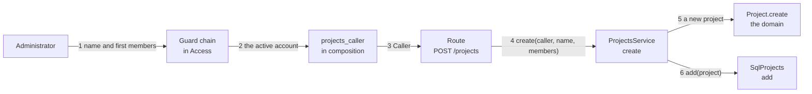
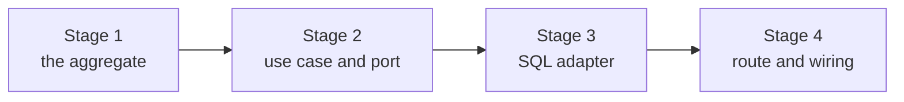

# Task P1.3: An administrator creates a project

**Task ID:** TSK-P1.3  
**Use Case:** UC-P1  
**Design Reference:** the design sequence, steps 5 and 7 (the new `Project`, saved, and the answer with empty files, endpoints and evaluations), and the `Project` aggregate  
**Criteria:** AC-9, AC-10  
**Status:** Built. Plan is a draft  
**Matches the code at:** `7481263`  
**Reviewer:** Pending

Ground rules, the layout and the commands are in the [chapter summary](summary.md).

This is the plan someone follows to build this task. It was written by working backwards from the code that exists, so each
block marked `# file` is a copy of that file at the commit above, except a block labelled `stage shape`, which is the file as
this task first wrote it (commit `9e8be89`).

---

## 1. Objective

`POST /projects` takes a name and a list of first members and makes a project whose members are exactly the people named. This
task builds the whole path once, thin, from the domain to the route: later tasks add the refusals. It does not yet check the
role, the name, the members' accounts or audit anything (TSK-P1.4 to P1.7).

| AC | Given | Then | Why |
|---|---|---|---|
| AC-9 | an administrator and an active account | they create a project naming that account as a first member; the project exists and that person is a member | This is the use case itself (FR-7): without it there is no project for anything else to hang on. |
| AC-10 | an administrator | they create a project naming themselves as a first member; it exists and they are a member | The administrator is a superuser (decision 13) but is not a member by default. Being one is a choice, and so is naming nobody: a project may start with no member. |

### Expected Behaviour

Given an administrator and an active account, when they create a project naming that account as a first member, the project
exists and that person is a member (201). Given an administrator who names themselves, they are a member. Given an administrator
who names nobody, the project exists with no member. The answer is the project plus three empty lists: `files`, `endpoints` and
`evaluations`.

## 2. Architecture and Reasoning

### Where does this logic belong?

- The rule that makes a project: the `Project` aggregate's domain (`Project.create`), in the Projects bounded context.
- The use case: `ProjectsService.create`, which builds the project and saves it through a port.
- The port: `ProjectRepository`, in `application/ports.py`. The table access: `SqlProjects` in `adapters/outbound/sql.py`.
- The route and its schemas: `adapters/inbound/`.
- The only code that sees Access and Projects together: `composition/`, which makes Projects' own `Caller` from the account the
  guard chain returns.

### Why?

The domain imports nothing outside itself and the route holds no rule (ADR 0010). Projects has its own `Caller`, so it does not
import Access (ADR 0002, ADR 0015). The route sits behind the same guard chain as every account route, so no token, a pending
and a deactivated account are refused before any Projects code runs.



*Reading guide:* the guard chain runs first, composition turns its account into a `Caller`, and the use case asks the domain for
a project and then saves it through the port.

### The logic, decision by decision

1. **Only the people named are members.** The creator is a member only if named (AC-10). A project with none is valid.
2. **`added_by` of every first member is the creator.** Each `Membership` records who added it (ADR 0015).
3. **The id is a random UUID made in the domain** (`uuid4`), so an id reveals no count or order and the domain needs no
   database to have one (ADR 0015).
4. **Each person once.** `dict.fromkeys` keeps the order and drops a repeat. The test for AC-89 comes in TSK-P1.6; the
   one line is here because it is the natural way to write the loop.
5. **The project and its memberships are written in the request's own session**, project first, then a flush, then the
   memberships (they point at it). They commit together or not at all.
6. **The database sets the times**, never the application (`created_at`, `added_at`): the API role may not name them
   (AC-95, built in TSK-P1.2).
7. **Projects has its own `Caller`**, built in `composition/` from the account the guard chain returns (ADR 0002, 0015).
   The route sits behind the same guard chain as every account route, so no token, a pending and a deactivated account
   are refused before any Projects code runs.
8. **The answer is the project plus three empty lists**, `files`, `endpoints` and `evaluations` (decision 23).

### Relevant Design

- Aggregate: `Project`, with its `Membership` entity inside it (OBJ-P1, OBJ-P2)
- Port: `ProjectRepository` (`add`, `by_id`), with the adapter `SqlProjects`
- Bridge: `projects_caller` in `composition/bridges.py`
- Verification: unit tests of the domain and the use case, SQL tests of the adapter, and API tests of the route

## 3. Implementation Plan

1. The aggregate: write the tests, then `Caller`, `ProjectsError` and `Project.create` (AC-9, AC-10).
2. The use case and its port: write the tests with `FakeProjects`, then `ProjectRepository` and `ProjectsService.create`.
3. The SQL adapter: write the tests, then `SqlProjects.add` and `by_id`.
4. The route and the wiring: write the tests, then the route, its schemas, the error handler and the composition.



*Reading guide:* the stages go inside out, from the domain to the route. The test comes before the code in each.

### Target Files

- `apps/api/app/projects/domain/caller.py`
- `apps/api/app/projects/domain/errors.py`
- `apps/api/app/projects/domain/project.py`
- `apps/api/app/projects/application/ports.py`
- `apps/api/app/projects/application/service.py`
- `apps/api/app/projects/adapters/outbound/sql.py`
- `apps/api/app/projects/adapters/inbound/http.py`
- `apps/api/app/projects/adapters/inbound/schemas.py`
- `apps/api/app/projects/adapters/inbound/errors.py`
- `apps/api/app/composition/bridges.py`
- `apps/api/app/composition/app.py`
- `apps/api/tests/fakes.py`
- `apps/api/tests/test_projects_domain.py`
- `apps/api/tests/test_projects_service.py`
- `apps/api/tests/test_projects_sql.py`
- `apps/api/tests/test_projects_api.py`
- `apps/api/tests/test_projects_errors.py`
- `apps/api/tests/test_projects_composition.py`

---

## 4. RED: Write the Failing Test

Each stage writes its tests first. The commands run from `apps/api/`. The tests below are the ones at `7481263`; at `9e8be89`
the service tests and the API answer were simpler (see "Where the real build differs").

### Stage 1: the aggregate (AC-9, AC-10)

#### Test

```python
# apps/api/tests/test_projects_domain.py
@pytest.mark.ac("AC-9")
def test_a_project_has_the_name_the_creator_and_the_named_first_members():
    p = Project.create(ADMIN, "Alpha", {"acc-maya", "acc-bob"})
    assert (p.name, p.created_by) == ("Alpha", "acc-ada")
    assert p.members == {"acc-maya", "acc-bob"}
```

```python
# apps/api/tests/test_projects_domain.py
@pytest.mark.ac("AC-9")
def test_each_first_member_is_added_by_the_creator():
    p = Project.create(ADMIN, "Alpha", ["acc-maya"])
    assert p.memberships == (Membership("acc-maya", added_by="acc-ada"),)
```

```python
# apps/api/tests/test_projects_domain.py
@pytest.mark.ac("AC-10")
def test_an_administrator_who_names_themselves_is_a_member():
    assert Project.create(ADMIN, "Alpha", ["acc-ada"]).members == {"acc-ada"}
```

```python
# apps/api/tests/test_projects_domain.py
@pytest.mark.ac("AC-10")
def test_an_administrator_who_names_nobody_makes_a_project_with_no_member():
    p = Project.create(ADMIN, "Alpha", [])
    assert p.members == frozenset() and p.memberships == ()
```

Two more tests carry no criterion (rules of this task with none of their own): `test_the_creator_is_not_a_member_unless_named` and
`test_the_id_is_a_random_uuid_made_in_the_domain`, in the same file.

#### Why this test?

It pins what the aggregate does with the first members: only the people named are members (AC-10 covers naming oneself and
naming nobody), and each one is added by the creator (ADR 0015).

#### Expected Result

A collection error, because `Project` does not exist yet.

#### Actual Execution Evidence

**Status:** Executed (recorded as checked in the earlier plan)  
**Test run:** `uv run pytest tests/test_projects_domain.py -q -x`  
**Failure reason:** a collection error, `Project` does not exist

### Stage 2: the use case and its port (AC-9, AC-10)

#### Test

```python
# apps/api/tests/test_projects_service.py
@pytest.mark.ac("AC-9")
def test_create_saves_the_project_with_its_first_members_and_returns_it(service, projects):
    p = service.create(ADMIN, "Alpha", ["acc-maya"])
    assert projects.by_id(p.id) is p.project
    assert (p.name, p.created_by, p.members) == ("Alpha", "acc-ada", {"acc-maya"})
```

```python
# apps/api/tests/test_projects_service.py
@pytest.mark.ac("AC-10")
def test_create_with_the_administrator_as_first_member(service, projects):
    p = service.create(ADMIN, "Alpha", ["acc-ada"])
    assert projects.by_id(p.id).members == {"acc-ada"}
```

```python
# apps/api/tests/test_projects_service.py
@pytest.mark.ac("AC-10")
def test_create_with_no_first_member(service, projects):
    p = service.create(ADMIN, "Alpha", [])
    assert projects.by_id(p.id).members == frozenset()
```

`FakeProjects` is an in-memory repository, in `tests/fakes.py`:

```python
# apps/api/tests/fakes.py, FakeProjects (the class holds more methods since)
class FakeProjects:
    """Stands in for Projects' ProjectRepository port: keeps the projects in memory."""

    def __init__(self):
        self.rows: dict[str, object] = {}
        self.added: list = []  # the memberships written by add_member
        self.lose_the_race = False  # another request inserts the same row first, as the unique key would show

    def add(self, project):
        self.rows[project.id] = project

    def by_id(self, project_id):
        return self.rows.get(project_id)
```

#### Why this test?

The use case is tested against a fake of the port, with no database: it saves the project with its first members and returns it.

#### Expected Result

A collection error, because `ProjectsService` does not exist yet.

#### Actual Execution Evidence

**Status:** Executed (recorded as checked in the earlier plan)  
**Test run:** `uv run pytest tests/test_projects_service.py -q -x`  
**Failure reason:** a collection error, `ProjectsService` does not exist

### Stage 3: the SQL adapter (AC-9, AC-10)

#### Test

The file runs on SQLite, and on PostgreSQL when `TEST_DATABASE_URL` is set.

```python
# apps/api/tests/test_projects_sql.py
@pytest.mark.ac("AC-9")
def test_a_project_and_its_memberships_come_back_from_a_new_session(engine):
    project = Project.create(ADMIN, "Alpha", ["acc-maya", "acc-bob"])
    with Session(engine) as s:
        SqlProjects(s).add(project)
        s.commit()
    with Session(engine) as s:
        got = SqlProjects(s).by_id(project.id)
    assert got is not None and got.id == project.id
    assert (got.name, got.created_by, got.members) == ("Alpha", "acc-ada", {"acc-maya", "acc-bob"})
    assert {m.added_by for m in got.memberships} == {"acc-ada"}
```

```python
# apps/api/tests/test_projects_sql.py
@pytest.mark.ac("AC-10")
def test_a_project_with_no_member_comes_back_with_none(engine):
    project = Project.create(ADMIN, "Alpha", [])
    with Session(engine) as s:
        SqlProjects(s).add(project)
        s.commit()
    with Session(engine) as s:
        assert SqlProjects(s).by_id(project.id).members == frozenset()
```

```python
# apps/api/tests/test_projects_sql.py
def test_the_project_and_its_memberships_commit_together(engine):
    project = Project.create(ADMIN, "Alpha", ["acc-maya", "acc-bob"])
    with Session(engine) as s:
        SqlProjects(s).add(project)
        s.flush()
        s.commit()
    assert counts(engine) == (1, 2)
```

```python
# apps/api/tests/test_projects_sql.py
def test_a_rollback_leaves_neither_the_project_nor_its_memberships(engine):
    with Session(engine) as s:
        SqlProjects(s).add(Project.create(ADMIN, "Alpha", ["acc-maya"]))
        s.rollback()
    assert counts(engine) == (0, 0)
```

Three more in the same file: the stored id is a UUID string, an unknown id gives `None`, and the database sets both times
(`created_at`, `added_at`).

#### Why this test?

A project and its memberships must come back from a new session, so the data is in the database and not in the session. The two
rows commit together or not at all.

#### Expected Result

A collection error, because `SqlProjects` does not exist yet.

#### Actual Execution Evidence

**Status:** Executed (recorded as checked in the earlier plan)  
**Test run:** `uv run pytest tests/test_projects_sql.py -q`  
**Failure reason:** a collection error, `SqlProjects` does not exist

### Stage 4: the route and the wiring (AC-9, AC-10)

#### Test

```python
# apps/api/tests/test_projects_api.py
@pytest.mark.ac("AC-9")
def test_an_administrator_creates_a_project_naming_an_active_account(api, admin, engine):
    maya_h, maya_id = register(api, "sub-maya", "maya@x.test")
    api.post(f"/accounts/{maya_id}/approve", headers=admin)

    r = api.post("/projects", headers=admin, json={"name": "Alpha", "members": [maya_id]})

    assert r.status_code == 201
    body = r.json()
    assert str(uuid.UUID(body["id"])) == body["id"]
    assert (body["name"], body["created_by"]) == ("Alpha", me_id(api, admin))
    assert body["members"] == [{"id": maya_id, "name": "maya"}]  # the name as Access has it now (ADR 0016)
    assert {k: body[k] for k in PLACEHOLDERS} == PLACEHOLDERS
    assert set(body) == {"id", "name", "created_by", "members", *PLACEHOLDERS}
    project = stored(engine, body["id"])  # a later read through the repository
    assert (project.name, project.members) == ("Alpha", {maya_id})
```

```python
# apps/api/tests/test_projects_api.py
@pytest.mark.ac("AC-10")
def test_an_administrator_naming_themselves_is_a_member(api, admin, engine):
    ada_id = me_id(api, admin)
    r = api.post("/projects", headers=admin, json={"name": "Alpha", "members": [ada_id]})
    assert (r.status_code, r.json()["members"]) == (201, [{"id": ada_id, "name": "Ada"}])
    assert stored(engine, r.json()["id"]).members == {ada_id}
```

```python
# apps/api/tests/test_projects_api.py
@pytest.mark.ac("AC-10")
def test_an_administrator_naming_nobody_makes_a_project_with_no_member(api, admin, engine):
    r = api.post("/projects", headers=admin, json={"name": "Alpha", "members": []})
    assert (r.status_code, r.json()["members"]) == (201, [])
    assert stored(engine, r.json()["id"]).members == frozenset()
```

```python
# apps/api/tests/test_projects_api.py
def test_the_route_is_behind_the_access_guard_chain(api):
    assert api.post("/projects", json={"name": "Alpha", "members": []}).status_code == 401
    h, _ = register(api, "sub-new", "new@x.test")  # pending
    r = api.post("/projects", headers=h, json={"name": "Alpha", "members": []})
    assert (r.status_code, r.json()["detail"]["code"]) == (403, "account_pending")
```

```python
# apps/api/tests/test_projects_api.py
def test_the_project_route_is_served_by_the_projects_context(api):
    modules = {r.endpoint.__module__ for r in _api_routes(api.app) if r.path == "/projects"}
    assert modules == {"app.projects.adapters.inbound.http"}
```

```python
# apps/api/tests/test_projects_errors.py
def test_a_projects_refusal_is_answered_with_its_code_and_message():
    class Odd(ProjectsError):
        code = "odd"

    app = FastAPI()
    register_error_handlers(app, FakeSecurityLog())

    @app.get("/x")
    def x():
        raise Odd("No.")

    r = TestClient(app).get("/x")
    assert (r.status_code, r.json()) == (400, {"detail": {"code": "odd", "message": "No."}})
```

```python
# apps/api/tests/test_projects_composition.py
@pytest.mark.ac("AC-10")
def test_the_guards_account_becomes_projects_caller():
    assert projects_caller(account(Role.administrator)) == Caller("acc-1", is_administrator=True)
    assert projects_caller(account(Role.user)) == Caller("acc-1", is_administrator=False)
```

```python
# apps/api/tests/test_projects_composition.py
def test_a_deactivated_administrator_is_not_an_administrator_for_projects():
    assert projects_caller(account(Role.administrator, Status.deactivated)).is_administrator is False
```

`test_two_projects_have_two_different_ids` is in the API file too.

#### Why this test?

The API tests go through the HTTP client: 201, a UUID id, the name, the creator, the member, the three empty lists, and the
stored project read back through the repository. The route is behind the guard chain (401 with no token, `account_pending` for a
pending account) and is served by the Projects context. The error test pins the handler: a `ProjectsError` is answered with its
code and message, 400 by default. The composition tests pin the bridge: the guard's account becomes Projects' `Caller`, and a
deactivated administrator is not an administrator.

#### Expected Result

Collection errors in the errors and composition files, because `projects_caller` and the handler do not exist. The API tests
fail with no route.

#### Actual Execution Evidence

**Status:** Executed (recorded as checked in the earlier plan), at the commit's parent with the route and schemas present and the wiring absent  
**Test run:** `uv run pytest tests/test_projects_api.py tests/test_projects_errors.py tests/test_projects_composition.py -q`  
**Failure reason:** collection errors in the errors and composition files, and `6 failed` in the API file alone (no route). With nothing present, the API file fails the same way for the same reason

---

## 5. GREEN: Implement the Behaviour

### Stage 1: the aggregate

#### Implementation

`caller.py` is final as it stands (the file also has a docstring):

```python
# apps/api/app/projects/domain/caller.py
@dataclass(frozen=True)
class Caller:
    account_id: str
    is_administrator: bool
```

`errors.py` holds the base the later refusals extend (the file has more classes since):

```python
# apps/api/app/projects/domain/errors.py
class ProjectsError(Exception):
    code = "projects_error"

    def __init__(self, message: str = ""):
        super().__init__(message)
        self.message = message
```

`project.py` as this task wrote it (commit `9e8be89`), **stage 1 shape, not the final file**. Today the file also has the later
methods, and `create` also checks the name and the cap on first members (TSK-P1.5):

```python
"""The Project aggregate and the Membership inside it (BC-PROJECTS, OBJ-P1, OBJ-P2). Pure: standard library only."""

import uuid
from collections.abc import Iterable
from dataclasses import dataclass

from app.projects.domain.caller import Caller


@dataclass(frozen=True)
class Membership:
    account_id: str
    added_by: str


@dataclass(frozen=True)
class Project:
    id: str
    name: str
    created_by: str
    memberships: tuple[Membership, ...] = ()

    @property
    def members(self) -> frozenset[str]:
        return frozenset(m.account_id for m in self.memberships)

    @classmethod
    def create(cls, caller: Caller, name: str, member_ids: Iterable[str]) -> "Project":
        """A new project. Its id is random, so it reveals nothing about count or order (ADR 0015). Only the people
        named are members: the creator is one only if named (AC-10)."""
        memberships = tuple(Membership(i, added_by=caller.account_id) for i in dict.fromkeys(member_ids))
        return cls(str(uuid.uuid4()), name, caller.account_id, memberships)
```

#### Explanation

Only the people named are members. `dict.fromkeys` keeps the order and drops a repeat. Each `Membership` records who added it
(`added_by`, ADR 0015). The id is a random UUID made in the domain (`uuid4`), so it reveals no count or order and needs no
database.

#### Actual Execution Evidence

**Status:** Executed (recorded as checked in the earlier plan)  
**Test run:** `uv run pytest tests/test_projects_domain.py -q`  
**Result:** `6 passed`

### Stage 2: the use case and its port

#### Implementation

Both blocks are the stage shape at `9e8be89`, not the final files (the port and the service hold more ports and checks today):

```python
# app/projects/application/ports.py (stage shape)
from typing import Protocol

from app.projects.domain.project import Project


class ProjectRepository(Protocol):
    def add(self, project: Project) -> None: ...
    def by_id(self, project_id: str) -> Project | None: ...
```

```python
# app/projects/application/service.py (stage shape)
class ProjectsService:
    def __init__(self, projects: ProjectRepository):
        self._projects = projects

    def create(self, caller: Caller, name: str, member_ids: Iterable[str]) -> Project:
        project = Project.create(caller, name, member_ids)
        self._projects.add(project)
        return project
```

#### Explanation

The use case builds the `Project` through the domain and saves it through the port. It knows no database.

#### Actual Execution Evidence

**Status:** Executed (recorded as checked in the earlier plan)  
**Test run:** `uv run pytest tests/test_projects_service.py -q`  
**Result:** `3 passed`

### Stage 3: the SQL adapter

#### Implementation

`SqlProjects.add` as it is today (the class also holds the readers and the member changes of later tasks; the two row classes
were made in TSK-P1.2):

```python
# apps/api/app/projects/adapters/outbound/sql.py, SqlProjects.add
    def add(self, project: Project) -> None:
        self._s.add(ProjectRow(id=project.id, name=project.name, created_by=project.created_by))
        self._s.flush()  # the project row first: the memberships point at it, and there is no relationship to order them
        self._s.add_all(
            MembershipRow(project_id=project.id, account_id=m.account_id, added_by=m.added_by)
            for m in project.memberships
        )
        self._s.flush()
```

#### Explanation

The project row is written first and flushed, because the memberships point at it and there is no relationship to order them.
Both are written in the request's own session, so they commit together or not at all. The database sets the times
(`created_at`, `added_at`), never the application: the API role may not name them (AC-95, TSK-P1.2).

#### Actual Execution Evidence

**Status:** Executed on SQLite (recorded as checked in the earlier plan). PostgreSQL: Not executed, `TEST_DATABASE_URL` was not set where the earlier plan was written  
**Test run:** `uv run pytest tests/test_projects_sql.py -q`  
**Result:** `7 passed` on SQLite

### Stage 4: the route and the wiring

#### Implementation

First the shapes this task wrote (commit `9e8be89`), enough to build and run the task on its own. They are **stage shape, not the
final files**:

```python
# app/projects/adapters/inbound/http.py (stage shape)
def build_router(
    service_dependency: Callable[..., ProjectsService], caller_dependency: Callable[..., Caller]
) -> APIRouter:
    router = APIRouter()

    @router.post("/projects", status_code=201, response_model=ProjectOut)
    def create_project(
        body: CreateProjectIn,
        who: Caller = Depends(caller_dependency),
        svc: ProjectsService = Depends(service_dependency),
    ):
        return ProjectOut.of(svc.create(who, body.name, body.members))

    return router
```

```python
# app/projects/adapters/inbound/schemas.py (stage shape)
class CreateProjectIn(BaseModel):
    name: str
    members: list[str] = []  # the first members, as account ids


class ProjectOut(BaseModel):
    id: str
    name: str
    created_by: str
    members: list[str]
    files: list[str] = []
    endpoints: list[str] = []
    evaluations: list[str] = []

    @classmethod
    def of(cls, p: Project) -> "ProjectOut":
        return cls(id=p.id, name=p.name, created_by=p.created_by, members=sorted(p.members))
```

The handler answers a Projects rule's refusal with its code and message. Nothing refuses yet, so the status table is empty and
every later task adds its error to it:

```python
# app/projects/adapters/inbound/errors.py (stage shape)
HTTP_STATUS: dict[type[ProjectsError], int] = {}


def register_error_handlers(app: FastAPI) -> None:
    @app.exception_handler(ProjectsError)
    async def projects_error(request: Request, exc: ProjectsError):
        return JSONResponse(
            {"detail": {"code": exc.code, "message": exc.message}},
            status_code=HTTP_STATUS.get(type(exc), 400),
        )
```

In `app/composition/app.py`, inside `create_app`, `register_projects_error_handlers(app)` is called beside the other two
`register_*_error_handlers` calls, and the service is built on the request's session:

```python
# app/composition/app.py (stage shape)
    def projects_service(session: Session = Depends(db)) -> ProjectsService:
        return ProjectsService(
            SqlProjects(session)
        )  # the request's session, so the project and its members commit together
```

What the files look like today. The router and the schemas have grown, and the role check moved out of the route's body. Three
things in them come from later tasks: `authorise_creation` and the raw body (TSK-P1.5, AC-11 and AC-93), `ProjectView` and
`MemberOut` (the member names, ADR 0016). The router also holds the list, open and member routes of UC-P3 and UC-P2.

```python
# apps/api/app/projects/adapters/inbound/http.py, inside build_router
    @router.post("/projects", status_code=201, response_model=ProjectOut)
    def create_project(
        raw: dict[str, Any] = Body(),
        who: Caller = Depends(caller_dependency),
        svc: ProjectsService = Depends(service_dependency),
    ):
        svc.authorise_creation(who)  # the role first, then the input (AC-11, AC-93)
        try:
            body = CreateProjectIn.model_validate(raw)
        except ValidationError:  # no detail: it would echo the input
            raise InvalidRequest("The request is not valid.") from None
        return ProjectOut.of(svc.create(who, body.name, body.members))
```

```python
# apps/api/app/projects/adapters/inbound/schemas.py
class CreateProjectIn(BaseModel):
    model_config = ConfigDict(extra="forbid")  # mass assignment: an unknown field is refused, not ignored (AC-93)

    name: str
    members: list[str] = []  # the first members, as account ids
```

```python
# apps/api/app/projects/adapters/inbound/schemas.py
class ProjectOut(BaseModel):
    id: str
    name: str
    created_by: str
    members: list[MemberOut]
    files: list[str] = []
    endpoints: list[str] = []
    evaluations: list[str] = []

    @classmethod
    def of(cls, v: ProjectView) -> "ProjectOut":
        members = [MemberOut(id=i, name=n) for i, n in sorted(v.names.items())]
        return cls(id=v.id, name=v.name, created_by=v.created_by, members=members)
```

The Caller bridge, the only place that knows both contexts:

```python
# apps/api/app/composition/bridges.py
def projects_caller(account: Account) -> ProjectsCaller:
    """The guard's account, in Projects' words (ADR 0002, 0015). The guard chain has refused a deactivated, pending
    or unknown account before this is built; whether an administrator may act is for the use case to say."""
    return ProjectsCaller(account.id, is_administrator=account.is_active_administrator)
```

and in `app/composition/app.py`, inside `create_app` (the lines that make the Caller and mount the router):

```python
# apps/api/app/composition/app.py
    def project_caller(account=Depends(guards.active_account)):
        return projects_caller(account)  # the same guard chain as every route: 401, pending and deactivated are refused
```

```python
# apps/api/app/composition/app.py
    app.include_router(build_projects_router(projects_service, project_caller))
```

#### Explanation

The route sits behind the same guard chain as every account route: no token, a pending and a deactivated account are refused
before any Projects code runs. `projects_service` builds the service on the request's session, so the project and its members
commit together. It was the one-argument `ProjectsService(SqlProjects(session))` shown above, and now also gets the account,
audit and people ports (TSK-P1.6, P1.7). The final `ProjectsService.create`, with every check added later, is in
[TSK-P1.4](TSK-P1.4-only-an-administrator-creates-a-project.md).

#### Actual Execution Evidence

**Status:** Executed (recorded as checked in the earlier plan)  
**Test run:** `uv run pytest tests/test_projects_api.py tests/test_projects_errors.py tests/test_projects_composition.py -q` (the nine tests of this task)  
**Result:** `9 passed`. At the commit that built this task the whole suite was `219 passed, 46 skipped` on SQLite

---

## 6. REFACTOR: Improve the Design

### Planned Improvements

None identified in this task.

### Actual Changes

None recorded. The commit built the task in one go, so there was no separate refactor step. Later tasks changed this code, and
they are changes, not refactors: the role check, the name and cap rules, the active-member check and the audit (TSK-P1.4 to
P1.7), and the member names in the answer (ADR 0016).

### Regression Verification

**Status:** Executed on 2026-11-24 at `7481263`, from `apps/api/`

```
uv run pytest tests/test_projects_domain.py -q      # whole file, all UC-P1 and later tasks: 14 passed (the 6 tests of this task pass)
uv run pytest tests/test_projects_service.py -q     # whole file: 62 passed (the 3 tests of this task pass)
uv run pytest tests/test_projects_sql.py -q         # whole file: 18 passed (the 7 tests of this task pass)
uv run pytest tests/test_projects_api.py tests/test_projects_errors.py tests/test_projects_composition.py -q   # the nine tests of this task, picked by name: 9 passed
uv run pytest -m "AC_9 or AC_10" -q                 # 15 passed, 500 deselected, counting later tasks' tests
uv run pytest -q                                    # the whole suite on SQLite: 468 passed, 47 skipped
```

---

## 7. Architecture Review

- [x] Domain has no infrastructure dependency. `uv run pytest tests/test_architecture.py -q`: 21 passed on 2026-11-24 at `7481263`. `domain/project.py`, `caller.py` and `errors.py` import only the standard library and each other.
- [x] Business invariant remains inside the aggregate. The id (`uuid4`) is made in `Project.create`; a search of `app/projects` finds no `uuid` outside `domain/`, and no `dict.fromkeys` outside the domain.
- [x] Application service does not duplicate the rule. `ProjectsService.create` calls `Project.create` and saves; the first-member and id rules are not repeated there.
- [x] Implementation matches the design model, for the steps of this task (5 and 7). The use case builds the project and saves it through `ProjectRepository`, and the answer has the three empty lists. The design draws `new Project(...)` and the code calls `Project.create`: a naming difference, not a boundary one. Steps 2 to 4 and 6 belong to TSK-P1.4 to P1.7.

**Design reviewer findings:** Not run for this task.

---

## 8. Decisions and Learnings

### Decisions

- Decision 13: an administrator is a superuser but is not a member by default. Being one is a choice, and so is naming nobody.
- Decision 23: the answer is the project plus three empty lists, `files`, `endpoints` and `evaluations`.
- ADR 0015: the id is a random UUID made in the domain; the database sets the times; Projects has its own `Caller`.
- ADR 0002 and ADR 0010: the contexts do not import each other, and the domain imports nothing outside itself.

### Learnings

**Composition root:** the one place that sees every adapter and both contexts. Here it turns Access's account into Projects' `Caller`.

**Port:** the use case asks `ProjectRepository` to save, and does not know it is SQL.

### Open Questions

- The design sequence says the use case does `new Project(...)`, and the code calls the factory `Project.create`. Should the design say so?
- The PostgreSQL run of the SQL tests was not repeated for this plan.

---

## 9. Implementation Evidence

**Source files:** the eleven source files under Target Files  
**Test files:** the six `tests/test_projects_*.py` files under Target Files, and `FakeProjects` in `apps/api/tests/fakes.py`  
**Git commits:** `9e8be89` built the task. The code is matched at `7481263`  
**Architecture checks:** `tests/test_architecture.py`, see section 7  
**Related ADRs:** [0015](../../../../adr/0015-projects-context-build-plan.md) (layout, ports, tables), 0002, 0010. No new ADR.

### Where the real build differs from this plan

- One commit, `9e8be89`, built all four stages together; the stages are a way to follow it, not four commits.
- The tests at that commit had the names, the `members` list of bare ids and a `FakeProjects` that returned the `Project`
  itself. Since then the answer carries `members` as `{id, name}` (ADR 0016) and the service returns a `ProjectView`, so the
  quoted `ProjectOut` and route differ from what the first commit wrote. The tests shown for AC-9 and AC-10 at `7481263` were
  adjusted to that (for instance `projects.by_id(p.id) is p.project`). They also build `ProjectsService` with four arguments
  (TSK-P1.6, TSK-P1.7).
- The stage 4 red was run at the commit's parent with the route and schemas present and the wiring absent; with nothing
  present the API file fails the same way for the same reason.
- Not here yet: the role check (TSK-P1.4), name and cap (P1.5), active members (P1.6), audit and security log (P1.7).

---

## 10. Developer Review

**Implementation status:** Built at `9e8be89`  
**Review status:** Pending

### Reviewer Feedback

No feedback recorded.

### Approval

**Approved by:** Pending  
**Approved revision:** Pending  
**Approval date:** Pending

Approval confirms review of the implementation explanation and associated evidence, not a guarantee that the software is defect-free.
