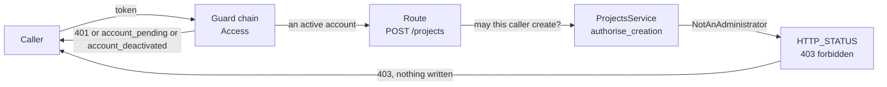
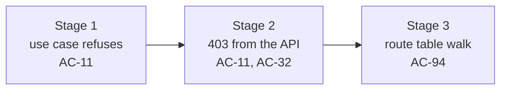

# Task P1.4: Only an administrator creates a project

**Task ID:** TSK-P1.4  
**Use Case:** UC-P1  
**Design Reference:** UC-P1 flow step 2 (the guard chain, then the administrator check, both before the input), and the `Caller` of the Projects context  
**Criteria:** AC-11, AC-32, AC-94  
**Status:** Built. Plan is a draft  
**Matches the code at:** `7481263`  
**Reviewer:** Pending

Ground rules, the layout and the commands are in the [chapter summary](summary.md).

This is the plan someone follows to build this task. It was written by working backwards from the code that exists, so
its final code is that code: each block marked `# file` is a copy of that file at the commit above. Where the file has
grown since (later tasks added to it), the text says so.

---

## 1. Objective

[TSK-P1.3](TSK-P1.3-an-administrator-creates-a-project.md) lets anyone who passes the guard chain create a project.
This task makes the server refuse everyone who is not an administrator, and proves that every route under `/projects`
sits behind the guard chain.

| AC | Given | Then | Why |
|---|---|---|---|
| AC-11 | a user who is not an administrator | they try to create a project; it is refused | Creating a project is an administrator's act (decision 13). The refusal is a 403 `forbidden`, nothing is written, and the name and members are not looked at. |
| AC-32 | a caller who may not make a project command (a user, or a member who is not an administrator), even if the screen hides the button | they make it; the server refuses it and nothing is created or changed | The screen is a courtesy, the server decides (NFR-1). Here the command is create; the add and remove commands are proven by UC-P2, under the same criterion. |
| AC-94 | a request with no token, a pending account, a deactivated account | each makes a request to every `/projects` route, with an id of a project that exists | Each is refused (401 or 403) before the project is looked at, and the answer shows nothing about the project. A route a later slice adds under `/projects` without the guard chain must fail a test. **Met in part here:** the walk test in this task uses a random UUID for a project that does not exist, and does not check that the answer hides the project. The cases with a real project id are the later tests named in stage 3. |

### Expected Behaviour

Given a caller who is not an administrator, when they create a project, it is refused with 403 `forbidden` and nothing is
written, whatever the name and members say. Given an administrator who is demoted, their next request is refused at once.
Given no token, a bad token, a pending account or a deactivated account, every route under `/projects` answers 401 or 403
from the guard chain.

## 2. Architecture and Reasoning

### Where does this logic belong?

- The role rule: the application service, `ProjectsService`, reading the `Caller` fact `is_administrator`.
- The error: `NotAnAdministrator` in the Projects domain, code `forbidden`.
- The status: `HTTP_STATUS` in `adapters/inbound/errors.py`.
- The guard chain: Access's `guards.active_account`, wired into the route by the composition root in TSK-P1.3. Projects does not repeat it.

### Why?

The route only maps the refusal to a status, so the rule has one home and a second caller (a job, a script) would be
refused the same way (ADR 0010). The role is read from the account on every request, so a token that still says
"administrator" proves nothing (AC-32). Nothing in `adapters/` mentions `is_administrator` (checked by search at `7481263`).



*Reading guide:* the guard chain answers first for a caller without an active account, then the use case answers for one who is not an administrator. Only an administrator reaches the rest of `create`.

### The logic, decision by decision

1. **The role check is the first thing `create` does** (AC-11). It runs before the name and members are looked at, so a
   non-administrator learns nothing about what is valid and nothing can be written. The order is decision 14.
2. **The rule is in the use case, not the route.** `Caller.is_administrator` is a fact the composition root reads from
   the account on every request, so a demoted administrator is refused at once, and a token that still says
   "administrator" proves nothing (AC-32). The route only maps the refusal to a status.
3. **One error, one answer.** `NotAnAdministrator`, code `forbidden`, status 403, a fixed message that repeats nothing the
   caller sent.
4. **Being a member of other projects is not a role.** A member who is not an administrator is refused the same way
   (AC-32). There are two roles and no project roles (decision 13).
5. **The guard chain is not repeated in Projects.** The route depends on `guards.active_account` (Access's chain), so
   401, `account_pending` and `account_deactivated` come from it before any Projects code (AC-94). The test walks the
   route table instead of naming routes, so a route added later is covered with no edit.

### Relevant Design

- Use case: UC-P1, step 2 and its refusals
- Error: `NotAnAdministrator` (code `forbidden`), answered 403 by the map in `adapters/inbound/errors.py`
- Check: `ProjectsService.authorise_creation`, called first by `create` and by the route
- Verification: unit tests of the use case and the error map, API tests of the route, and a walk of the route table

## 3. Implementation Plan

1. The use case refuses: write the tests, add the error and the check (AC-11).
2. The status, and the API refuses: write the tests, map the error to 403 (AC-11, AC-32).
3. Every project route passes the guard chain: write the walk test (AC-94). It needs no new code.



*Reading guide:* the stages are a work order. Stages 1 and 2 add code after a failing test; stage 3 is a test that passes at once, a guard for the routes to come.

### Target Files

- `apps/api/app/projects/domain/errors.py`
- `apps/api/app/projects/application/service.py`
- `apps/api/app/projects/adapters/inbound/errors.py`
- `apps/api/tests/test_projects_service.py`
- `apps/api/tests/test_projects_errors.py`
- `apps/api/tests/test_projects_api.py`

---

## 4. RED: Write the Failing Test

Each stage writes its tests first. The commands run from `apps/api/`.

### Stage 1: the use case refuses (AC-11)

#### Test

Two tests in `tests/test_projects_service.py`, each marked `@pytest.mark.ac("AC-11")`:

```python
# apps/api/tests/test_projects_service.py
@pytest.mark.ac("AC-11")
def test_create_refuses_a_caller_who_is_not_an_administrator_and_saves_nothing(service, projects):
    with pytest.raises(NotAnAdministrator):
        service.create(USER, "Alpha", ["acc-maya"])
    assert projects.rows == {}
```

```python
# apps/api/tests/test_projects_service.py
@pytest.mark.ac("AC-11")
def test_create_checks_the_role_before_the_input(service, projects):
    with pytest.raises(NotAnAdministrator):  # the name and the members are not looked at
        service.create(USER, "", ["", "not-an-account"])
    assert projects.rows == {}
```

#### Why this test?

The first pins that a non-administrator is refused and the repository holds nothing. The second pins the order: with an
empty name and a member who is no account, the answer is still `NotAnAdministrator`, not a rule about the name.

#### Expected Result

A collection error: `NotAnAdministrator` does not exist yet.

#### Actual Execution Evidence

**Status:** Not executed in this conversion. The old plan marks the collection error as checked but kept no output  
**Test run:** `uv run pytest tests/test_projects_service.py -q -x`  
**Failure reason:** `NotAnAdministrator` does not exist

### Stage 2: the status, and the API refuses (AC-11, AC-32)

#### Test

In `tests/test_projects_errors.py`:

```python
# apps/api/tests/test_projects_errors.py
def test_not_an_administrator_is_answered_with_a_403_and_the_forbidden_body():
    app = FastAPI()
    register_error_handlers(app, FakeSecurityLog())

    @app.get("/x")
    def x():
        raise NotAnAdministrator("Administrators only.")

    r = TestClient(app).get("/x")
    assert (r.status_code, r.json()) == (
        403,
        {"detail": {"code": "forbidden", "message": "Administrators only."}},
    )
```

In `tests/test_projects_api.py`, through the HTTP client, with a project count read from the database:

```python
# apps/api/tests/test_projects_api.py
@pytest.mark.ac("AC-11")
@pytest.mark.ac("AC-32")
def test_an_ordinary_user_cannot_create_a_project(api, admin, engine):
    maya_h, maya_id = active_user(api, admin, "sub-maya", "maya@x.test")
    r = api.post("/projects", headers=maya_h, json={"name": "Alpha", "members": [maya_id]})
    assert (r.status_code, r.json()["detail"]["code"]) == (403, "forbidden")
    assert project_count(engine) == 0
```

```python
# apps/api/tests/test_projects_api.py
@pytest.mark.ac("AC-11")
@pytest.mark.ac("AC-32")
def test_a_member_of_other_projects_is_still_not_an_administrator(api, admin, engine):
    maya_h, maya_id = active_user(api, admin, "sub-maya", "maya@x.test")
    assert api.post("/projects", headers=admin, json={"name": "Alpha", "members": [maya_id]}).status_code == 201
    r = api.post("/projects", headers=maya_h, json={"name": "Beta", "members": [maya_id]})
    assert (r.status_code, r.json()["detail"]["code"]) == (403, "forbidden")
    assert project_count(engine) == 1
```

```python
# apps/api/tests/test_projects_api.py
@pytest.mark.ac("AC-11")
def test_the_role_is_checked_before_the_input(api, admin, engine):
    maya_h, _ = active_user(api, admin, "sub-maya", "maya@x.test")
    r = api.post("/projects", headers=maya_h, json={"name": "", "members": ["not-an-account"]})
    assert (r.status_code, r.json()["detail"]["code"]) == (403, "forbidden")
    assert project_count(engine) == 0
```

```python
# apps/api/tests/test_projects_api.py
@pytest.mark.ac("AC-32")
def test_a_demoted_administrator_is_refused_at_once(api, admin, engine):
    """The role is read on every request, not taken from the token (AC-32: the server decides, not the screen)."""
    bo_h, bo_id = active_user(api, admin, "sub-bo", "bo@x.test")
    assert api.post(f"/accounts/{bo_id}/promote", headers=admin, json={"reason": "Covers"}).status_code == 200
    assert api.post("/projects", headers=bo_h, json={"name": "Alpha", "members": []}).status_code == 201
    assert api.post(f"/accounts/{bo_id}/demote", headers=admin, json={"reason": "Back"}).status_code == 200
    r = api.post("/projects", headers=bo_h, json={"name": "Beta", "members": []})
    assert (r.status_code, r.json()["detail"]["code"]) == (403, "forbidden")
    assert project_count(engine) == 1
```

#### Why this test?

The error test pins the status and the body shape. The API tests prove the refusal end to end and that nothing is written
(the project count). A member of another project is still refused, so membership is not a role. The order test proves a bad
body gets 403, not 422. The demotion test proves the role is read on every request.

#### Expected Result

A collection error in the errors and service files, and in the API file `4 failed, 7 passed`: the four new tests fail
(the answer is 201), the TSK-P1.3 tests still pass.

#### Actual Execution Evidence

**Status:** Executed at `5f3ecff` according to the old plan, which marked it as checked  
**Test run:** `uv run pytest tests/test_projects_api.py tests/test_projects_errors.py tests/test_projects_service.py -q`  
**Failure reason:** a collection error in the errors and service files; in the API file `4 failed, 7 passed`, the four new tests fail because the answer is 201

### Stage 3: every project route passes the guard chain (AC-94)

#### Test

```python
# apps/api/tests/test_projects_api.py
@pytest.mark.ac("AC-94")
def test_every_projects_route_passes_the_guard_chain(api, admin):
    """Walks the route table, so a route a later slice adds under /projects is covered with no edit here."""
    pending, _ = register(api, "sub-new", "new@x.test")
    gone, gone_id = active_user(api, admin, "sub-gone", "gone@x.test")
    assert api.post(f"/accounts/{gone_id}/deactivate", headers=admin, json={"reason": "Left"}).status_code == 200
    bad = {"Authorization": "Bearer not-a-token"}
    routes = [r for r in _api_routes(api.app) if r.path == "/projects" or r.path.startswith("/projects/")]
    assert len(routes) >= 1, "the table must really cover the routes"
    for route in routes:
        path = route.path.replace("{project_id}", str(uuid.uuid4()))
        for method in sorted(route.methods - {"HEAD", "OPTIONS"}):
            body = {"json": {"name": "Alpha", "members": [], "reason": "a reason"}} if method != "GET" else {}
            expected = {
                "no token": ({}, 401, None),
                "bad token": (bad, 401, None),
                "pending": (pending, 403, "account_pending"),
                "deactivated": (gone, 403, "account_deactivated"),
            }
            for who, (headers, status, code) in expected.items():
                r = api.request(method, path, headers=headers, **body)
                assert r.status_code == status, f"{who}: {method} {route.path}"
                if code:
                    assert r.json()["detail"]["code"] == code, f"{who}: {method} {route.path}"
```

It builds a pending account and a deactivated one, takes every route of the app whose path is `/projects` or starts with
`/projects/`, replaces `{project_id}` with a UUID, and for each method sends it four times: no token and a bad token (401),
the pending account (403 `account_pending`), the deactivated one (403 `account_deactivated`). It asserts the table is not
empty, so a rename cannot make it pass on nothing.

#### Why this test?

It walks the route table instead of naming routes, so a route a later slice adds under `/projects` without the guard chain
fails it, with no edit here. The `{project_id}` it sends is a random UUID, so no project exists behind it: the test proves
that the guard chain answers first on every route, but not the AC's "a project that exists" or "shows nothing about the
project". Those are proved by two later tests that create real projects:
`test_the_read_routes_are_behind_the_guard_chain_before_the_project_is_looked_at` in `tests/test_projects_read_api.py` (`GET /projects` and `GET /projects/{id}`) and
`test_the_member_routes_are_behind_the_guard_chain_before_the_project_is_looked_at` in `tests/test_projects_members_api.py`
(the add and remove routes). Both try only no token and a pending account, not a bad token or a deactivated account.

#### Expected Result

It passes at once, because the guard dependency was wired in TSK-P1.3. It is a guard for the routes to come, not a driver of new code.

#### Actual Execution Evidence

**Status:** Not executed as a failing run: it never failed. The commit message says an unguarded test route made it fail; that was not run for this plan  
**Test run:** `uv run pytest tests/test_projects_api.py -q`  
**Result:** the old plan records `11 passed` in the API file when it was added. Today's run is in section 6

---

## 5. GREEN: Implement the Behaviour

### Stage 1: the use case refuses

#### Implementation

The error is final:

```python
# apps/api/app/projects/domain/errors.py
class NotAnAdministrator(ProjectsError):
    code = "forbidden"
```

and the check, as it was written (stage 1 shape, not the final file; the final form is stage 3 of this section):

```python
    def create(self, caller: Caller, name: str, member_ids: Iterable[str]) -> Project:
        if not caller.is_administrator:
            raise NotAnAdministrator("Administrators only.")
        project = Project.create(caller, name, member_ids)
        self._projects.add(project)
        return project
```

#### Explanation

The check is the first line of `create`, so nothing after it runs for a non-administrator and nothing is saved.

#### Actual Execution Evidence

**Status:** Executed at `5f3ecff` according to the old plan, which marked it as checked  
**Test run:** the three files of stage 2  
**Result:** the two new service tests pass, as part of `18 passed` for the three files

### Stage 2: the status

#### Implementation

```python
# apps/api/app/projects/adapters/inbound/errors.py, HTTP_STATUS (the table holds more entries since)
HTTP_STATUS: dict[type[ProjectsError], int] = {
    NotAnAdministrator: 403,
    InvalidProjectName: 422,
    InvalidRequest: 422,
    MemberNotEligible: 422,
    ProjectNotFound: 404,
}
```

At this task the table was `{NotAnAdministrator: 403}`; the other four entries come from TSK-P1.5, P1.6 and UC-P3.

#### Explanation

One entry maps the error to 403. The shared handler writes the body `{"detail": {"code", "message"}}`.

#### Actual Execution Evidence

**Status:** Executed at `5f3ecff` according to the old plan, which marked it as checked  
**Test run:** `uv run pytest tests/test_projects_api.py tests/test_projects_errors.py tests/test_projects_service.py -q`  
**Result:** `18 passed` for the three files

### Stage 3: the guard chain

#### Implementation

No new code. The route depends on Access's `guards.active_account`, wired in TSK-P1.3. The check today is a method the route
can call before it reads the body (TSK-P1.5, AC-93), and `create` calls it first. Quoted from the file; the class holds more since:

```python
# apps/api/app/projects/application/service.py, ProjectsService
    @staticmethod
    def authorise_creation(caller: Caller) -> None:
        """Only an administrator creates a project. The route calls it before it reads the body (AC-11, AC-93)."""
        if not caller.is_administrator:
            raise NotAnAdministrator("Administrators only.")
```

```python
# apps/api/app/projects/application/service.py, ProjectsService
    def create(self, caller: Caller, name: str, member_ids: Iterable[str]) -> ProjectView:
        """Create a project with its first members (AC-9, AC-10). Only an administrator may, and that is checked
        before the input is (AC-11, AC-32); then the name and the cap on first members are (AC-12, AC-91, AC-92); then that every person named has an
        active account (AC-13), each counted once (AC-89). The audit entry is written after saving, in the request's own
        transaction, and only when the project was created (AC-29)."""
        self.authorise_creation(caller)
        project = Project.create(caller, name, member_ids)
        named = set(project.members)  # each person once (AC-89)
        if named and not named <= self._accounts.active_among(named):
            raise MemberNotEligible  # pending, deactivated or unknown: one answer (AC-13)
        self._projects.add(project)
        self._audit.record(
            ProjectEvent(
                "create_project",
                caller.account_id,
                project.id,
                project.name,
                tuple(m.account_id for m in project.memberships),
            )
        )
        return self._view(project)
```

The rest of `create` is the work of TSK-P1.5 to P1.7. The route calls `svc.authorise_creation(who)` before it validates the
body; that line is shown in the route block of TSK-P1.3.

#### Explanation

The guard chain answers for a missing, bad, pending or deactivated caller before any Projects code runs. The use case
answers for an active caller who is not an administrator.

#### Actual Execution Evidence

**Status:** Executed at `5f3ecff` according to the old plan, which marked it as checked  
**Test run:** `uv run pytest tests/test_projects_api.py -q`  
**Result:** `11 passed` in the API file

---

## 6. REFACTOR: Improve the Design

### Planned Improvements

None identified in this task.

### Actual Changes

None recorded. One commit, `5f3ecff`, built the three stages. Later tasks changed the code, and they are changes, not
refactors: TSK-P1.5 split out `authorise_creation` and had the route call it before it reads the body, and `create` returns a
`ProjectView` since ADR 0016.

### Regression Verification

**Status:** Executed on 2026-11-24 at `7481263`, from `apps/api/` (SQLite, the default)

```
uv run pytest tests/test_projects_service.py -q     # 62 passed
uv run pytest tests/test_projects_errors.py -q      # 3 passed
uv run pytest tests/test_projects_api.py -q         # 31 passed
uv run pytest tests/test_projects_service.py tests/test_projects_errors.py tests/test_projects_api.py -q   # 96 passed
uv run pytest -m "AC_11 or AC_32 or AC_94" -q       # 15 passed, 500 deselected
uv run pytest -q                                     # 468 passed, 47 skipped
```

By criterion, across the suite: AC-11 7 passed, AC-32 7, AC-94 3. The 47 skipped tests need a database or the stack and were not run. The PostgreSQL run was not repeated (no `TEST_DATABASE_URL` was set).

---

## 7. Architecture Review

- [x] Domain has no infrastructure dependency. `tests/test_architecture.py`: 21 passed at `7481263`.
- [x] Business invariant remains inside the use case and the domain. `NotAnAdministrator` is in `domain/errors.py`, and the role is read in `ProjectsService` only: a search of `app/projects` finds `is_administrator` in `application/service.py`, `domain/caller.py` and `domain/project.py`, and none in `adapters/`.
- [x] Application service does not duplicate the rule in the route. The route calls `svc.authorise_creation(who)` and holds no role check; `HTTP_STATUS` only maps the error to 403.
- [x] Implementation matches the design model. UC-P1 step 2 says the guard chain, then the administrator, both before the input; the route and the use case do that in that order.

**Design reviewer findings:** Not run for this task.

---

## 8. Decisions and Learnings

### Decisions

- Decision 13 (owner): there are two roles, an administrator and a user, and no project roles. Creating a project is an administrator's act.
- Decision 14 (owner): authorisation is checked before the input is validated.
- ADR 0010: where the code goes. ADR 0015: the walk test is its "Tests" line.

### Learnings

**Server decides:** the screen is a courtesy. Whatever the screen hides, the server refuses a command the role may not make (AC-32).

**Role read on every request:** `Caller.is_administrator` comes from the account, not from the token, so a demotion takes effect at once.

### Open Questions

- AC-94 asks for a project that exists and an answer that shows nothing about it. The walk test here uses a random UUID. Two later tests cover real project ids, but only for no token and a pending account. Should one test cover all four cases with a real id?
- The commit message says an unguarded test route made the walk test fail. That was not run for this plan.

---

## 9. Implementation Evidence

**Source files:** `apps/api/app/projects/domain/errors.py`, `apps/api/app/projects/application/service.py`, `apps/api/app/projects/adapters/inbound/errors.py`  
**Test files:** `apps/api/tests/test_projects_service.py`, `apps/api/tests/test_projects_errors.py`, `apps/api/tests/test_projects_api.py`  
**Git commits:** `5f3ecff` built the task. The code is matched at `7481263`  
**Architecture checks:** `tests/test_architecture.py`, 21 passed at `7481263` (the old plan recorded 20 at the commit that built the task)  
**Related ADRs:** [0015](../../../../adr/0015-projects-context-build-plan.md) (the walk test is its "Tests" line). No new ADR

Not here: the security log line for a refusal (TSK-P1.7, AC-48). At this task a 403 writes nothing to the log. Not proved here:
AC-32 for add and remove a member, and AC-94 for the member routes' own cases. The walk test covers their routes once they
exist; their own refusals are tests of UC-P2.

### Where the real build differs from this plan

- One commit, `5f3ecff`, built the three stages. The role check was in `create` only; the route calling
  `authorise_creation` before it reads the body arrived with TSK-P1.5 (AC-93), and `create` returns a `ProjectView`
  since ADR 0016. The quoted `create` is today's, with all its later checks.
- AC-94 passed the first time it ran. The guard chain was already on the route from TSK-P1.3; this task adds the test
  that keeps it so. Two later tests repeat the idea with a real project id for the read routes and the member routes
  (`test_projects_read_api.py`, `test_projects_members_api.py`), for no token and a pending account only; the walk here
  covers every route and all four cases, but with an id that matches no project.
- The `HTTP_STATUS` table at the commit had one entry; the block above is today's.
- At the commit that built this task the whole suite was `227 passed, 46 skipped` on SQLite and 273 on PostgreSQL (the
  commit message; not run here). Today's suite is `468 passed, 47 skipped`.

---

## 10. Developer Review

**Implementation status:** Built at `5f3ecff`  
**Review status:** Pending

### Reviewer Feedback

No feedback recorded.

### Approval

**Approved by:** Pending  
**Approved revision:** Pending  
**Approval date:** Pending

Approval confirms review of the implementation explanation and associated evidence, not a guarantee that the software is defect-free.
