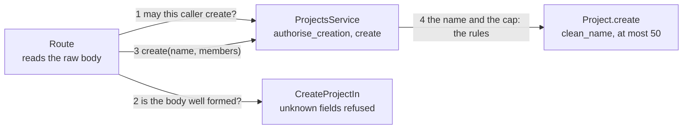
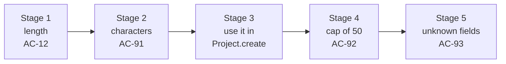

# Task P1.5: Check the name, the members and the fields

**Task ID:** TSK-P1.5  
**Use Case:** UC-P1  
**Design Reference:** the design sequence, step 3 (the name, at most 50 members, names counted once), and the `Project` aggregate  
**Criteria:** AC-12, AC-91, AC-92, AC-93  
**Status:** Built. Plan is a draft  
**Matches the code at:** `7481263`  
**Reviewer:** Pending

Ground rules, the layout and the commands are in the [chapter summary](summary.md).

This is the plan someone follows to build this task. It was written by working backwards from the code that exists, so each
block marked `# file` is a copy of that file at the commit above.

---

## 1. Objective

A project name is plain text, trimmed, 1 to 100 characters, and anything else is refused with `InvalidProjectName`. A
project starts with at most 50 distinct first members, and a request body with a field the route does not define is
refused. All three refusals answer 422 in the shared body shape and never repeat the input.

| AC | Given a name that... | Then | Why |
|---|---|---|---|
| AC-12 | is empty, only spaces, or over 100 characters | it is refused | Without a readable name a project cannot be found or told apart in a list, and an unbounded name can break screens and the audit trail (FR-7). |
| AC-91 | has a control or direction-override character | it is refused with `InvalidProjectName` (422) and no project exists | Such a name can read as another one or hide text, and would reach the trail and the screen. Names are plain text (AC-81, FR-7). |
| AC-92 | an administrator names more than 50 first members | it is refused with a 422 and no project exists | The first members are capped at 50 (decision 23, ADR 0015), so one request cannot write an unbounded number of rows. Members added later are not capped in the alpha. |
| AC-93 | an administrator sends a body with a field the route does not define (`id`, `created_by`, `added_by`, `created_at`, `files`) | it is refused with a 422 and nothing is created | Mass assignment: a field the route does not define must never be taken as input, whether it is ignored or stored (ADR 0015). |

### Expected Behaviour

Given a project name that is empty, only spaces, over 100 characters, or holds a control or direction character, when a
project is created with it, it is refused with `InvalidProjectName` (422) and nothing is created. Given more than 50 first
members, it is refused with `InvalidRequest` (422). Given a body with a field the route does not define, it is refused with
`InvalidRequest` (422). None of the three answers repeats the input.

## 2. Architecture and Reasoning

### Where does this logic belong?

- The name rule and the cap: the `Project` aggregate's domain, in the Projects bounded context. The name rule is one pure
  function, `clean_name`, called by `Project.create`.
- The unknown fields: the HTTP layer (`adapters/inbound`), the only layer that sees a request body.
- Who may create: `ProjectsService.authorise_creation`, called by the route before it reads the body.

### Why?

A name can arrive by another path later, and the domain must refuse it just the same (ADR 0001, ADR 0010). Unknown fields are
an HTTP matter, so the schema and the route refuse them. The map from rule to status is in `adapters/inbound/errors.py`.

The route and the application service must not repeat the length rule or the cap. Nothing outside the domain mentions
`MAX_NAME_LENGTH`, `MAX_FIRST_MEMBERS` or `clean_name` (checked by search at `7481263`).



*Reading guide:* the role is checked first, then the shape of the body, then the rules. The rules have one home, the domain.

### The logic, decision by decision

1. **Trim first, then count.** "   " is empty, and spaces around a good name are not part of it (AC-12).
2. **Count characters, not bytes.** 100 emoji are 100 characters; `len` on a Python `str` already counts them so.
3. **Refuse control characters (category `Cc`) and the direction marks.** The marks are category `Cf`, and `Cf` also holds
   harmless characters, so we list the marks by hand instead of refusing all of `Cf` (AC-91).
4. **The message never repeats the name.** It would carry the hidden characters into the log and onto the screen.
5. **Cap the distinct people, not the list.** The list is de-duplicated first (`dict.fromkeys`, already in `create` from
   TSK-P1.3), then counted: 80 ids naming 50 people are accepted. 50 is accepted, 51 refused (AC-92). The counting of
   duplicates as a criterion (AC-89) is TSK-P1.6.
6. **An unknown field is refused, not ignored** (AC-93). The schema forbids extra fields.
7. **The role is checked before the body is read.** A non administrator who sends a bad name and an unknown field still
   gets 403 (AC-11). So the route cannot let FastAPI validate the body first: it takes the raw object, asks the use case
   whether the caller may, and only then validates it.
8. **A refusal of the input is one body shape, `{"detail": {"code", "message"}}`, status 422, with no detail.** FastAPI's
   and pydantic's own answer lists the input back, so the route catches `ValidationError` and raises `InvalidRequest`
   with a fixed message.

**Where it lives:** the name rule is one pure function `clean_name` in the domain, called by `Project.create`, as is the
cap. Not in the route or the schema: a name can arrive by another path later, and the domain must refuse it just the
same (ADR 0001, ADR 0010). The unknown fields are an HTTP matter, so they are refused in the schema and the route
(`adapters/inbound`), the only layer that sees a request body. The map from rule to status is in
`adapters/inbound/errors.py`.

### Relevant Design

- Aggregate: `Project`, with its `Membership` entity inside it
- Rule: `clean_name` (a pure function in `domain/name.py`), and the cap `MAX_FIRST_MEMBERS` in `Project.create`
- Errors: `InvalidProjectName` and `InvalidRequest`, both answered 422 by the map in `adapters/inbound/errors.py`
- Verification: unit tests of the rules and the use case, and API tests of the route

## 3. Implementation Plan

1. Length rule: name the error, write the tests, write `clean_name` (AC-12).
2. Character rule: write the tests, finish `clean_name` (AC-91).
3. Use it where a project is made: one line in `Project.create`.
4. The cap on first members: name `InvalidRequest`, write the tests, write the rule (AC-92).
5. Refuse unknown fields, and check the role before the body: write the tests, forbid extra fields, split out
   `authorise_creation`, have the route call it first (AC-93, and AC-11 for the order).



*Reading guide:* the stages are a work order. The test comes before the code in each, except stage 3, which is a call to code
that exists.

### Target Files

- `apps/api/app/projects/domain/name.py`
- `apps/api/app/projects/domain/errors.py`
- `apps/api/app/projects/domain/project.py`
- `apps/api/app/projects/application/service.py`
- `apps/api/app/projects/adapters/inbound/schemas.py`
- `apps/api/app/projects/adapters/inbound/http.py`
- `apps/api/app/projects/adapters/inbound/errors.py`
- `apps/api/tests/test_projects_input.py`
- `apps/api/tests/test_projects_api.py`

---

## 4. RED: Write the Failing Test

Each stage writes its tests first. The commands run from `apps/api/`.

There is no RED for stage 3: it is a call to code that exists, covered by the tests of stages 1 and 2.

### Stage 1: the length rule (AC-12)

#### Test

First name the error in `app/projects/domain/errors.py`:

```python
# apps/api/app/projects/domain/errors.py
class InvalidProjectName(ProjectsError):
    code = "invalid_project_name"
```

Then these tests, each marked `@pytest.mark.ac("AC-12")` (two of the several in the file):

```python
# apps/api/tests/test_projects_input.py
@pytest.mark.ac("AC-12")
@pytest.mark.parametrize("bad", ["", "   ", "\u00a0 ", "x" * 101, " " + "x" * 101 + " "])
def test_an_empty_blank_or_too_long_name_is_refused(bad):
    with pytest.raises(InvalidProjectName):
        clean_name(bad)
```

```python
# apps/api/tests/test_projects_input.py
@pytest.mark.ac("AC-12")
def test_the_length_is_counted_in_characters_not_bytes():
    assert clean_name("\U0001f600" * 100) == "\U0001f600" * 100
    assert clean_name("é" * 100) == "é" * 100
    with pytest.raises(InvalidProjectName):
        clean_name("\U0001f600" * 101)
```

#### Why this test?

It pins the length rule on the rule itself: empty, blank, a non-breaking space, 101 characters, 101 with spaces around,
exactly 100 (accepted, and the spaces removed), and 100 emoji accepted and 101 refused.

#### Expected Result

The tests fail before the rule exists: a collection error, because `clean_name` does not exist yet.

#### Actual Execution Evidence

**Status:** Not executed. The collection error is reasoned from the import, not run  
**Test run:** `uv run pytest tests/test_projects_input.py -q -x`  
**Failure reason:** `clean_name` does not exist

### Stage 2: the character rule (AC-91)

#### Test

```python
# apps/api/tests/test_projects_input.py
@pytest.mark.ac("AC-91")
@pytest.mark.parametrize(
    "char", ["\n", "\t", "\r", "\x00", "\x7f", "\u202e", "\u202a", "\u2066", "\u2069", "\u200e", "\u200f", "\u061c"]
)
def test_a_name_with_a_control_or_bidirectional_character_is_refused(char):
    with pytest.raises(InvalidProjectName) as e:
        clean_name(f"Al{char}pha")
    assert "Alpha" not in e.value.message and char not in e.value.message
```

#### Why this test?

A name with a control character or a direction mark can read as another name or hide text. The character goes in the middle
of the name, and the message must hold neither `Alpha` nor the character: the rule of reasons (AC-81).

#### Expected Result

All 12 character cases fail while the 7 length cases still pass.

#### Actual Execution Evidence

**Status:** Executed at `9e96f0c`, against the stage 1 shape of `name.py`  
**Test run:** `uv run pytest tests/test_projects_input.py -q -k "empty_blank or 100_characters or counted or control_or_bidi"`  
**Failure reason:** `12 failed, 7 passed`: the control and direction characters are accepted, because there is no character rule yet

### Stage 4: the cap on first members (AC-92)

#### Test

First name the error in `app/projects/domain/errors.py`. `InvalidRequest` is the one answer for input that is wrong in shape,
not in one field:

```python
# apps/api/app/projects/domain/errors.py
class InvalidRequest(ProjectsError):
    code = "invalid_request"
```

```python
# apps/api/tests/test_projects_input.py
@pytest.mark.ac("AC-92")
def test_more_than_50_first_members_is_refused_before_the_repository_is_asked():
    with pytest.raises(InvalidRequest):
        ProjectsService(ExplodingRepo(), FakeAccountStatus(), FakeProjectsAudit(), FakePeople()).create(
            ADMIN, "Alpha", [f"acc-{i}" for i in range(51)]
        )
```

```python
# apps/api/tests/test_projects_api.py
@pytest.mark.ac("AC-92")
def test_51_first_members_are_refused_and_50_are_accepted(api, admin, engine):
    ids = [active_user(api, admin, f"sub-{i}", f"u{i}@x.test")[1] for i in range(51)]
    refused(api.post("/projects", headers=admin, json={"name": "Alpha", "members": ids}), "invalid_request")
    assert project_count(engine) == 0
    r = api.post("/projects", headers=admin, json={"name": "Alpha", "members": ids[:50]})
    assert (r.status_code, len(r.json()["members"])) == (201, 50)
```

#### Why this test?

The first members are capped at 50 (decision 23, ADR 0015), so one request cannot write an unbounded number of rows. The use
case test also pins that the repository is never asked. 50 accepted, and 80 ids naming 50 people accepted, are in the same
files.

#### Expected Result

The two tests that refuse 51 fail while there is no cap. Accepting 50 and counting distinct ids already hold.

#### Actual Execution Evidence

**Status:** Executed at `9e96f0c`, with the cap lines removed from `create`  
**Test run:** `uv run pytest tests/test_projects_input.py tests/test_projects_api.py -q -m AC_92`  
**Failure reason:** `2 failed, 2 passed`: the two that refuse 51 find none refused. (The collection error before the error class is added is not run: reasoned from the import.)

### Stage 5: unknown fields, and the role before the body (AC-93, AC-11)

#### Test

```python
# apps/api/tests/test_projects_api.py
@pytest.mark.ac("AC-93")
@pytest.mark.parametrize(
    "field,value",
    [("id", "p-1"), ("created_by", "acc-x"), ("added_by", "acc-x"), ("created_at", "2020-01-01"), ("files", ["f"])],
)
def test_an_unknown_field_is_refused_not_ignored_and_not_echoed(api, admin, engine, field, value):
    r = api.post("/projects", headers=admin, json={"name": "Alpha", "members": [], field: value})
    refused(r, "invalid_request")
    assert str(value) not in r.text and "Alpha" not in r.text
    assert project_count(engine) == 0
```

```python
# apps/api/tests/test_projects_api.py
@pytest.mark.ac("AC-93")
def test_the_known_fields_still_work(api, admin):
    assert api.post("/projects", headers=admin, json={"name": "Alpha", "members": []}).status_code == 201
    assert api.post("/projects", headers=admin, json={"name": "Beta"}).status_code == 201
```

```python
# apps/api/tests/test_projects_api.py
@pytest.mark.ac("AC-11")
def test_the_role_is_checked_before_unknown_fields_and_before_a_bad_name(api, admin, engine):
    maya_h, _ = active_user(api, admin, "sub-maya", "maya@x.test")
    r = api.post("/projects", headers=maya_h, json={"name": "", "members": [], "id": "p-1"})
    assert (r.status_code, r.json()["detail"]["code"]) == (403, "forbidden")
    assert project_count(engine) == 0
```

#### Why this test?

Mass assignment: a field the route does not define must never be taken as input, whether it is ignored or stored (ADR 0015).
The third test only pins the order, the role before the input. AC-11 itself is proved by TSK-P1.4.

#### Expected Result

Without `extra="forbid"` the five unknown fields are accepted. With it but with the old route, FastAPI validates the body
before the route runs, so a person who is not an administrator gets 422 where AC-11 wants 403.

#### Actual Execution Evidence

**Status:** Executed at `9e96f0c`, twice  
**Test run:** `uv run pytest tests/test_projects_api.py -q`  
**Failure reason:** with `extra="forbid"` removed: `5 failed, 23 passed` (the five unknown fields are each accepted and answered 201). With it forbidden but the old route: `1 failed, 27 passed` (the role test fails: 422 where 403 is wanted)

---

## 5. GREEN: Implement the Behaviour

### Stage 1: the length rule

#### Implementation

This is the stage 1 shape of `app/projects/domain/name.py`, not the final file:

```python
# app/projects/domain/name.py, stage 1
from app.projects.domain.errors import InvalidProjectName

MAX_NAME_LENGTH = 100


def clean_name(name: str) -> str:
    text = name.strip()
    if not 1 <= len(text) <= MAX_NAME_LENGTH:
        raise InvalidProjectName(f"A project name has 1 to {MAX_NAME_LENGTH} characters.")
    return text
```

#### Explanation

Trim first, then count. `len` on a Python `str` counts characters, not bytes.

#### Actual Execution Evidence

**Status:** Executed at `9e96f0c`  
**Test run:** the length cases of `tests/test_projects_input.py`  
**Result:** the 7 length cases pass

### Stage 2: the character rule

#### Implementation

The final file:

```python
# apps/api/app/projects/domain/name.py
"""The rule of a project's name (AC-12, AC-91): plain text, trimmed, 1 to 100 characters. Pure."""

import unicodedata

from app.projects.domain.errors import InvalidProjectName

MAX_NAME_LENGTH = 100
# Bidirectional marks, embeddings, overrides and isolates: they can make a name read as another one.
BIDIRECTIONAL = frozenset("‎‏؜" + "".join(map(chr, [*range(0x202A, 0x202F), *range(0x2066, 0x206A)])))


def clean_name(name: str) -> str:
    """The trimmed name, or InvalidProjectName. The length is counted in Unicode characters after trimming. The
    message never repeats the name: it would carry the hidden characters to the log and the screen."""
    text = name.strip()
    if not 1 <= len(text) <= MAX_NAME_LENGTH:
        raise InvalidProjectName(f"A project name has 1 to {MAX_NAME_LENGTH} characters.")
    if any(c in BIDIRECTIONAL or unicodedata.category(c) == "Cc" for c in text):
        raise InvalidProjectName("A project name is plain text, with no control or direction characters.")
    return text
```

#### Explanation

The control characters are category `Cc`. The direction marks are category `Cf`, which also holds harmless characters, so the
marks are listed by hand and not all of `Cf` is refused. The message never repeats the name: it would carry the hidden
characters into the log and onto the screen.

#### Actual Execution Evidence

**Status:** Executed at `9e96f0c`  
**Test run:** the name tests of `tests/test_projects_input.py`  
**Result:** all 19 name tests pass

### Stage 3: use it where a project is made

#### Implementation

In `Project.create` the first line of the body is the call, with `from app.projects.domain.name import clean_name` at the top
of the file:

```python
# app/projects/domain/project.py, inside Project.create
        name = clean_name(name)
```

#### Explanation

One call, so the rule has one caller and one home.

### Stage 4: the cap on first members

#### Implementation

```python
# app/projects/domain/project.py
MAX_FIRST_MEMBERS = 50
```

```python
# apps/api/app/projects/domain/project.py, Project.create
    @classmethod
    def create(cls, caller: Caller, name: str, member_ids: Iterable[str]) -> "Project":
        """A new project. Its id is random, so it reveals nothing about count or order (ADR 0015). Only the people
        named are members: the creator is one only if named (AC-10). The name is trimmed and checked (AC-12, AC-91);
        at most 50 distinct first members (AC-92)."""
        name = clean_name(name)
        ids = tuple(dict.fromkeys(member_ids))
        if len(ids) > MAX_FIRST_MEMBERS:
            raise InvalidRequest(f"A project starts with at most {MAX_FIRST_MEMBERS} members.")
        memberships = tuple(Membership(i, added_by=caller.account_id) for i in ids)
        return cls(str(uuid.uuid4()), name, caller.account_id, memberships)
```

In `app/projects/adapters/inbound/errors.py` the map holds these two entries (the others in the file are other tasks'). Without
an entry an unmapped rule answers 400:

```python
# app/projects/adapters/inbound/errors.py
    InvalidProjectName: 422,
    InvalidRequest: 422,
```

#### Explanation

The list is de-duplicated first (`dict.fromkeys`), then counted: 80 ids naming 50 people are accepted, 50 is accepted and 51 is
refused. The file also holds the later `add_member` and `remove_member` of UC-P2, and its `errors` import also names
`MemberNotEligible`.

#### Actual Execution Evidence

**Status:** Executed at `9e96f0c`, at the end of stage 5  
**Test run:** the AC-92 use case and API tests  
**Result:** pass, as part of the 53 below

### Stage 5: unknown fields, and the role first

#### Implementation

Forbid extra fields in the schema:

```python
# apps/api/app/projects/adapters/inbound/schemas.py
class CreateProjectIn(BaseModel):
    model_config = ConfigDict(extra="forbid")  # mass assignment: an unknown field is refused, not ignored (AC-93)

    name: str
    members: list[str] = []  # the first members, as account ids
```

Split the role check out of `create`, so a caller that bypasses the route is refused just the same (`create` calls it as its
first line):

```python
# apps/api/app/projects/application/service.py, ProjectsService.authorise_creation
    @staticmethod
    def authorise_creation(caller: Caller) -> None:
        """Only an administrator creates a project. The route calls it before it reads the body (AC-11, AC-93)."""
        if not caller.is_administrator:
            raise NotAnAdministrator("Administrators only.")
```

The route reads the raw object, checks the role, then validates:

```python
# apps/api/app/projects/adapters/inbound/http.py, inside build_router
    @router.post("/projects", status_code=201, response_model=ProjectOut)
    def create_project(
        raw: dict[str, Any] = Body(),
        who: Caller = Depends(caller_dependency),
        svc: ProjectsService = Depends(service_dependency),
    ):
        svc.authorise_creation(who)  # the role first, then the input (AC-11, AC-93)
        try:
            body = CreateProjectIn.model_validate(raw)
        except ValidationError:  # no detail: it would echo the input
            raise InvalidRequest("The request is not valid.") from None
        return ProjectOut.of(svc.create(who, body.name, body.members))
```

A body that is not even an object: FastAPI would refuse it with an answer that echoes the input, so `/projects` gets the same
shape of refusal:

```python
# apps/api/app/projects/adapters/inbound/errors.py, inside register_error_handlers
    @app.exception_handler(RequestValidationError)
    async def invalid_request(request: Request, exc: RequestValidationError):
        """A body that is not even a JSON object, on /projects only. FastAPI's own answer echoes the input."""
        if request.url.path != "/projects" and not request.url.path.startswith("/projects/"):
            return await request_validation_exception_handler(request, exc)
        error = InvalidRequest("The request is not valid.")
        refused(request, error.code)
        return JSONResponse({"detail": {"code": error.code, "message": error.message}}, status_code=422)
```

#### Explanation

An unknown field is refused, not ignored (AC-93). The role is checked before the body is read, so a person who may not create a
project gets 403 even with a bad name and an unknown field (AC-11). The route cannot let FastAPI validate the body first, so it
takes the raw object. A refusal of the input is one body shape, `{"detail": {"code", "message"}}`, status 422, with no detail.

The `refused(...)` line in the last handler, with the `refused` helper and the `security_log` argument it uses, belong to TSK-P1.7
(the security log, AC-48). At the commit that built this task the handler had no such line. No test in this task sends a body that
is not an object, so this handler is not pinned here.

#### Actual Execution Evidence

**Status:** Executed at `9e96f0c`  
**Test run:** `uv run pytest tests/test_projects_input.py tests/test_projects_api.py -q`  
**Result:** `53 passed` (the counts in section 6 are at `7481263`, so they are higher). The handler for a body that is not an object: not run

---

## 6. REFACTOR: Improve the Design

### Planned Improvements

None identified in this task.

### Actual Changes

None recorded. The commit built the task in one go, so there was no separate refactor step. Two later tasks touched this
code, and they are changes, not refactors: TSK-P1.6 changed the ids in the 51-member API test, and TSK-P1.7 added the
`refused(...)` line to the handler.

### Regression Verification

**Status:** Executed on 2026-11-24 at `7481263`, from `apps/api/`

```
uv run pytest tests/test_projects_input.py -q       # the whole file: 25 passed
uv run pytest tests/test_projects_api.py -q         # all UC-P1 tasks so far: 31 passed
uv run pytest tests/test_projects_input.py tests/test_projects_api.py -q -m "AC_12 or AC_91 or AC_92 or AC_93"   # 40 passed
```

By criterion, in the two files: AC-12 14 passed, AC-91 16, AC-92 4, AC-93 6.

---

## 7. Architecture Review

- [x] Domain has no infrastructure dependency. `tests/test_architecture.py`: 21 passed at `7481263`. The domain files import only the standard library and each other.
- [x] Business invariant remains inside the aggregate. The length rule and the cap are in `domain/name.py` and `Project.create`.
- [x] Application service does not duplicate the rule. A search finds no `MAX_NAME_LENGTH`, `MAX_FIRST_MEMBERS` or `clean_name` outside the domain.
- [ ] Implementation matches the design model. The design sequence and the use case name a `ProjectName` value object, but the code has a function, `clean_name`, and no `ProjectName` type. Decide whether to change the code or the design.

**Design reviewer findings:** Not run for this task.

---

## 8. Decisions and Learnings

### Decisions

- Decision 14 (owner): authorisation is checked before the input is validated.
- Decision 23 and ADR 0015: the first members are capped at 50 and de-duplicated; a name follows the rule of reasons (AC-81).
- ADR 0010: where the code goes. ADR 0015: a field the route does not define is never taken as input.

### Learnings

**Mass assignment:** a request that sets a field the author never meant to expose, because the code copies every field it receives.

**Rule of reasons:** a refusal says which rule was broken and never repeats the input, so hidden characters do not reach the log or the screen.

### Open Questions

- Should the code have a `ProjectName` value object, as the design says, or should the design say `clean_name`?
- Members added later are not capped in the alpha. Should they be?
- No test sends a body that is not a JSON object, so that handler is not pinned.

---

## 9. Implementation Evidence

**Source files:** the nine files under Target Files  
**Test files:** `apps/api/tests/test_projects_input.py` and `apps/api/tests/test_projects_api.py`  
**Git commits:** `9e96f0c` built the task. The code is matched at `7481263`  
**Architecture checks:** `tests/test_architecture.py`, 21 passed at `7481263`  
**Related ADRs:** 0001, 0010, 0015

### Where the real build differs from this plan

- The commit built it all at once, test and code in one go. The stages are a work order, and the evidence lines were checked by taking
  the code of `9e96f0c` apart, not by replaying the history.
- The 51-member API test of this commit used made-up ids (`acc-0`, ...). TSK-P1.6 changed them to real active accounts, because from
  then on the ids are looked up. The use case tests keep made-up ids and a permissive `FakeAccountStatus`.
- At `9e96f0c` the use case constructor took only the repository. At `7481263` the tests build `ProjectsService` with four arguments
  (TSK-P1.6, TSK-P1.7).
- The AC-92 and AC-93 tests run on SQLite here. The PostgreSQL run was not repeated for this plan (no `TEST_DATABASE_URL` was set); the
  commit message reports 315 on PostgreSQL.

---

## 10. Developer Review

**Implementation status:** Built at `9e96f0c`  
**Review status:** Pending

### Reviewer Feedback

No feedback recorded. A read-only agent checked this plan's accuracy against the code on 2026-11-24, which is not a review by a person.

### Approval

**Approved by:** Pending  
**Approved revision:** Pending  
**Approval date:** Pending

Approval confirms review of the implementation explanation and associated evidence, not a guarantee that the software is defect-free.
