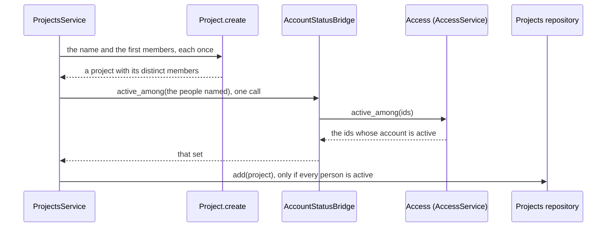
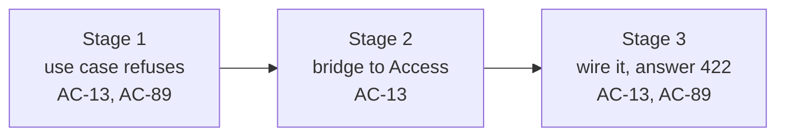

# Task P1.6: First members need an active account, each counted once

**Task ID:** TSK-P1.6  
**Use Case:** UC-P1  
**Design Reference:** the design sequence, step 4 (each named first member has an active account, counted once), and the `AccountStatus` port of Projects  
**Criteria:** AC-13, AC-89  
**Status:** Built. Plan is a draft  
**Matches the code at:** `7481263`  
**Reviewer:** Pending

Ground rules, the layout and the commands are in the [chapter summary](summary.md). This task needs TSK-P1.1 (Access answers which
accounts are active among some ids) and TSK-P1.3 (the project is created).

This is the plan someone follows to build this task. It was written by working backwards from the code that exists, so each
block marked `# file` is a copy of that file at the commit above.

---

## 1. Objective

Creating a project may name first members. Each must be a person with an active account, and each is one member however often
they are named.

| AC | Given | Then | Why |
|---|---|---|---|
| AC-13 | an administrator names a first member who is not active or does not exist | it is refused, with one answer for an account that cannot be a member | A pending, a deactivated and an unknown account get the same answer, so the refusal cannot be used to find out which ids exist or in what state (FR-7). |
| AC-89 | an administrator names the same active account twice | the project has that person once | First members are de-duplicated before anything is written, so the project has one membership and, once TSK-P1.7 is built, one audit entry that names them once (FR-7). |

### Expected Behaviour

Given a first member who is pending, deactivated or unknown, when a project is created, it is refused with `MemberNotEligible`
(422), one identical answer for the three that names no id and no status, and nothing is written, not even the project. Given
one inactive person among active ones, everyone is refused. Given the same active person named twice, the project has one
membership and Access is asked about that id once. Given no first members, nobody is asked.

## 2. Architecture and Reasoning

### Where does this logic belong?

- The question: `AccountStatus.active_among(ids)`, a port of Projects in `application/ports.py`. Projects declares what it needs.
- The check: `ProjectsService.create`, the use case. It is a fact about another context, so it cannot be a rule of the `Project`
  aggregate.
- The answer: `AccountStatusBridge` in `composition/bridges.py`, the one place that sees both Access and Projects. It calls
  Access's own use case.
- The one refusal: `MemberNotEligible` in `domain/errors.py`, answered 422 by the map in `adapters/inbound/errors.py`.

### Why?

Projects must not import Access (ADR 0002, 0010, 0015), so Projects asks through a port of its own and the composition root
wires the answer. An architecture test fails if Projects imports another context. The meaning of "active" stays in Access
(`Account.is_active`), so it means the same here as everywhere.

### The logic, decision by decision

1. **Projects asks, Access answers, and Projects never imports Access.** Projects declares its own port,
   `AccountStatus.active_among(ids)`; a bridge in `composition/` answers it by calling Access's own use case (ADR 0002,
   0010, 0015). An architecture test fails if Projects imports another context.
2. **One question for all the people named,** not one for each: the ids are asked in one call (no N+1).
3. **Each person once.** The ids are already de-duplicated by `Project.create` (`dict.fromkeys`, TSK-P1.3), so the
   service asks about `set(project.members)` and Access is asked about each id once (AC-89). This task adds the test that
   pins it, not new de-duplication code.
4. **One answer for every reason.** `MemberNotEligible` carries a fixed message and names no id and no status (AC-13).
5. **One bad person refuses everyone.** The check is before the save, so nothing is written, not even the project.
6. **Order of the refusals:** the role first, then the name and the cap (rules in the domain, no lookup), then the
   eligibility. A request that is already refused for a cheaper reason never asks Access (AC-11, AC-12, AC-92).
7. **No names, no list:** an empty list of first members asks nobody.

Known gap, accepted in the commit message: there is no lock between the check and the save, so a person deactivated in that gap
could still become a member.



*Reading guide:* the question is asked once, after the domain has trimmed and counted, and the project is saved only if the answer
holds every person named.

### Relevant Design

- Aggregate: `Project`, which already holds each first member once
- Port: `AccountStatus` (`active_among`), declared by Projects and answered through `AccountStatusBridge` in `composition/`
- Error: `MemberNotEligible`, answered 422
- Verification: unit tests of the use case with a fake port, a bridge test over a real `AccessService` with fakes, an
  architecture test, and API tests over the real app and database

## 3. Implementation Plan

1. The use case refuses an inactive first member: write the fake port and the tests, name the error, declare the port, add
   the check (AC-13, AC-89).
2. Access answers the port: write the bridge test and the architecture test, write the bridge (AC-13).
3. Wire it and answer 422: write the HTTP tests, wire the bridge in `create_app`, map the error to 422 (AC-13, AC-89).



*Reading guide:* the stages are a work order. Each starts from a test, and each stage's check passes only once the one before it
exists.

### Target Files

- `apps/api/app/projects/domain/errors.py`
- `apps/api/app/projects/application/ports.py`
- `apps/api/app/projects/application/service.py`
- `apps/api/app/projects/adapters/inbound/errors.py`
- `apps/api/app/composition/bridges.py`
- `apps/api/app/composition/app.py`
- `apps/api/tests/fakes.py`
- `apps/api/tests/test_projects_service.py`
- `apps/api/tests/test_projects_composition.py`
- `apps/api/tests/test_architecture.py`
- `apps/api/tests/test_projects_api.py`

---

## 4. RED: Write the Failing Test

Each stage writes its tests first. The commands run from `apps/api/`.

### Stage 1: the use case refuses an inactive first member (AC-13, AC-89)

#### Test

First a fake for the port, so the use case can be tested with no Access:

```python
# apps/api/tests/fakes.py
class FakeAccountStatus:
    """Stands in for Projects' AccountStatus port. `active=None` means every id is an active account."""

    def __init__(self, active: set[str] | None = None):
        self.active = active
        self.asked: list[set[str]] = []

    def active_among(self, ids):
        self.asked.append(set(ids))
        return set(ids) if self.active is None else set(ids) & self.active
```

Then a helper that builds the service over fakes (the constructor has four arguments at `7481263`: TSK-P1.7 added the audit and
people ports):

```python
# apps/api/tests/test_projects_service.py
def service_with(active):
    projects, status = FakeProjects(), FakeAccountStatus(set(active))
    return ProjectsService(projects, status, FakeProjectsAudit(), FakePeople()), projects, status
```

Then the tests of the use case:

```python
# apps/api/tests/test_projects_service.py
@pytest.mark.ac("AC-13")
@pytest.mark.parametrize("member", ["acc-pending", "acc-deactivated", "acc-unknown"])
def test_a_first_member_who_is_not_active_is_refused_with_one_answer_and_nothing_is_saved(member):
    service, projects, _ = service_with({"acc-maya"})
    with pytest.raises(MemberNotEligible) as refusal:
        service.create(ADMIN, "Alpha", [member])
    assert (refusal.value.code, refusal.value.message) == (
        "member_not_eligible",
        "That person cannot be added to or removed from this project.",
    )
    assert member not in str(refusal.value)
    assert projects.rows == {}
```

```python
# apps/api/tests/test_projects_service.py
@pytest.mark.ac("AC-13")
def test_one_inactive_among_active_members_refuses_all_and_saves_nothing():
    service, projects, _ = service_with({"acc-maya", "acc-bob"})
    with pytest.raises(MemberNotEligible):
        service.create(ADMIN, "Alpha", ["acc-maya", "acc-gone", "acc-bob"])
    assert projects.rows == {}
```

```python
# apps/api/tests/test_projects_service.py
@pytest.mark.ac("AC-13")
def test_eligibility_is_checked_after_authorisation_and_after_the_input_rules():
    service, projects, status = service_with(set())
    with pytest.raises(NotAnAdministrator):
        service.create(USER, "Alpha", ["acc-gone"])
    with pytest.raises(InvalidProjectName):
        service.create(ADMIN, "", ["acc-gone"])
    with pytest.raises(InvalidRequest):
        service.create(ADMIN, "Alpha", [f"acc-{i}" for i in range(51)])
    assert status.asked == [] and projects.rows == {}
```

```python
# apps/api/tests/test_projects_service.py
@pytest.mark.ac("AC-89")
def test_naming_the_same_active_person_twice_makes_one_membership_and_asks_about_the_id_once():
    service, projects, status = service_with({"acc-maya"})
    p = service.create(ADMIN, "Alpha", ["acc-maya", "acc-maya"])
    assert len(p.memberships) == 1 and p.members == {"acc-maya"}
    assert projects.by_id(p.id) is p.project
    assert status.asked == [{"acc-maya"}]
```

```python
# apps/api/tests/test_projects_service.py
@pytest.mark.ac("AC-13")
def test_no_first_member_asks_nobody_and_is_accepted():
    service, _, status = service_with(set())
    assert service.create(ADMIN, "Alpha", []).members == frozenset()
    assert all(not asked for asked in status.asked)
```

The existing `ProjectsService(...)` calls in `tests/test_projects_service.py` and `tests/test_projects_input.py` now pass
`FakeAccountStatus()` as the second argument. First, name the error (the final text, below):

```python
# apps/api/app/projects/domain/errors.py
class MemberNotEligible(ProjectsError):
    """One answer for a first member who is pending, deactivated or unknown: it names no id and no status (AC-13)."""

    code = "member_not_eligible"

    def __init__(self):
        super().__init__("That person cannot be added to or removed from this project.")
```

#### Why this test?

AC-13 is about one answer: a pending, a deactivated and an unknown account must be indistinguishable, and the message must not
hold the id. The second test pins that one bad person refuses all. The third pins the order, so a request refused for a cheaper
reason never asks Access. AC-89 is pinned by the `asked == [{"acc-maya"}]` line: Access hears the id once.

#### Expected Result

Every test that builds the service fails with `TypeError: ProjectsService.__init__() takes 2 positional arguments but 3 were given`,
because the service does not yet take the port.

#### Actual Execution Evidence

**Status:** Executed at `c5c6f64`, test files from that commit on the code of `9e96f0c`, with the error added  
**Test run:** `uv run pytest tests/test_projects_service.py tests/test_projects_input.py -q`  
**Failure reason:** every test that builds the service fails with `TypeError: ProjectsService.__init__() takes 2 positional arguments but 3 were given`

### Stage 2: Access answers the port (AC-13)

#### Test

```python
# apps/api/tests/test_projects_composition.py
@pytest.mark.ac("AC-13")
def test_the_account_status_bridge_answers_through_accesss_own_is_active_rule():
    from app.access.application.service import AccessService
    from app.composition.bridges import AccountStatusBridge
    from tests.fakes import FakeAccounts, FakeAudit, FakeIdp, FakeUnitOfWork

    accounts = FakeAccounts()
    for acc_id, status in (("a", Status.active), ("p", Status.pending), ("d", Status.deactivated)):
        accounts.add(
            Account(acc_id, f"sub-{acc_id}", acc_id, f"{acc_id}@x.test", Role.user, status, datetime(2026, 1, 1), None)
        )
    access = AccessService(accounts, FakeAudit(), FakeIdp(), set(), uow=FakeUnitOfWork())
    bridge = AccountStatusBridge(access)
    assert bridge.active_among({"a", "p", "d", "unknown"}) == {"a"}
    assert bridge.active_among(set()) == set()
    assert isinstance(bridge.active_among({"a"}), set)
```

And an architecture test that no file of Projects imports another context, that the port imports nothing from Access, and that
the bridge does:

```python
# apps/api/tests/test_architecture.py
def test_projects_imports_no_other_context_only_composition_sees_both():
    # UC-P1 TSK-P1.6: Projects asks about accounts through its own AccountStatus port, answered by a bridge.
    for f in py_files(APP / "projects"):
        for mod in imports_of(f):
            assert not any(mod == f"app.{c}" or mod.startswith(f"app.{c}.") for c in contexts() if c != "projects"), (
                f"{f.relative_to(APP)} imports {mod}: Projects knows no other context (ADR 0002, 0010, 0015)"
            )
    ports = imports_of(APP / "projects" / "application" / "ports.py")
    assert not any(m.startswith("app.access") for m in ports)
    assert any(p.name == "bridges.py" for p in py_files(APP / "composition"))
    assert any(m.startswith("app.access") for m in imports_of(APP / "composition" / "bridges.py"))
```

#### Why this test?

The bridge test builds a real `AccessService` over fakes holding one active, one pending and one deactivated account, and shows
that only the active one is answered, that an empty question gives an empty answer, and that an unknown id is never answered.
The architecture test makes the boundary a failing test, not a habit.

#### Expected Result

The bridge test fails because `AccountStatusBridge` does not exist, and the three HTTP tests of stage 3 fail because they build
the app.

#### Actual Execution Evidence

**Status:** Executed at `c5c6f64`  
**Test run:** `uv run pytest tests -q -m "AC_13 or AC_89"`  
**Failure reason:** `4 failed, 7 passed`: the three HTTP tests of stage 3, which build the app, and the bridge test

### Stage 3: wire it and answer 422 (AC-13, AC-89)

#### Test

The HTTP tests, over the real app and database, with the `active_user(...)` and `register(...)` helpers that approve or leave an
account pending. First the helper that checks the one answer:

```python
# apps/api/tests/test_projects_api.py
def ineligible(r):
    assert r.status_code == 422
    assert r.json() == {
        "detail": {
            "code": "member_not_eligible",
            "message": "That person cannot be added to or removed from this project.",
        }
    }
```

```python
# apps/api/tests/test_projects_api.py
@pytest.mark.ac("AC-13")
def test_a_pending_a_deactivated_and_an_unknown_account_get_the_identical_refusal_and_nothing_is_written(
    api, admin, engine
):
    _, pending_id = register(api, "sub-pen", "pen@x.test")
    _, gone_id = active_user(api, admin, "sub-gone", "gone@x.test")
    assert api.post(f"/accounts/{gone_id}/deactivate", headers=admin, json={"reason": "left"}).status_code == 200
    answers = []
    for member in (pending_id, gone_id, str(uuid.uuid4())):
        r = api.post("/projects", headers=admin, json={"name": "Alpha", "members": [member]})
        ineligible(r)
        assert member not in r.text
        answers.append((r.status_code, r.json()))
    assert answers[0] == answers[1] == answers[2]
    assert project_count(engine) == 0
```

```python
# apps/api/tests/test_projects_api.py
@pytest.mark.ac("AC-13")
def test_one_active_and_one_inactive_member_refuses_all_and_writes_nothing(api, admin, engine):
    _, maya_id = active_user(api, admin, "sub-maya", "maya@x.test")
    _, pending_id = register(api, "sub-pen", "pen@x.test")
    ineligible(api.post("/projects", headers=admin, json={"name": "Alpha", "members": [maya_id, pending_id]}))
    assert project_count(engine) == 0
    with Session(engine) as s:
        assert s.execute(text("SELECT count(*) FROM memberships")).scalar_one() == 0
```

```python
# apps/api/tests/test_projects_api.py
@pytest.mark.ac("AC-89")
def test_naming_the_same_active_person_twice_makes_one_membership(api, admin, engine):
    _, maya_id = active_user(api, admin, "sub-maya", "maya@x.test")
    r = api.post("/projects", headers=admin, json={"name": "Alpha", "members": [maya_id, maya_id]})
    assert (r.status_code, r.json()["members"]) == (201, [{"id": maya_id, "name": "maya"}])
    with Session(engine) as s:
        assert s.execute(text("SELECT count(*) FROM memberships")).scalar_one() == 1
```

The 51-member test of TSK-P1.5 changes to register 51 real active accounts, because from now on the ids are looked up.

#### Why this test?

The answer for a pending, a deactivated and a made-up UUID must be the same status and the same body, and must not hold the id
(AC-13). The mixed list shows that no project and no membership row is written. The duplicate test shows one row in
`memberships` through the whole stack (AC-89).

#### Expected Result

With the bridge written but not wired, the three HTTP tests fail. With the wiring but no status entry, the two refusal tests
fail, because the unmapped error answers 400 where 422 is wanted.

#### Actual Execution Evidence

**Status:** Executed at `c5c6f64`, twice  
**Test run:** `uv run pytest tests -q -m "AC_13 or AC_89"`  
**Failure reason:** before the wiring: `3 failed, 8 passed` (the three HTTP tests fail because the app does not use the bridge). With the wiring but no status entry: `2 failed, 9 passed` (the two refusal tests fail). That the status is then the default 400 is read from the code, not observed

---

## 5. GREEN: Implement the Behaviour

### Stage 1: the use case refuses an inactive first member

#### Implementation

Declare the port:

```python
# apps/api/app/projects/application/ports.py
class AccountStatus(Protocol):
    def active_among(self, ids: set[str]) -> set[str]:
        """Of these account ids, the ones whose people may be members."""
        ...
```

Give `ProjectsService` the port as its second argument (`self._accounts = accounts`; the constructor also takes the audit and
people ports, from TSK-P1.7), and add the check to `create`, after `Project.create` has applied the name and the cap. These are
the lines this task adds (the audit call after them is TSK-P1.7):

```python
# apps/api/app/projects/application/service.py, inside ProjectsService.create
        project = Project.create(caller, name, member_ids)
        named = set(project.members)  # each person once (AC-89)
        if named and not named <= self._accounts.active_among(named):
            raise MemberNotEligible  # pending, deactivated or unknown: one answer (AC-13)
        self._projects.add(project)
```

#### Explanation

`set(project.members)` holds each person once, so Access is asked once for each id (AC-89). `named <= active_among(named)` is
true only if every person named is active. One missing person raises the one error, before the save, so nothing is written. An
empty set skips the question.

#### Actual Execution Evidence

**Status:** Executed at `c5c6f64`  
**Test run:** `uv run pytest tests/test_projects_service.py tests/test_projects_input.py -q`  
**Result:** `37 passed` (the file counts at `7481263` are higher, see section 6)

### Stage 2: Access answers the port

#### Implementation

Add the bridge to `app/composition/bridges.py`, with `from app.access.application.service import AccessService` at the top of the file:

```python
# apps/api/app/composition/bridges.py
class AccountStatusBridge:
    """Projects' AccountStatus port, answered by Access's use case, on the same session as the request."""

    def __init__(self, access: AccessService):
        self._access = access

    def active_among(self, ids: set[str]) -> set[str]:
        return set(self._access.active_among(list(ids)))
```

#### Explanation

`AccessService.active_among` is TSK-P1.1. It uses the account's own `is_active` rule, so "active" means the same here as
everywhere. The bridge only turns Access's list into the set that Projects asked for.

#### Actual Execution Evidence

**Status:** Executed at `c5c6f64`  
**Test run:** `uv run pytest tests -q -m "AC_13 or AC_89"`  
**Result:** `3 failed, 8 passed`: the bridge test now passes, the three HTTP tests still fail because the app does not use it

### Stage 3: wire it and answer 422

#### Implementation

In `app/composition/app.py` the service of a request is built over the request's own session and Access service, so the check
and the save are in one transaction. This is the function at the commit above; its audit and people arguments were added by
TSK-P1.7, and the one this task adds is `AccountStatusBridge(access)`:

```python
# apps/api/app/composition/app.py
    def projects_service(
        session: Session = Depends(db),
        access: AccessService = Depends(service),
        audit: AuditService = Depends(audit_service),
    ) -> ProjectsService:
        # the request's session, so the project, its members and its audit entry commit together
        people = PeopleBridge(access)
        return ProjectsService(
            SqlProjects(session), AccountStatusBridge(access), ProjectsAuditBridge(audit, people), people
        )
```

Map the error to 422. Without the entry the answer is 400:

```python
# apps/api/app/projects/adapters/inbound/errors.py, in the status map
    MemberNotEligible: 422,
```

#### Explanation

The bridge shares the request's session, so the lookup and the save see the same data. The status map is the only place that
knows `MemberNotEligible` is a 422.

#### Actual Execution Evidence

**Status:** Executed at `c5c6f64`  
**Test run:** `uv run pytest tests -q -m "AC_13 or AC_89"`  
**Result:** `11 passed`

---

## 6. REFACTOR: Improve the Design

### Planned Improvements

None identified in this task.

### Actual Changes

None recorded. The commit built the task in one go, so there was no separate refactor step. Later commits changed this code, and
they are changes, not refactors: TSK-P1.7 added the audit and people arguments, and commit `643d61d` (UC-P2) reworded the
message of `MemberNotEligible`.

### Regression Verification

**Status:** Executed on 2026-11-24 at `7481263`, from `apps/api/` (SQLite)

```
uv run pytest tests/test_projects_service.py tests/test_projects_input.py -q          # 87 passed
uv run pytest tests/test_projects_service.py tests/test_projects_composition.py -q    # 68 passed (these also hold TSK-P1.7 tests)
uv run pytest tests -q -m AC_13                                                       # 9 passed
uv run pytest tests -q -m AC_89                                                       # 4 passed (the audit tests of TSK-P1.7 carry AC-89 too)
uv run pytest tests -q -m "AC_13 or AC_89"                                            # 13 passed
uv run pytest tests/test_architecture.py -q                                           # 21 passed
uv run pytest -q                                                                      # 468 passed, 47 skipped (PostgreSQL ones)
```

At `c5c6f64`, the commit that built this task, the whole suite was `281 passed, 46 skipped` (checked); its message reports 327 on
PostgreSQL, which was not repeated (no `TEST_DATABASE_URL`). The counts for the two markers include tests added by later tasks
that carry the same marker.

---

## 7. Architecture Review

- [x] Domain has no infrastructure dependency. `tests/test_architecture.py`: 21 passed on 2026-11-24 at `7481263`, including `test_projects_imports_no_other_context_only_composition_sees_both`.
- [x] Business invariant remains inside the aggregate. "Each person once" is in `Project.create` (`dict.fromkeys`); whether a person is active is a fact of Access, so it is asked through a port, not held in the aggregate.
- [x] Application service does not duplicate the rule. `is_active` is defined once, in `app/access/domain/account.py`, and a search finds no `is_active` and no `Status.active` under `app/projects/` (searched on 2026-11-24).
- [x] Implementation matches the design model. The use case (step 4) and the design sequence ("members active?") are done by the use case through the `AccountStatus` port, as built.

**Design reviewer findings:** Not run for this task.

---

## 8. Decisions and Learnings

### Decisions

- ADR 0002, 0010, 0015: Projects asks through its own port and never imports Access; a bridge in `composition/` answers.
- One answer for a pending, a deactivated and an unknown account (AC-13), so a refusal never tells which ids exist or in what state (FR-7).
- Known gap, accepted in the commit message: no lock between the check and the save.

### Learnings

**Port and bridge:** one context asks for what it needs in its own words, and the composition root, the only place that sees both
contexts, answers by calling the other context's use case.

**One answer for every reason:** a refusal that differs by state tells a caller which ids exist and in what state.

### Open Questions

- A person deactivated between the check and the save could still become a member (no lock). Should the check and the save be
  guarded, or is the risk accepted in the checklist's "Accepted for now" list?
- The message of `MemberNotEligible` was `"A first member cannot be added."` when this task was built, and is
  `"That person cannot be added to or removed from this project."` now (see below). The evidence lines above were checked with the
  original text.

---

## 9. Implementation Evidence

**Source files:** the six `app/` files under Target Files  
**Test files:** `apps/api/tests/test_projects_service.py`, `apps/api/tests/test_projects_api.py`, `apps/api/tests/test_projects_composition.py`, `apps/api/tests/test_architecture.py`, with the fake in `apps/api/tests/fakes.py`  
**Git commits:** `c5c6f64` built the task. The code is matched at `7481263`  
**Architecture checks:** `tests/test_architecture.py`, 21 passed on 2026-11-24 at `7481263`  
**Related ADRs:** 0002, 0010, 0015 (none new)

### Where the real build differs from this plan

- The message of `MemberNotEligible` was `"A first member cannot be added."` when this task was built. Commit `643d61d`
  (UC-P2) worded it to fit an add and a removal, and the tests now expect the new text; the plan ends on the code that
  exists. The evidence lines above were checked with the original text.
- De-duplication was not built here: `dict.fromkeys` was already in `Project.create` from TSK-P1.3. This task added the
  tests for AC-89 and the guarantee that Access is asked once for each id.
- `ProjectsService` has four constructor arguments now (TSK-P1.7 added the audit and people ports), so the tests build it
  with `FakeProjectsAudit()` and `FakePeople()` too.
- The counts for `-m AC_13` and `-m AC_89` at `7481263` include tests added by later tasks that carry the same marker.
- The commit built it all at once. The stages are a work order, and the evidence lines were checked by taking the code of
  `c5c6f64` apart, not by replaying the history.

---

## 10. Developer Review

**Implementation status:** Built at `c5c6f64`  
**Review status:** Pending

### Reviewer Feedback

No feedback recorded. This plan has not been read by a person against the code.

### Approval

**Approved by:** Pending  
**Approved revision:** Pending  
**Approval date:** Pending

Approval confirms review of the implementation explanation and associated evidence, not a guarantee that the software is defect-free.
