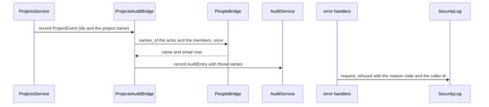
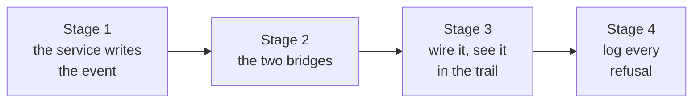

# Task P1.7: Audit a project creation, and log every refusal

**Task ID:** TSK-P1.7  
**Use Case:** UC-P1  
**Design Reference:** the design sequence (record the audit entry in the same transaction, and the refusal line to the security log), and the `AuditLog`, `People` and `SecurityLog` ports of Projects with their bridges in `composition/`  
**Criteria:** AC-29, AC-48 (the refused-request line only: the sign-in and session lines of AC-48 are not this task's). The same commit also proves AC-85 and AC-89  
**Status:** Built. Plan is a draft  
**Matches the code at:** `7481263`  
**Reviewer:** Pending

Ground rules, the layout and the commands are in the [chapter summary](summary.md).

This is the plan someone follows to build this task. It was written by working backwards from the code that exists, so
its final code is that code: each block marked `# file` is a copy of that file at the commit above. The task was built
in commit `58dc0f1`; later slices (UC-P2, UC-P3) changed some of the same files, and the blocks show them as they are now.

---

## 1. Objective

Creating a project writes one audit entry that says who created it, which project and who the first members are, each with the
name and email they had at that time. Every refusal that Projects answers writes one line to the security log, with the reason
code and the caller's id, and never the project name or an id from the body. A successful creation writes no log line, and a
refused one writes no audit entry.

| AC | Given | Then | Why |
|---|---|---|---|
| AC-29 | an administrator and active accounts | creating a project naming them writes one audit entry: who created it, which project (id and name), and the first members, each with the name and email they had at that time | The trail must say who made what and with whom, and a later rename must not rewrite history (RULE-L4). A refused creation writes none. |
| AC-48 (the refused-request part) | a refused request | it writes one log line, holding no token and no code | Operators need to see refusals. Here the line also holds no project name and no id from the body, since the input is untrusted. |
| AC-89 | a person named twice as a first member | they are in the project once and in the entry once | One person, one line in the trail (the de-duplication itself is TSK-P1.6; this task proves it reaches the entry). |
| AC-85 | an administrator who created projects | opens the audit trail | the creations show, newest first, with the names as they were. Owned by UC-L1; here only proved through the HTTP path. |

### Expected Behaviour

Given an administrator who creates a project naming active accounts, one audit entry is written in the same transaction as
the project, with the names and emails as they are now, and a later rename does not change it. Given a person named twice, they are
in the entry once. Given any refusal that Projects answers (not an administrator, an empty name, an unknown field, a member who
is not eligible, a body that is not a JSON object), exactly one `request_refused` line is written with its code and the caller's
id, and no audit entry and no project row exist. A refusal by the guard chain is logged by the guard, once, and not again by
Projects.

## 2. Architecture and Reasoning

### Where does this logic belong?

- The event and the three ports (`AuditLog`, `People`, `SecurityLog`): `application/ports.py` in Projects, in Projects' own
  words (ids, not Audit's or Access's types).
- Writing the event: `ProjectsService.create`, after the save, on the success path only.
- Turning the event into an audit entry with names: the two bridges in `composition/bridges.py`, the only place that sees both
  Projects and Audit or Access.
- The wiring: `composition/app.py`.
- The refusal line: the error handlers of `adapters/inbound/errors.py`, because that is the one place every Projects refusal passes.

### Why?

Projects must not import Audit or Access (ADR 0010, ADR 0015), so it has its own ports and the bridges answer them with Audit's and
Access's use cases. The audit entry and the project are one transaction, so both rows commit together or neither does. The
names are written into the entry when it is made, so a later rename cannot rewrite history (RULE-L4). The security log is
for operators and is never an audit entry (ADR 0013).

The use case and the handlers must not repeat what the bridges do. A search at `7481263` finds `create_project`, `ProjectEvent`
and `names_of` only in `application/` and `composition/`, and `request_refused` in Projects only in `adapters/inbound/errors.py`.



*Reading guide:* on success the service hands Projects' event to the audit bridge, which asks for the names once and writes Audit's entry; on any refusal the handlers write one line to the security log and no entry.

### The logic, decision by decision

1. **The entry is written after the project is saved, in the same transaction.** Both rows commit together or neither does,
   so there is no entry for a project that does not exist (AC-29). The service writes it only on the success path, so
   every refusal before it writes nothing.
2. **Projects speaks in ids; names are looked up when the entry is written.** `ProjectEvent` holds ids and the project
   name. The names and emails are taken at that moment and stored in the entry, so a rename later changes nothing (AC-29).
3. **One question for all the people.** The actor and the members go to the `People` port in one call (no N+1).
4. **An id with no name keeps its id** (`Person(id)` with no name or email) instead of failing.
5. **Projects does not import Audit or Access.** It has its own ports (`AuditLog`, `People`, `SecurityLog`); the bridges
   in `composition/` answer them with Audit's and Access's use cases (ADR 0010, ADR 0015).
6. **Every refusal Projects answers writes one line** (`request_refused`, result `refused`, the reason code and the
   caller's id from `request.state.person_id`), and never the name or an id from the body (AC-48, ADR 0013). Both
   handlers do it: Projects' own errors and a body that is not a JSON object. A refusal by the guard chain is already
   logged by the guard, so Projects does not log it again.
7. **A success writes no line.**

**Where it lives:** the event and the three ports in `application/ports.py`; the use in `ProjectsService.create`; the
two bridges in `composition/bridges.py`; the wiring in `composition/app.py`; the log in the error handlers of
`adapters/inbound/errors.py`, because that is the one place every Projects refusal passes.

### Relevant Design

- Aggregate: `Project` (unchanged by this task); the event is built in the use case from the saved project
- Ports: `AuditLog`, `People` and `SecurityLog`, with the value `ProjectEvent`, all in Projects' `application/ports.py`
- Bridges: `PeopleBridge` (answered by Access's `people`) and `ProjectsAuditBridge` (answered by Audit's `record`), in `composition/bridges.py`
- Rules: RULE-L4 (the names are the ones at the time), ADR 0013 (the security log), ADR 0010 and ADR 0015 (where the code goes)
- Verification: use case tests with fakes, bridge tests, and API tests through `create_app` and `GET /audit`

## 3. Implementation Plan

1. The service writes the event: name the event and the port, write the tests, call the port after saving (AC-29, AC-89).
2. The bridges: write the fake and the tests, add the `People` port and the two bridges (AC-29).
3. Wire it, and see it in the trail: write the API tests, build the service with the bridges (AC-29, AC-85, AC-89).
4. Log every refusal: write the tests, add the `SecurityLog` port and pass the log to the handlers (AC-48).



*Reading guide:* the stages are a work order, and in each the test comes before the code.

### Target Files

- `apps/api/app/projects/application/ports.py`
- `apps/api/app/projects/application/service.py`
- `apps/api/app/projects/adapters/inbound/errors.py`
- `apps/api/app/composition/bridges.py`
- `apps/api/app/composition/app.py`
- `apps/api/tests/test_projects_service.py`
- `apps/api/tests/test_projects_composition.py`
- `apps/api/tests/test_projects_audit_api.py`
- `apps/api/tests/test_projects_errors.py`
- `apps/api/tests/fakes.py`

---

## 4. RED: Write the Failing Test

Each stage writes its tests first. The commands run from `apps/api/`. The stage results marked "checked" are the ones the old
plan records: its stages were checked by applying the commit's files in that order on its parent.

### Stage 1: the service writes the event (AC-29, AC-89)

#### Test

A fake `FakeProjectsAudit` in `tests/fakes.py` keeps the events and what the repository held when each came:

```python
# apps/api/tests/fakes.py
class FakeProjectsAudit:
    """Stands in for Projects' AuditLog port: keeps the events, and what the repository held when each came."""

    def __init__(self, projects=None):
        self.events: list = []
        self.held_when_recorded: list = []
        self._projects = projects

    def record(self, event):
        self.events.append(event)
        if self._projects is not None:
            self.held_when_recorded.append(self._projects.by_id(event.project_id))
```

Then the tests in `tests/test_projects_service.py`:

```python
# apps/api/tests/test_projects_service.py
def audited(active=None):
    projects = FakeProjects()
    audit = FakeProjectsAudit(projects)
    return ProjectsService(projects, FakeAccountStatus(active), audit, FakePeople()), projects, audit
```

```python
# apps/api/tests/test_projects_service.py
@pytest.mark.ac("AC-29")
def test_create_writes_one_event_with_the_actor_the_project_and_the_first_members():
    service, _, audit = audited()
    p = service.create(ADMIN, "Alpha", ["acc-maya", "acc-bob"])
    assert audit.events == [ProjectEvent("create_project", "acc-ada", p.id, "Alpha", ("acc-maya", "acc-bob"))]
    assert audit.events[0].reason is None
```

```python
# apps/api/tests/test_projects_service.py
@pytest.mark.ac("AC-29")
def test_the_event_is_written_after_the_project_is_saved_and_carries_the_trimmed_name():
    service, _, audit = audited()
    p = service.create(ADMIN, "  Alpha  ", [])
    assert audit.held_when_recorded == [p.project]
    assert (audit.events[0].project_name, audit.events[0].member_ids) == ("Alpha", ())
```

```python
# apps/api/tests/test_projects_service.py
@pytest.mark.ac("AC-89")
def test_a_person_named_twice_is_in_the_event_once():
    service, _, audit = audited()
    service.create(ADMIN, "Alpha", ["acc-maya", "acc-maya", "acc-bob"])
    assert audit.events[0].member_ids == ("acc-maya", "acc-bob")
```

```python
# apps/api/tests/test_projects_service.py
@pytest.mark.ac("AC-29")
@pytest.mark.parametrize(
    "caller,name,members",
    [
        (USER, "Alpha", []),
        (ADMIN, "", []),
        (ADMIN, "Alpha", [f"acc-{i}" for i in range(51)]),
        (ADMIN, "Alpha", ["acc-gone"]),
    ],
)
def test_a_refused_creation_writes_no_event(caller, name, members):
    service, projects, audit = audited(active={"acc-maya"})
    with pytest.raises(Exception):  # noqa: B017 - which refusal is proven in the tests above
        service.create(caller, name, members)
    assert audit.events == [] and projects.rows == {}
```

Every place that builds `ProjectsService` now passes the fake as a third argument, so the existing tests in
`tests/test_projects_input.py` and `tests/test_projects_service.py` change by that one argument.

#### Why this test?

It pins the event (who, which project, which members, in order), that it comes after the save and holds the trimmed name, that a
person named twice is in it once (AC-89), and that none of four refusals writes an event: not an administrator, an empty name, 51
members, and an account that is not active.

#### Expected Result

The tests fail before the event exists: a collection error, `cannot import name 'ProjectEvent'`.

#### Actual Execution Evidence

**Status:** Checked at the build commit `58dc0f1`, as the old plan records it  
**Test run:** `uv run pytest tests/test_projects_service.py -q`  
**Failure reason:** a collection error, `cannot import name 'ProjectEvent'`

### Stage 2: the bridges (AC-29)

#### Test

A fake `FakePeople` in `tests/fakes.py` answers `names_of` from a dict and leaves out unknown ids:

```python
# apps/api/tests/fakes.py
class FakePeople:
    """Stands in for Projects' People port: {id: (name, email)} for the known ids, nothing for the others."""

    def __init__(self, known: dict[str, tuple[str, str]] | None = None):
        self.known = known or {}
        self.asked: list[set[str]] = []

    def names_of(self, ids):
        self.asked.append(set(ids))
        return {i: self.known[i] for i in ids if i in self.known}
```

Then the tests in `tests/test_projects_composition.py`, each marked `@pytest.mark.ac("AC-29")`:

```python
# apps/api/tests/test_projects_composition.py
def access_with(*people):
    from app.access.application.service import AccessService
    from tests.fakes import FakeAccounts, FakeAudit, FakeIdp, FakeUnitOfWork

    accounts = FakeAccounts()
    for acc_id, name, email in people:
        accounts.add(
            Account(acc_id, f"sub-{acc_id}", name, email, Role.user, Status.active, datetime(2026, 1, 1), None)
        )
    return AccessService(accounts, FakeAudit(), FakeIdp(), set(), uow=FakeUnitOfWork())
```

```python
# apps/api/tests/test_projects_composition.py
@pytest.mark.ac("AC-29")
def test_the_people_bridge_answers_through_accesss_people_and_leaves_out_the_unknown():
    from app.composition.bridges import PeopleBridge

    bridge = PeopleBridge(access_with(("a", "Ada", "ada@x.test"), ("m", "Maya", "maya@x.test")))
    assert bridge.names_of(["a", "m", "ghost"]) == {"a": ("Ada", "ada@x.test"), "m": ("Maya", "maya@x.test")}
    assert bridge.names_of([]) == {}
```

```python
# apps/api/tests/test_projects_composition.py
@pytest.mark.ac("AC-29")
def test_the_audit_bridge_turns_a_project_event_into_a_project_entry_with_the_names_now():
    from app.audit.application.service import AuditService
    from app.audit.domain.entry import Kind, Person
    from app.composition.bridges import ProjectsAuditBridge
    from app.projects.application.ports import ProjectEvent
    from tests.fakes import FakeAuditEntries, FakePeople

    port = FakeAuditEntries()
    people = FakePeople({"a": ("Ada", "ada@x.test"), "m": ("Maya", "maya@x.test")})
    ProjectsAuditBridge(AuditService(port), people).record(
        ProjectEvent("create_project", "a", "p-1", "Alpha", ("m", "a"))
    )
    (stored,) = port.stored
    e = stored.entry
    assert (e.kind, e.action, e.reason) == (Kind.project, "create_project", None)
    assert e.actor == Person("a", "Ada", "ada@x.test")
    assert e.target == Person("p-1", "Alpha", None)
    assert e.details == (Person("m", "Maya", "maya@x.test"), Person("a", "Ada", "ada@x.test"))
    assert people.asked == [{"a", "m"}]  # one question, for the actor and the members together
```

```python
# apps/api/tests/test_projects_composition.py
@pytest.mark.ac("AC-29")
def test_the_audit_bridge_keeps_an_id_it_has_no_name_for():
    from app.audit.application.service import AuditService
    from app.audit.domain.entry import Person
    from app.composition.bridges import ProjectsAuditBridge
    from app.projects.application.ports import ProjectEvent
    from tests.fakes import FakeAuditEntries, FakePeople

    port = FakeAuditEntries()
    ProjectsAuditBridge(AuditService(port), FakePeople()).record(
        ProjectEvent("create_project", "a", "p", "Alpha", ("m",))
    )
    e = port.stored[0].entry
    assert (e.actor, e.details) == (Person("a"), (Person("m"),))
```

#### Why this test?

The first test pins that the people bridge goes through Access's own `people` and leaves out an unknown id. The second pins that the
audit bridge turns the event into a project entry with the names now, and asks for them once, for the actor and the members
together (no N+1). The third pins that an id with no name keeps its id, instead of failing.

#### Expected Result

The three new tests fail for the missing bridges, and the three that were already in the file pass.

#### Actual Execution Evidence

**Status:** Checked at the build commit `58dc0f1`, as the old plan records it  
**Test run:** `uv run pytest tests/test_projects_composition.py -q`  
**Failure reason:** `3 failed, 3 passed`: the three new tests fail for the missing bridges

### Stage 3: wire it, and see it in the trail (AC-29, AC-85, AC-89)

#### Test

A new file `tests/test_projects_audit_api.py`, through `create_app` and `GET /audit`. `project_entries` keeps the
entries with `kind == "project"`:

```python
# apps/api/tests/test_projects_audit_api.py
def project_entries(api, admin):
    return [e for e in api.get("/audit", headers=admin).json() if e["kind"] == "project"]
```

```python
# apps/api/tests/test_projects_audit_api.py
@pytest.mark.ac("AC-29")
def test_a_created_project_writes_one_entry_with_the_actor_the_project_and_the_first_members(api, admin):
    _, maya_id = active_user(api, admin, "sub-maya", "maya@x.test")
    _, bob_id = active_user(api, admin, "sub-bob", "bob@x.test")
    ada_id = me_id(api, admin)

    project = api.post("/projects", headers=admin, json={"name": "Alpha", "members": [maya_id, bob_id]}).json()

    (e,) = project_entries(api, admin)
    assert (e["kind"], e["action"], e["reason"]) == ("project", "create_project", None)
    assert (e["actor_id"], e["actor_name"], e["actor_email"]) == (ada_id, "Ada", "ada@x.test")
    assert (e["target_id"], e["target_name"], e["target_email"]) == (project["id"], "Alpha", None)
    assert e["details"] == [
        {"id": maya_id, "name": "maya", "email": "maya@x.test"},
        {"id": bob_id, "name": "bob", "email": "bob@x.test"},
    ]
```

```python
# apps/api/tests/test_projects_audit_api.py
@pytest.mark.ac("AC-29")
def test_a_rename_afterwards_does_not_change_the_entry(api, admin):
    _, maya_id = active_user(api, admin, "sub-maya", "maya@x.test")
    api.post("/projects", headers=admin, json={"name": "Alpha", "members": [maya_id]})
    renamed = auth("sub-maya", "maya@x.test", name="Maya Lopez")
    assert api.get("/me", headers=renamed).json()["name"] == "Maya Lopez"
    assert api.get("/me", headers=auth("sub-ada", "ada@x.test", name="Ada Byron")).json()["name"] == "Ada Byron"

    (e,) = project_entries(api, admin)
    assert (e["actor_name"], e["details"][0]["name"]) == ("Ada", "maya")
```

```python
# apps/api/tests/test_projects_audit_api.py
@pytest.mark.ac("AC-29")
def test_a_project_with_no_first_member_still_writes_one_entry(api, admin):
    api.post("/projects", headers=admin, json={"name": "Alpha", "members": []})
    (e,) = project_entries(api, admin)
    assert e["details"] == []
```

```python
# apps/api/tests/test_projects_audit_api.py
@pytest.mark.ac("AC-29")
def test_a_refused_creation_writes_no_entry(api, admin, engine):
    _, maya_id = register(api, "sub-maya", "maya@x.test")  # pending: not eligible
    user_h, _ = active_user(api, admin, "sub-bob", "bob@x.test")
    before = api.get("/audit", headers=admin).json()
    bad = [
        (user_h, {"name": "Alpha", "members": []}),
        (admin, {"name": "", "members": []}),
        (admin, {"name": "Alpha", "members": [], "id": "x"}),
        (admin, {"name": "Alpha", "members": [maya_id]}),
    ]
    for headers, body in bad:
        assert api.post("/projects", headers=headers, json=body).status_code in (403, 422)
    assert api.get("/audit", headers=admin).json() == before
    with Session(engine) as s:
        assert s.execute(text("SELECT count(*) FROM projects")).scalar_one() == 0
```

```python
# apps/api/tests/test_projects_audit_api.py
@pytest.mark.ac("AC-89")
def test_naming_a_person_twice_names_them_once_in_the_entry(api, admin):
    _, maya_id = active_user(api, admin, "sub-maya", "maya@x.test")
    api.post("/projects", headers=admin, json={"name": "Alpha", "members": [maya_id, maya_id]})
    (e,) = project_entries(api, admin)
    assert [d["id"] for d in e["details"]] == [maya_id]
```

```python
# apps/api/tests/test_projects_audit_api.py
@pytest.mark.ac("AC-85")
def test_an_administrator_sees_each_project_creation_in_the_trail_newest_first(api, admin):
    _, maya_id = active_user(api, admin, "sub-maya", "maya@x.test")
    first = api.post("/projects", headers=admin, json={"name": "Alpha", "members": [maya_id]}).json()
    second = api.post("/projects", headers=admin, json={"name": "Beta", "members": []}).json()

    entries = api.get("/audit", headers=admin).json()
    assert [(e["kind"], e["target_name"]) for e in entries[:2]] == [("project", "Beta"), ("project", "Alpha")]
    assert (entries[0]["target_id"], entries[1]["target_id"]) == (second["id"], first["id"])
    assert entries[1]["details"][0]["name"] == "maya"
    assert entries[2]["kind"] == "account"  # the account entries are still there, below
```

#### Why this test?

It proves the whole path through HTTP: one entry with the actor, the target (id and name, no email) and the members with names
and emails (AC-29); that a rename afterwards changes nothing (RULE-L4); that no first member still writes one entry with no details;
that four refusals write no entry and no row in `projects`; that a person named twice is named once (AC-89); and that two creations show
newest first, above the account entries (AC-85, owned by UC-L1 and only proved here through the HTTP path).

#### Expected Result

They fail, because `create_app` builds the service without an audit.

#### Actual Execution Evidence

**Status:** Not executed. The old plan only says the tests are expected to fail, and records no run of this RED  
**Test run:** `uv run pytest tests/test_projects_audit_api.py -q`  
**Failure reason:** not recorded

### Stage 4: log every refusal (AC-48)

#### Test

In the same file, each marked `@pytest.mark.ac("AC-48")`, with a `FakeSecurityLog` as the log:

```python
# apps/api/tests/fakes.py
class FakeSecurityLog:
    """Records the security events, so a test can see what was raised. Satisfies both contexts' SecurityLog ports."""

    def __init__(self):
        self.events: list[dict] = []

    def event(self, name, result, person_id=None, session_id=None, reason=None):
        self.events.append(
            {"event": name, "result": result, "person_id": person_id, "session_id": session_id, "reason": reason}
        )
```

```python
# apps/api/tests/test_projects_audit_api.py
def refusal_lines(log, since):
    return log.events[since:]
```

```python
# apps/api/tests/test_projects_audit_api.py
@pytest.mark.ac("AC-48")
@pytest.mark.parametrize(
    "who,body,status,code",
    [
        ("user", {"name": "Alpha", "members": []}, 403, "forbidden"),
        ("admin", {"name": "  ", "members": []}, 422, "invalid_project_name"),
        ("admin", {"name": "Alpha", "members": [], "id": "x"}, 422, "invalid_request"),
        ("admin", {"name": "Alpha", "members": ["no-such-account"]}, 422, "member_not_eligible"),
        ("admin", ["not", "an", "object"], 422, "invalid_request"),
    ],
)
def test_each_projects_refusal_writes_exactly_one_line_with_its_code_and_who(api, admin, log, who, body, status, code):
    user_h, user_id = active_user(api, admin, "sub-bob", "bob@x.test")
    headers, account_id = (user_h, user_id) if who == "user" else (admin, me_id(api, admin))
    since = len(log.events)

    r = api.post("/projects", headers=headers, json=body)

    assert r.status_code == status
    (line,) = refusal_lines(log, since)
    assert (line["event"], line["result"], line["reason"], line["person_id"]) == (
        "request_refused",
        "refused",
        code,
        account_id,
    )
```

```python
# apps/api/tests/test_projects_audit_api.py
@pytest.mark.ac("AC-48")
def test_a_created_project_writes_no_line(api, admin, log):
    _, maya_id = active_user(api, admin, "sub-maya", "maya@x.test")
    since = len(log.events)
    assert api.post("/projects", headers=admin, json={"name": "Alpha", "members": [maya_id]}).status_code == 201
    assert refusal_lines(log, since) == []
```

```python
# apps/api/tests/test_projects_audit_api.py
@pytest.mark.ac("AC-48")
def test_a_guards_refusal_is_logged_once_by_the_guard_and_not_again_by_projects(api, admin, log):
    pending, pending_id = register(api, "sub-new", "new@x.test")
    gone, gone_id = active_user(api, admin, "sub-gone", "gone@x.test")
    api.post(f"/accounts/{gone_id}/deactivate", headers=admin, json={"reason": "Left"})
    body = {"name": "Alpha", "members": []}
    for headers, code in [
        ({}, "missing_token"),
        ({"Authorization": "Bearer nope"}, "invalid_token"),
        (pending, "account_pending"),
        (gone, "account_deactivated"),
    ]:
        since = len(log.events)
        assert api.post("/projects", headers=headers, json=body).status_code in (401, 403)
        assert [e["reason"] for e in refusal_lines(log, since)] == [code]
```

```python
# apps/api/tests/test_projects_audit_api.py
@pytest.mark.ac("AC-48")
def test_the_json_line_holds_no_project_name_and_no_account_id_but_the_callers(engine):
    stream = StringIO()
    settings = Settings(keycloak_url="http://kc.test", bootstrap_admin_emails="ada@x.test")
    verifier = JwtTokenVerifier(ISSUER, AUDIENCE, lambda _t: KEY.public_key())
    api = TestClient(create_app(settings, verifier, FakeIdp(), engine, JsonStdoutSecurityLog(stream)))
    admin = auth("sub-ada", "ada@x.test", name="Ada")
    ada_id = me_id(api, admin)
    stream.truncate(0)
    stream.seek(0)

    r = api.post("/projects", headers=admin, json={"name": "Secret Alpha", "members": ["acc-someone-else"]})

    assert r.status_code == 422
    (raw,) = stream.getvalue().splitlines()
    line = json.loads(raw)
    assert (line["event"], line["result"], line["reason"], line["person_id"]) == (
        "request_refused",
        "refused",
        "member_not_eligible",
        ada_id,
    )
    assert "Secret" not in raw and "acc-someone-else" not in raw
```

#### Why this test?

The table pins five refusals (not an administrator, empty name, an unknown field, a member who is not eligible, a body that is a list):
each writes exactly one line with `request_refused`, `refused`, its code and the caller's id. A created project writes no line. A guard's
refusal (no token, a bad token, pending, deactivated) is logged once, by the guard, and not again by Projects. The real
`JsonStdoutSecurityLog` line holds neither the project name nor an account id from the body, since the input is untrusted.

#### Expected Result

Six of the eight fail. The two that pass are "a created project writes no line" and the guard test, which already hold.

#### Actual Execution Evidence

**Status:** Checked at the build commit `58dc0f1`, as the old plan records it  
**Test run:** `uv run pytest tests/test_projects_audit_api.py -m AC_48 -q`  
**Failure reason:** `6 failed, 2 passed`: the two that pass are "a created project writes no line" and the guard test

---

## 5. GREEN: Implement the Behaviour

### Stage 1: the service writes the event

#### Implementation

The event and the port in `app/projects/application/ports.py`, an `audit: AuditLog` argument to `ProjectsService.__init__`
(stored as `self._audit`), and the call in `create`. This is where the final code is; the `People` port follows in stage 2 and
the `SecurityLog` port in stage 4.

```python
# apps/api/app/projects/application/ports.py
@dataclass(frozen=True)
class ProjectEvent:
    """What happened to a project, in Projects' words: ids only, the names are looked up when it is written."""

    action: str  # create_project, add_member or remove_member
    actor_id: str
    project_id: str
    project_name: str
    member_ids: tuple[str, ...] = ()  # the first members, each once, or the one member of a change
    reason: str | None = None  # none for a creation
```

```python
# apps/api/app/projects/application/ports.py
class AuditLog(Protocol):
    def record(self, event: ProjectEvent) -> None:
        """Write one entry in the trail, in the request's own transaction."""
        ...
```

The constructor, as it is now (it also takes `people` since UC-P3):

```python
# apps/api/app/projects/application/service.py, ProjectsService.__init__
    def __init__(self, projects: ProjectRepository, accounts: AccountStatus, audit: AuditLog, people: People):
        self._projects = projects
        self._accounts = accounts
        self._audit = audit
        self._people = people
```

The call in `ProjectsService.create` (the method today; the view it returns is from UC-P3):

```python
# apps/api/app/projects/application/service.py, ProjectsService.create
    def create(self, caller: Caller, name: str, member_ids: Iterable[str]) -> ProjectView:
        """Create a project with its first members (AC-9, AC-10). Only an administrator may, and that is checked
        before the input is (AC-11, AC-32); then the name and the cap on first members are (AC-12, AC-91, AC-92); then that every person named has an
        active account (AC-13), each counted once (AC-89). The audit entry is written after saving, in the request's own
        transaction, and only when the project was created (AC-29)."""
        self.authorise_creation(caller)
        project = Project.create(caller, name, member_ids)
        named = set(project.members)  # each person once (AC-89)
        if named and not named <= self._accounts.active_among(named):
            raise MemberNotEligible  # pending, deactivated or unknown: one answer (AC-13)
        self._projects.add(project)
        self._audit.record(
            ProjectEvent(
                "create_project",
                caller.account_id,
                project.id,
                project.name,
                tuple(m.account_id for m in project.memberships),
            )
        )
        return self._view(project)
```

#### Explanation

The entry is written after the project is saved and only on the success path, so every refusal before it writes nothing. Projects
speaks in ids: the names are looked up later, by the bridge. The members come from the saved project, so each is in the event once (AC-89).

#### Actual Execution Evidence

**Status:** Checked at the build commit `58dc0f1`, as the old plan records it  
**Test run:** `uv run pytest tests/test_projects_service.py -q`, then with `tests/test_projects_input.py`  
**Result:** `19 passed` for the service file, and `44 passed` for it with `test_projects_input.py`

### Stage 2: the bridges

#### Implementation

The `People` port, in `ports.py`:

```python
# apps/api/app/projects/application/ports.py
class People(Protocol):
    def names_of(self, ids: list[str]) -> dict[str, tuple[str, str]]:
        """For each known id, (name, email) as they are now. Unknown ids are left out."""
        ...
```

The two bridges, in `app/composition/bridges.py`:

```python
# apps/api/app/composition/bridges.py
class PeopleBridge:
    """Projects' People port, answered by Access's use case, on the same session as the request."""

    def __init__(self, access: AccessService):
        self._access = access

    def names_of(self, ids: list[str]) -> dict[str, tuple[str, str]]:
        return {p.id: (p.name, p.email) for p in self._access.people(ids)}
```

```python
# apps/api/app/composition/bridges.py
class ProjectsAuditBridge:
    """Projects' AuditLog port, answered by Audit's use case, on the same session as the request. The names are the
    ones people have now, written into the entry so a later rename does not change it (RULE-L4)."""

    def __init__(self, audit: AuditService, people: People):
        self._audit = audit
        self._people = people

    def record(self, event: ProjectEvent) -> None:
        names = self._people.names_of([event.actor_id, *event.member_ids])

        def person(account_id: str) -> Person:
            name, email = names.get(account_id, (None, None))
            return Person(account_id, name, email)

        self._audit.record(
            AuditEntry(
                actor=person(event.actor_id),
                action=event.action,
                kind=Kind.project,
                target=Person(event.project_id, event.project_name),  # the project: id and name, no email
                details=tuple(person(i) for i in event.member_ids),
                reason=event.reason,
            )
        )
```

#### Explanation

Projects does not import Audit or Access. The bridges are the only place that sees both sides: the people bridge answers Projects'
`People` port with Access's use case, and the audit bridge answers `AuditLog` with Audit's. The people are asked once, for the actor and
the members together, and an id with no name keeps its id (`Person(id)` with no name or email). The project is the target: its id and
name, no email.

#### Actual Execution Evidence

**Status:** Checked at the build commit `58dc0f1`, as the old plan records it  
**Test run:** `uv run pytest tests/test_projects_composition.py -q`  
**Result:** `6 passed`

### Stage 3: wire it

#### Implementation

The service is built with the two bridges on the request's session (`people` is shared with the service since UC-P3; at this task it was
built inline for the audit bridge only):

```python
# apps/api/app/composition/app.py, inside create_app
    def projects_service(
        session: Session = Depends(db),
        access: AccessService = Depends(service),
        audit: AuditService = Depends(audit_service),
    ) -> ProjectsService:
        # the request's session, so the project, its members and its audit entry commit together
        people = PeopleBridge(access)
        return ProjectsService(
            SqlProjects(session), AccountStatusBridge(access), ProjectsAuditBridge(audit, people), people
        )
```

#### Explanation

The request's one session means the project, its members and its audit entry commit together. The route and the use case do not
know that Audit exists.

#### Actual Execution Evidence

**Status:** Checked at the build commit `58dc0f1`, as the old plan records it (with the error handler still unchanged)  
**Test run:** `uv run pytest tests/test_projects_audit_api.py -m "AC_29 or AC_85 or AC_89" -q`  
**Result:** `6 passed`

### Stage 4: log every refusal

#### Implementation

The `SecurityLog` port, in `ports.py` (the handlers import it):

```python
# apps/api/app/projects/application/ports.py
class SecurityLog(Protocol):
    """Where Projects says that it refused a request, for the operators (ADR 0013). Never an audit entry."""

    def event(
        self,
        name: str,
        result: str,
        person_id: str | None = None,
        session_id: str | None = None,
        reason: str | None = None,
    ) -> None: ...
```

`register_error_handlers(app, security_log)` calls `refused(...)` in both handlers:

```python
# apps/api/app/projects/adapters/inbound/errors.py
def register_error_handlers(app: FastAPI, security_log: SecurityLog) -> None:
    def refused(request: Request, code: str) -> None:
        """One line for each refusal Projects answers: the code and who, never the name or an id from the body."""
        security_log.event(
            "request_refused", "refused", person_id=getattr(request.state, "person_id", None), reason=code
        )

    @app.exception_handler(ProjectsError)
    async def projects_error(request: Request, exc: ProjectsError):
        refused(request, exc.code)
        return JSONResponse(
            {"detail": {"code": exc.code, "message": exc.message}},
            status_code=HTTP_STATUS.get(type(exc), 400),
        )

    @app.exception_handler(RequestValidationError)
    async def invalid_request(request: Request, exc: RequestValidationError):
        """A body that is not even a JSON object, on /projects only. FastAPI's own answer echoes the input."""
        if request.url.path != "/projects" and not request.url.path.startswith("/projects/"):
            return await request_validation_exception_handler(request, exc)
        error = InvalidRequest("The request is not valid.")
        refused(request, error.code)
        return JSONResponse({"detail": {"code": error.code, "message": error.message}}, status_code=422)
```

`composition/app.py` passes the log, inside `create_app`:

```python
# apps/api/app/composition/app.py, inside create_app
    register_projects_error_handlers(app, security_log)
```

In `tests/test_projects_errors.py` the two calls to `register_error_handlers` get a `FakeSecurityLog()`.

#### Explanation

Every Projects refusal passes the two handlers, so there is one place for the line: the code and the caller's id from
`request.state.person_id`, never the name or an id from the body (ADR 0013). Both handlers do it: Projects' own errors and a body that
is not a JSON object. The guard's refusals are already logged by the guard, so Projects does not log them again. A success writes no line.

#### Actual Execution Evidence

**Status:** Checked at the build commit `58dc0f1`, as the old plan records it  
**Test run:** `uv run pytest tests/test_projects_audit_api.py -q`, then `uv run pytest -q`  
**Result:** `14 passed` in `test_projects_audit_api.py`, and the whole suite `305 passed, 46 skipped` at the build commit (the 46 are PostgreSQL tests, skipped without `TEST_DATABASE_URL`). With PostgreSQL the commit reports 351: not run here, `TEST_DATABASE_URL` is not set

---

## 6. REFACTOR: Improve the Design

### Planned Improvements

None identified in this task.

### Actual Changes

None recorded. The commit built the task in one go, so there was no separate refactor step. Later slices (UC-P2 and UC-P3) reuse the same
`ProjectEvent` and share the `people` bridge with the service, which are changes made for those slices.

### Regression Verification

**Status:** Executed on 2026-11-24 at `7481263`, from `apps/api/` (SQLite)

```
uv run pytest tests/test_projects_service.py -q            # 62 passed
uv run pytest tests/test_projects_composition.py -q        # 6 passed
uv run pytest tests/test_projects_audit_api.py -q          # 14 passed
uv run pytest tests/test_projects_errors.py -q             # 3 passed
uv run pytest tests/test_projects_audit_api.py -q -m AC_48   # 8 passed, 6 deselected
uv run pytest tests/test_projects_audit_api.py -q -m "AC_29 or AC_85 or AC_89"   # 6 passed, 8 deselected
uv run pytest tests/test_projects_service.py tests/test_projects_composition.py -q -m "AC_29 or AC_89"   # 11 passed, 57 deselected
uv run pytest -q                                           # 468 passed, 47 skipped
```

By criterion in `test_projects_audit_api.py`: AC-29 4 passed, AC-48 8, AC-85 1, AC-89 1. The PostgreSQL run was not executed (no
`TEST_DATABASE_URL`).

---

## 7. Architecture Review

- [x] Domain has no infrastructure dependency. `tests/test_architecture.py`: 21 passed on 2026-11-24. A search of `app/projects/domain` and `app/projects/application` finds no import from outside `app.projects`.
- [x] Business invariant remains inside the aggregate. This task adds no rule to the `Project` aggregate; the event is built in the use case from the saved project's own state, and the rule of the names at the time lives in the bridge that writes the entry.
- [x] Application service does not duplicate the rule. A search finds `create_project`, `ProjectEvent` and `names_of` only in `application/` and `composition/`, and `request_refused` in Projects only in `adapters/inbound/errors.py`.
- [x] Implementation matches the design model. The design names the `AuditLog`, `People` and `SecurityLog` ports, the bridges in `composition/` and the `JsonStdoutSecurityLog` adapter, and the code has each of them (the adapter is in `app/infrastructure/security_log.py`, shared with the other contexts).

**Design reviewer findings:** Not run for this task.

---

## 8. Decisions and Learnings

### Decisions

- Decision 22 (owner): a refused creation is not an audit entry; it writes a line to the security log (AC-48).
- RULE-L4: the names in an entry are the ones at the time, so a later rename does not rewrite history.
- ADR 0013: the security log, never an audit entry. ADR 0010 and ADR 0015: Projects has its own ports and does not import Audit or Access; the bridges are in `composition/`. No new ADR.

### Learnings

**Audit trail and security log are two things:** the trail says who changed what and is written in the request's transaction; the log
says what was refused and is for operators, and is never an entry.

**A bridge keeps two contexts apart:** Projects speaks in ids, and one bridge turns its event into Audit's entry with the names taken
at that moment.

### Open Questions

- The commit holds this task with AC-85 and AC-89, which the summary table does not list for it. Should the table say so?
- AC-85 is owned by UC-L1 and is only proved here through the HTTP path.
- The PostgreSQL run (351 at the build commit) was not repeated for this plan.

---

## 9. Implementation Evidence

**Source files:** the five source files under Target Files  
**Test files:** `apps/api/tests/test_projects_service.py`, `test_projects_composition.py`, `test_projects_audit_api.py`, `test_projects_errors.py`, and `tests/fakes.py` (`FakeProjectsAudit`, `FakePeople`)  
**Git commits:** `58dc0f1` built the task. The code is matched at `7481263`  
**Architecture checks:** `tests/test_architecture.py`, 21 passed on 2026-11-24  
**Related ADRs:** 0013 (security log), 0015 (the Projects build plan), 0010. None new

UC-P2 reuses the same `ProjectEvent` for adding and removing a member (AC-30).

### Where the real build differs from this plan

- One commit (`58dc0f1`) holds this task with AC-85 and AC-89, which the summary table does not list for it.
- The stages here are an ordering made afterwards; the commit is one step. Stages 1 to 4 were checked by applying the
  commit's files in that order on its parent.
- The service file went from 19 tests at the build commit to 62 at `7481263` (UC-P2 and UC-P3), and the whole suite from
  305 passed, 46 skipped to 468 passed, 47 skipped. The composition (6) and audit (14) counts are the same at `7481263`.
- At the build commit the `People` bridge was built inline; `ProjectsService` took no `People` until UC-P3.

---

## 10. Developer Review

**Implementation status:** Built at `58dc0f1`  
**Review status:** Pending

### Reviewer Feedback

No feedback recorded.

### Approval

**Approved by:** Pending  
**Approved revision:** Pending  
**Approval date:** Pending

Approval confirms review of the implementation explanation and associated evidence, not a guarantee that the software is defect-free.
