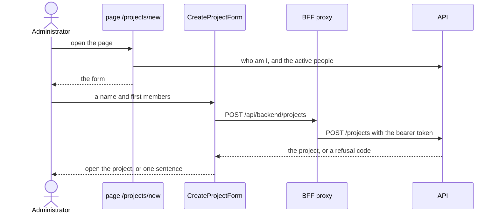
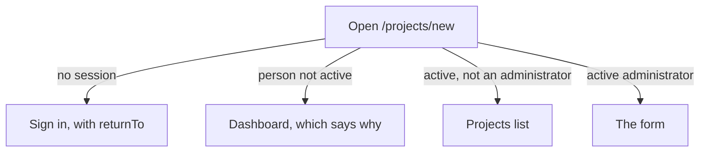
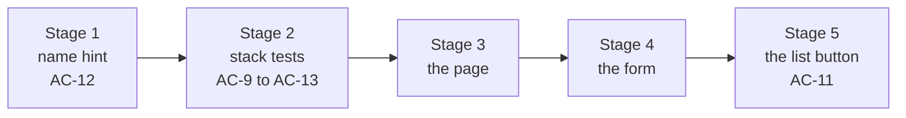

# Task P1.8: The page `/projects/new` and its form

**Task ID:** TSK-P1.8  
**Use Case:** UC-P1  
**Design Reference:** the design, "The web side (ADR 0016)": the sequence diagram and D16, D17, D18  
**Criteria:** AC-9, AC-10, AC-11, AC-12, AC-13, AC-32  
**Status:** Built. Plan is a draft  
**Matches the code at:** `7481263`  
**Reviewer:** Pending

Ground rules, the layout and the commands are in the [chapter summary](summary.md). This task works in `apps/web/`, so run
the commands from there. The Next.js version has breaking changes: `apps/web/AGENTS.md` says to read
`node_modules/next/dist/docs/` before changing Next code (`proxy.ts` not `middleware.ts`; Base UI, so `render` not `asChild`).

This is the plan someone follows to build this task. It was written by working backwards from the code that exists, so each
block marked `// file` is a copy of that file at the commit above. It was built as web slice W4 in commit `3ba329d`.

---

## 1. Objective

An administrator can create a project from a screen. The page `/projects/new` shows a name field and a list of active people
to pick as first members; the form sends the same request the API route already accepts, through the BFF proxy, so the
browser never holds a token. A person who is not an administrator is sent away, and the API refuses them anyway. The stack
tests also name AC-91 (the control character name). Cells marked *by hand only* or *proved elsewhere* below have no test in
this task.

| AC | Given | Then | Why |
|---|---|---|---|
| AC-9 | an administrator and an active person | the form creates a project naming them as a first member | The API route exists (TSK-P1.3); a person has to be able to use it from a screen. Stack test: the form's request, then the list and the member's name. The form clicks are *by hand only*. |
| AC-10 | an administrator | the AC text: they create a project naming themselves as a first member and are a member | First members are optional, and an administrator may be one. The stack test sends the request with one member and with none. An administrator naming themselves is *proved elsewhere* (API, TSK-P1.3), not by a web test here. |
| AC-11 | a user who is not an administrator | the AC text: creating is refused. This task's UI behaviour from the use case: opening `/projects/new` sends them to `/projects`, and the list shows no Create link | The screen is a convenience; the API refuses anyway (TSK-P1.4). Stack tests: the redirect and the link. |
| AC-32 | a caller who may not create | the page is opened, or the proxy is called | the server decides. Stack test here: the redirect of a member. A non administrator posting through the proxy is *proved elsewhere* (API, TSK-P1.4). |
| AC-12 | a name empty, blank or over 100 characters | the form is submitted | the API answers 422 `invalid_project_name` (stack test) and `looksLikeAName` is unit tested. That the Create button stays off (the `disabled` wiring) and that the refusal reads as a sentence are *by hand only*: the sentence comes from `projectRefusalMessage` (TSK-P3.5) and no test here asserts it on the page. |
| AC-13 | a first member who is not active | the form is submitted | the API answers `member_not_eligible` (stack test). That the page shows one message for it is *by hand only*. The picker lists only active people, so this happens only with a stale page. |

### Expected Behaviour

Given an administrator, when they open `/projects/new`, they see a form with the project name and the active people. When
they submit a name (and any first members), the project is created through `/api/backend/projects` and they land on the new
project. Given a person who is not an administrator, opening `/projects/new` sends them to `/projects`, and the list shows
them no Create project button. Given a name that is empty, blank or over 100 characters, the Create button stays off. Given
a refusal from the API, the form shows one sentence for its code and keeps what was typed.

## 2. Architecture and Reasoning

### Where does this logic belong?

- The one new rule, `looksLikeAName`: `src/domain/` (pure, with a `node --test` file).
- The page: `src/app/(app)/projects/new/page.tsx`, a thin server page. It reads `/me` and the active accounts with `api()`.
- The form: `src/components/create-project-form.tsx`, the only client code. It calls the BFF proxy.
- The Create project button: `src/app/(app)/projects/page.tsx`, for administrators only.

### Why?

The web side follows ports and adapters on the server (ADR 0016), but pages and components stay thin and have no ports of
their own. The rule that a name looks fine is pure, so it sits in the domain. The server stays the judge of the name and of
who may create: the screen is a convenience (AC-11, AC-32).



*Reading guide:* the page runs on the server and the form in the browser; the token exists only between the proxy and the API.

### The logic, decision by decision

1. **A thin server page, a client component only for the action** (ADR 0016). The page reads `/me` and the active accounts
   with `api()`; the form calls the BFF proxy `/api/backend/projects`, so the browser never holds a token.
2. **Redirects, in this order:** no session goes to sign in with `returnTo`; a person who is not active goes to the
   dashboard, which says why; an active person who is not an administrator goes to `/projects`. The API still refuses a
   non administrator (AC-11, AC-32).
3. **The picker is the same pure function as UC-P2.** `memberCandidates(accounts, [])` keeps the active accounts, sorted by
   name; with no members yet, the second argument is empty. At most 50 are checked: past that the unchecked boxes are disabled (AC-92 on the screen).
4. **Name hint.** `looksLikeAName` says whether the trimmed name has 1 to 100 characters. It only turns the button off; the server
   stays the judge of the rest (control characters, AC-91), so the function does not try to.
5. **A refusal is a sentence, and what was typed stays.** The form maps the API's code with `projectRefusalMessage`
   (never the API's own text, never the input). The state is kept in the component, so nothing typed is lost.
6. **Success opens the new project**, `/projects/[id]`; if the answer has no id, it goes back to the list.
7. **The list gets a Create project button for administrators only.** A `Button` rendered as a `Link` (Base UI `render`).

 (TSK-P3.5, and the answer with names, D15): `src/domain/member-candidates.ts`
(`memberCandidates`), `src/domain/project-messages.ts` (`projectRefusalMessage`), the types `Account` and `getMe`/`api` in
`src/lib/api.ts`, and the proxy `src/app/api/backend/[...path]/route.ts`. Nothing in them changes in this task.

 the one new rule, `looksLikeAName`, in `src/domain/` (pure, with a `node --test` file); the page in
`src/app/(app)/projects/new/page.tsx` (thin); the form in `src/components/create-project-form.tsx` (the only client code).



*Reading guide:* the page checks the caller in a fixed order and only an active administrator reaches the form; the API refuses the others whatever the page shows.

### Relevant Design

- Design: UC-P1, "The web side (ADR 0016)": D16 (the route), D17 (the client component), D18 (the pure functions)
- Rule: `looksLikeAName` (a pure function in `src/domain/project-name.ts`), only a hint
- Reused: `memberCandidates`, `projectRefusalMessage`, `api`, `getMe`, the proxy route
- Verification: unit test of the rule, stack tests of the page, the redirect, the link and the request the form sends

## 3. Implementation Plan

1. The name hint: write the tests, write `looksLikeAName` (AC-12).
2. The stack tests for the page, the redirect, the list link and the request (AC-9, AC-10, AC-11, AC-12, AC-13, AC-32).
3. The page: a thin server page that reads `/me` and the active accounts and renders the form.
4. The form: `CreateProjectForm`, the only client code.
5. The Create project button on the list, for administrators only (AC-11).



*Reading guide:* the stages are a work order. Stage 3 needs the form of stage 4 to compile, so write them together and run the checks once both exist.

### Target Files

- `apps/web/src/domain/project-name.ts`
- `apps/web/src/domain/project-name.test.ts`
- `apps/web/src/acceptance/projects.it.ts`
- `apps/web/src/app/(app)/projects/new/page.tsx`
- `apps/web/src/components/create-project-form.tsx`
- `apps/web/src/app/(app)/projects/page.tsx`

---

## 4. RED: Write the Failing Test

Each stage writes its tests first. The commands run from `apps/web/`. The web test runner is `node --test`; the stack tests
need the running stack.

Stages 3 and 4 have no RED of their own: they make the stage 2 stack tests pass, and the form has no unit test. Stage 5 is
covered by the stack test of stage 2 that checks the list link.

### Stage 1: the name hint (AC-12)

#### Test

Each title ends `(Verifies AC-12)`: 1 to 100 characters after trimming looks fine; empty, blank (`"   \t "`) or 101 characters does not.

```ts
// apps/web/src/domain/project-name.test.ts
import test from "node:test";
import assert from "node:assert/strict";
import { looksLikeAName } from "./project-name.ts";

test("a name of 1 to 100 characters after trimming looks fine (Verifies AC-12)", () => {
  assert.equal(looksLikeAName("Apollo"), true);
  assert.equal(looksLikeAName("  Apollo  "), true);
  assert.equal(looksLikeAName("a".repeat(100)), true);
});

test("an empty or blank name, or one over 100 characters, does not (Verifies AC-12)", () => {
  assert.equal(looksLikeAName(""), false);
  assert.equal(looksLikeAName("   \t "), false);
  assert.equal(looksLikeAName("a".repeat(101)), false);
});
```

#### Why this test?

It pins the hint on the function itself: the edges are 100 (fine) and 101 (not), the spaces around a name are ignored, and a
blank name is not a name. The server stays the judge of the rest.

#### Expected Result

The tests fail before the function exists: `ERR_MODULE_NOT_FOUND` for `project-name.ts`.

#### Actual Execution Evidence

**Status:** Executed at the build commit's parent, with that commit's files added  
**Test run:** `node --test src/domain/project-name.test.ts`  
**Failure reason:** `ERR_MODULE_NOT_FOUND` for `project-name.ts` (checked)

### Stage 2: the stack tests for the page (AC-9, AC-10, AC-11, AC-12, AC-13, AC-32)

#### Test

At the end of `src/acceptance/projects.it.ts`, under the heading "UC-P1: create a project", a helper `newPage(jar)` fetches
`/projects/new` and returns the status, the HTML and the `Location`. Each title ends `(Verifies AC-n)`.

```ts
// apps/web/src/acceptance/projects.it.ts
async function newPage(jar: CookieJar) {
  const res = await http(`${config.appUrl}/projects/new`, { jar });
  return { status: res.status, html: await res.text(), location: res.headers.get("location") ?? "" };
}
```

```ts
// apps/web/src/acceptance/projects.it.ts
itest("an administrator opens /projects/new and sees the form with the active people (Verifies AC-9)", async () => {
  const admin = await adminSignIn();
  const a = await activePerson(admin);
  const page = await newPage(admin);
  assert.equal(page.status, 200);
  assert.match(page.html, /Create project/);
  assert.match(page.html, /name="name"|aria-label="Project name"|Project name/);
  assert.ok(page.html.includes(await nameOf(a.jar)), "an active person is offered");
  assert.ok(page.html.includes(a.id), "by their id as the value");
});
```

```ts
// apps/web/src/acceptance/projects.it.ts
itest("a member opening /projects/new is sent to /projects (Verifies AC-11, AC-32)", async () => {
  const admin = await adminSignIn();
  const a = await activePerson(admin);
  const page = await newPage(a.jar);
  assert.ok(page.status >= 300 && page.status < 400, `redirected, got ${page.status}`);
  assert.match(page.location, /\/projects$/);
});
```

```ts
// apps/web/src/acceptance/projects.it.ts
itest("the list shows the Create project link to an administrator and not to a member (Verifies AC-11)", async () => {
  const admin = await adminSignIn();
  const a = await activePerson(admin);
  assert.match((await projectsPage(admin)).html, /href="\/projects\/new"/);
  assert.ok(!/href="\/projects\/new"/.test((await projectsPage(a.jar)).html), "no link for a member");
});
```

```ts
// apps/web/src/acceptance/projects.it.ts
itest(
  "an administrator creates a project with the form's request, and it lists with names (Verifies AC-9, AC-10)",
  async () => {
    const admin = await adminSignIn();
    const a = await activePerson(admin);
    const name = unique("Created");
    const res = await backend(admin, "POST", "projects", { name: `  ${name}  `, members: [a.id] });
    assert.equal(res.status, 201, res.text);
    assert.equal(res.json.name, name, "the name is trimmed");
    const page = await projectsPage(admin);
    assert.ok(page.html.includes(name), "the administrator's list shows it");
    const open = await projectPage(admin, res.json.id);
    assert.ok(open.html.includes(await nameOf(a.jar)), "its member is shown by name");
    const none = await backend(admin, "POST", "projects", { name: unique("Nobody"), members: [] });
    assert.equal(none.status, 201, "an administrator may name nobody");
  },
);
```

```ts
// apps/web/src/acceptance/projects.it.ts
itest("an invalid name, with a control character, is refused and creates nothing (Verifies AC-12, AC-91)", async () => {
  const admin = await adminSignIn();
  const before = (await backend(admin, "GET", "projects")).json.length;
  for (const name of ["", "   ", "a".repeat(101), `Bad\u0007${unique("Name")}`]) {
    const res = await backend(admin, "POST", "projects", { name, members: [] });
    assert.equal(res.status, 422, `refused: ${JSON.stringify(name)}`);
    assert.equal(res.code, "invalid_project_name");
  }
  assert.equal((await backend(admin, "GET", "projects")).json.length, before, "nothing was created");
});
```

```ts
// apps/web/src/acceptance/projects.it.ts
itest("a pending person named as a first member is refused and creates nothing (Verifies AC-13)", async () => {
  const admin = await adminSignIn();
  const { jar } = await signIn(await throwaway()); // never approved: pending
  const pendingId = (await backend(jar, "GET", "me")).json.id as string;
  const before = (await backend(admin, "GET", "projects")).json.length;
  const res = await backend(admin, "POST", "projects", { name: unique("Pending"), members: [pendingId] });
  assert.ok(res.status >= 400 && res.status < 500, `refused, got ${res.status}`);
  assert.equal(res.code, "member_not_eligible");
  assert.equal((await backend(admin, "GET", "projects")).json.length, before, "nothing was created");
});
```

#### Why this test?

The page and the list link are what a person sees, so the first three tests pin them as a person would meet them: the form for
an administrator, the redirect for a member, the link only for an administrator. The last three send the form's own request
through the proxy, so they prove what the form sends, not the clicks. An administrator naming themselves (AC-10) is *proved
elsewhere* (API, TSK-P1.3). A non administrator posting through the proxy (AC-32) is *proved elsewhere* (API, TSK-P1.4).

#### Expected Result

Tests 1 to 3 (the page, the member's redirect, the list link) fail, because the page and the button do not exist. Tests 4 to 6
already hold, because the API exists (inferred from the code).

#### Actual Execution Evidence

**Status:** Not executed. The stack (Keycloak, API, web) is not up here, and these tests need it  
**Test run:** `INTEGRATION=1 npm run test:integration`  
**Failure reason:** not observed. The commit reports six new tests, 19 in the file, passing on the rebuilt web container.

---

## 5. GREEN: Implement the Behaviour

### Stage 1: the name hint

#### Implementation

```ts
// apps/web/src/domain/project-name.ts
/** A client side hint only: the trimmed name has 1 to 100 characters. The server stays the judge of the rest. */
export function looksLikeAName(name: string): boolean {
  const length = name.trim().length;
  return length >= 1 && length <= 100;
}
```

#### Explanation

Trim, then count: 1 to 100 characters. It only turns the Create button off. The server stays the judge of the rest (control
characters, AC-91), so the function does not try to.

#### Actual Execution Evidence

**Status:** Executed at the build commit's parent, with that commit's files added  
**Test run:** `node --test src/domain/project-name.test.ts`  
**Result:** `tests 2, pass 2`, and the whole `npm test` went from 93 to 95 (checked)

### Stage 3: the page

#### Implementation

```tsx
// apps/web/src/app/(app)/projects/new/page.tsx
import Link from "next/link";
import { redirect } from "next/navigation";
import { CreateProjectForm } from "@/components/create-project-form";
import { Card, CardContent, CardHeader, CardTitle } from "@/components/ui/card";
import { memberCandidates } from "@/domain/member-candidates";
import { api, getMe, type Account } from "@/lib/api";

export default async function NewProjectPage() {
  const back = "/auth/login?returnTo=/projects/new";
  const me = await getMe();
  if (!me.ok) redirect(me.status === 401 ? back : "/dashboard");
  if (me.data.status !== "active") redirect("/dashboard"); // the dashboard says why
  if (me.data.role !== "administrator") redirect("/projects"); // the server refuses anyway (AC-11)

  const accounts = await api<Account[]>("/accounts?status=active");
  if (!accounts.ok) redirect(accounts.status === 401 ? back : "/projects");

  return (
    <div className="space-y-4">
      <Link href="/projects" className="text-sm underline-offset-4 hover:underline">
        Back to projects
      </Link>
      <Card>
        <CardHeader>
          <CardTitle>Create project</CardTitle>
        </CardHeader>
        <CardContent>
          <CreateProjectForm choices={memberCandidates(accounts.data, []).map((a) => ({ id: a.id, name: a.name }))} />
        </CardContent>
      </Card>
    </div>
  );
}
```

#### Explanation

The page is what the first two stack tests ask for. It reads `/me` and the active accounts and renders the form. It needs the
form component from stage 4 to compile, so write stage 4 right after and run the checks once both exist.

#### Actual Execution Evidence

**Status:** Executed at the build commit (typecheck, eslint and prettier), with stages 3 and 4 in place  
**Test run:** `npm run typecheck`, `npx eslint src/components "src/app/(app)/projects" src/domain`, `npx prettier --check` on the new files  
**Result:** all clean (checked at the build commit)

### Stage 4: the form

#### Implementation

```tsx
// apps/web/src/components/create-project-form.tsx
"use client";

import { useRouter } from "next/navigation";
import { useState } from "react";
import { Alert, AlertDescription } from "@/components/ui/alert";
import { Button } from "@/components/ui/button";
import { looksLikeAName } from "@/domain/project-name";
import { projectRefusalMessage } from "@/domain/project-messages";

export function CreateProjectForm({ choices }: { choices: { id: string; name: string }[] }) {
  const router = useRouter();
  const [name, setName] = useState("");
  const [members, setMembers] = useState<string[]>([]);
  const [error, setError] = useState<string | null>(null);
  const [busy, setBusy] = useState(false);

  function toggle(id: string) {
    setMembers((current) => (current.includes(id) ? current.filter((m) => m !== id) : [...current, id]));
  }

  async function create() {
    setBusy(true);
    setError(null);
    const res = await fetch("/api/backend/projects", {
      method: "POST",
      headers: { "Content-Type": "application/json" },
      body: JSON.stringify({ name, members }),
    });
    if (!res.ok) {
      const body = await res.json().catch(() => ({}));
      setBusy(false);
      setError(projectRefusalMessage(body?.code ?? body?.detail?.code ?? ""));
      return;
    }
    const created = await res.json().catch(() => null);
    if (typeof created?.id !== "string") {
      setBusy(false);
      router.push("/projects");
      router.refresh();
      return;
    }
    router.push(`/projects/${encodeURIComponent(created.id)}`);
    router.refresh();
  }

  return (
    <form
      className="space-y-4"
      onSubmit={(e) => {
        e.preventDefault();
        if (!busy && looksLikeAName(name)) void create();
      }}
    >
      <div className="space-y-1">
        <label htmlFor="project-name" className="text-sm font-medium">
          Project name
        </label>
        <input
          id="project-name"
          name="name"
          maxLength={100}
          value={name}
          onChange={(e) => setName(e.target.value)}
          className="h-8 w-full max-w-md rounded-lg border border-border bg-background px-2 text-sm"
        />
      </div>
      <fieldset className="space-y-2">
        <legend className="text-sm font-medium">First members (optional, at most 50)</legend>
        {choices.length === 0 ? (
          <p className="text-sm text-muted-foreground">No active people to add yet.</p>
        ) : (
          <ul className="max-h-64 space-y-1 overflow-y-auto">
            {choices.map((c) => (
              <li key={c.id}>
                <label className="flex items-center gap-2 text-sm">
                  <input
                    type="checkbox"
                    name="members"
                    value={c.id}
                    checked={members.includes(c.id)}
                    disabled={!members.includes(c.id) && members.length >= 50}
                    onChange={() => toggle(c.id)}
                  />
                  {c.name}
                </label>
              </li>
            ))}
          </ul>
        )}
      </fieldset>
      <Button type="submit" disabled={busy || !looksLikeAName(name)}>
        Create
      </Button>
      {error && (
        <Alert variant="destructive">
          <AlertDescription>{error}</AlertDescription>
        </Alert>
      )}
    </form>
  );
}
```

#### Explanation

The logic is in three pure pieces already tested (`looksLikeAName`, `projectRefusalMessage`, `memberCandidates`). The component
itself has no unit test and was not tried in a browser: the stack tests prove the request it sends (they send the same body
through the proxy), not the clicks.

#### Actual Execution Evidence

**Status:** Executed at the build commit for the typecheck, eslint and prettier checks of stage 3. Not executed for the stack tests  
**Test run:** see stage 3  
**Result:** clean at the build commit. The form's behaviour in a browser: not run

### Stage 5: the Create project button on the list

#### Implementation

In `src/app/(app)/projects/page.tsx` the list takes `isAdmin` once, shows the button only to an administrator, and passes the
same value to the table. The page is shown whole; the lines this task adds or changes are the `Button` and `Link` imports, the
`isAdmin` line, the `flex flex-row items-center justify-between` header class, the button line and the `isAdmin` prop of the
table (the rest of the page is UC-P3):

```tsx
// apps/web/src/app/(app)/projects/page.tsx
import Link from "next/link";
import { redirect } from "next/navigation";
import { ProjectsTable } from "@/components/projects-table";
import { Button } from "@/components/ui/button";
import { Card, CardContent, CardHeader, CardTitle } from "@/components/ui/card";
import { api, getMe, type Project } from "@/lib/api";

export default async function ProjectsPage() {
  const me = await getMe();
  if (!me.ok) redirect(me.status === 401 ? "/auth/login?returnTo=/projects" : "/dashboard");
  if (me.data.status !== "active") redirect("/dashboard"); // the dashboard says why

  const projects = await api<Project[]>("/projects");
  if (!projects.ok) redirect(projects.status === 401 ? "/auth/login?returnTo=/projects" : "/dashboard");

  const isAdmin = me.data.role === "administrator";
  return (
    <Card>
      <CardHeader className="flex flex-row items-center justify-between">
        <CardTitle>Projects</CardTitle>
        {isAdmin && <Button render={<Link href="/projects/new" />}>Create project</Button>}
      </CardHeader>
      <CardContent>
        <ProjectsTable projects={projects.data} isAdmin={isAdmin} />
      </CardContent>
    </Card>
  );
}
```

#### Explanation

The button is a `Button` rendered as a `Link` (Base UI `render`, not `asChild`). It is shown only to an administrator. A
member who opens `/projects/new` by hand is sent back to `/projects` by the page of stage 3.

#### Actual Execution Evidence

**Status:** Not executed. The stack is not up here  
**Test run:** `INTEGRATION=1 npm run test:integration` on the rebuilt stack  
**Result:** not observed. The commit reports six new tests passing, 19 in `projects.it.ts`.

---

## 6. REFACTOR: Improve the Design

### Planned Improvements

None identified in this task.

### Actual Changes

None recorded. The commit built the task in one go, so there was no separate refactor step.

### Regression Verification

**Status:** Executed on 2026-11-24 at `7481263`, from `apps/web/`

```
node --test src/domain/project-name.test.ts   # tests 2, pass 2, fail 0
npm test                                      # tests 113, pass 113, fail 0 (95 at the build commit)
```

The stack tests of stages 2 and 5 were not run: they need the running stack.

---

## 7. Architecture Review

- [x] Domain has no infrastructure dependency. `node --test src/architecture.test.ts`: 4 passed on 2026-11-24 at `7481263` ("the domain imports only the domain"). `looksLikeAName` imports nothing.
- [x] Business rule stays out of the page and the form. The only rule, the name hint, is in `src/domain/project-name.ts`; the form calls it and the page holds none (a search of `src` finds `looksLikeAName` only in the domain and in the form).
- [x] Components import no adapter. A search of `src/app` and `src/components` for `adapters` finds nothing, and the architecture test holds that only `composition.ts` imports an adapter.
- [ ] Implementation matches the design model. The architecture test checks `domain/`, `application/` and the adapters only, so it does not guard the thinness of pages and components. The page and the form have no test (the form's clicks are *by hand only*).

**Design reviewer findings:** Not run for this task.

---

## 8. Decisions and Learnings

### Decisions

- ADR 0016: the web side of UC-P1, a thin server page, a client component only for the action, the BFF proxy for the call.
- The server stays the judge: the name hint only turns the button off, and the API refuses a non administrator whatever the screen shows (AC-11, AC-32).

### Learnings

**BFF proxy:** the browser calls our own server, which adds the token. The browser never sees one.

**Hint, not rule:** `looksLikeAName` can be wrong in the harmless direction (it lets through a name with a control character); the server then refuses it with `invalid_project_name`.

### Open Questions

- The form has no component test and no browser test: checked boxes, the cap of 50, the message on a refusal and the redirect after a success are *by hand only*. A component test or a browser test would close it.
- The stack tests also name AC-91, and AC-10 and AC-32 are only partly proved here, which the chapter summary row does not show.

---

## 9. Implementation Evidence

**Source files:** `apps/web/src/app/(app)/projects/new/page.tsx`, `apps/web/src/components/create-project-form.tsx`, `apps/web/src/domain/project-name.ts`, `apps/web/src/app/(app)/projects/page.tsx`  
**Test files:** `apps/web/src/domain/project-name.test.ts` (unit), `apps/web/src/acceptance/projects.it.ts` (stack)  
**Git commits:** `3ba329d` built the task. The code is matched at `7481263`  
**Architecture checks:** `apps/web/src/architecture.test.ts`, 4 passed on 2026-11-24 at `7481263`  
**Related ADRs:** 0016

### Where the real build differs from this plan

- The commit follows UC-P2 (`8539ba0`), not TSK-P1.7, in the history. The task needs nothing from UC-P2.
- One commit holds all five stages; the order here is made afterwards. Stage 1 and the checks of stage 4 were run at the build
  commit's parent, with that commit's files added; the stack tests of stages 2 and 5 were not.
- The stack tests also name AC-91 and AC-10, which the summary row does not list for this task.

---

## 10. Developer Review

**Implementation status:** Built at `3ba329d`  
**Review status:** Pending

### Reviewer Feedback

No feedback recorded.

### Approval

**Approved by:** Pending  
**Approved revision:** Pending  
**Approval date:** Pending

Approval confirms review of the implementation explanation and associated evidence, not a guarantee that the software is defect-free.
