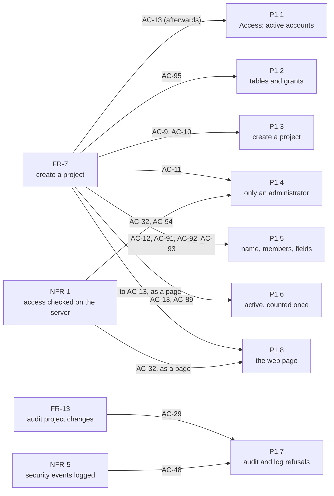
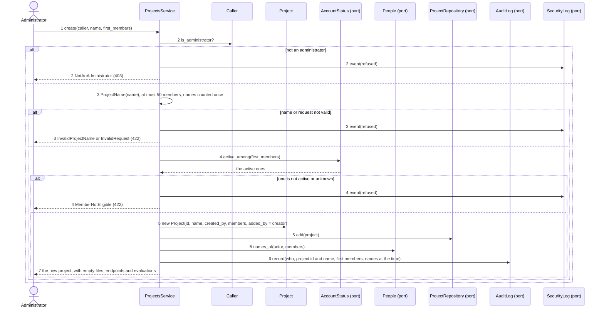

# UC-P1: Create a project (chapter 001)

**Version:** v1, initial implementation  
**Status:** Built. Plan is a draft, not reviewed by a person  
**Tier:** full  
**Use Case:** [UC-P1](../../../../usecases/UC-P1-create-a-project.md)  
**Requirements:** FR-7, FR-13  
**Design:** [design sequence](../../../../usecases/diagrams/UC-P1-create-a-project-design-sequence.puml), [Projects design](../../../../domain/diagrams/projects-design.puml)  
**Code matched at:** `7481263`

Read this first. It holds what every task file in this chapter assumes, so the task files do not repeat it.

---

## 1. Objective

An administrator creates a project with a name and, optionally, first members.

Only an administrator may. The first members must have active accounts. The creation is audited, every refusal is logged, and a web page does it in the browser.

## 2. Engineering Context

### Requirements
- FR-7: The system shall let an administrator create a project and name its first members.
- FR-13: The system shall record an audit entry for every project creation and every change to a project's members.

The criteria below also prove NFR-1 (access is checked on the server), NFR-5 (security events are logged) and FR-9.

### Acceptance Criteria
- AC-9: An administrator creates a project naming an active account as a first member. The project exists and that person is a member.
- AC-10: An administrator may name themselves as a first member.
- AC-11: A user who is not an administrator is refused.
- AC-12: A name that is empty, only spaces, or over 100 characters is refused.
- AC-13: A first member who is not active is refused, with one answer for an account that cannot be a member.
- AC-29: One audit entry says who created the project, which one (its id and name) and who the first members are, each with the name and email they had at that time.
- AC-32: The server refuses a project command the role may not make, even if the screen hides it, and nothing is created or changed.
- AC-48: Each refused sign in, refused request, and session start or end writes one log line, and none holds a token or a code.
- AC-89: A first member named twice is counted once, in the project and in the audit entry.
- AC-91: A name with a control character or a bidirectional override character is refused with `InvalidProjectName` (422), and no project exists.
- AC-92: More than 50 first members is refused with a 422, and no project exists.
- AC-93: A request body with a field the route does not define is refused with a 422, and nothing is created or changed.
- AC-94: Every `/projects` route refuses no token or a bad one (401) and a pending or deactivated account (403), before the project is looked at.
- AC-95: The database role the API connects with cannot update or delete a project or update a membership (42501), while adding and reading projects and memberships, and deleting a membership, still work.

### At a Glance



*Reading guide:* an arrow runs from a requirement to the task that builds it, labelled with the criteria that prove it there.
Status is in the Execution Plan table, never in the colour of a box.

### Architecture
- **Bounded Context:** Projects (BC-PROJECTS)
- **Aggregate:** Project, with its Membership entity inside it
- **Value Objects:** ProjectName, Caller
- **Application Service:** ProjectsService
- **Ports:** ProjectRepository, AccountStatus, People, AuditLog, SecurityLog
- **Adapters:** SqlProjects (outbound), the routes and guard chain (inbound), and the bridges in `composition/` that answer AccountStatus, People and AuditLog from Access and Audit
- **Web:** the page `/projects/new` (TSK-P1.8)

### Design Artifacts
- [Analysis Sequence Diagram](../../../../usecases/diagrams/UC-P1-create-a-project-analysis-sequence.puml)
- [Design Sequence Diagram](../../../../usecases/diagrams/UC-P1-create-a-project-design-sequence.puml)
- [Projects Design Diagram](../../../../domain/diagrams/projects-design.puml)
- [Context Map](../../../../domain/diagrams/context-map.puml)

The PlantUML files are the source. This is a reading copy of the design sequence: change both in the same commit.



*Reading guide:* the numbers are the steps of the use case's flow. Every refusal writes one security log line, and the role is
checked before the input is validated (decision 14).

## 3. Implementation Strategy

Implement the feature incrementally, test first, one task at a time.

The Project aggregate owns the rules. The service coordinates the ports. The route only maps a rule's error to a status.

### Ground rules for every task

1. **Work in `apps/api/`** (the web task, TSK-P1.8, works in `apps/web/`). Commands are run from there.
2. **Where code goes (ADR 0010).** Everything is under `app/projects/`:

   ```
   domain/                  rules, pure: standard library and itself only (project.py, name.py, caller.py, errors.py)
   application/             ports.py (the ports) and service.py (ProjectsService)
   adapters/inbound/        http.py, schemas.py, errors.py (rule to HTTP status)
   adapters/outbound/       sql.py
   ```

   `composition/` is the only place that sees every adapter. A context never imports another context.
   `tests/test_architecture.py` fails if any of this is broken.
3. **The test comes first.** Each test carries `@pytest.mark.ac("AC-n")` for the criterion it proves (it also becomes
   the mark `-m AC_n`). A task is done when its criteria each have a test, and the fast gate passes.
4. **The gates.** While working: `uv run pytest -q` (SQLite, fast). Before finishing a task: `scripts/check.sh`, from the
   repo root (format, lint, types, tests, requirement and tag checks). Before the pull request: the PostgreSQL run with
   `TEST_DATABASE_URL`, always the `playground_test` database, never `playground`.
5. **Refusals never repeat the input,** and every refusal writes one line to the security log (AC-48, built in TSK-P1.7).
6. **Rules live in the domain,** not the route. The route only maps a rule's error to a status.

## 4. Execution Plan

| Task | Description | Verification | Needs | Status |
|---|---|---|---|---|
| [P1.1](TSK-P1.1-access-answers-which-accounts-are-active.md) | Access answers which accounts are active among some ids | AC-13, AC-18 (afterwards) | none | Built, plan draft |
| [P1.2](TSK-P1.2-projects-and-memberships-tables-with-grants.md) | The `projects` and `memberships` tables, with grants | AC-95 | none | Built, plan draft |
| [P1.3](TSK-P1.3-an-administrator-creates-a-project.md) | An administrator creates a project, with first members | AC-9, AC-10 | P1.1, P1.2 | Built, plan draft |
| [P1.4](TSK-P1.4-only-an-administrator-creates-a-project.md) | Only an administrator may; every route passes the guard chain | AC-11, AC-32, AC-94 | P1.3 | Built, plan draft |
| [P1.5](TSK-P1.5-name-members-and-fields.md) | The name, the cap on first members, unknown fields refused | AC-12, AC-91, AC-92, AC-93 | P1.3 | Built, plan draft |
| [P1.6](TSK-P1.6-first-members-active-and-once.md) | First members need an active account, counted once | AC-13, AC-89 | P1.1, P1.3 | Built, plan draft |
| [P1.7](TSK-P1.7-audit-and-log-refusals.md) | Creation is audited with names; every refusal is logged | AC-29, AC-48 | P1.3 | Built, plan draft |
| [P1.8](TSK-P1.8-create-project-page.md) | The web page `/projects/new` | AC-9 to AC-13, AC-32 | P1.3 to P1.7, TSK-P3.5 | Built, plan draft |

"Needs" is read from the order of the use case's slice list and the text of each slice; confirm it when a task is reviewed.
"Verification" is the criteria whose tagged tests prove the task. Each task is `TSK-` plus its number in the use case's Slices.

## 5. Risks and Design Considerations

- A field the route does not define must never be taken as input, whether ignored or stored: mass assignment (AC-93, ADR 0015).
- The role is checked before the body is read, so a person who may not create a project learns nothing about whether their input was valid (decision 14).
- A refusal must not repeat the input: a hidden character would reach the log and the screen (AC-91).
- An audit name comes from People at that moment. An id People does not know keeps its id with `name: null`, so the trail can hold a null name.
- The 50-member cap applies to first members only. Members added later are not capped in the alpha.
- The API's database role has no UPDATE or DELETE on `projects` (AC-95), so a later feature that edits or deletes a project needs a migration that widens the grants first.

## 6. Decisions and Deviations

No deviations recorded in this chapter.

Owner's decisions: 13, 14, 22 and 23 in `docs/domain/decisions.md`. Technical decisions: ADR 0010 (layout), 0012 (migrations), 0013 (security log), 0015 (the Projects build plan) and 0016 (the answer shape).

Stale statuses found while writing this, not changed here: the Projects ports in `BC-PROJECTS.md` and the title of the design sequence still say "planned", though the feature is built. Correct them when the chapter is accepted.

## 7. Verification Summary

**Status:** Executed on 2026-11-24 at `7481263`. 13 of 14 criteria have a passing test in the unit run. AC-95 is covered by the stack run only.

- Unit tests: API 515 cases, 0 failing, 47 skipped (SQLite; the skipped ones need the stack). Web 113 cases, 0 failing.
- Integration tests: AC-95 needs the fresh-stack run (`scripts/test-stack.sh all`). Not re-run for this summary.
- Acceptance tests: the 13 criteria above have tagged tests that passed in the unit run. The stack acceptance tests were not re-run.
- Architecture checks: `tests/test_architecture.py`, 21 passed. It holds Projects to ADR 0010.
- Traceability checks: Requirements ok, Criteria warn (AC-95 has no result), Analysis warn (not frozen), Rules ok (none listed), Design ok, Slices ok, Security warn (not probed), Review warn (not stamped: 16 links, and 14 tagged criteria have no test review hash).

Regenerate with `scripts/test-results.sh`, then `python3 .claude/skills/vbench-vcycle/scripts/vcycle.py UC-P1`.

## 8. Approvals

**Plan approval:** Pending  
**Implementation approval:** Pending

A read-only agent checked each task's accuracy against the code on 2026-11-24. That is not an approval: no person has read the plan and written a commit.

Approval names a commit, never just "reviewed". If the cited code changes in behaviour, the approval is stale until the step is reviewed again.

## 9. Outcome and Learnings

To be completed when the plan is reviewed.

This section summarizes what was actually built, any deviations from the original design, and lessons learned during execution.
