# UC-P1: Create a project (chapter 001)

**Version:** v1, initial implementation  
**Status:** Built. Plan is a draft, not reviewed by a person  
**Tier:** full  
**Use Case:** [UC-P1](../../../../usecases/UC-P1-create-a-project.md)  
**Requirements:** FR-7, FR-13  
**Design:** [design sequence](../../../../usecases/diagrams/UC-P1-create-a-project-design-sequence.puml), [Projects design](../../../../domain/diagrams/projects-design.puml)  
**Code matched at:** `7481263`

Read this first. It holds what every task file in this chapter assumes, so the task files do not repeat it.

---

## 1. Objective

An administrator creates a project with a name and, optionally, first members.

Only an administrator may. The first members must have active accounts. The creation is audited, every refusal is logged, and a web page does it in the browser.

## 2. Engineering Context

### Requirements
- FR-7: The system shall let an administrator create a project and name its first members.
- FR-13: The system shall record an audit entry for every project creation and every change to a project's members.

The criteria below also prove NFR-1 (access is checked on the server), NFR-5 (security events are logged) and FR-9.

### Acceptance Criteria
- AC-9: An administrator creates a project naming an active account as a first member. The project exists and that person is a member.
- AC-10: An administrator may name themselves as a first member.
- AC-11: A user who is not an administrator is refused.
- AC-12: A name that is empty, only spaces, or over 100 characters is refused.
- AC-13: A first member who is not active is refused, with one answer for an account that cannot be a member.
- AC-29: One audit entry says who created the project, which one (its id and name) and who the first members are, each with the name and email they had at that time.
- AC-32: The server refuses a project command the role may not make, even if the screen hides it, and nothing is created or changed.
- AC-48: Each refused sign in, refused request, and session start or end writes one log line, and none holds a token or a code.
- AC-89: A first member named twice is counted once, in the project and in the audit entry.
- AC-91: A name with a control character or a bidirectional override character is refused with `InvalidProjectName` (422), and no project exists.
- AC-92: More than 50 first members is refused with a 422, and no project exists.
- AC-93: A request body with a field the route does not define is refused with a 422, and nothing is created or changed.
- AC-94: Every `/projects` route refuses no token or a bad one (401) and a pending or deactivated account (403), before the project is looked at.
- AC-95: The database role the API connects with cannot update or delete a project or update a membership (42501), while adding and reading projects and memberships, and deleting a membership, still work.

### At a Glance

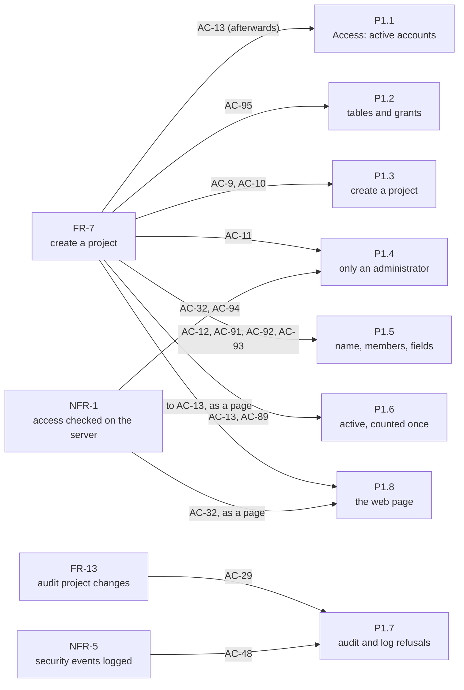

*Reading guide:* an arrow runs from a requirement to the task that builds it, labelled with the criteria that prove it there.
Status is in the Execution Plan table, never in the colour of a box.

### Architecture
- **Bounded Context:** Projects (BC-PROJECTS)
- **Aggregate:** Project, with its Membership entity inside it
- **Value Objects:** ProjectName, Caller
- **Application Service:** ProjectsService
- **Ports:** ProjectRepository, AccountStatus, People, AuditLog, SecurityLog
- **Adapters:** SqlProjects (outbound), the routes and guard chain (inbound), and the bridges in `composition/` that answer AccountStatus, People and AuditLog from Access and Audit
- **Web:** the page `/projects/new` (TSK-P1.8)

### Design Artifacts
- [Analysis Sequence Diagram](../../../../usecases/diagrams/UC-P1-create-a-project-analysis-sequence.puml)
- [Design Sequence Diagram](../../../../usecases/diagrams/UC-P1-create-a-project-design-sequence.puml)
- [Projects Design Diagram](../../../../domain/diagrams/projects-design.puml)
- [Context Map](../../../../domain/diagrams/context-map.puml)

The PlantUML files are the source. This is a reading copy of the design sequence: change both in the same commit.

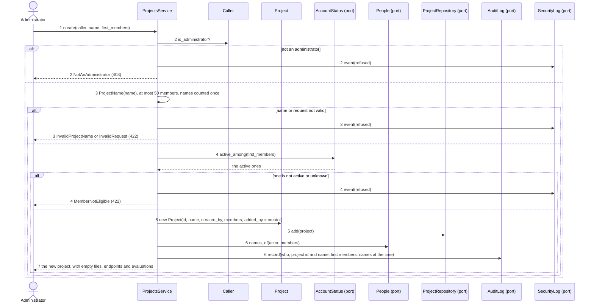

*Reading guide:* the numbers are the steps of the use case's flow. Every refusal writes one security log line, and the role is
checked before the input is validated (decision 14).

## 3. Implementation Strategy

Implement the feature incrementally, test first, one task at a time.

The Project aggregate owns the rules. The service coordinates the ports. The route only maps a rule's error to a status.

### Ground rules for every task

1. **Work in `apps/api/`** (the web task, TSK-P1.8, works in `apps/web/`). Commands are run from there.
2. **Where code goes (ADR 0010).** Everything is under `app/projects/`:

   ```
   domain/                  rules, pure: standard library and itself only (project.py, name.py, caller.py, errors.py)
   application/             ports.py (the ports) and service.py (ProjectsService)
   adapters/inbound/        http.py, schemas.py, errors.py (rule to HTTP status)
   adapters/outbound/       sql.py
   ```

   `composition/` is the only place that sees every adapter. A context never imports another context.
   `tests/test_architecture.py` fails if any of this is broken.
3. **The test comes first.** Each test carries `@pytest.mark.ac("AC-n")` for the criterion it proves (it also becomes
   the mark `-m AC_n`). A task is done when its criteria each have a test, and the fast gate passes.
4. **The gates.** While working: `uv run pytest -q` (SQLite, fast). Before finishing a task: `scripts/check.sh`, from the
   repo root (format, lint, types, tests, requirement and tag checks). Before the pull request: the PostgreSQL run with
   `TEST_DATABASE_URL`, always the `playground_test` database, never `playground`.
5. **Refusals never repeat the input,** and every refusal writes one line to the security log (AC-48, built in TSK-P1.7).
6. **Rules live in the domain,** not the route. The route only maps a rule's error to a status.

## 4. Execution Plan

| Task | Description | Verification | Needs | Status |
|---|---|---|---|---|
| [P1.1](TSK-P1.1-access-answers-which-accounts-are-active.md) | Access answers which accounts are active among some ids | AC-13, AC-18 (afterwards) | none | Built, plan draft |
| [P1.2](TSK-P1.2-projects-and-memberships-tables-with-grants.md) | The `projects` and `memberships` tables, with grants | AC-95 | none | Built, plan draft |
| [P1.3](TSK-P1.3-an-administrator-creates-a-project.md) | An administrator creates a project, with first members | AC-9, AC-10 | P1.1, P1.2 | Built, plan draft |
| [P1.4](TSK-P1.4-only-an-administrator-creates-a-project.md) | Only an administrator may; every route passes the guard chain | AC-11, AC-32, AC-94 | P1.3 | Built, plan draft |
| [P1.5](TSK-P1.5-name-members-and-fields.md) | The name, the cap on first members, unknown fields refused | AC-12, AC-91, AC-92, AC-93 | P1.3 | Built, plan draft |
| [P1.6](TSK-P1.6-first-members-active-and-once.md) | First members need an active account, counted once | AC-13, AC-89 | P1.1, P1.3 | Built, plan draft |
| [P1.7](TSK-P1.7-audit-and-log-refusals.md) | Creation is audited with names; every refusal is logged | AC-29, AC-48 | P1.3 | Built, plan draft |
| [P1.8](TSK-P1.8-create-project-page.md) | The web page `/projects/new` | AC-9 to AC-13, AC-32 | P1.3 to P1.7, TSK-P3.5 | Built, plan draft |

"Needs" is read from the order of the use case's slice list and the text of each slice; confirm it when a task is reviewed.
"Verification" is the criteria whose tagged tests prove the task. Each task is `TSK-` plus its number in the use case's Slices.

### What and why, task by task

Each task file is how to build and test one slice (ADR 0022). The reasons are here: what a task does, why, the logic, the decisions and the open questions.

#### P1.1: access answers which accounts are active

**What.** Projects must know whether a first member has an active account (AC-13), and later whether a person being added is one
(AC-18). Projects never reads an account, so Access answers. This task is the Access side only, built before Projects.

Given some account ids, when Access is asked which are active, it answers the ids of the active accounts only. An unknown,
pending or deactivated id is left out, and nothing in the answer tells the three apart. A duplicate id counts once, and an
empty list asks nothing. Asked for the names of some ids, Access answers id, name and email as they are now, for the known ids.

**Why, criterion by criterion**

| AC | Given | Then | Why it exists |
|---|---|---|---|
| AC-13 (afterwards, TSK-P1.6) | an administrator creates a project naming a first member who is not active or does not exist | it is refused, with one answer for an account that cannot be a member | A project member is someone who can sign in. Access owns "active", so Projects asks it and never reads a status itself. |
| AC-18 (afterwards, UC-P2) | an administrator adds an account that is pending, deactivated or unknown | it is refused, with one answer for all three | The same question, asked when a member is added later. One answer for three cases so the refusal does not tell which account exists. |

**The logic, decision by decision**

1. **"Active" is a rule of the account, so it sits on `Account`.** `is_active` is true only for status `active`; pending
   and deactivated are not (AC-13, AC-18). `is_active_administrator` already tested the same status, so it now reuses it.
2. **Unknown, pending and deactivated ids are all left out of the answer.** The caller gets the active ones and nothing
   that tells the three apart (AC-13, AC-18).
3. **A duplicate id counts once, and an empty list asks nothing.** The service removes duplicates before it asks; the
   repository answers `[]` for no ids without running a query.
4. **One query for any number of ids.** `by_ids` is a single `IN` query, never one query per id.
5. **Plain values cross the boundary.** `active_among` returns a list of id strings, and `people` returns
   `AccountSummary` (id, name, email), never an `Account`. So Projects imports nothing from Access (ADR 0015); the bridge
   that connects them is `AccountStatusBridge`, built in TSK-P1.6 (the `people` bridge comes in TSK-P1.7).
6. **`people` rides along.** The slice text asks only for `active_among`. The commit also built `people(ids)` (name and
   email now, unknown ids left out) from the same query, for the audit entry of TSK-P1.7 and the member names of ADR 0016.
   It is shown here because it is in the code and shares `by_ids`.

**Where it lives.** - "Active": the `Account` entity in the Access domain (`is_active`).
- Finding many accounts at once: the `AccountRepository` port and its SQL adapter, in Access.
- Answering another context: an Access use case, `AccessService.active_among` (and `people`), returning plain values.

Projects and Access are two bounded contexts. Projects must not import an Access type (ADR 0015), so Access answers with a use
case that gives back strings and a small summary, never an `Account`. The rule "active" is a rule of the account, so it sits on
`Account`, and the one place that decides what active means is the domain. Everything stays inside Access (ADR 0010).

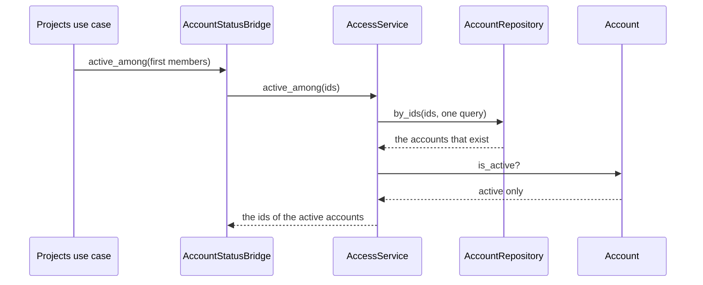

*Reading guide:* Projects asks through a bridge, Access reads once and keeps only the accounts that are active. The bridge
itself is built in TSK-P1.6, so this task builds the part from `AccessService` down.

**Design check.** Not yet true of the code:

- [ ] Implementation matches the design model. The design sequence draws `active_among(first_members)` going straight from the Projects use case to Access. The code has an `AccountStatusBridge` in between (TSK-P1.6) and Access answers a list, not a set. Decide whether the design should show the bridge.

**Decisions.**

- ADR 0015: Access answers through a new use case that returns plain values, so Projects imports nothing from Access. No new ADR in this task.
- ADR 0010: where the code goes, inside the Access context.
- ADR 0016: the member names the `people` use case serves.

**Learnings.**

**Plain values at a boundary:** a context gives another context ids and small summaries, never its own entity, so neither side depends on the other's types.

**One answer for three cases:** leaving unknown, pending and deactivated ids out the same way means the caller cannot tell which account exists.

**Open questions.**

- `people` was built here although the slice text names only `active_among`. Should its own task or criterion say so?
- The design sequence does not show the bridge between Projects and Access. Should it?

**Where the real build differs from this plan.**

- One commit, `5b3dd94`, built the task. It also built `people` (decision 6), which the slice text does not name.
- The commit message says tests were also run on PostgreSQL (220). That was not run for this plan: `TEST_DATABASE_URL` was not set, so only SQLite counts are given. No test of this task needs PostgreSQL.
- No test here has an `@pytest.mark.ac` marker, because the criteria belong to TSK-P1.6 and UC-P2.
- Not here: the bridge in `composition/` that calls `active_among` for Projects (`AccountStatusBridge`, first added in TSK-P1.6, commit `c5c6f64`), the refusal itself (TSK-P1.6, AC-13), and the bridge for `people` (TSK-P1.7, `58dc0f1`).

How to build it and test it: [TSK-P1.1](TSK-P1.1-access-answers-which-accounts-are-active.md).

#### P1.2: the projects and memberships tables, with grants

**What.** Two tables, owned by the owner role that runs the migrations, and a database role for the API that can do only what
Projects needs. Nothing here creates a project yet (TSK-P1.3).

Given the API role, when it adds or reads a project or a membership, or removes a membership, the database accepts it. When
it updates or deletes a project, updates a membership, names `created_at` or `added_at` in an insert, or truncates, alters or
drops either table, the database refuses with `42501`, and the owner role, running the same statement, is accepted.

**Why, criterion by criterion**

| AC | Given | Then | Why |
|---|---|---|---|
| AC-95 | the database role the API connects with (not the owner role that runs the migrations) | it tries to update or delete a project, update a membership, or truncate, alter or drop either table: the database refuses each one (42501), while adding and reading projects and memberships, and deleting a membership, still work | A project and its membership history must not be rewritable by a bug or by stolen API credentials. The rule is enforced by permissions in PostgreSQL, like the audit table (AC-80, FR-7, FR-9). |

**The logic, decision by decision**

1. **The API role holds an allow list, from nothing.** The migration revokes everything first, then grants: on `projects`
   SELECT and INSERT of `id, name, created_by` (no UPDATE, no DELETE, no TRUNCATE); on `memberships` SELECT, DELETE and
   INSERT of `project_id, account_id, added_by` (no UPDATE). No default privileges. A second run ends in the same place
   (AC-95).
2. **Only the columns the application sets are insertable.** `created_at` and `added_at` are set by the database, so an
   insert that names one is refused too (the same idea as RULE-L2, which says it for an audit entry).
3. **A membership can be removed but never edited.** Removing is a DELETE of one row; an UPDATE is refused. So history
   is the difference between the rows before and after (ADR 0015).
4. **Ids are random UUID strings made by the application,** so there is no sequence, and an id reveals neither count nor
   order (ADR 0015).
5. **A person is in a project once.** A unique key on (project, account) is the identity of a membership, and a foreign
   key ties it to an existing project (AC-90, built on in the later slices).
6. **The control.** Each forbidden statement runs as the API role in its own transaction and fails with `42501`; then
   the owner runs the very same statement and it is accepted (rolled back), so a typo cannot make a refusal pass.
7. **PostgreSQL only.** SQLite has no roles, so there the migration makes the tables and stops; the grant test is skipped
   unless `TEST_DATABASE_URL` is set.

**Where it lives.** - The two tables: the Projects outbound adapter (`app/projects/adapters/outbound/sql.py`), on the shared `Base`.
- The grants: one Alembic migration, `migrations/versions/0004_projects.py`, run by the owner role outside the app (ADR 0012).
- The proof: a PostgreSQL grant test, `tests/test_projects_permissions.py`.
- The Projects folders (`domain/`, `application/`, `adapters/inbound/`, `adapters/outbound/`) exist so the architecture test sees
  the context (ADR 0010).

A project and its membership history must not be rewritable by a bug or by stolen API credentials, so the database itself
refuses the change, not the application code. A permission is a fact about the database, so it lives in a migration and is
tested against PostgreSQL, the engine of Amazon RDS on AWS (ADR 0015, decision 4). No rule of the domain is involved here, and
`GRANT` and `REVOKE` appear only in migrations (checked by search at `7481263`).

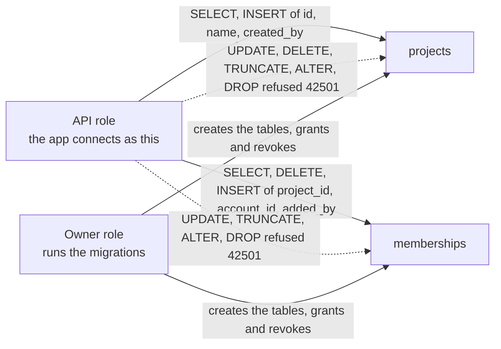

*Reading guide:* solid arrows are what the API role may do, dotted arrows are what the database refuses it, and the owner role is the only one that shapes the tables.

**Decisions.**

- ADR 0015: the tables, the random string ids, and the column level grants with no default privileges.
- ADR 0012: migrations run as the owner role, outside the app. ADR 0010: the folder layout of a context.
- No new ADR.

**Learnings.**

**Column level grant:** PostgreSQL can allow INSERT on chosen columns only, so the API role can add a row yet never name a column the database sets.

**Control statement:** the owner role runs the same forbidden statement and it is accepted, so a typo in the test cannot make a refusal pass.

**Open questions.**

- The grant test has never been run for this plan. When a `playground_test` database is available, run it and record the counts.
- ADR 0015 says the ids are "made in the domain", and the tables comment says "made by the application". Both are the application side; say which in one place if it matters.

**Where the real build differs from this plan.**

- One commit, `48064f7`, built the task, and the grant test was written with the migration. Stage 4 splits them to show the test
  first; that split was not run.
- The PostgreSQL grant test could not be run for this plan (`TEST_DATABASE_URL` unset), so no Expect in stage 4 is checked and
  the 240 figure is from the commit message only.
- `app/projects/adapters/outbound/sql.py` was 30 lines in this commit (the two table classes). Later tasks added `SqlProjects`
  to the same file; only this task's part is quoted.
- The test file and the migration are unchanged between `48064f7` and `7481263`.

How to build it and test it: [TSK-P1.2](TSK-P1.2-projects-and-memberships-tables-with-grants.md).

#### P1.3: an administrator creates a project

**What.** `POST /projects` takes a name and a list of first members and makes a project whose members are exactly the people named. This
task builds the whole path once, thin, from the domain to the route: later tasks add the refusals. It does not yet check the
role, the name, the members' accounts or audit anything (TSK-P1.4 to P1.7).

Given an administrator and an active account, when they create a project naming that account as a first member, the project
exists and that person is a member (201). Given an administrator who names themselves, they are a member. Given an administrator
who names nobody, the project exists with no member. The answer is the project plus three empty lists: `files`, `endpoints` and
`evaluations`.

**Why, criterion by criterion**

| AC | Given | Then | Why |
|---|---|---|---|
| AC-9 | an administrator and an active account | they create a project naming that account as a first member; the project exists and that person is a member | This is the use case itself (FR-7): without it there is no project for anything else to hang on. |
| AC-10 | an administrator | they create a project naming themselves as a first member; it exists and they are a member | The administrator is a superuser (decision 13) but is not a member by default. Being one is a choice, and so is naming nobody: a project may start with no member. |

**The logic, decision by decision**

1. **Only the people named are members.** The creator is a member only if named (AC-10). A project with none is valid.
2. **`added_by` of every first member is the creator.** Each `Membership` records who added it (ADR 0015).
3. **The id is a random UUID made in the domain** (`uuid4`), so an id reveals no count or order and the domain needs no
   database to have one (ADR 0015).
4. **Each person once.** `dict.fromkeys` keeps the order and drops a repeat. The test for AC-89 comes in TSK-P1.6; the
   one line is here because it is the natural way to write the loop.
5. **The project and its memberships are written in the request's own session**, project first, then a flush, then the
   memberships (they point at it). They commit together or not at all.
6. **The database sets the times**, never the application (`created_at`, `added_at`): the API role may not name them
   (AC-95, built in TSK-P1.2).
7. **Projects has its own `Caller`**, built in `composition/` from the account the guard chain returns (ADR 0002, 0015).
   The route sits behind the same guard chain as every account route, so no token, a pending and a deactivated account
   are refused before any Projects code runs.
8. **The answer is the project plus three empty lists**, `files`, `endpoints` and `evaluations` (decision 23).

**Where it lives.** - The rule that makes a project: the `Project` aggregate's domain (`Project.create`), in the Projects bounded context.
- The use case: `ProjectsService.create`, which builds the project and saves it through a port.
- The port: `ProjectRepository`, in `application/ports.py`. The table access: `SqlProjects` in `adapters/outbound/sql.py`.
- The route and its schemas: `adapters/inbound/`.
- The only code that sees Access and Projects together: `composition/`, which makes Projects' own `Caller` from the account the
  guard chain returns.

The domain imports nothing outside itself and the route holds no rule (ADR 0010). Projects has its own `Caller`, so it does not
import Access (ADR 0002, ADR 0015). The route sits behind the same guard chain as every account route, so no token, a pending
and a deactivated account are refused before any Projects code runs.

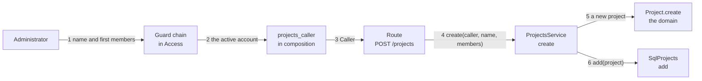

*Reading guide:* the guard chain runs first, composition turns its account into a `Caller`, and the use case asks the domain for
a project and then saves it through the port.

**Decisions.**

- Decision 13: an administrator is a superuser but is not a member by default. Being one is a choice, and so is naming nobody.
- Decision 23: the answer is the project plus three empty lists, `files`, `endpoints` and `evaluations`.
- ADR 0015: the id is a random UUID made in the domain; the database sets the times; Projects has its own `Caller`.
- ADR 0002 and ADR 0010: the contexts do not import each other, and the domain imports nothing outside itself.

**Learnings.**

**Composition root:** the one place that sees every adapter and both contexts. Here it turns Access's account into Projects' `Caller`.

**Port:** the use case asks `ProjectRepository` to save, and does not know it is SQL.

**Open questions.**

- The design sequence says the use case does `new Project(...)`, and the code calls the factory `Project.create`. Should the design say so?
- The PostgreSQL run of the SQL tests was not repeated for this plan.

**Where the real build differs from this plan.**

- One commit, `9e8be89`, built all four stages together; the stages are a way to follow it, not four commits.
- The tests at that commit had the names, the `members` list of bare ids and a `FakeProjects` that returned the `Project`
  itself. Since then the answer carries `members` as `{id, name}` (ADR 0016) and the service returns a `ProjectView`, so the
  quoted `ProjectOut` and route differ from what the first commit wrote. The tests shown for AC-9 and AC-10 at `7481263` were
  adjusted to that (for instance `projects.by_id(p.id) is p.project`). They also build `ProjectsService` with four arguments
  (TSK-P1.6, TSK-P1.7).
- The stage 4 red was run at the commit's parent with the route and schemas present and the wiring absent; with nothing
  present the API file fails the same way for the same reason.
- Not here yet: the role check (TSK-P1.4), name and cap (P1.5), active members (P1.6), audit and security log (P1.7).

How to build it and test it: [TSK-P1.3](TSK-P1.3-an-administrator-creates-a-project.md).

#### P1.4: only an administrator creates a project

**What.** [TSK-P1.3](TSK-P1.3-an-administrator-creates-a-project.md) lets anyone who passes the guard chain create a project.
This task makes the server refuse everyone who is not an administrator, and proves that every route under `/projects`
sits behind the guard chain.

Given a caller who is not an administrator, when they create a project, it is refused with 403 `forbidden` and nothing is
written, whatever the name and members say. Given an administrator who is demoted, their next request is refused at once.
Given no token, a bad token, a pending account or a deactivated account, every route under `/projects` answers 401 or 403
from the guard chain.

**Why, criterion by criterion**

| AC | Given | Then | Why |
|---|---|---|---|
| AC-11 | a user who is not an administrator | they try to create a project; it is refused | Creating a project is an administrator's act (decision 13). The refusal is a 403 `forbidden`, nothing is written, and the name and members are not looked at. |
| AC-32 | a caller who may not make a project command (a user, or a member who is not an administrator), even if the screen hides the button | they make it; the server refuses it and nothing is created or changed | The screen is a courtesy, the server decides (NFR-1). Here the command is create; the add and remove commands are proven by UC-P2, under the same criterion. |
| AC-94 | a request with no token, a pending account, a deactivated account | each makes a request to every `/projects` route, with an id of a project that exists | Each is refused (401 or 403) before the project is looked at, and the answer shows nothing about the project. A route a later slice adds under `/projects` without the guard chain must fail a test. **Met in part here:** the walk test in this task uses a random UUID for a project that does not exist, and does not check that the answer hides the project. The cases with a real project id are the later tests named in stage 3. |

**The logic, decision by decision**

1. **The role check is the first thing `create` does** (AC-11). It runs before the name and members are looked at, so a
   non-administrator learns nothing about what is valid and nothing can be written. The order is decision 14.
2. **The rule is in the use case, not the route.** `Caller.is_administrator` is a fact the composition root reads from
   the account on every request, so a demoted administrator is refused at once, and a token that still says
   "administrator" proves nothing (AC-32). The route only maps the refusal to a status.
3. **One error, one answer.** `NotAnAdministrator`, code `forbidden`, status 403, a fixed message that repeats nothing the
   caller sent.
4. **Being a member of other projects is not a role.** A member who is not an administrator is refused the same way
   (AC-32). There are two roles and no project roles (decision 13).
5. **The guard chain is not repeated in Projects.** The route depends on `guards.active_account` (Access's chain), so
   401, `account_pending` and `account_deactivated` come from it before any Projects code (AC-94). The test walks the
   route table instead of naming routes, so a route added later is covered with no edit.

**Where it lives.** - The role rule: the application service, `ProjectsService`, reading the `Caller` fact `is_administrator`.
- The error: `NotAnAdministrator` in the Projects domain, code `forbidden`.
- The status: `HTTP_STATUS` in `adapters/inbound/errors.py`.
- The guard chain: Access's `guards.active_account`, wired into the route by the composition root in TSK-P1.3. Projects does not repeat it.

The route only maps the refusal to a status, so the rule has one home and a second caller (a job, a script) would be
refused the same way (ADR 0010). The role is read from the account on every request, so a token that still says
"administrator" proves nothing (AC-32). Nothing in `adapters/` mentions `is_administrator` (checked by search at `7481263`).

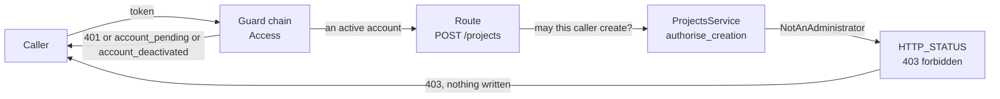

*Reading guide:* the guard chain answers first for a caller without an active account, then the use case answers for one who is not an administrator. Only an administrator reaches the rest of `create`.

**Decisions.**

- Decision 13 (owner): there are two roles, an administrator and a user, and no project roles. Creating a project is an administrator's act.
- Decision 14 (owner): authorisation is checked before the input is validated.
- ADR 0010: where the code goes. ADR 0015: the walk test is its "Tests" line.

**Learnings.**

**Server decides:** the screen is a courtesy. Whatever the screen hides, the server refuses a command the role may not make (AC-32).

**Role read on every request:** `Caller.is_administrator` comes from the account, not from the token, so a demotion takes effect at once.

**Open questions.**

- AC-94 asks for a project that exists and an answer that shows nothing about it. The walk test here uses a random UUID. Two later tests cover real project ids, but only for no token and a pending account. Should one test cover all four cases with a real id?
- The commit message says an unguarded test route made the walk test fail. That was not run for this plan.

**Where the real build differs from this plan.**

- One commit, `5f3ecff`, built the three stages. The role check was in `create` only; the route calling
  `authorise_creation` before it reads the body arrived with TSK-P1.5 (AC-93), and `create` returns a `ProjectView`
  since ADR 0016. The quoted `create` is today's, with all its later checks.
- AC-94 passed the first time it ran. The guard chain was already on the route from TSK-P1.3; this task adds the test
  that keeps it so. Two later tests repeat the idea with a real project id for the read routes and the member routes
  (`test_projects_read_api.py`, `test_projects_members_api.py`), for no token and a pending account only; the walk here
  covers every route and all four cases, but with an id that matches no project.
- The `HTTP_STATUS` table at the commit had one entry; the block above is today's.
- At the commit that built this task the whole suite was `227 passed, 46 skipped` on SQLite and 273 on PostgreSQL (the
  commit message; not run here). Today's suite is `468 passed, 47 skipped`.

How to build it and test it: [TSK-P1.4](TSK-P1.4-only-an-administrator-creates-a-project.md).

#### P1.5: check the name, the members and the fields

**What.** A project name is plain text, trimmed, 1 to 100 characters, and anything else is refused with `InvalidProjectName`. A
project starts with at most 50 distinct first members, and a request body with a field the route does not define is
refused. All three refusals answer 422 in the shared body shape and never repeat the input.

Given a project name that is empty, only spaces, over 100 characters, or holds a control or direction character, when a
project is created with it, it is refused with `InvalidProjectName` (422) and nothing is created. Given more than 50 first
members, it is refused with `InvalidRequest` (422). Given a body with a field the route does not define, it is refused with
`InvalidRequest` (422). None of the three answers repeats the input.

**Why, criterion by criterion**

| AC | Given a name that... | Then | Why |
|---|---|---|---|
| AC-12 | is empty, only spaces, or over 100 characters | it is refused | Without a readable name a project cannot be found or told apart in a list, and an unbounded name can break screens and the audit trail (FR-7). |
| AC-91 | has a control or direction-override character | it is refused with `InvalidProjectName` (422) and no project exists | Such a name can read as another one or hide text, and would reach the trail and the screen. Names are plain text (AC-81, FR-7). |
| AC-92 | an administrator names more than 50 first members | it is refused with a 422 and no project exists | The first members are capped at 50 (decision 23, ADR 0015), so one request cannot write an unbounded number of rows. Members added later are not capped in the alpha. |
| AC-93 | an administrator sends a body with a field the route does not define (`id`, `created_by`, `added_by`, `created_at`, `files`) | it is refused with a 422 and nothing is created | Mass assignment: a field the route does not define must never be taken as input, whether it is ignored or stored (ADR 0015). |

**The logic, decision by decision**

1. **Trim first, then count.** "   " is empty, and spaces around a good name are not part of it (AC-12).
2. **Count characters, not bytes.** 100 emoji are 100 characters; `len` on a Python `str` already counts them so.
3. **Refuse control characters (category `Cc`) and the direction marks.** The marks are category `Cf`, and `Cf` also holds
   harmless characters, so we list the marks by hand instead of refusing all of `Cf` (AC-91).
4. **The message never repeats the name.** It would carry the hidden characters into the log and onto the screen.
5. **Cap the distinct people, not the list.** The list is de-duplicated first (`dict.fromkeys`, already in `create` from
   TSK-P1.3), then counted: 80 ids naming 50 people are accepted. 50 is accepted, 51 refused (AC-92). The counting of
   duplicates as a criterion (AC-89) is TSK-P1.6.
6. **An unknown field is refused, not ignored** (AC-93). The schema forbids extra fields.
7. **The role is checked before the body is read.** A non administrator who sends a bad name and an unknown field still
   gets 403 (AC-11). So the route cannot let FastAPI validate the body first: it takes the raw object, asks the use case
   whether the caller may, and only then validates it.
8. **A refusal of the input is one body shape, `{"detail": {"code", "message"}}`, status 422, with no detail.** FastAPI's
   and pydantic's own answer lists the input back, so the route catches `ValidationError` and raises `InvalidRequest`
   with a fixed message.

**Where it lives:** the name rule is one pure function `clean_name` in the domain, called by `Project.create`, as is the
cap. Not in the route or the schema: a name can arrive by another path later, and the domain must refuse it just the
same (ADR 0001, ADR 0010). The unknown fields are an HTTP matter, so they are refused in the schema and the route
(`adapters/inbound`), the only layer that sees a request body. The map from rule to status is in
`adapters/inbound/errors.py`.

**Where it lives.** - The name rule and the cap: the `Project` aggregate's domain, in the Projects bounded context. The name rule is one pure
  function, `clean_name`, called by `Project.create`.
- The unknown fields: the HTTP layer (`adapters/inbound`), the only layer that sees a request body.
- Who may create: `ProjectsService.authorise_creation`, called by the route before it reads the body.

A name can arrive by another path later, and the domain must refuse it just the same (ADR 0001, ADR 0010). Unknown fields are
an HTTP matter, so the schema and the route refuse them. The map from rule to status is in `adapters/inbound/errors.py`.

The route and the application service must not repeat the length rule or the cap. Nothing outside the domain mentions
`MAX_NAME_LENGTH`, `MAX_FIRST_MEMBERS` or `clean_name` (checked by search at `7481263`).

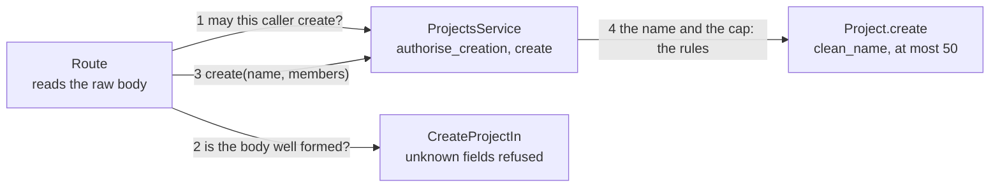

*Reading guide:* the role is checked first, then the shape of the body, then the rules. The rules have one home, the domain.

**Design check.** Not yet true of the code:

- [ ] Implementation matches the design model. The design sequence and the use case name a `ProjectName` value object, but the code has a function, `clean_name`, and no `ProjectName` type. Decide whether to change the code or the design.

**Decisions.**

- Decision 14 (owner): authorisation is checked before the input is validated.
- Decision 23 and ADR 0015: the first members are capped at 50 and de-duplicated; a name follows the rule of reasons (AC-81).
- ADR 0010: where the code goes. ADR 0015: a field the route does not define is never taken as input.

**Learnings.**

**Mass assignment:** a request that sets a field the author never meant to expose, because the code copies every field it receives.

**Rule of reasons:** a refusal says which rule was broken and never repeats the input, so hidden characters do not reach the log or the screen.

**Open questions.**

- Should the code have a `ProjectName` value object, as the design says, or should the design say `clean_name`?
- Members added later are not capped in the alpha. Should they be?
- No test sends a body that is not a JSON object, so that handler is not pinned.

**Where the real build differs from this plan.**

- The commit built it all at once, test and code in one go. The stages are a work order, and the evidence lines were checked by taking
  the code of `9e96f0c` apart, not by replaying the history.
- The 51-member API test of this commit used made-up ids (`acc-0`, ...). TSK-P1.6 changed them to real active accounts, because from
  then on the ids are looked up. The use case tests keep made-up ids and a permissive `FakeAccountStatus`.
- At `9e96f0c` the use case constructor took only the repository. At `7481263` the tests build `ProjectsService` with four arguments
  (TSK-P1.6, TSK-P1.7).
- The AC-92 and AC-93 tests run on SQLite here. The PostgreSQL run was not repeated for this plan (no `TEST_DATABASE_URL` was set); the
  commit message reports 315 on PostgreSQL.

How to build it and test it: [TSK-P1.5](TSK-P1.5-name-members-and-fields.md).

#### P1.6: first members need an active account, each counted once

**What.** Creating a project may name first members. Each must be a person with an active account, and each is one member however often
they are named.

Given a first member who is pending, deactivated or unknown, when a project is created, it is refused with `MemberNotEligible`
(422), one identical answer for the three that names no id and no status, and nothing is written, not even the project. Given
one inactive person among active ones, everyone is refused. Given the same active person named twice, the project has one
membership and Access is asked about that id once. Given no first members, nobody is asked.

**Why, criterion by criterion**

| AC | Given | Then | Why |
|---|---|---|---|
| AC-13 | an administrator names a first member who is not active or does not exist | it is refused, with one answer for an account that cannot be a member | A pending, a deactivated and an unknown account get the same answer, so the refusal cannot be used to find out which ids exist or in what state (FR-7). |
| AC-89 | an administrator names the same active account twice | the project has that person once | First members are de-duplicated before anything is written, so the project has one membership and, once TSK-P1.7 is built, one audit entry that names them once (FR-7). |

**The logic, decision by decision**

1. **Projects asks, Access answers, and Projects never imports Access.** Projects declares its own port,
   `AccountStatus.active_among(ids)`; a bridge in `composition/` answers it by calling Access's own use case (ADR 0002,
   0010, 0015). An architecture test fails if Projects imports another context.
2. **One question for all the people named,** not one for each: the ids are asked in one call (no N+1).
3. **Each person once.** The ids are already de-duplicated by `Project.create` (`dict.fromkeys`, TSK-P1.3), so the
   service asks about `set(project.members)` and Access is asked about each id once (AC-89). This task adds the test that
   pins it, not new de-duplication code.
4. **One answer for every reason.** `MemberNotEligible` carries a fixed message and names no id and no status (AC-13).
5. **One bad person refuses everyone.** The check is before the save, so nothing is written, not even the project.
6. **Order of the refusals:** the role first, then the name and the cap (rules in the domain, no lookup), then the
   eligibility. A request that is already refused for a cheaper reason never asks Access (AC-11, AC-12, AC-92).
7. **No names, no list:** an empty list of first members asks nobody.

Known gap, accepted in the commit message: there is no lock between the check and the save, so a person deactivated in that gap
could still become a member.

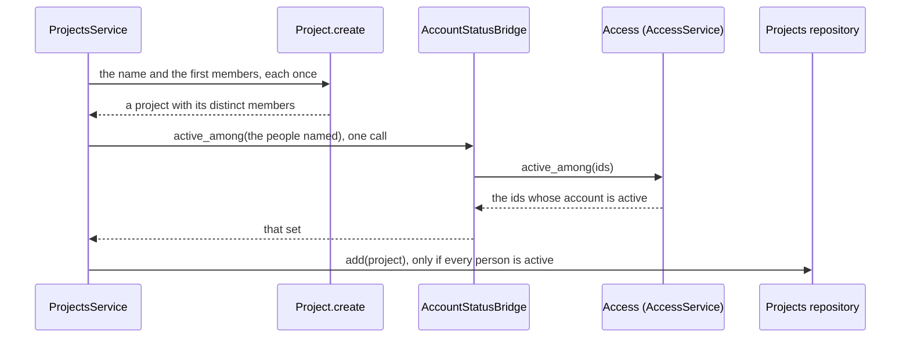

*Reading guide:* the question is asked once, after the domain has trimmed and counted, and the project is saved only if the answer
holds every person named.

**Where it lives.** - The question: `AccountStatus.active_among(ids)`, a port of Projects in `application/ports.py`. Projects declares what it needs.
- The check: `ProjectsService.create`, the use case. It is a fact about another context, so it cannot be a rule of the `Project`
  aggregate.
- The answer: `AccountStatusBridge` in `composition/bridges.py`, the one place that sees both Access and Projects. It calls
  Access's own use case.
- The one refusal: `MemberNotEligible` in `domain/errors.py`, answered 422 by the map in `adapters/inbound/errors.py`.

Projects must not import Access (ADR 0002, 0010, 0015), so Projects asks through a port of its own and the composition root
wires the answer. An architecture test fails if Projects imports another context. The meaning of "active" stays in Access
(`Account.is_active`), so it means the same here as everywhere.


*Reading guide:* the question is asked once, after the domain has trimmed and counted, and the project is saved only if the answer
holds every person named.

**Decisions.**

- ADR 0002, 0010, 0015: Projects asks through its own port and never imports Access; a bridge in `composition/` answers.
- One answer for a pending, a deactivated and an unknown account (AC-13), so a refusal never tells which ids exist or in what state (FR-7).
- Known gap, accepted in the commit message: no lock between the check and the save.

**Learnings.**

**Port and bridge:** one context asks for what it needs in its own words, and the composition root, the only place that sees both
contexts, answers by calling the other context's use case.

**One answer for every reason:** a refusal that differs by state tells a caller which ids exist and in what state.

**Open questions.**

- A person deactivated between the check and the save could still become a member (no lock). Should the check and the save be
  guarded, or is the risk accepted in the checklist's "Accepted for now" list?
- The message of `MemberNotEligible` was `"A first member cannot be added."` when this task was built, and is
  `"That person cannot be added to or removed from this project."` now (see below). The evidence lines above were checked with the
  original text.

**Where the real build differs from this plan.**

- The message of `MemberNotEligible` was `"A first member cannot be added."` when this task was built. Commit `643d61d`
  (UC-P2) worded it to fit an add and a removal, and the tests now expect the new text; the plan ends on the code that
  exists. The evidence lines above were checked with the original text.
- De-duplication was not built here: `dict.fromkeys` was already in `Project.create` from TSK-P1.3. This task added the
  tests for AC-89 and the guarantee that Access is asked once for each id.
- `ProjectsService` has four constructor arguments now (TSK-P1.7 added the audit and people ports), so the tests build it
  with `FakeProjectsAudit()` and `FakePeople()` too.
- The counts for `-m AC_13` and `-m AC_89` at `7481263` include tests added by later tasks that carry the same marker.
- The commit built it all at once. The stages are a work order, and the evidence lines were checked by taking the code of
  `c5c6f64` apart, not by replaying the history.

How to build it and test it: [TSK-P1.6](TSK-P1.6-first-members-active-and-once.md).

#### P1.7: audit a project creation, and log every refusal

**What.** Creating a project writes one audit entry that says who created it, which project and who the first members are, each with the
name and email they had at that time. Every refusal that Projects answers writes one line to the security log, with the reason
code and the caller's id, and never the project name or an id from the body. A successful creation writes no log line, and a
refused one writes no audit entry.

Given an administrator who creates a project naming active accounts, one audit entry is written in the same transaction as
the project, with the names and emails as they are now, and a later rename does not change it. Given a person named twice, they are
in the entry once. Given any refusal that Projects answers (not an administrator, an empty name, an unknown field, a member who
is not eligible, a body that is not a JSON object), exactly one `request_refused` line is written with its code and the caller's
id, and no audit entry and no project row exist. A refusal by the guard chain is logged by the guard, once, and not again by
Projects.

**Why, criterion by criterion**

| AC | Given | Then | Why |
|---|---|---|---|
| AC-29 | an administrator and active accounts | creating a project naming them writes one audit entry: who created it, which project (id and name), and the first members, each with the name and email they had at that time | The trail must say who made what and with whom, and a later rename must not rewrite history (RULE-L4). A refused creation writes none. |
| AC-48 (the refused-request part) | a refused request | it writes one log line, holding no token and no code | Operators need to see refusals. Here the line also holds no project name and no id from the body, since the input is untrusted. |
| AC-89 | a person named twice as a first member | they are in the project once and in the entry once | One person, one line in the trail (the de-duplication itself is TSK-P1.6; this task proves it reaches the entry). |
| AC-85 | an administrator who created projects | opens the audit trail | the creations show, newest first, with the names as they were. Owned by UC-L1; here only proved through the HTTP path. |

**The logic, decision by decision**

1. **The entry is written after the project is saved, in the same transaction.** Both rows commit together or neither does,
   so there is no entry for a project that does not exist (AC-29). The service writes it only on the success path, so
   every refusal before it writes nothing.
2. **Projects speaks in ids; names are looked up when the entry is written.** `ProjectEvent` holds ids and the project
   name. The names and emails are taken at that moment and stored in the entry, so a rename later changes nothing (AC-29).
3. **One question for all the people.** The actor and the members go to the `People` port in one call (no N+1).
4. **An id with no name keeps its id** (`Person(id)` with no name or email) instead of failing.
5. **Projects does not import Audit or Access.** It has its own ports (`AuditLog`, `People`, `SecurityLog`); the bridges
   in `composition/` answer them with Audit's and Access's use cases (ADR 0010, ADR 0015).
6. **Every refusal Projects answers writes one line** (`request_refused`, result `refused`, the reason code and the
   caller's id from `request.state.person_id`), and never the name or an id from the body (AC-48, ADR 0013). Both
   handlers do it: Projects' own errors and a body that is not a JSON object. A refusal by the guard chain is already
   logged by the guard, so Projects does not log it again.
7. **A success writes no line.**

**Where it lives:** the event and the three ports in `application/ports.py`; the use in `ProjectsService.create`; the
two bridges in `composition/bridges.py`; the wiring in `composition/app.py`; the log in the error handlers of
`adapters/inbound/errors.py`, because that is the one place every Projects refusal passes.

**Where it lives.** - The event and the three ports (`AuditLog`, `People`, `SecurityLog`): `application/ports.py` in Projects, in Projects' own
  words (ids, not Audit's or Access's types).
- Writing the event: `ProjectsService.create`, after the save, on the success path only.
- Turning the event into an audit entry with names: the two bridges in `composition/bridges.py`, the only place that sees both
  Projects and Audit or Access.
- The wiring: `composition/app.py`.
- The refusal line: the error handlers of `adapters/inbound/errors.py`, because that is the one place every Projects refusal passes.

Projects must not import Audit or Access (ADR 0010, ADR 0015), so it has its own ports and the bridges answer them with Audit's and
Access's use cases. The audit entry and the project are one transaction, so both rows commit together or neither does. The
names are written into the entry when it is made, so a later rename cannot rewrite history (RULE-L4). The security log is
for operators and is never an audit entry (ADR 0013).

The use case and the handlers must not repeat what the bridges do. A search at `7481263` finds `create_project`, `ProjectEvent`
and `names_of` only in `application/` and `composition/`, and `request_refused` in Projects only in `adapters/inbound/errors.py`.

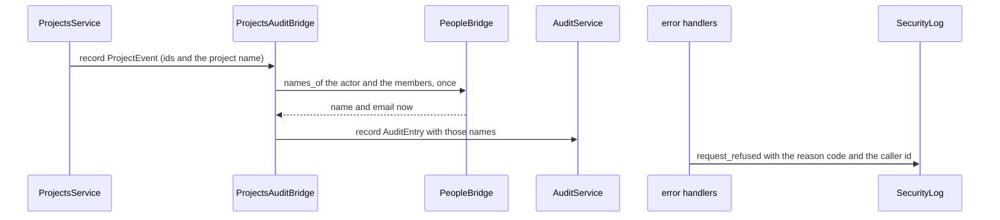

*Reading guide:* on success the service hands Projects' event to the audit bridge, which asks for the names once and writes Audit's entry; on any refusal the handlers write one line to the security log and no entry.

**Decisions.**

- Decision 22 (owner): a refused creation is not an audit entry; it writes a line to the security log (AC-48).
- RULE-L4: the names in an entry are the ones at the time, so a later rename does not rewrite history.
- ADR 0013: the security log, never an audit entry. ADR 0010 and ADR 0015: Projects has its own ports and does not import Audit or Access; the bridges are in `composition/`. No new ADR.

**Learnings.**

**Audit trail and security log are two things:** the trail says who changed what and is written in the request's transaction; the log
says what was refused and is for operators, and is never an entry.

**A bridge keeps two contexts apart:** Projects speaks in ids, and one bridge turns its event into Audit's entry with the names taken
at that moment.

**Open questions.**

- The commit holds this task with AC-85 and AC-89, which the summary table does not list for it. Should the table say so?
- AC-85 is owned by UC-L1 and is only proved here through the HTTP path.
- The PostgreSQL run (351 at the build commit) was not repeated for this plan.

**Where the real build differs from this plan.**

- One commit (`58dc0f1`) holds this task with AC-85 and AC-89, which the summary table does not list for it.
- The stages here are an ordering made afterwards; the commit is one step. Stages 1 to 4 were checked by applying the
  commit's files in that order on its parent.
- The service file went from 19 tests at the build commit to 62 at `7481263` (UC-P2 and UC-P3), and the whole suite from
  305 passed, 46 skipped to 468 passed, 47 skipped. The composition (6) and audit (14) counts are the same at `7481263`.
- At the build commit the `People` bridge was built inline; `ProjectsService` took no `People` until UC-P3.

How to build it and test it: [TSK-P1.7](TSK-P1.7-audit-and-log-refusals.md).

#### P1.8: the page `/projects/new` and its form

**What.** An administrator can create a project from a screen. The page `/projects/new` shows a name field and a list of active people
to pick as first members; the form sends the same request the API route already accepts, through the BFF proxy, so the
browser never holds a token. A person who is not an administrator is sent away, and the API refuses them anyway. The stack
tests also name AC-91 (the control character name). Cells marked *by hand only* or *proved elsewhere* below have no test in
this task.

Given an administrator, when they open `/projects/new`, they see a form with the project name and the active people. When
they submit a name (and any first members), the project is created through `/api/backend/projects` and they land on the new
project. Given a person who is not an administrator, opening `/projects/new` sends them to `/projects`, and the list shows
them no Create project button. Given a name that is empty, blank or over 100 characters, the Create button stays off. Given
a refusal from the API, the form shows one sentence for its code and keeps what was typed.

**Why, criterion by criterion**

| AC | Given | Then | Why |
|---|---|---|---|
| AC-9 | an administrator and an active person | the form creates a project naming them as a first member | The API route exists (TSK-P1.3); a person has to be able to use it from a screen. Stack test: the form's request, then the list and the member's name. The form clicks are *by hand only*. |
| AC-10 | an administrator | the AC text: they create a project naming themselves as a first member and are a member | First members are optional, and an administrator may be one. The stack test sends the request with one member and with none. An administrator naming themselves is *proved elsewhere* (API, TSK-P1.3), not by a web test here. |
| AC-11 | a user who is not an administrator | the AC text: creating is refused. This task's UI behaviour from the use case: opening `/projects/new` sends them to `/projects`, and the list shows no Create link | The screen is a convenience; the API refuses anyway (TSK-P1.4). Stack tests: the redirect and the link. |
| AC-32 | a caller who may not create | the page is opened, or the proxy is called | the server decides. Stack test here: the redirect of a member. A non administrator posting through the proxy is *proved elsewhere* (API, TSK-P1.4). |
| AC-12 | a name empty, blank or over 100 characters | the form is submitted | the API answers 422 `invalid_project_name` (stack test) and `looksLikeAName` is unit tested. That the Create button stays off (the `disabled` wiring) and that the refusal reads as a sentence are *by hand only*: the sentence comes from `projectRefusalMessage` (TSK-P3.5) and no test here asserts it on the page. |
| AC-13 | a first member who is not active | the form is submitted | the API answers `member_not_eligible` (stack test). That the page shows one message for it is *by hand only*. The picker lists only active people, so this happens only with a stale page. |

**The logic, decision by decision**

1. **A thin server page, a client component only for the action** (ADR 0016). The page reads `/me` and the active accounts
   with `api()`; the form calls the BFF proxy `/api/backend/projects`, so the browser never holds a token.
2. **Redirects, in this order:** no session goes to sign in with `returnTo`; a person who is not active goes to the
   dashboard, which says why; an active person who is not an administrator goes to `/projects`. The API still refuses a
   non administrator (AC-11, AC-32).
3. **The picker is the same pure function as UC-P2.** `memberCandidates(accounts, [])` keeps the active accounts, sorted by
   name; with no members yet, the second argument is empty. At most 50 are checked: past that the unchecked boxes are disabled (AC-92 on the screen).
4. **Name hint.** `looksLikeAName` says whether the trimmed name has 1 to 100 characters. It only turns the button off; the server
   stays the judge of the rest (control characters, AC-91), so the function does not try to.
5. **A refusal is a sentence, and what was typed stays.** The form maps the API's code with `projectRefusalMessage`
   (never the API's own text, never the input). The state is kept in the component, so nothing typed is lost.
6. **Success opens the new project**, `/projects/[id]`; if the answer has no id, it goes back to the list.
7. **The list gets a Create project button for administrators only.** A `Button` rendered as a `Link` (Base UI `render`).

 (TSK-P3.5, and the answer with names, D15): `src/domain/member-candidates.ts`
(`memberCandidates`), `src/domain/project-messages.ts` (`projectRefusalMessage`), the types `Account` and `getMe`/`api` in
`src/lib/api.ts`, and the proxy `src/app/api/backend/[...path]/route.ts`. Nothing in them changes in this task.

 the one new rule, `looksLikeAName`, in `src/domain/` (pure, with a `node --test` file); the page in
`src/app/(app)/projects/new/page.tsx` (thin); the form in `src/components/create-project-form.tsx` (the only client code).

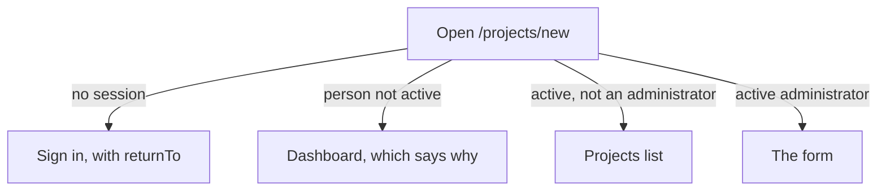

*Reading guide:* the page checks the caller in a fixed order and only an active administrator reaches the form; the API refuses the others whatever the page shows.

**Where it lives.** - The one new rule, `looksLikeAName`: `src/domain/` (pure, with a `node --test` file).
- The page: `src/app/(app)/projects/new/page.tsx`, a thin server page. It reads `/me` and the active accounts with `api()`.
- The form: `src/components/create-project-form.tsx`, the only client code. It calls the BFF proxy.
- The Create project button: `src/app/(app)/projects/page.tsx`, for administrators only.

The web side follows ports and adapters on the server (ADR 0016), but pages and components stay thin and have no ports of
their own. The rule that a name looks fine is pure, so it sits in the domain. The server stays the judge of the name and of
who may create: the screen is a convenience (AC-11, AC-32).

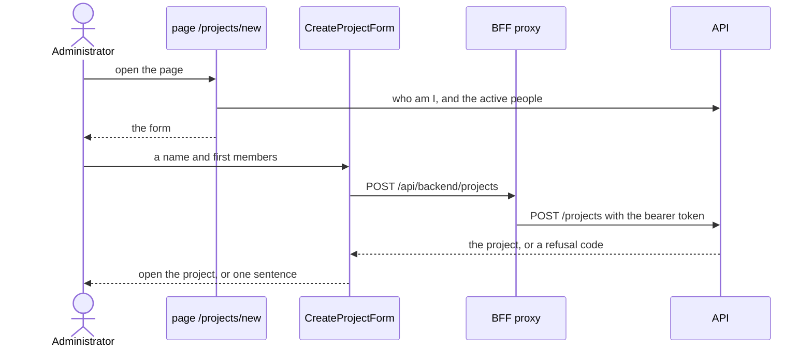

*Reading guide:* the page runs on the server and the form in the browser; the token exists only between the proxy and the API.

**Design check.** Not yet true of the code:

- [ ] Implementation matches the design model. The architecture test checks `domain/`, `application/` and the adapters only, so it does not guard the thinness of pages and components. The page and the form have no test (the form's clicks are *by hand only*).

**Decisions.**

- ADR 0016: the web side of UC-P1, a thin server page, a client component only for the action, the BFF proxy for the call.
- The server stays the judge: the name hint only turns the button off, and the API refuses a non administrator whatever the screen shows (AC-11, AC-32).

**Learnings.**

**BFF proxy:** the browser calls our own server, which adds the token. The browser never sees one.

**Hint, not rule:** `looksLikeAName` can be wrong in the harmless direction (it lets through a name with a control character); the server then refuses it with `invalid_project_name`.

**Open questions.**

- The form has no component test and no browser test: checked boxes, the cap of 50, the message on a refusal and the redirect after a success are *by hand only*. A component test or a browser test would close it.
- The stack tests also name AC-91, and AC-10 and AC-32 are only partly proved here, which the chapter summary row does not show.

**Where the real build differs from this plan.**

- The commit follows UC-P2 (`8539ba0`), not TSK-P1.7, in the history. The task needs nothing from UC-P2.
- One commit holds all five stages; the order here is made afterwards. Stage 1 and the checks of stage 4 were run at the build
  commit's parent, with that commit's files added; the stack tests of stages 2 and 5 were not.
- The stack tests also name AC-91 and AC-10, which the summary row does not list for this task.

How to build it and test it: [TSK-P1.8](TSK-P1.8-create-project-page.md).

## 5. Risks and Design Considerations

- A field the route does not define must never be taken as input, whether ignored or stored: mass assignment (AC-93, ADR 0015).
- The role is checked before the body is read, so a person who may not create a project learns nothing about whether their input was valid (decision 14).
- A refusal must not repeat the input: a hidden character would reach the log and the screen (AC-91).
- An audit name comes from People at that moment. An id People does not know keeps its id with `name: null`, so the trail can hold a null name.
- The 50-member cap applies to first members only. Members added later are not capped in the alpha.
- The API's database role has no UPDATE or DELETE on `projects` (AC-95), so a later feature that edits or deletes a project needs a migration that widens the grants first.

## 6. Decisions and Deviations

No deviations recorded in this chapter.

Owner's decisions: 13, 14, 22 and 23 in `docs/domain/decisions.md`. Technical decisions: ADR 0010 (layout), 0012 (migrations), 0013 (security log), 0015 (the Projects build plan) and 0016 (the answer shape).

Stale statuses found while writing this, not changed here: the Projects ports in `BC-PROJECTS.md` and the title of the design sequence still say "planned", though the feature is built. Correct them when the chapter is accepted.

## 7. Verification Summary

**Status:** Executed on 2026-11-24 at `7481263`. 13 of 14 criteria have a passing test in the unit run. AC-95 is covered by the stack run only.

- Unit tests: API 515 cases, 0 failing, 47 skipped (SQLite; the skipped ones need the stack). Web 113 cases, 0 failing.
- Integration tests: AC-95 needs the fresh-stack run (`scripts/test-stack.sh all`). Not re-run for this summary.
- Acceptance tests: the 13 criteria above have tagged tests that passed in the unit run. The stack acceptance tests were not re-run.
- Architecture checks: `tests/test_architecture.py`, 21 passed. It holds Projects to ADR 0010.
- Traceability checks: Requirements ok, Criteria warn (AC-95 has no result), Analysis warn (not frozen), Rules ok (none listed), Design ok, Slices ok, Security warn (not probed), Review warn (not stamped: 16 links, and 14 tagged criteria have no test review hash).

Regenerate with `scripts/test-results.sh`, then `python3 .claude/skills/vbench-vcycle/scripts/vcycle.py UC-P1`.

## 8. Approvals

**Plan approval:** Pending  
**Implementation approval:** Pending

A read-only agent checked each task's accuracy against the code on 2026-11-24. That is not an approval: no person has read the plan and written a commit.

Approval names a commit, never just "reviewed". If the cited code changes in behaviour, the approval is stale until the step is reviewed again.

## 9. Outcome and Learnings

To be completed when the plan is reviewed.

This section summarizes what was actually built, any deviations from the original design, and lessons learned during execution.
