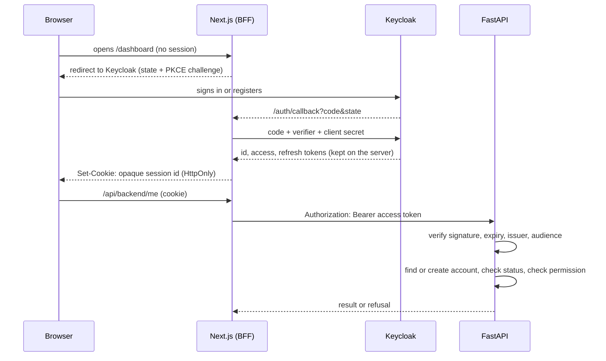
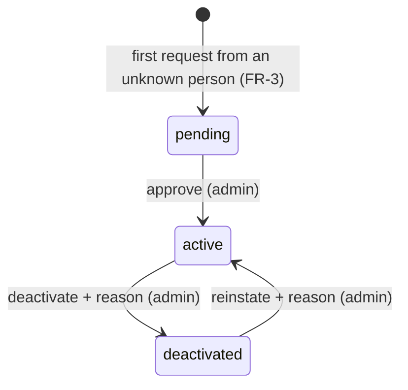

# Keycloak auth module: build spec

Distilled from an earlier prototype for this playground. The originals now live under `docs/`: [requirements](../requirements/requirements.md), [use cases](../usecases/), and the [domain](../domain/) (contexts, ontology, decisions). This page is what the code in `apps/` and `keycloak-config/` is built from.

## What is built

| Piece | Where | Role |
|---|---|---|
| Keycloak + realm `playground` | `keycloak-config/` | Proves who a person is. Holds passwords, sessions, self-registration |
| FastAPI API | `apps/api/` | Validates the token on every request, owns the **account** (status, role), audit trail, account admin |
| Next.js web (BFF) | `apps/web/` | Runs the OIDC code flow with PKCE, keeps tokens on the server, gives the browser one opaque cookie |

Source: decisions 1 and 2, `BC-ACCESS`, `OBJ-A1`, `SET-1`, `SET-2`, `RULE-A1/A2/A3/A4`, `UC-A4`, and the requirements and criteria in [docs/requirements](../requirements/requirements.md) (FR-1 to FR-5, NFR-1, AC-1 to AC-8, AC-32 and AC-33).

## The model

- Playground issues no tokens of its own. The browser never sees a token.
- The token says **who**. The account (in our database) says **what they may do**.
- The account is read on every request, so deactivation and role changes apply at once.

## Account

| Field | Notes |
|---|---|
| `id` | our own id |
| `identity` | Keycloak `sub`. The stable link. Never the email |
| `name`, `email` | copied from the token at each request |
| `role` | `user` or `administrator` (SET-1). Kept here, not in Keycloak |
| `status` | `pending`, `active` or `deactivated` (decision 2) |
| `created`, `created_by` | `created_by` empty for the bootstrap administrator |

Never deleted. Deactivation removes nothing (RULE-A4).

## Behaviour

| Rule | Behaviour |
|---|---|
| Unknown person, valid token | A `pending` account is created (AC-3), once only (AC-3) |
| Pending | Every request except `GET /me` is refused with `account_pending` (FR-3, AC-4, AC-4) |
| Deactivated | Every request is refused with `account_deactivated`, checked per request (AC-6) |
| No / expired / foreign token | 401 (NFR-1, AC-33) |
| Approve | Status change in our API only. Keycloak is not called (decision 2) |
| Deactivate | Reason required. Disables the person in Keycloak and ends their sessions, then updates the account |
| Reinstate | Reason required. Enables the person in Keycloak, then updates the account |
| Promote / demote | Administrator only, reason required, audited |
| RULE-A1 | A change that leaves no active administrator is refused |
| RULE-A2 | Nobody deactivates or demotes themselves |
| RULE-A3 | Deactivate, reinstate, promote, demote need a real reason |
| Audit | Every account change writes who, what, why, when (UC-A4 step 7) |
| First administrator | Comes from setup: an email in `BOOTSTRAP_ADMIN_EMAILS` becomes an active administrator on first request |
| Sessions | Keycloak SSO session: 30 min idle, 8 h max. Access token: 5 min |
| Backend credential | Keycloak service account `playground-backend` with `view-users`, `manage-users` only |

## Conflicts in the source, and what was chosen

The source pages were written at different times. Where they disagree, the latest decision wins.

| Conflict | Chosen | Why |
|---|---|---|
| Roles in the token (decision 1) vs in our database (amendment, `BC-ACCESS`, `OBJ-A1`) | Database | The amendment is dated 16 Nov and later pages follow it |
| `pending` status (decision 2, FR-3, AC-4, AC-4) vs "no pending status" (`SET-2`, `OBJ-A1`) | `pending` exists | Decision 2 is the newest and says the ontology is not reworked yet |
| A former requirement "no role change from our screens" vs "an administrator promotes with a reason" (`SET-1`, `RULE-A1/A2/A3`) | Promote and demote exist | The rules are meaningless without them. The requirement was stale and was retired (decision 6) |
| Roles: member, administrator, auditor (a former requirement, retired in decision 6) vs user, administrator (`SET-1`) | `user`, `administrator` | The first release has no auditor |
| UC-A4 "pending person cannot sign in" vs decision 2 "can sign in, API holds them" | Can sign in, API holds them | Decision 2 |

## Left out on purpose

Time-limited access (undecided), project membership (moved to Projects), the account request queue, shares, auditor role, MFA for administrators, API keys, FR-6 SSO with a company login. The `Permissions` check is a simple role check here, because there are no other contexts yet.

## Open questions carried over

- Open: can `manage-users` assign roles? In Keycloak, yes, it can map roles. The backend account is therefore limited by realm design (no sensitive realm roles exist) and not by Keycloak rights alone.
- Account created in Keycloak and ours together: if one side fails (BC-ACCESS Q6). Here Keycloak is called first, and our account changes only after it succeeds.
- Rate limiting on registration is not done.
