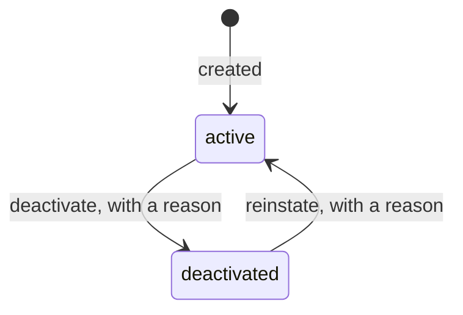

```yaml
id: SET-6
type: set
name: Account statuses
status: draft
ordered: false
comment: Whether an account can be used.
values:
  - active
  - deactivated
meanings:
  active: The person can sign in and use Playground.
  deactivated: The person can no longer sign in. Everything they made is kept.
used_by:
  - OBJ-A1
questions:
  - Can this person use Playground right now?
satisfies: []
```

# Account statuses

## What it is

Two statuses. An **active** account can be used. A **deactivated** account cannot, and nothing it made is removed.

## How it changes



Deactivating also disables the person in Keycloak and ends their sessions, so a token they already hold stops
working at their very next request. What deactivation leaves alone is in
[RULE-A6](RULE-A6-deactivation-removes-nothing.md).

There is no "pending" status. A person who has only asked for an account has a request
([SET-7](SET-7-request-statuses.md)), not an account.

Used by the [account](OBJ-A1-account.md).
