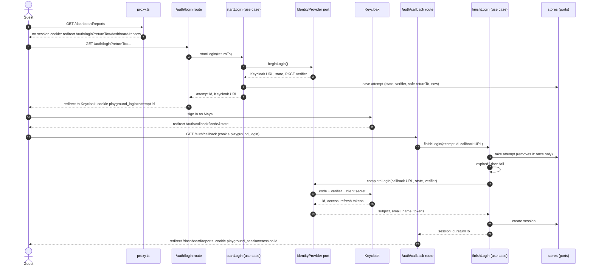
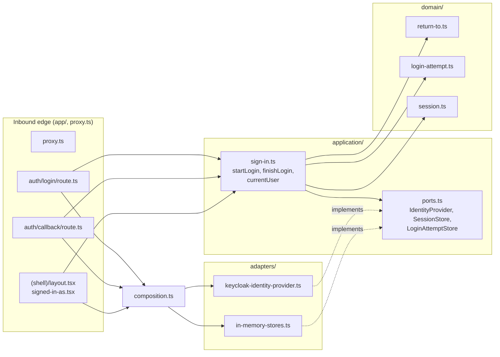
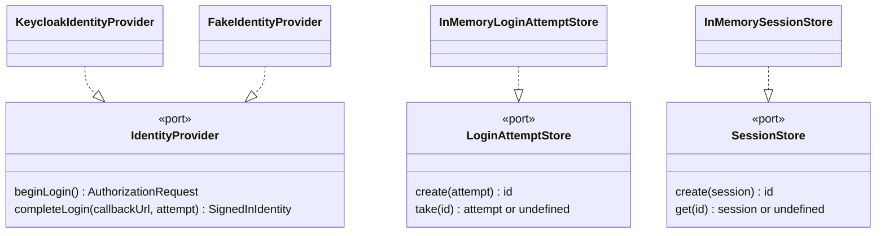
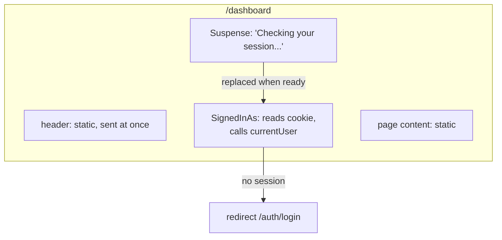
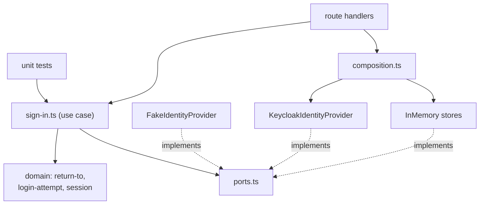

# UC-A10 Sign in, test first (build lesson)

> **This is a lesson plan, not a description of the current code.** It was written for the earlier "aiaas" project (13 Nov 2026) and has not been run against this repo. The names are adapted (Playground, `apps/web`, `playground_session`) and the ids are mapped, but **check each step against the code before you trust it**.

## What this lesson is for

[Decision 26](../domain/decisions.md) says the frontend, like the backend, follows domain driven design, test driven development and hexagonal architecture (NFR-3, NFR-4, NFR-3). The API already does. **The web side does not yet:** `apps/web` signs people in correctly, with the same flow, but the code is in `src/lib/auth/`, calls `openid-client` directly and has one unit test (`safeReturnTo`).

**Update (decision 27): the lean version of this is now built.** `apps/web` has `domain/`, `application/`, `adapters/` and `composition.ts`, with 36 tests, and the sign-in flow was checked end to end against Keycloak. Read the real files next to this lesson: it is the longer, fuller walk-through. Two differences from the code samples below: the repo tests with Node's built-in runner (`node:test` and `node:assert`, which run TypeScript directly on Node 26), so translate `expect(x).toBe(y)` to `assert.equal(x, y)` and skip installing vitest; and the stores are asynchronous, with `take` for read-and-forget. The lesson stays useful for **why each piece is shaped as it is**, and for the sign-out and refresh slices.

This lesson is how to rebuild sign in the other way: a pure `domain/`, a `application/` with ports, `adapters/` for Keycloak and memory, and a strict fake Keycloak for fast tests. A workable path:

1. Build `src/domain`, `src/application` and `src/adapters` **next to** `src/lib/auth`, test first, following the steps below.
2. Switch `auth/login/route.ts` and `auth/callback/route.ts` to the new use cases.
3. Delete what `lib/auth/` no longer needs (its `oidc.ts` logic becomes `KeycloakIdentityProvider`, `store.ts` becomes the in-memory stores).

Read the [auth study guide](../AUTH-STUDY-GUIDE.md) first for the theory (code flow, PKCE, tokens, cookies, BFF), and [the web hexagon concepts](web-hexagon-concepts.md) for the shape this lesson builds.

## Requirements and criteria

The lesson's checks, and what exists in `docs/requirements/` today:

| Lesson label | What it checks | In this repo |
|---|---|---|
| SI-1 | a guest opening a protected page is sent to Keycloak | covered in spirit by **AC-1** (FR-1) |
| SI-2 | after signing in, back on the page they asked for, signed in | **AC-1** (FR-1) |
| SI-3 | a return address outside the app becomes `/dashboard` | *proposed*: no criterion yet |
| SI-4 | an unknown, used, expired or wrong-state callback fails | *proposed*: no criterion yet |
| SI-5 | the browser holds one opaque `HttpOnly` cookie and no token | *proposed*: no criterion yet |

The requirement is **FR-1** (sign in through the identity provider). SI-3 to SI-5 would become new criteria through vbench-req. Until then, tag tests `Verifies AC-1` where they prove it, and keep the `SI-n` label in the test name.

## Differences from the old project to expect

- The route groups here are `(public)` and `(app)`, not `(shell)`. The pages are `/dashboard` and `/admin/accounts`. There is no `/dashboard/reports` page: use `/dashboard`.
- This repo's use case for the next lessons is [UC-A13](../usecases/UC-A13-view-my-name-and-role.md) (view my name and role), [UC-A14](../usecases/UC-A14-keep-the-session-alive.md) (refresh) and [UC-A11](UC-A11-sign-out-test-first.md) (sign out).
- The API already exists, so "Signed in as ..." can come from `getMe()` in `src/lib/api.ts`.
- Check whether `next.config.ts` enables Cache Components before you rely on the `<Suspense>` advice in section 13.

> **Outcome.**
> Open `/dashboard` as a guest, get sent to Keycloak, sign in as Maya, and land back on `/dashboard` with "Signed in as Maya" on screen. The tokens stay on the Next.js server. The browser holds one opaque cookie. Built test first: the domain and use cases are tested with fakes in milliseconds, without Keycloak. Only the frontend changes in this use case. The backend joins in [UC-A13 view my name and role](../usecases/UC-A13-view-my-name-and-role.md).

---

## 1. Use case specification

| Field | Value |
|---|---|
| Actor | Guest |
| Trigger | opens a shell page, for example `/dashboard/reports` |
| Precondition | Keycloak runs. The person has a Keycloak user |
| Main flow | no session, so start a sign in attempt and go to Keycloak. Sign in there. Come back with a code. Swap the code for tokens. Store a session. Go back to the page |
| Alternative A | wrong password: Keycloak shows its error. Playground sees nothing |
| Alternative B | unknown, used or expired attempt: no session, "start again" page (SI-4) |
| Alternative C | return address outside Playground: go to `/dashboard` (SI-3) |
| Postcondition | a session on the server, an `HttpOnly` cookie in the browser, no token in the browser |



How to read it: the route handlers (`/auth/login`, `/auth/callback`) only deal with HTTP: query strings, cookies, redirects. All decisions are in the two use cases. The use cases reach Keycloak and the stores only through ports, so a test can swap in fakes.

## 2. The slice in the hexagon



How to read it: the inbound edge asks `composition.ts` for the use case's helpers (the adapters), then calls the use case. `composition.ts` is the only file that knows `KeycloakIdentityProvider` exists. Change it to a fake, and the whole app runs without Keycloak.

The build order in this lesson follows the arrows from the inside out: domain, then ports, then use cases with fakes, then adapters, then the inbound edge.

---

## 3. Get ready

The old lesson set Keycloak up by hand. In this repo that is **already done**, so there is only a little to check and one thing to add.

**Already in place (check, do not redo):**

| What | Where | Value |
|---|---|---|
| The `playground-web` client | [playground-realm.json](../../keycloak-config/realm/playground-realm.json) | client authentication on, standard flow on, direct access grants off, PKCE `S256` |
| Redirect address | the same client | exactly `http://localhost:3000/auth/callback` (never a `/*` pattern: that would let any page receive codes) |
| Post logout address | the same client | `http://localhost:3000/*` (the old lesson used the exact `http://localhost:3000/`: tighten it if you like) |
| A person to sign in as | the realm's users | `maya@example.test` / `Maya123!`, email verified |
| Settings | [apps/web/.env.example](../../apps/web/.env.example) | `APP_URL`, `API_URL`, `KEYCLOAK_ISSUER`, `KEYCLOAK_CLIENT_ID`, `KEYCLOAK_CLIENT_SECRET`. Copy it to `apps/web/.env.local`. In Docker one more is set, `KEYCLOAK_INTERNAL_ISSUER` |
| `openid-client` | [package.json](../../apps/web/package.json) | already installed (6.9.0). `import "server-only"` is already used in `lib/auth/` |

Start the stack as the [getting started guide](../GETTING-STARTED.md) says, or run only Keycloak and the API in Docker and `npm run dev` for the web app.

**To add: a test runner.** `npm test` today runs one file with `node --test`. This lesson uses **vitest** and the `@/` path alias (already set in `tsconfig.json`):

```bash
cd apps/web
npm install -D vitest
```

Then make `"test"` in `package.json` run `vitest run`, and add a `vitest.config.ts` that maps `@` to `src`. The existing `src/lib/auth/safe-return-to.test.ts` can move to the new `src/domain/` test in step 4 (it is the same rule).

| Package | Why |
|---|---|
| `vitest` | fast unit tests for the domain and the use cases, with no browser and no Keycloak |

---

## 4. RED: the return address rule

The first rule (SI-3): after sign in, go back only to a **local** page. Otherwise a link like `/auth/login?returnTo=https://evil.example` would sign you in and then hand you to an attacker's site that looks like Playground. This is called an **open redirect**.

Create `apps/web/tests/unit/return-to.test.ts`:

```ts
import { describe, expect, it } from "vitest";
import { DEFAULT_RETURN_TO, safeReturnTo } from "@/domain/return-to";

describe("safeReturnTo", () => {
  it("keeps a local path", () => {
    expect(safeReturnTo("/dashboard/reports?tab=2")).toBe("/dashboard/reports?tab=2");
  });

  it.each([
    [null],
    [""],
    ["https://evil.example"],
    ["//evil.example"],
    ["/\\evil.example"],
    ["dashboard"],
  ])("turns %j into the default", (raw) => {
    expect(safeReturnTo(raw)).toBe(DEFAULT_RETURN_TO);
  });
});
```

Why `//evil.example`? A browser reads an address that starts with `//` as "same scheme, **other site**". And some browsers treat `/\` like `//`. Both look local and are not.

Run `npm test`. Expected **RED**: the test cannot import `@/domain/return-to`, because it does not exist.

## 5. GREEN: `domain/return-to.ts`

```ts
// Where to go after sign in. Only a local path is allowed (no open redirect).
export const DEFAULT_RETURN_TO = "/dashboard";

export function safeReturnTo(raw: string | null | undefined): string {
  if (!raw || !raw.startsWith("/")) return DEFAULT_RETURN_TO;
  if (raw.startsWith("//") || raw.startsWith("/\\")) return DEFAULT_RETURN_TO;
  return raw;
}
```

Run `npm test`. Expected: the return address tests pass, and the architecture test still passes (the file imports nothing).

## 6. RED, then GREEN: the sign in attempt and the session

Two more domain rules: an attempt lasts 10 minutes (SI-4), and a page sees only a name and an email, never the tokens (SI-5).

`apps/web/tests/unit/login-attempt.test.ts`:

```ts
import { describe, expect, it } from "vitest";
import { LOGIN_ATTEMPT_LIFETIME_MS, isExpired, type LoginAttempt } from "@/domain/login-attempt";

const attempt: LoginAttempt = {
  state: "s1",
  codeVerifier: "v1",
  returnTo: "/dashboard",
  startedAt: 1_000_000,
};

describe("a sign in attempt", () => {
  it("is fresh at the edge of its lifetime", () => {
    expect(isExpired(attempt, attempt.startedAt + LOGIN_ATTEMPT_LIFETIME_MS)).toBe(false);
  });

  it("has expired one millisecond later", () => {
    expect(isExpired(attempt, attempt.startedAt + LOGIN_ATTEMPT_LIFETIME_MS + 1)).toBe(true);
  });
});
```

`apps/web/tests/unit/session.test.ts`:

```ts
import { describe, expect, it } from "vitest";
import { signedInUser, type Session } from "@/domain/session";

function session(name: string): Session {
  return {
    subject: "maya-sub",
    email: "maya@example.test",
    name,
    tokens: { accessToken: "a", refreshToken: "r", idToken: "i", accessTokenExpiresAt: 0 },
    startedAt: 0,
  };
}

describe("signedInUser", () => {
  it("shows the name and email, and nothing else", () => {
    expect(signedInUser(session("Maya"))).toEqual({ name: "Maya", email: "maya@example.test" });
  });

  it("falls back to the email when there is no name", () => {
    expect(signedInUser(session("")).name).toBe("maya@example.test");
  });
});
```

`toEqual` with exactly two fields is the real check here: if someone later adds the tokens to `SignedInUser`, this test goes red.

Run `npm test`: **RED**. Now the code.

`apps/web/src/domain/login-attempt.ts`:

```ts
// A sign in that has started but not finished. It is used once, within 10 minutes.
export const LOGIN_ATTEMPT_LIFETIME_MS = 10 * 60 * 1000;

export type LoginAttempt = {
  state: string; // a random value Keycloak sends back, to tie the callback to this attempt
  codeVerifier: string; // the PKCE secret. Only its hash went to Keycloak
  returnTo: string; // already checked by safeReturnTo
  startedAt: number; // milliseconds since 1970
};

export function isExpired(attempt: LoginAttempt, now: number): boolean {
  return now - attempt.startedAt > LOGIN_ATTEMPT_LIFETIME_MS;
}
```

`apps/web/src/domain/session.ts`:

```ts
// One browser being signed in. The tokens stay on the server.
export type Tokens = {
  accessToken: string;
  refreshToken: string;
  idToken: string;
  accessTokenExpiresAt: number; // milliseconds since 1970
};

export type Session = {
  subject: string; // the Keycloak user id (sub)
  email: string;
  name: string;
  tokens: Tokens;
  startedAt: number;
};

// What a page may show about the person. Never the tokens.
export type SignedInUser = { name: string; email: string };

export function signedInUser(session: Session): SignedInUser {
  return { name: session.name || session.email, email: session.email };
}
```

Run `npm test`. Expected: all domain tests and both architecture tests pass.

> **Your turn.**
> Why is `now` a parameter of `isExpired`, instead of calling `Date.now()` inside?

<details>
<summary>Answer</summary>

So the test controls time. With `Date.now()` inside, the "one millisecond later" test would need to wait 10 minutes, or fake the clock. Passing `now` keeps the domain a plain function: same input, same output. The edge of the app (the route handler) is the one place that reads the real clock.

</details>

---

## 7. The ports

A port is what the use case **needs** from outside, written in the use case's own words. Create `apps/web/src/application/ports.ts`:

```ts
import type { LoginAttempt } from "@/domain/login-attempt";
import type { Session, Tokens } from "@/domain/session";

// Where to send the browser, and the two secrets to remember until it comes back.
export type AuthorizationRequest = { url: string; state: string; codeVerifier: string };

// Who signed in, as the identity provider proved it.
export type SignedInIdentity = { subject: string; email: string; name: string; tokens: Tokens };

export interface IdentityProvider {
  beginLogin(): Promise<AuthorizationRequest>;
  completeLogin(
    callbackUrl: URL,
    attempt: Pick<LoginAttempt, "state" | "codeVerifier">,
  ): Promise<SignedInIdentity>;
}

export interface LoginAttemptStore {
  create(attempt: LoginAttempt): Promise<string>; // returns a new opaque id
  take(id: string): Promise<LoginAttempt | undefined>; // returns it AND forgets it
}

export interface SessionStore {
  create(session: Session): Promise<string>; // returns a new opaque id
  get(id: string): Promise<Session | undefined>;
}
```

Look at what is **not** here: no `discovery`, no `code_challenge`, no `fetch`, no cookie. Those are how Keycloak and Next.js work, not what sign in needs. `take` instead of `get` plus `delete` makes "once only" (SI-4) part of the port's promise, so every adapter must keep it.



How to read it: each port has more than one adapter. The fake one is for tests. Later, a Redis or Postgres session store can replace the in-memory one without touching the use case.

---

## 8. RED: the use case tests

### 8a. A strict fake

Create `apps/web/tests/support/fakes.ts`:

```ts
import type { AuthorizationRequest, IdentityProvider, SignedInIdentity } from "@/application/ports";
import type { LoginAttempt } from "@/domain/login-attempt";

// Behaves like Keycloak in the ways that matter: it checks the state, and a code works once.
export class FakeIdentityProvider implements IdentityProvider {
  private usedCodes = new Set<string>();

  async beginLogin(): Promise<AuthorizationRequest> {
    return { url: "https://keycloak.test/auth?state=s1", state: "s1", codeVerifier: "v1" };
  }

  async completeLogin(
    callbackUrl: URL,
    attempt: Pick<LoginAttempt, "state" | "codeVerifier">,
  ): Promise<SignedInIdentity> {
    const code = callbackUrl.searchParams.get("code") ?? "";
    if (callbackUrl.searchParams.get("state") !== attempt.state) throw new Error("state mismatch");
    if (this.usedCodes.has(code)) throw new Error("code already used");
    this.usedCodes.add(code);
    return {
      subject: "maya-sub",
      email: "maya@example.test",
      name: "Maya",
      tokens: { accessToken: "a", refreshToken: "r", idToken: "i", accessTokenExpiresAt: 0 },
    };
  }
}
```

Why strict? A fake that always says yes would let a use case pass that never checks anything. This one fails the same way Keycloak does, so the tests mean something.

### 8b. The tests, one per acceptance criterion

Create `apps/web/tests/unit/sign-in.test.ts`:

```ts
import { beforeEach, describe, expect, it } from "vitest";
import { InMemoryLoginAttemptStore, InMemorySessionStore } from "@/adapters/in-memory-stores";
import { currentUser, finishLogin, LoginFailed, type SignInDeps, startLogin } from "@/application/sign-in";
import { LOGIN_ATTEMPT_LIFETIME_MS } from "@/domain/login-attempt";
import { FakeIdentityProvider } from "../support/fakes";

const NOW = 1_000_000;
const callback = (state = "s1", code = "c1") =>
  new URL(`http://localhost:3000/auth/callback?code=${code}&state=${state}`);

let deps: SignInDeps;
beforeEach(() => {
  deps = {
    identity: new FakeIdentityProvider(),
    attempts: new InMemoryLoginAttemptStore(),
    sessions: new InMemorySessionStore(),
  };
});

describe("UC-A10 sign in", () => {
  it("SI-2: comes back to the page the person asked for, signed in", async () => {
    const { attemptId, redirectTo } = await startLogin(deps, "/dashboard/reports", NOW);
    expect(redirectTo).toContain("keycloak.test");

    const { sessionId, returnTo } = await finishLogin(deps, attemptId, callback(), NOW);

    expect(returnTo).toBe("/dashboard/reports");
    expect(await currentUser(deps, sessionId)).toEqual({ name: "Maya", email: "maya@example.test" });
  });

  it("SI-3: an outside return address becomes the default", async () => {
    const { attemptId } = await startLogin(deps, "https://evil.example", NOW);
    const { returnTo } = await finishLogin(deps, attemptId, callback(), NOW);
    expect(returnTo).toBe("/dashboard");
  });

  it("SI-4: an unknown attempt fails", async () => {
    await expect(finishLogin(deps, "no-such-attempt", callback(), NOW)).rejects.toThrow(LoginFailed);
  });

  it("SI-4: a missing attempt cookie fails", async () => {
    await expect(finishLogin(deps, undefined, callback(), NOW)).rejects.toThrow(LoginFailed);
  });

  it("SI-4: an attempt works once", async () => {
    const { attemptId } = await startLogin(deps, null, NOW);
    await finishLogin(deps, attemptId, callback(), NOW);
    await expect(finishLogin(deps, attemptId, callback(), NOW)).rejects.toThrow(LoginFailed);
  });

  it("SI-4: an attempt older than 10 minutes fails", async () => {
    const { attemptId } = await startLogin(deps, null, NOW);
    const later = NOW + LOGIN_ATTEMPT_LIFETIME_MS + 1;
    await expect(finishLogin(deps, attemptId, callback(), later)).rejects.toThrow(LoginFailed);
  });

  it("SI-4: a callback with the wrong state fails", async () => {
    const { attemptId } = await startLogin(deps, null, NOW);
    await expect(finishLogin(deps, attemptId, callback("forged"), NOW)).rejects.toThrow(LoginFailed);
  });

  it("no session id means a guest", async () => {
    expect(await currentUser(deps, undefined)).toBeNull();
    expect(await currentUser(deps, "unknown")).toBeNull();
  });
});
```

Each test name starts with the acceptance criterion it proves. In this repo a test is also tagged `Verifies AC-n`. The `SI-n` labels are this lesson's own, and the table at the top says which of them are real criteria today.

Run `npm test`. Expected **RED**: `@/application/sign-in` and `@/adapters/in-memory-stores` do not exist.

## 9. GREEN: the in-memory adapters

Create `apps/web/src/adapters/in-memory-stores.ts`:

```ts
import { randomBytes } from "node:crypto";
import type { LoginAttemptStore, SessionStore } from "@/application/ports";
import type { LoginAttempt } from "@/domain/login-attempt";
import type { Session } from "@/domain/session";

// 32 random bytes: impossible to guess, so the id alone proves nothing about the person.
function newId(): string {
  return randomBytes(32).toString("base64url");
}

// Keeps attempts in memory. Forgets everything when the server restarts.
export class InMemoryLoginAttemptStore implements LoginAttemptStore {
  private attempts = new Map<string, LoginAttempt>();

  async create(attempt: LoginAttempt): Promise<string> {
    const id = newId();
    this.attempts.set(id, attempt);
    return id;
  }

  async take(id: string): Promise<LoginAttempt | undefined> {
    const attempt = this.attempts.get(id);
    this.attempts.delete(id); // once only, even if it turns out to be expired
    return attempt;
  }
}

// Keeps sessions in memory. Forgets everything when the server restarts.
export class InMemorySessionStore implements SessionStore {
  private sessions = new Map<string, Session>();

  async create(session: Session): Promise<string> {
    const id = newId();
    this.sessions.set(id, session);
    return id;
  }

  async get(id: string): Promise<Session | undefined> {
    return this.sessions.get(id);
  }
}
```

An adapter may use `node:crypto`: adapters are the outside of the hexagon. The architecture test only guards `domain/` and `application/`.

## 10. GREEN: the use cases

Create `apps/web/src/application/sign-in.ts`:

```ts
import { isExpired } from "@/domain/login-attempt";
import { safeReturnTo } from "@/domain/return-to";
import { type SignedInUser, signedInUser } from "@/domain/session";
import type { IdentityProvider, LoginAttemptStore, SessionStore, SignedInIdentity } from "./ports";

export class LoginFailed extends Error {}

export type SignInDeps = {
  identity: IdentityProvider;
  attempts: LoginAttemptStore;
  sessions: SessionStore;
};

// Step 1: remember the attempt, and say where to send the browser.
export async function startLogin(
  deps: SignInDeps,
  rawReturnTo: string | null,
  now: number,
): Promise<{ attemptId: string; redirectTo: string }> {
  const request = await deps.identity.beginLogin();
  const attemptId = await deps.attempts.create({
    state: request.state,
    codeVerifier: request.codeVerifier,
    returnTo: safeReturnTo(rawReturnTo),
    startedAt: now,
  });
  return { attemptId, redirectTo: request.url };
}

// Step 2: the browser is back. Check the attempt, swap the code, make a session.
export async function finishLogin(
  deps: SignInDeps,
  attemptId: string | undefined,
  callbackUrl: URL,
  now: number,
): Promise<{ sessionId: string; returnTo: string }> {
  const attempt = attemptId ? await deps.attempts.take(attemptId) : undefined;
  if (!attempt || isExpired(attempt, now)) throw new LoginFailed("no valid sign in attempt");

  let identity: SignedInIdentity;
  try {
    identity = await deps.identity.completeLogin(callbackUrl, attempt);
  } catch (cause) {
    throw new LoginFailed("the identity provider refused the sign in", { cause });
  }

  const sessionId = await deps.sessions.create({ ...identity, startedAt: now });
  return { sessionId, returnTo: attempt.returnTo };
}

// Who is signed in on this browser, as a page may show it. Null means a guest.
export async function currentUser(
  deps: Pick<SignInDeps, "sessions">,
  sessionId: string | undefined,
): Promise<SignedInUser | null> {
  const session = sessionId ? await deps.sessions.get(sessionId) : undefined;
  return session ? signedInUser(session) : null;
}
```

Run `npm test`. Expected: every test passes, including both architecture tests.

> **Your turn.**
> Why does `finishLogin` turn every `completeLogin` error into one `LoginFailed`, instead of passing the real reason up?

<details>
<summary>Answer</summary>

Two reasons. The route handler then needs to know only one error, whatever the identity provider is. And the person should see one calm "start again" message: telling a visitor "state mismatch" or "code already used" helps an attacker more than a user. The real reason is kept in `cause`, for the server log.

</details>

> **Break it.**
> In `in-memory-stores.ts`, change `take` so it no longer deletes (remove the `delete` line). Run `npm test`. Which test goes red, and which attack does it stop? Put the line back.

---

## 11. The real adapter: Keycloak

Now the adapter that speaks OIDC. Create `apps/web/src/adapters/keycloak-identity-provider.ts`:

```ts
import * as oidc from "openid-client";
import type { AuthorizationRequest, IdentityProvider, SignedInIdentity } from "@/application/ports";
import type { LoginAttempt } from "@/domain/login-attempt";

export type KeycloakSettings = {
  issuer: string; // http://localhost:8080/realms/playground
  clientId: string;
  clientSecret: string;
  redirectUri: string; // http://localhost:3000/auth/callback
};

export class KeycloakIdentityProvider implements IdentityProvider {
  private readonly settings: KeycloakSettings;
  private config?: Promise<oidc.Configuration>;

  constructor(settings: KeycloakSettings) {
    this.settings = settings;
  }

  // Reads Keycloak's discovery document once, then reuses it.
  private configuration(): Promise<oidc.Configuration> {
    const { issuer, clientId, clientSecret } = this.settings;
    // Local Keycloak is plain http. openid-client refuses that unless told otherwise.
    const options = issuer.startsWith("http://") ? { execute: [oidc.allowInsecureRequests] } : undefined;
    this.config ??= oidc.discovery(new URL(issuer), clientId, clientSecret, undefined, options);
    return this.config;
  }

  async beginLogin(): Promise<AuthorizationRequest> {
    const config = await this.configuration();
    const codeVerifier = oidc.randomPKCECodeVerifier();
    const state = oidc.randomState();
    const url = oidc.buildAuthorizationUrl(config, {
      redirect_uri: this.settings.redirectUri,
      scope: "openid email profile",
      code_challenge: await oidc.calculatePKCECodeChallenge(codeVerifier),
      code_challenge_method: "S256",
      state,
    });
    return { url: url.href, state, codeVerifier };
  }

  async completeLogin(
    callbackUrl: URL,
    attempt: Pick<LoginAttempt, "state" | "codeVerifier">,
  ): Promise<SignedInIdentity> {
    const config = await this.configuration();
    // Checks the state, swaps the code (with the verifier and the client secret),
    // and checks the ID token's signature, issuer, audience and expiry.
    const tokens = await oidc.authorizationCodeGrant(config, callbackUrl, {
      pkceCodeVerifier: attempt.codeVerifier,
      expectedState: attempt.state,
    });
    const claims = tokens.claims();
    if (!claims || !tokens.refresh_token || !tokens.id_token) {
      throw new Error("Keycloak's answer is missing the ID token or the refresh token");
    }
    return {
      subject: claims.sub,
      email: String(claims.email ?? ""),
      name: String(claims.name ?? claims.preferred_username ?? ""),
      tokens: {
        accessToken: tokens.access_token,
        refreshToken: tokens.refresh_token,
        idToken: tokens.id_token,
        accessTokenExpiresAt: Date.now() + (tokens.expiresIn() ?? 0) * 1000,
      },
    };
  }
}
```

What each part does, mapped to what you would do by hand (see the [auth study guide](../AUTH-STUDY-GUIDE.md), Part 3 Flow A and the experiments):

| By hand with curl | Here |
|---|---|
| read `/.well-known/openid-configuration` | `oidc.discovery(...)` |
| make a verifier, hash it to a challenge, make a state | `randomPKCECodeVerifier`, `calculatePKCECodeChallenge`, `randomState` |
| build the long `/auth?client_id=...` URL | `buildAuthorizationUrl` |
| check `state`, POST the code with `-u playground-web:secret` and the verifier | `authorizationCodeGrant` |
| `jwt_peek.py` on the ID token (without checking it) | `tokens.claims()`, **after** the library checked the signature |

> **No unit test for this file.**
> It is a thin wrapper around a library, and it needs a real Keycloak. It is proved by the acceptance run in section 14. If it grows any logic of its own, that logic moves into the domain or the use case, where it can be unit tested.

---

## 12. The composition root

Create `apps/web/src/composition.ts`. It is the **only** file that picks adapters:

```ts
import "server-only";
import { InMemoryLoginAttemptStore, InMemorySessionStore } from "@/adapters/in-memory-stores";
import { KeycloakIdentityProvider } from "@/adapters/keycloak-identity-provider";
import type { SignInDeps } from "@/application/sign-in";

function required(name: string): string {
  const value = process.env[name];
  if (!value) throw new Error(`Set ${name} in apps/web/.env.local`);
  return value;
}

function build(): SignInDeps {
  return {
    identity: new KeycloakIdentityProvider({
      issuer: required("KEYCLOAK_ISSUER"),
      clientId: required("KEYCLOAK_CLIENT_ID"),
      clientSecret: required("KEYCLOAK_CLIENT_SECRET"),
      redirectUri: `${required("APP_URL")}/auth/callback`,
    }),
    attempts: new InMemoryLoginAttemptStore(),
    sessions: new InMemorySessionStore(),
  };
}

// One set of adapters for the whole server. Kept on globalThis because the dev server
// reloads changed modules, and the in-memory stores would otherwise be emptied.
const shared = globalThis as typeof globalThis & { PlaygroundServices?: SignInDeps };

export function services(): SignInDeps {
  shared.PlaygroundServices ??= build();
  return shared.PlaygroundServices;
}
```

`services()` builds on first use, not when the file is loaded, so `npm run build` does not need the secret.

---

## 13. The inbound edge: routes, proxy and shell

### 13a. Cookie names in one place

`apps/web/src/app/auth/cookies.ts`:

```ts
export const SESSION_COOKIE = "playground_session";
export const LOGIN_COOKIE = "playground_login";

export const cookieOptions = {
  httpOnly: true, // JavaScript in the page cannot read it (SI-5)
  sameSite: "lax" as const, // sent on the redirect back from Keycloak, not on cross-site posts
  secure: process.env.NODE_ENV === "production", // https only, except on localhost
  path: "/",
};
```

Why `lax` and not `strict`? The callback is a redirect **from Keycloak's site**. With `strict`, the browser would not send the `playground_login` cookie on that redirect, and every sign in would fail with SI-4.

### 13b. `/auth/login`

`apps/web/src/app/auth/login/route.ts`:

```ts
import { type NextRequest, NextResponse } from "next/server";
import { startLogin } from "@/application/sign-in";
import { services } from "@/composition";
import { cookieOptions, LOGIN_COOKIE } from "../cookies";

export async function GET(request: NextRequest) {
  const returnTo = request.nextUrl.searchParams.get("returnTo");
  const { attemptId, redirectTo } = await startLogin(services(), returnTo, Date.now());

  const response = NextResponse.redirect(redirectTo);
  response.cookies.set(LOGIN_COOKIE, attemptId, { ...cookieOptions, maxAge: 600 });
  return response;
}
```

### 13c. `/auth/callback`

`apps/web/src/app/auth/callback/route.ts`:

```ts
import { type NextRequest, NextResponse } from "next/server";
import { finishLogin, LoginFailed } from "@/application/sign-in";
import { services } from "@/composition";
import { cookieOptions, LOGIN_COOKIE, SESSION_COOKIE } from "../cookies";

export async function GET(request: NextRequest) {
  const attemptId = request.cookies.get(LOGIN_COOKIE)?.value;
  try {
    const { sessionId, returnTo } = await finishLogin(services(), attemptId, new URL(request.url), Date.now());
    const response = NextResponse.redirect(new URL(returnTo, request.url));
    response.cookies.set(SESSION_COOKIE, sessionId, cookieOptions);
    response.cookies.delete(LOGIN_COOKIE);
    return response;
  } catch (error) {
    if (!(error instanceof LoginFailed)) throw error;
    console.warn("sign in failed", error.cause ?? error.message);
    const response = NextResponse.redirect(new URL("/auth/failed", request.url));
    response.cookies.delete(LOGIN_COOKIE);
    return response;
  }
}
```

### 13d. `/auth/failed`

`apps/web/src/app/auth/failed/page.tsx`:

```tsx
export default function SignInFailed() {
  return (
    <main className="mx-auto max-w-md p-8">
      <h1 className="text-xl font-semibold">Sign in did not finish</h1>
      <p className="mt-2 text-sm text-muted-foreground">
        The sign in link was old or had already been used. This is safe to retry.
      </p>
      <a className="mt-4 inline-block underline" href="/auth/login">
        Sign in again
      </a>
    </main>
  );
}
```

### 13e. `proxy.ts`: the quick check

`apps/web/src/proxy.ts` (next to `app/`, because the project uses `src/`):

```ts
import { type NextRequest, NextResponse } from "next/server";

// A quick, optimistic check: is there a session cookie at all? It reads no store,
// because Next.js runs this on every matching request. The real check is in the page.
export function proxy(request: NextRequest) {
  if (request.cookies.has("playground_session")) return NextResponse.next();

  const login = new URL("/auth/login", request.url);
  login.searchParams.set("returnTo", request.nextUrl.pathname + request.nextUrl.search);
  return NextResponse.redirect(login);
}

export const config = { matcher: ["/dashboard/:path*"] };
```

The cookie name is repeated here on purpose: the Next.js docs warn against relying on shared modules in the proxy.

### 13f. The shell: a frame, and the user streamed in

Cache Components is on, so reading cookies must happen **inside a `<Suspense>` boundary**. The frame of the page renders at once, and the "Signed in as" part streams in after the session is read.



`apps/web/src/app/(shell)/signed-in-as.tsx`:

```tsx
import { cookies } from "next/headers";
import { redirect } from "next/navigation";
import { SESSION_COOKIE } from "@/app/auth/cookies";
import { currentUser } from "@/application/sign-in";
import { services } from "@/composition";

// The real check: is this cookie a live session on the server?
export async function SignedInAs() {
  const sessionId = (await cookies()).get(SESSION_COOKIE)?.value;
  const user = await currentUser(services(), sessionId);
  if (!user) redirect("/auth/login");
  return <span className="text-sm">Signed in as {user.name}</span>;
}
```

`apps/web/src/app/(shell)/layout.tsx`:

```tsx
import { Suspense } from "react";
import { SignedInAs } from "./signed-in-as";

export default function ShellLayout({ children }: { children: React.ReactNode }) {
  return (
    <div className="min-h-screen">
      <header className="flex items-center justify-between border-b px-6 py-3">
        <span className="font-semibold">Playground</span>
        <Suspense fallback={<span className="text-sm text-muted-foreground">Checking your session...</span>}>
          <SignedInAs />
        </Suspense>
      </header>
      <main className="p-6">{children}</main>
    </div>
  );
}
```

`apps/web/src/app/(shell)/dashboard/page.tsx`:

```tsx
export default function Dashboard() {
  return (
    <>
      <h1 className="text-2xl font-semibold">Dashboard</h1>
      <p className="mt-2 text-muted-foreground">You are in. Your Playground profile arrives in UC-A13.</p>
    </>
  );
}
```

`(shell)` in brackets is a **route group**: it shares the layout without adding `/shell` to the address. The page is still `/dashboard`.

> **The page content is not protected by itself.**
> The dashboard text above is static and public-safe, so it does not matter that it renders before the check finishes. From UC-A13 on, any page that shows **private data** reads it through a use case that checks the session itself. Never rely on the proxy or the header's redirect alone.

Finally, a Sign in button on the home page `apps/web/src/app/page.tsx` (Base UI has no `asChild`: render the button as a link with `render`):

```tsx
import { Button } from "@/components/ui/button";

export default function Home() {
  return (
    <main className="mx-auto max-w-md p-8">
      <h1 className="text-2xl font-semibold">Playground</h1>
      <Button className="mt-4" render={<a href="/auth/login" />} nativeButton={false}>
        Sign in
      </Button>
    </main>
  );
}
```

Run `npm run lint`, `npm test` and `npm run build`. All should pass.

---

## 14. Acceptance run

```bash
npm run dev
```

Use a **private** browser window, so no old Keycloak session interferes, and always `localhost`, never `127.0.0.1` (cookies and redirect addresses must match exactly).

| AC | Do this | Expect |
|---|---|---|
| SI-1 | open http://localhost:3000/dashboard/reports | sent to Keycloak's sign in page |
| SI-2 | sign in as Maya | back on `/dashboard/reports` (a 404 page in the frame is fine: that page does not exist yet), "Signed in as ..." in the header |
| SI-3 | sign out by deleting the cookies, then open http://localhost:3000/auth/login?returnTo=https://example.com and sign in | land on `/dashboard`, not example.com |
| SI-4 | after a sign in, press Back until you reach the `/auth/callback?...` address, and load it again | the "Sign in did not finish" page |
| SI-5 | developer tools, Application, Cookies | one `playground_session` cookie, `HttpOnly` ticked, its value a random string, no `eyJ...` token anywhere |

Also check the Network tab during sign in: the request to Keycloak's `/token` endpoint does **not** appear. It happened server to server.

> **Break it.**
> 1. Restart `npm run dev` while signed in, then reload `/dashboard`. What happens, and why? (Hint: section 9's comment.)
> 2. Change Keycloak's valid redirect URI to `http://localhost:3000/auth/callbackX` and sign in. Who refuses, and at which arrow of the sequence diagram in section 1? Put it back.

## 15. Architecture check



Explain aloud, then compare with section 2:
1. Why does `sign-in.ts` not import `openid-client`?
2. Why do the tests use the in-memory stores but a **fake** identity provider?
3. What would change to keep sessions in Redis instead of memory? Which files, and which not?

## Definition of done

- [ ] SI-1 to SI-5 checked by hand, and SI-2, SI-3, SI-4 also by unit tests.
- [ ] `npm test`: return-to, login-attempt, session, sign-in and both architecture tests pass.
- [ ] `npm run lint` and `npm run build` pass.
- [ ] `application/` imports only `domain/` and itself. `composition.ts` is the only file that names an adapter.
- [ ] `.env.local` is not in `git status`. `.env.example` is.
- [ ] Commit with `vbench-commit` on a `feat/UC-A10-sign-in` branch: a `test(UC-A10)` commit for the failing tests, then `feat(UC-A10)` for the code that passes them.

**Known gaps:** the in-memory stores forget everything on restart, and sessions never end (UC-A11 and UC-A14 fix that). The session's lifetime is not tied to Keycloak's yet.

Next: [UC-A13 view my name and role](../usecases/UC-A13-view-my-name-and-role.md).
