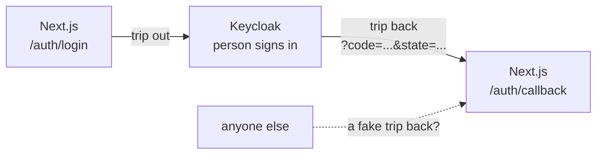
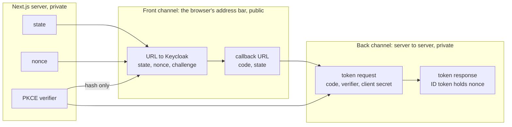
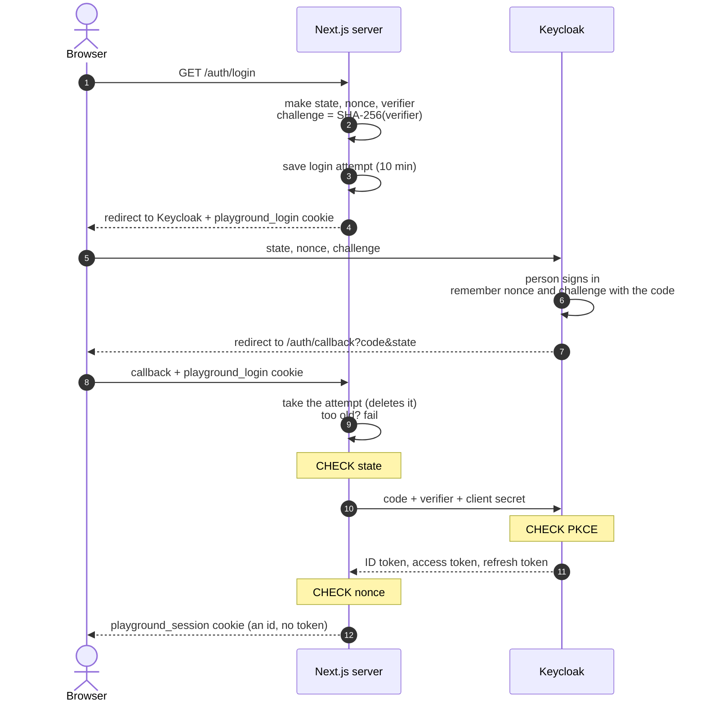
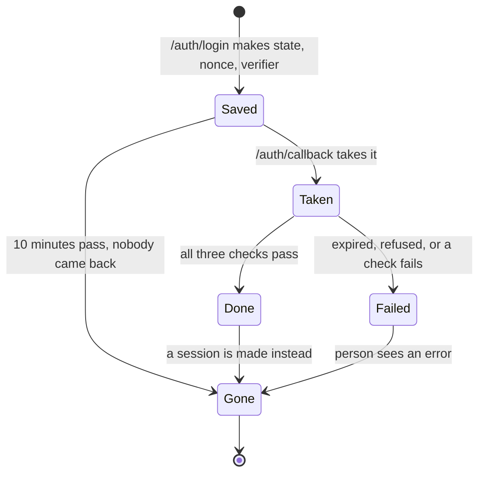
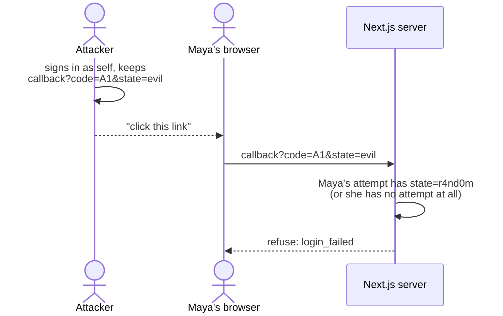
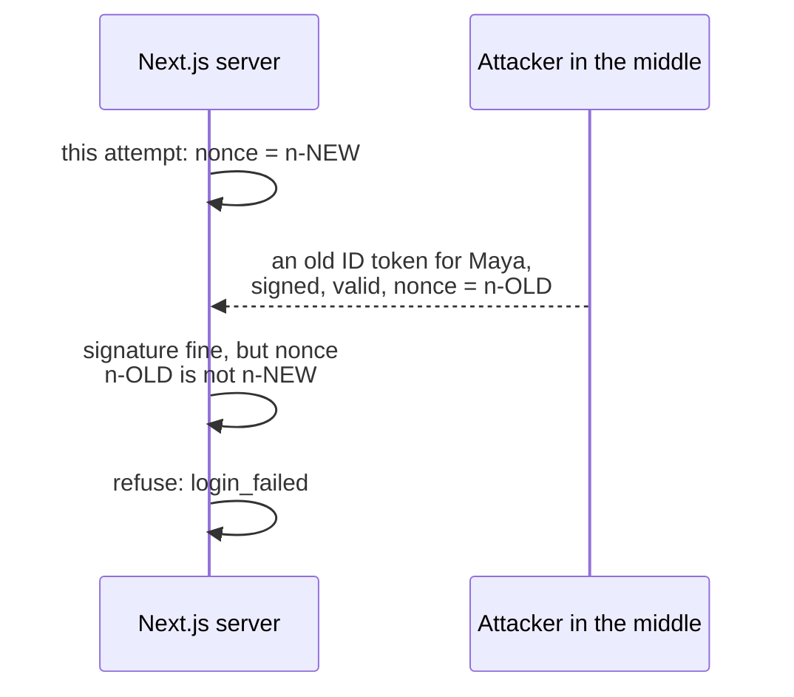
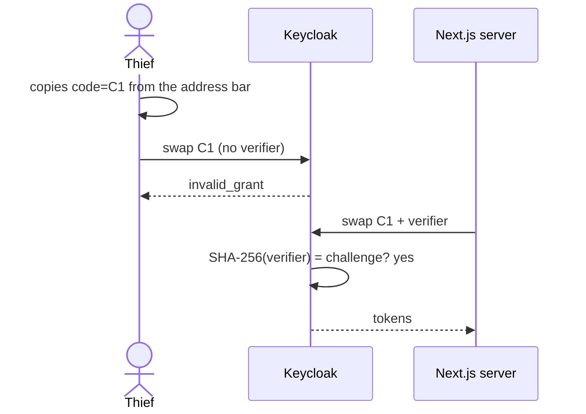
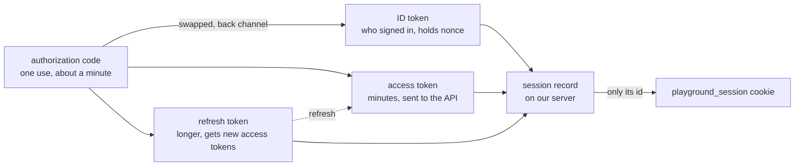

# `state`, `nonce` and PKCE: what they are and how long they live

For someone new to sign in. Read it beside [the auth study guide](../AUTH-STUDY-GUIDE.md), sections 1.7 and 1.8, which draw the normal path for `state` and PKCE. This page draws the whole life cycle, the `nonce`, and what each value stops.

## Contents

1. [The problem: two trips, and nobody watching between them](#1-the-problem-two-trips-and-nobody-watching-between-them)
2. [The three values at a glance](#2-the-three-values-at-a-glance)
3. [Where each value travels](#3-where-each-value-travels)
4. [The life cycle, step by step](#4-the-life-cycle-step-by-step)
5. [The login attempt: born, used once, gone](#5-the-login-attempt-born-used-once-gone)
6. [What each value stops, drawn](#6-what-each-value-stops-drawn)
7. [Where it is in the code](#7-where-it-is-in-the-code)
8. [Related terms](#8-related-terms)

## 1. The problem: two trips, and nobody watching between them

Sign in is two separate trips of the browser:

1. **Out.** Next.js sends the browser to Keycloak: "please sign this person in".
2. **Back.** Keycloak sends the browser to `/auth/callback` with a one time **authorization code**. Next.js swaps the code for tokens.

How to read it: between the two trips the browser is out of our hands, and anybody can send a request to `/auth/callback`. Our server needs proof that the trip back finishes **the same sign in it started**. `state`, `nonce` and PKCE are three random values, made at the start, that give that proof in three different ways.

Think of a coat check. You hand over your coat and get a ticket. `state` shows the ticket is from your visit, `nonce` is a name tag sewn into the coat, and PKCE is the torn-off half of the ticket that never left your pocket.

## 2. The three values at a glance

| | `state` | `nonce` | PKCE (verifier and challenge) |
|---|---|---|---|
| What it is | a random string | a random string | a random secret (the **verifier**) and its SHA-256 hash (the **challenge**) |
| Sent to Keycloak | as it is, in the URL | as it is, in the URL | only the hash, `code_challenge`, method `S256` |
| Comes back | in the callback URL | **inside the ID token**, signed by Keycloak | it does not come back; our server sends the verifier when it swaps the code |
| Who checks | our server | our server | **Keycloak** |
| Question it answers | "is this the sign in I started?" | "was this ID token made for this sign in?" | "is the one swapping the code the one who asked for it?" |
| Stops | login CSRF | a replayed ID token | a stolen code being used |

## 3. Where each value travels

How to read it: everything in the front channel can be seen and changed by the browser and anything on it. The verifier only ever goes through the back channel, which is why PKCE still works when the code leaks. The `nonce` comes back sealed inside a signed token, so nobody can change it on the way.

## 4. The life cycle, step by step

One sign in, from the click to the session. The three checks are the notes.

How to read it: steps 1 to 4 prepare, 5 to 7 happen at Keycloak, 8 to 14 finish. The browser only ever holds two random ids in cookies, never a token. The study guide (section 0.3) shows the real data at each of these steps.

## 5. The login attempt: born, used once, gone

The three values are kept together, with where to go after sign in (`returnTo`) and the start time, as one **login attempt**. Its id goes into the `playground_login` cookie.

How to read it: "take" reads and deletes in one go, so a second callback with the same cookie finds nothing. Each value lives for **one** sign in, at most 10 minutes, and is never reused. Two login tabs make two attempts with their own values.

## 6. What each value stops, drawn

### `state` stops login CSRF

The attacker starts a sign in with **their own** account, stops before the callback, and gets Maya to open their callback link. Without `state`, Maya would be signed in as the attacker, and what she uploads would go into the attacker's account.

How to read it: the attacker can't know the `state` our server made for Maya's browser, so the link they send never matches.

### `nonce` stops a replayed ID token

Someone gets hold of an old ID token for Maya (from a log, or an earlier sign in) and tries to slip it into a new sign in as the answer.

How to read it: the token is genuine but was made for a different sign in. Keycloak's signature covers the nonce, so it can't be changed to match.

### PKCE stops a stolen code

The code passes through the address bar, so it can leak through browser history, a proxy log, or a bad browser extension.

How to read it: the thief has the code but not the verifier, which never left our server. Our server also sends a client secret, and PKCE is a second lock: the secret is shared by every sign in and lasts months, while a verifier is new each time and lives only minutes.

## 7. Where it is in the code

| Step | Where |
|---|---|
| Make the three values, build the Keycloak URL | `beginLogin` in [keycloak-identity-provider.ts](../../apps/web/src/adapters/keycloak-identity-provider.ts) |
| Save the attempt, set `playground_login` | `startLogin` in [sign-in.ts](../../apps/web/src/application/sign-in.ts), [login/route.ts](../../apps/web/src/app/auth/login/route.ts) |
| The attempt and its 10 minute limit | [login-attempt.ts](../../apps/web/src/domain/login-attempt.ts) |
| Take the attempt once, check age and errors | `finishLogin` in [sign-in.ts](../../apps/web/src/application/sign-in.ts) |
| The three checks | `completeLogin` in [keycloak-identity-provider.ts](../../apps/web/src/adapters/keycloak-identity-provider.ts): `openid-client`'s `authorizationCodeGrant` with `expectedState`, `expectedNonce`, `pkceCodeVerifier` |
| Keycloak requires PKCE | `pkce.code.challenge.method: S256` on the client in the realm import |

## 8. Related terms

How the things you get from sign in relate:

How to read it: the code is a voucher that is only good for tokens. The tokens stay on our server in the session record, and the browser holds just the record's id. This is the BFF pattern.

- **OAuth 2.0:** the standard for "may this app act for this person". **OpenID Connect (OIDC)** adds "who is this person" through the ID token.
- **Authorization code flow:** the two-trip flow above. The browser only carries a code, and tokens are fetched server to server.
- **Authorization code:** a one-use voucher, valid for about a minute.
- **`redirect_uri`:** where Keycloak sends the browser back. It must exactly match a URI registered on the client, so a code can't be sent somewhere else.
- **`scope`:** what we ask for. `openid` turns on OIDC, and `profile email` adds those claims.
- **ID token:** a signed JWT for our app that says who signed in (`sub`, email, `nonce`).
- **Access token:** a short-lived JWT sent to the API. The token says *who*; our database says *what they may do*.
- **Refresh token:** used to get a new access token without signing in again.
- **JWT:** header, payload and signature. We check the signature with Keycloak's public keys, found through the **discovery document** (`/.well-known/openid-configuration`).
- **`S256`:** the PKCE hash method (SHA-256, then base64url). `plain` sends the verifier as it is and shouldn't be used.
- **Client, client secret:** our app as registered in Keycloak. `playground-web` is **confidential** (a server that can keep a secret). A **public** client (a phone app or a browser app) can't keep a secret, which is why PKCE was invented. OAuth 2.1 requires PKCE for every client.
- **Login CSRF:** being signed in, without knowing it, to someone else's account. `state` stops it.
- **Replay:** using a valid message (a code, a token) a second time. Single-use codes, single-use attempts and the `nonce` stop it.
- **Front channel, back channel:** the address bar (public) and server to server (private).
- **BFF (backend for frontend):** the server keeps the tokens, and the browser holds only an opaque session id.
