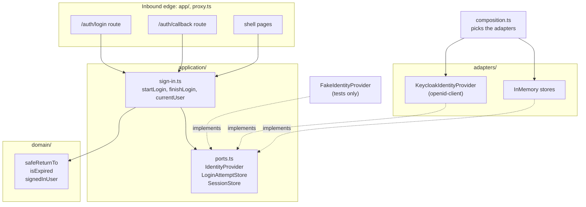
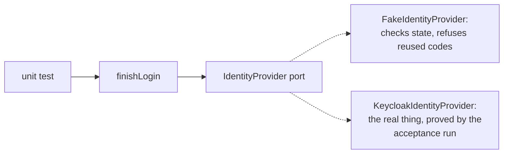
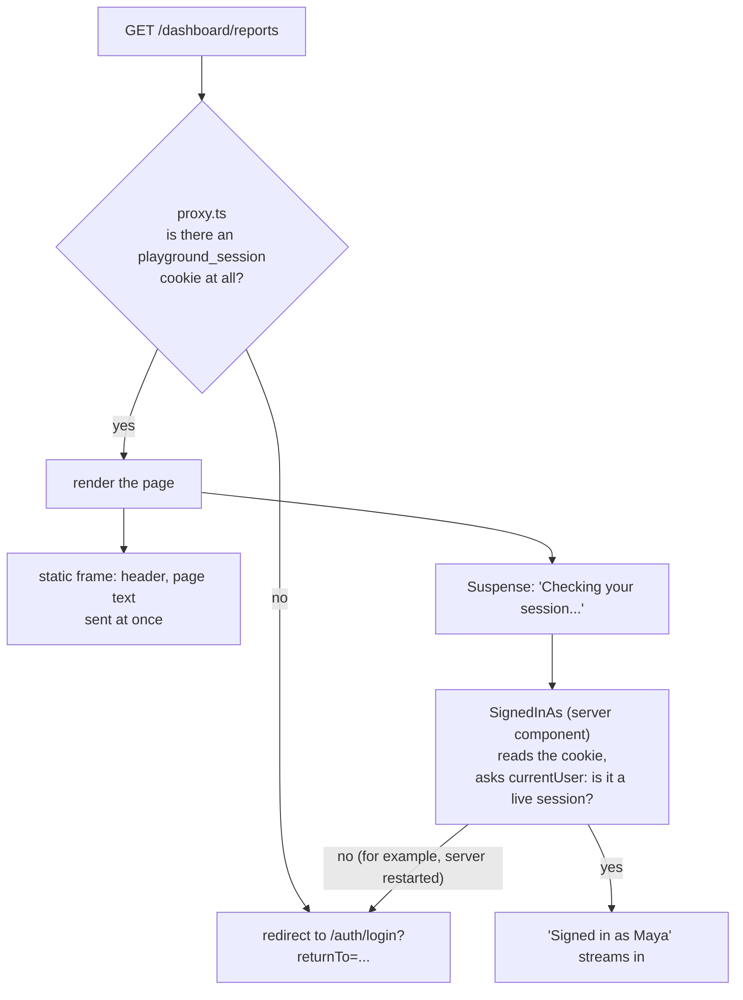

# The web hexagon: concepts for sign in

> **Adapted from an earlier note.** The ideas of that note about sign in itself (who is who, the code flow, `state` and PKCE, tokens and cookies, the BFF, open redirect) are now in the [auth study guide](../AUTH-STUDY-GUIDE.md), Part 1 (open redirect is [1.13](../AUTH-STUDY-GUIDE.md#113-open-redirect-where-we-send-people-after-sign-in)). This note keeps what is about **how to structure the frontend**: the **ports and adapters shape** (decision 4) and **where code lives in Next.js**.
>
> The `SI-n` labels are the criteria of the [sign in build lesson](UC-A1-sign-in-test-first.md). Paths such as `application/` and `adapters/` are the lesson's target layout, which `apps/web` does not have yet: today the auth code is in `src/lib/auth/`.

**Read before:** the [auth study guide](../AUTH-STUDY-GUIDE.md). **Read after:** the [sign in build lesson](UC-A1-sign-in-test-first.md).

| # | Idea | The question it answers |
|---|---|---|
| 6 | [The hexagon in the frontend](#6-the-hexagon-in-the-frontend) | why ports, adapters and a fake Keycloak? |
| 7 | [Where the code lives in Next.js](#7-where-the-code-lives-in-nextjs) | route handlers, `proxy.ts`, `<Suspense>` |

---

## 6. The hexagon in the frontend

The frontend's server has real rules, so it gets the same shape as the backend.

How to read it: arrows point **inward**. The use cases know the ports, never the adapters. `composition.ts` is the only file that says "use Keycloak and memory". The tests say "use the fake and memory" instead, and nothing else changes.

| Layer | In UC-A1 | Knows about |
|---|---|---|
| Domain | `safeReturnTo`, `isExpired`, `signedInUser`, the `Session` and `LoginAttempt` types | nothing outside itself |
| Application | `startLogin`, `finishLogin`, `currentUser`, and the three **ports** | the domain |
| Adapters | `KeycloakIdentityProvider`, `InMemoryLoginAttemptStore`, `InMemorySessionStore` | the ports, and their technology (openid-client, `node:crypto`) |
| Inbound edge | route handlers, `proxy.ts`, pages | the use cases and `composition.ts` |

### Three design choices worth noticing

1. **The port speaks the use case's language.** `IdentityProvider` has `beginLogin()` and `completeLogin()`. It says nothing about discovery documents, `code_challenge` or HTTP. Those are Keycloak's business, inside the adapter.
2. **`take()`, not `get()` then `delete()`.** "Read and forget in one step" makes **once only** part of the port's promise. Every adapter must keep it, and a use case cannot forget the second call.
3. **The fake is strict.** `FakeIdentityProvider` checks the `state` and refuses a reused code, like Keycloak does. A fake that always said yes would let a careless use case pass its tests.

> **Your turn.**
> In two years Playground moves from Keycloak to another identity provider that also speaks OIDC. Which files change, and which do not?

Answer

**Change:** a new adapter (or the settings of `KeycloakIdentityProvider`, since the protocol is the same), and `composition.ts`, which picks it. **Unchanged:** the domain, `sign-in.ts`, the ports, the route handlers, the pages and every unit test. If a move like that forces a change in the use cases, the port knew too much about Keycloak.

---

## 7. Where the code lives in Next.js

Next.js gives three places for code to run on the server. UC-A1 uses all three, for different jobs.

How to read it: two checks, on purpose.

| Place | Job here | Why there |
|---|---|---|
| **Route handlers** (`app/auth/login/route.ts`, `app/auth/callback/route.ts`) | the sign in steps: redirects and cookies, then call a use case | they are plain HTTP endpoints, no page |
| **`proxy.ts`** | the **quick** check: is there a session cookie at all? | runs before every matching request, so it must be cheap: it reads no store |
| **A server component in `<Suspense>`** | the **real** check: is that cookie a live session? | it can read the store, and the rest of the page does not wait for it |

### Why two checks?

`proxy.ts` is an **optimistic** check: it trusts that a cookie means a session. Usually that is true, and it turns every guest away in a few microseconds. But a cookie can be stale (the server restarted, the session ended). The real check reads the session store and catches those.

### Why `<Suspense>`?

With **Cache Components** on, Next.js splits each page into a **static shell**, ready at once and the same for everyone, and **dynamic parts** that depend on this request. Reading `cookies()` is request data, so it must sit inside a `<Suspense>` boundary. The frame shows instantly with "Checking your session...", and the name streams in a moment later. Reading cookies outside a boundary is a **build error** in this setup.

### Why a route group, `(shell)`?

A folder in brackets groups pages under one layout **without** adding to the address. `app/(shell)/dashboard/page.tsx` is `/dashboard`, and it gets the shell's header and session check.

> **The proxy is not a lock.**
> Never rely on `proxy.ts` alone to protect data. It only checks that a cookie exists. Any page that shows **private data** must read it through a use case that checks the session itself (UC-A5 does this for the profile).

> **Your turn.**
> Maya signs in, then the Next.js dev server restarts. She reloads `/dashboard`. Walk through the diagram above: which check lets her through, which one stops her, and where does she end up?

Answer

The browser still sends the old `playground_session` cookie, so **`proxy.ts` lets her through**: a cookie exists. The page's frame renders. Then `SignedInAs` asks the session store, which is in memory and was emptied by the restart, so `currentUser` returns null and it **redirects to `/auth/login`**. She signs in again (with Keycloak's own session still alive, perhaps without even typing her password) and lands on `/dashboard`.

---

## Check your understanding

The theory questions (why a code, what `state` and PKCE stop, why not `SameSite=Strict`, open redirect) are in the [auth study guide](../AUTH-STUDY-GUIDE.md#9-test-yourself). These are about this note.

1. Why is `safeReturnTo` in `domain/` and not in the route handler that reads the query string? ([6](#6-the-hexagon-in-the-frontend))
2. Why does a store have `take()` instead of `get()` and `delete()`? ([6. The hexagon in the frontend](#6-the-hexagon-in-the-frontend))
3. Why do we check the session twice, once in `proxy.ts` and once in the page? ([7. Where the code lives in Next.js](#7-where-the-code-lives-in-nextjs))
4. If Playground moves to another OIDC provider, which files change and which do not? ([6](#6-the-hexagon-in-the-frontend))

Answer to 1

Because it is a **rule of the product** ("we only ever send people to our own pages"), not a detail of HTTP. In the domain it is a plain function with no imports, tested in milliseconds with every tricky input (see [the open redirect cases](../AUTH-STUDY-GUIDE.md#113-open-redirect-where-we-send-people-after-sign-in)). Any part of the app that ever needs a return address (sign in, registering, sign out) uses the same rule, so it cannot be forgotten in one of them.

When you can answer all four without looking, you are ready for the [sign in build lesson](UC-A1-sign-in-test-first.md).
