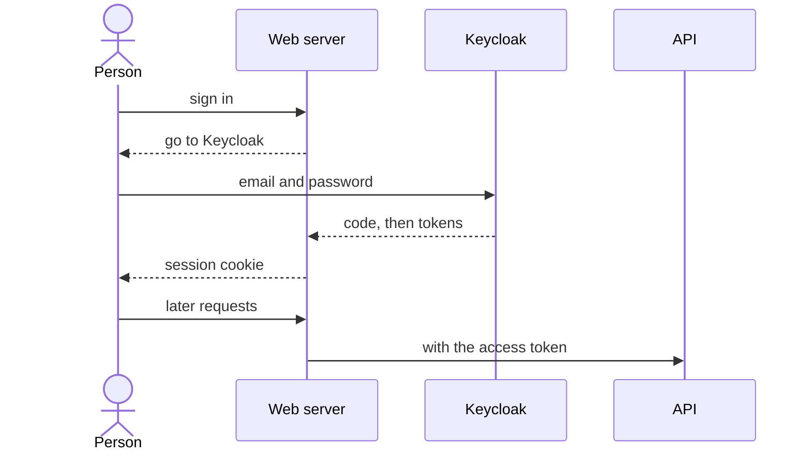

```yaml
id: UC-A1
type: use-case
name: Sign in
status: draft
actor: person (not yet signed in)
context: BC-ACCESS
satisfies:
  - id: NFR-1
  - id: FR-1
criteria:
  - id: AC-1
  - id: AC-33
  - id: AC-38
  - id: AC-39
  - id: AC-40
  - id: AC-41
  - id: AC-42
  - id: AC-43
  - id: AC-44
  - id: AC-45
parameters: []
objects: [OBJ-A1]
rules: []
effects:
  - the web server holds the person's Keycloak tokens in a session
  - the browser holds only an opaque session cookie
  - a person's earlier session ends when they sign in again
evolved_from: [MK3 UC-A1]
```

# Sign in

<!-- vbench-uc:begin mirror (generated from the requirements files, do not edit here: change the row, then run sync) -->

<details>
<summary>The requirements and criteria it runs, copied from docs/requirements (2 requirements, 10 criteria). Do not edit.</summary>

## What this serves

**NFR-1**: The system shall check access on the server for every command and read.

**FR-1**: The system shall let a person sign in through the identity provider.

## Acceptance criteria it runs

**AC-1** (acceptance, proves FR-1)

- Given an active account
- When its person signs in through the identity provider, then asks for their own account
- Then they have a session, and the answer shows their account

**AC-33** (acceptance, proves NFR-1)

- Given a request with no token, an expired one, one from another issuer, or one made for another audience
- When it reaches a protected route
- Then it is answered 401, and no account or audit entry is made

**AC-38** (acceptance, proves FR-1)

- Given a sign in that was never started, was already used, or has expired
- When the identity provider sends the person back for it
- Then no session is made, and the person is asked to sign in again

**AC-39** (acceptance, proves FR-1)

- Given a person who cancels at the identity provider, or a sign in whose proof does not check out
- When they are sent back
- Then no session is made, and they are told the sign in did not work

**AC-40** (acceptance, proves FR-1)

- Given a sign in whose return address points to another site
- When the person signs in
- Then they land on a page of ours, never on the other site

**AC-41** (acceptance, proves FR-1)

- Given a signed-in person
- When the browser's cookies and storage are inspected
- Then they hold the session id and no token

**AC-42** (acceptance, proves FR-1)

- Given a sign in finished in a browser that did not start it
- When it reaches the system
- Then it is refused and no session is made

**AC-43** (acceptance, proves FR-1)

- Given a person who is already signed in
- When they sign in again
- Then the earlier session no longer works

**AC-44** (acceptance, proves FR-1)

- Given an identity provider that cannot be reached
- When a person asks to sign in
- Then they are told sign in is not available, and no session is made

**AC-45** (acceptance, proves FR-4)

- Given a deactivated account whose person still signs in, for example re-enabled in Keycloak by hand
- When they sign in
- Then they see that the account is deactivated, and their session ends

## How it is verified

- acceptance: AC-1, AC-33, AC-38, AC-39, AC-40, AC-41, AC-42, AC-43, AC-44, AC-45

Each criterion is run by a test tagged `Verifies AC-<n>`.

</details>

<!-- vbench-uc:end mirror -->

> Study copy. Rewritten from MK3's UC-A1 (login) for Keycloak. The requirement and criterion rows are in
> `docs/requirements/`. The front matter is not in the use case tool's format yet, so no review hashes are stamped.

## Description

A person proves who they are to Keycloak, and Playground trusts the signed answer. Playground never sees the password. It sends the person to Keycloak's login page, gets a one-time code back, and exchanges it for tokens on the web server. The tokens stay on the web server. The browser gets a random session cookie and nothing else. Signing in proves who the person is, not that they may use the product: that is decided by the account, on every request (decisions 8 and 10; see UC-A3 and UC-A4). A pending person lands on the waiting page, and a deactivated person on a "deactivated" page.

## What changed from MK3

| MK3 UC-A1 | Playground UC-A1 |
|---|---|
| Our login form posts email and password to our API | Keycloak's login page. We never receive the password |
| `AuthService` checks the password with bcrypt | Keycloak checks it |
| Generic 401 and a dummy hash, so a wrong email and a wrong password look and time the same | Keycloak's job now. Nothing for us to build |
| We mint an access token and a refresh token, and whitelist the refresh token in Redis | Keycloak mints them. We keep no list |
| Both tokens go to the browser as httpOnly cookies | The browser never sees a token. It holds one opaque session id |
| Login is one request | A redirect, then a code, then a back-channel exchange (Authorization Code with PKCE) |

What is new in the design language: **a login attempt is a short-lived, single-use record** (state, nonce and PKCE verifier) that ties the redirect to the callback. MK3 had no such thing, because it had no redirect.

## Preconditions

- The person has a Keycloak account.
- The person is not signed in. If they already are, signing in again ends the earlier session (other flows).

## Main flow

1. The person asks to sign in. (FR-1)
2. The system starts a login attempt: it makes a random state, nonce and PKCE verifier, keeps them for a short time, and sends the person to Keycloak. (FR-1)
3. The person gives their email and password to Keycloak. (FR-1)
4. Keycloak sends the person back with a one-time code. (FR-1)
5. The system finds the login attempt that this browser started, uses it once, and checks the state. (FR-1, AC-38, AC-42)
6. The system exchanges the code for tokens directly with Keycloak. Keycloak checks the PKCE verifier. The system checks the nonce in the ID token. (FR-1, AC-39)
7. The system keeps the tokens on the server under a new random session id, ends any earlier session of the person, and sets the new id as the session cookie. (FR-1, AC-41, AC-43)
8. The person is sent to the page they first asked for, or to their own page when that address is not one of ours. (FR-1, AC-40)
9. The page asks the API for the person's account, with the access token. The API checks the signature, expiry, issuer and audience, and then reads the account. A person the system does not know gets a pending account at this first call (UC-A3). (FR-1, NFR-1, AC-1, AC-33)
10. What the person sees depends on the account. An active person sees their page. A pending person sees the waiting page (UC-A3). A deactivated person sees that the account is deactivated, and their session ends. (AC-1, AC-45)

## Other flows

- The login attempt is missing, used already or expired: no session is made, and the person is sent back to the start with "login expired". (AC-38)
- The sign in is finished in a browser that did not start it: it is refused like a missing attempt, and no session is made. (AC-42)
- The person cancels, or Keycloak refuses: no session is made, and the person is sent back with "login refused". (AC-39)
- The code exchange fails, or the state, nonce or PKCE check fails: no session is made, and the person is sent back with "login failed". (AC-39)
- Keycloak cannot be reached when the person asks to sign in: the person is told that sign in is not available, and no session is made. (AC-44)
- The person is already signed in and signs in again: the new session is made and the earlier one ends. With two tabs, the later sign in wins, and the other tab's callback gets "login expired". (AC-43)
- The `returnTo` address points to another site: it is replaced by the person's own page, so a sign in link cannot send a person elsewhere. (AC-40)
- A request reaches the API with no token, an expired token, a token from another issuer or a token for another audience: the API answers 401 and creates nothing. (AC-33)
- A deactivated person is normally refused on Keycloak's own page and never comes back to us. If they get through anyway, for example when they were re-enabled in Keycloak by hand, they see that the account is deactivated and their session ends. (AC-45)

## Postconditions

- A session exists on the web server. The browser holds its id and no token, and any earlier session of the person has ended.
- The use case ends at the session. The first API call (step 9) is what creates a pending account for a person the system does not know (UC-A3). Signing in again creates nothing.

## Open questions

Email verification is not required for now (decision 10): the product runs inside the corporate network, and the API only refuses to give the first administrator to an unverified email. Revisit it with UC-A7 (single sign on), or before the product is reachable from outside the network. No other question is open for this use case.

## Overview

The high level picture. The analysis sequence is in [UC-A1-sign-in-analysis-sequence.puml](diagrams/UC-A1-sign-in-analysis-sequence.puml) and the design sequence, with the routes, ports and adapters, in [UC-A1-sign-in-design-sequence.puml](diagrams/UC-A1-sign-in-design-sequence.puml). Both use the step numbers of the main flow.



## Analysis

### Revision 1

What the person and Playground say to each other, with no route, store, port or token. The diagram is
[UC-A1-sign-in-analysis-sequence.puml](diagrams/UC-A1-sign-in-analysis-sequence.puml). Revised for decision 10 (A17 to A20). Not frozen yet: read it, then freeze it.

- A1 (step): The person asks to sign in
- A2 (step): Playground sends the person to Keycloak
- A3 (step): The person proves who they are to Keycloak
- A4 (step): Keycloak sends the person back with proof
- A5 (step): Playground checks that the proof is genuine and belongs to this sign in
- A6 (step): Playground signs the person in, ends any earlier session, and sends them to the page they asked for
- A7 (step): On each request, Playground checks the proof and then the account
- A8 (rule): A sign in is single use and short lived
- A9 (rule): Signing in proves who the person is, not what they may do
- A10 (rule): The person is sent only to a page of our own
- A11 (refusal): The sign in is missing, used already or expired
- A12 (refusal): The person cancels, or Keycloak refuses
- A13 (refusal): The proof fails a check
- A14 (refusal): A request with no valid proof is refused
- A15 (outside system): Keycloak
- A16 (object): Account
- A17 (step): The person sees what their account allows: their page, the waiting page, or the deactivated page
- A18 (refusal): The sign in is finished in a browser that did not start it
- A19 (rule): A second sign in ends the person's earlier session
- A20 (refusal): Keycloak cannot be reached when the person asks to sign in

## Design

The parts that do the work, drawn in [UC-A1-sign-in-design-sequence.puml](diagrams/UC-A1-sign-in-design-sequence.puml). The class diagram of the API side is [access-design.puml](../domain/diagrams/access-design.puml). The web server side (decision 5) has no class diagram yet (decision 9, still open). D12 and D13 are new from decision 10 and are not built yet.

- D1 (route): The login and callback routes, kept thin
- D2 (use case): The sign in use case of the web server
- D3 (port): IdentityProvider
- D4 (port): LoginAttemptStore
- D5 (port): SessionStore
- D6 (port): BackendApi
- D7 (adapter): Keycloak through openid-client, behind IdentityProvider
- D8 (adapter): In-memory login attempt and session stores, ElastiCache on AWS
- D9 (domain rule): safeReturnTo, and when a login attempt expires
- D10 (service): The API TokenVerifier
- D11 (aggregate): Account, read by the API on every request
- D12 (page): The waiting page and the deactivated page, chosen from the account status
- D13 (domain rule): A new session ends the person's earlier one, through SessionStore
- D14 (domain rule): A login attempt belongs to the browser that started it, through the login cookie

## Changes from analysis to design

```
A1 became -> D1
A2 became -> D2, D3, D4
A3 dropped: Keycloak's own login page, nothing of ours is built for it
A4 became -> D1, D3
A5 became -> D2, D3, D4
A6 became -> D2, D5, D8, D13
A7 became -> D6, D10, D11
A8 became -> D4, D8, D9
A9 became -> D10, D11
A10 became -> D9
A11 became -> D2, D4
A12 became -> D2
A13 became -> D2, D3
A14 became -> D10
A15 became -> D3, D7
A16 became -> D11
A17 became -> D1, D12
A18 became -> D2, D4, D14
A19 became -> D2, D5, D13
A20 became -> D1, D3
```

## Slices

1. TSK-A1.1: Send the person to Keycloak and handle the callback (AC-1)
2. TSK-A1.2: Refuse a sign in that is expired, replayed, from another browser, cancelled or failed (AC-38, AC-39, AC-42)
3. TSK-A1.3: Keep the return address local and every token out of the browser (AC-40, AC-41)
4. TSK-A1.4: A second sign in ends the earlier session (AC-43)
5. TSK-A1.5: Say so when Keycloak cannot be reached (AC-44)
6. TSK-A1.6: The API checks the token on every protected route (AC-33)
7. TSK-A1.7: A deactivated person who still signs in sees why and is signed out (AC-45)

## Not in this use case

- Proving that every command and read checks membership (AC-32). It moved to UC-P1 and UC-P2 (decision 10).
- Creating the pending account and approving it (UC-A3, UC-A4).
- Signing out and keeping the session alive (UC-A2, UC-A6).
