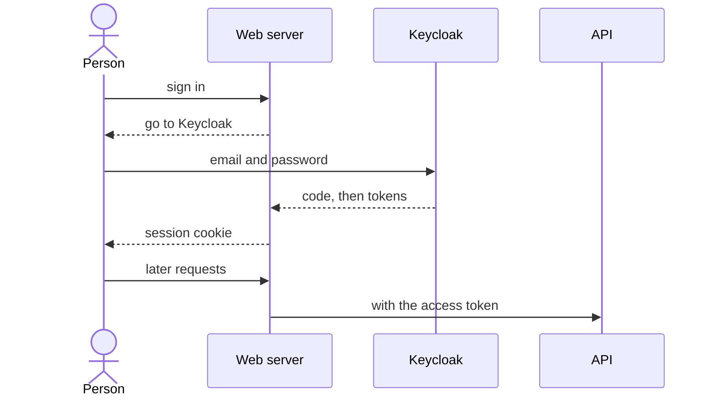

```yaml
id: UC-A1
type: use-case
name: Sign in
status: draft
actor: person (not yet signed in)
context: BC-ACCESS
satisfies:
  - id: NFR-1
  - id: FR-1
  - id: FR-4
  - id: NFR-5
criteria:
  - id: AC-1
  - id: AC-33
  - id: AC-38
  - id: AC-39
  - id: AC-40
  - id: AC-41
  - id: AC-42
  - id: AC-43
  - id: AC-44
  - id: AC-45
  - id: AC-46
  - id: AC-48
parameters: []
objects: [OBJ-A1]
rules: []
effects:
  - the web server holds the person's Keycloak tokens in a session
  - the browser holds only an opaque session cookie
  - this browser's earlier session ends when the person signs in again
  - a log line is written for each refusal and each session that starts or ends
evolved_from: [MK3 UC-A1]
```

# Sign in

<!-- vbench-uc:begin mirror (generated from the requirements files, do not edit here: change the row, then run sync) -->

<details>
<summary>The requirements and criteria it runs, copied from docs/requirements (4 requirements, 12 criteria). Do not edit.</summary>

## What this serves

**NFR-1**: The system shall check access on the server for every command and read.

**FR-1**: The system shall let a person sign in through the identity provider.

**FR-4**: The system shall let an administrator decide who can use the product: approve a pending account, deactivate an active one with a reason, and reinstate a deactivated one with a reason.

**NFR-5**: The system shall write a log line for every refused sign in, every refused request and every session that starts or ends.

## Acceptance criteria it runs

**AC-1** (acceptance, proves FR-1)

- Given an active account
- When its person signs in through the identity provider, then asks for their own account
- Then they have a session, and the answer shows their account

**AC-33** (acceptance, proves NFR-1)

- Given a request with no token, an expired one, one from another issuer, one made for another audience, or one signed with an algorithm we do not allow
- When it reaches a protected route
- Then it is answered 401, and no account or audit entry is made

**AC-38** (acceptance, proves FR-1)

- Given a sign in that was never started, was already used, or has expired
- When the identity provider sends the person back for it
- Then no session is made, and the person is asked to sign in again

**AC-39** (acceptance, proves FR-1)

- Given a person who cancels at the identity provider, or a sign in whose proof does not check out
- When they are sent back
- Then no session is made, and they are told the sign in did not work

**AC-40** (acceptance, proves FR-1)

- Given a sign in whose return address points to another site
- When the person signs in
- Then they land on a page of ours, never on the other site

**AC-41** (acceptance, proves FR-1)

- Given a signed-in person
- When the browser's cookies and storage are inspected
- Then they hold the session id and no token

**AC-42** (acceptance, proves FR-1)

- Given a sign in finished in a browser that did not start it
- When it reaches the system
- Then it is refused and no session is made

**AC-43** (acceptance, proves FR-1)

- Given a browser that already holds a session
- When they sign in again
- Then the earlier session of this browser no longer works

**AC-44** (acceptance, proves FR-1)

- Given an identity provider that cannot be reached
- When a person asks to sign in
- Then they are told sign in is not available, and no session is made

**AC-45** (acceptance, proves FR-4)

- Given a deactivated account whose person still signs in, for example re-enabled in Keycloak by hand
- When they sign in
- Then they see that the account is deactivated, and both their session and Keycloak's end

**AC-46** (acceptance, proves FR-1)

- Given a sign in started in two tabs of one browser
- When the older one finishes
- Then it is refused, and the newer one can still finish

**AC-48** (acceptance, proves NFR-5)

- Given a refused sign in, a refused request, and a session that starts and ends
- When each happens
- Then each writes one log line, and none holds a token or a code

## How it is verified

- acceptance: AC-1, AC-33, AC-38, AC-39, AC-40, AC-41, AC-42, AC-43, AC-44, AC-45, AC-46, AC-48

Each criterion is run by a test tagged `Verifies AC-<n>`.

</details>

<!-- vbench-uc:end mirror -->

> Study copy. Rewritten from MK3's UC-A1 (login) for Keycloak. The requirement and criterion rows are in
> `docs/requirements/`. The front matter is not in the use case tool's format yet, so no review hashes are stamped.

## Description

A person proves who they are to Keycloak, and Playground trusts the signed answer. Playground never sees the password. It sends the person to Keycloak's login page, gets a one-time code back, and exchanges it for tokens on the web server. The tokens stay on the web server. The browser gets a random session cookie and nothing else. Signing in proves who the person is, not that they may use the product: that is decided by the account, on every request (decisions 8 and 10; see UC-A3 and UC-A4). A pending person lands on the waiting page, and a deactivated person on a "deactivated" page.

## What changed from MK3

| MK3 UC-A1 | Playground UC-A1 |
|---|---|
| Our login form posts email and password to our API | Keycloak's login page. We never receive the password |
| `AuthService` checks the password with bcrypt | Keycloak checks it |
| Generic 401 and a dummy hash, so a wrong email and a wrong password look and time the same | Keycloak's job now. Nothing for us to build |
| We mint an access token and a refresh token, and whitelist the refresh token in Redis | Keycloak mints them. We keep no list |
| Both tokens go to the browser as httpOnly cookies | The browser never sees a token. It holds one opaque session id |
| Login is one request | A redirect, then a code, then a back-channel exchange (Authorization Code with PKCE) |

What is new in the design language: **a login attempt is a short-lived, single-use record** (state, nonce and PKCE verifier) that ties the redirect to the callback. MK3 had no such thing, because it had no redirect.

## Preconditions

- The person has a Keycloak account.
- Nothing else. A person who is already signed in can sign in again (other flows).

## Main flow

1. The person asks to sign in. (FR-1)
2. The system starts a login attempt: it makes a random state, nonce and PKCE verifier, keeps them for 10 minutes together with the return address (a path of ours that starts with one `/`), ties them to this browser with a login cookie, and sends the person to Keycloak. (FR-1, AC-40, AC-46)
3. If Keycloak does not already know the person, they give their email and password to Keycloak. (FR-1)
4. Keycloak sends the person back with a one-time code. (FR-1)
5. The system finds the login attempt that this browser started, checks the state, and only then uses the attempt up. A callback that does not match is refused without spending the newer attempt. Nothing is sent to Keycloak before this check. (FR-1, AC-38, AC-42, AC-46)
6. The system exchanges the code for tokens directly with Keycloak. Keycloak checks the PKCE verifier. The system checks the nonce in the ID token. (FR-1, AC-39)
7. The system keeps the tokens on the server under a new random session id, ends the session this browser already held, and sets the new id as the session cookie (`HttpOnly`, `Secure`, `SameSite=Lax`, no `Domain`, and the `__Host-` prefix when served over HTTPS). A log line records that a session started. (FR-1, NFR-5, AC-41, AC-43, AC-48)
8. The person is sent to the page they first asked for, or to their own page when that address is not one of ours. (FR-1, AC-40)
9. The page asks the API for the person's account, with the access token. The API checks the signature (only the algorithm the realm uses, with keys from the realm's published key set in configuration), expiry, issuer and audience, and then reads the account. A person the system does not know gets a pending account at this first call (UC-A3). (FR-1, NFR-1, AC-1, AC-33)
10. What the person sees depends on the account. An active person sees their page. A pending person sees the waiting page (UC-A3). A deactivated person sees that the account is deactivated, and both their session and Keycloak's session end (sign out, UC-A2). (AC-1, AC-45, UC-A3 for the waiting page)

## Other flows

- The login attempt is missing, used already or expired: no session is made, and the person is sent back to the start with "login expired". (AC-38)
- The sign in is finished in a browser that did not start it: it is refused like a missing attempt, and no session is made. (AC-42)
- The person cancels, or Keycloak refuses: no session is made, and the person is sent back with "login refused". (AC-39)
- The code exchange fails, or the state, nonce or PKCE check fails: no session is made, and the person is sent back with "login failed". (AC-39)
- Keycloak cannot be reached when the person asks to sign in: the person is told that sign in is not available, and no session is made. (AC-44)
- The browser already holds a session and the person signs in again: the new session is made and the earlier session of this browser ends. Other devices stay signed in. (AC-43)
- Sign in is started in two tabs of one browser: only the latest start can finish. The older tab's callback is refused with "login expired" and does not use up the newer attempt. Tabs that are already signed in share one session and are not affected. (AC-46)
- The return address is not a path of ours (another site, `//host`, `/\host`, or an encoded form of those): it is replaced by the person's own page, so a sign in link cannot send a person elsewhere. The address is kept in the login attempt and never read again from the callback. (AC-40)
- A request reaches the API with no token, an expired token, a token from another issuer, a token for another audience, or a token signed with an algorithm we do not allow: the API answers 401 and creates nothing. (AC-33)
- A deactivated person is normally refused on Keycloak's own page and never comes back to us. If they get through anyway, for example when they were re-enabled in Keycloak by hand, they see that the account is deactivated and both their session and Keycloak's end, so they are not signed straight back in. (AC-45)
- Every refusal above, every 401, and every session that starts or ends writes a server log line: the event, the result, the person's id when it is known and a hash of the session id. Never a token or a code. A deactivated person who gets through also raises a line that Keycloak and Playground disagree. (NFR-5, AC-48)

## Postconditions

- A session exists on the web server. The browser holds its id and no token, and the session this browser held before has ended.
- The use case ends at the first page the person sees (step 10): their own page, the waiting page, or the deactivated page. The first API call (step 9) is what creates a pending account for a person the system does not know (UC-A3). Signing in again creates no account.

## Open questions

Email verification is not required for now (decision 10): the product runs inside the corporate network, and the API only refuses to give the first administrator to an unverified email. Revisit it with UC-A7 (single sign on), or before the product is reachable from outside the network. 
What a freshly signed-in person sees when the API cannot answer, or answers 401 straight after sign in (a wrong audience after a deploy would otherwise be a sign in loop through Keycloak's own session). No flow or criterion yet.

## Overview

The high level picture. The analysis sequence is in [UC-A1-sign-in-analysis-sequence.puml](diagrams/UC-A1-sign-in-analysis-sequence.puml) and the design sequence, with the routes, ports and adapters, in [UC-A1-sign-in-design-sequence.puml](diagrams/UC-A1-sign-in-design-sequence.puml). Both use the step numbers of the main flow.



## Analysis

### Revision 1

What the person and Playground say to each other, with no route, store, port or token. The diagram is
[UC-A1-sign-in-analysis-sequence.puml](diagrams/UC-A1-sign-in-analysis-sequence.puml). Revised for decisions 10 and 12 (A17 to A22). Not frozen yet: read it, then freeze it.

- A1 (step): The person asks to sign in
- A2 (step): Playground sends the person to Keycloak
- A3 (step): The person proves who they are to Keycloak
- A4 (step): Keycloak sends the person back with proof
- A5 (step): Playground checks that the proof is genuine and belongs to this sign in
- A6 (step): Playground signs the person in, ends the session this browser already held, and sends them to the page they asked for
- A7 (step): On each request, Playground checks the proof and then the account
- A8 (rule): A sign in is single use and short lived
- A9 (rule): Signing in proves who the person is, not what they may do
- A10 (rule): The person is sent only to a page of our own
- A11 (refusal): The sign in is missing, used already or expired
- A12 (refusal): The person cancels, or Keycloak refuses
- A13 (refusal): The proof fails a check
- A14 (refusal): A request with no valid proof is refused
- A15 (outside system): Keycloak
- A16 (object): Account
- A17 (step): The person sees what their account allows: their page, the waiting page, or the deactivated page, and a deactivated person is signed out everywhere
- A18 (refusal): The sign in is finished in a browser that did not start it
- A19 (rule): A second sign in ends this browser's earlier session
- A20 (refusal): Keycloak cannot be reached when the person asks to sign in
- A21 (rule): Of two sign ins started at once in one browser, only the latest can finish
- A22 (rule): Refusals and session starts and ends are logged, with no token or code

## Design

The parts that do the work. The web server class diagram is [bff-design.puml](../domain/diagrams/bff-design.puml) and the API one is [access-design.puml](../domain/diagrams/access-design.puml). The design sequence is [UC-A1-sign-in-design-sequence.puml](diagrams/UC-A1-sign-in-design-sequence.puml) (steps 1 to 8) and [UC-A1-sign-in-design-sequence-later-requests.puml](diagrams/UC-A1-sign-in-design-sequence-later-requests.puml) (step 9 on). The web server's `IdentityProvider` port is a different port from the API's of the same name, which enables and disables people.

**Planned, not built (decision 12): D12, D13, D15's reuse, D16, and the lookup of an attempt by state in D4 and D14.** The rest is built.

- D1 (route): The login, callback, logout and backend routes, with proxy.ts and lib/ as the Next.js edge, kept thin
- D2 (use case): SignIn, with startLogin and finishLogin
- D3 (port): IdentityProvider of the web server
- D4 (port): LoginAttemptStore, with a planned lookup by state that does not use up the attempt on a refusal
- D5 (port): SessionStore
- D6 (port): BackendApi
- D7 (adapter): KeycloakIdentityProvider, through openid-client
- D8 (adapter): InMemoryLoginAttemptStore and InMemorySessionStore, ElastiCache on AWS
- D9 (domain rule): safeReturnTo, and when a LoginAttempt expires
- D10 (adapter): The API TokenVerifier, which turns a Keycloak token into a Principal
- D11 (aggregate): Account, read by the API on every request
- D12 (use case): Planned SessionVisibility: what a session may see (active, pending, deactivated, signed out), with the waiting page and the deactivated page
- D13 (domain rule): Planned: a new session ends the session this browser already held, through SessionStore
- D14 (domain rule): A login attempt belongs to the browser that started it, through the login cookie. The lookup by state is planned
- D15 (use case): SignOut, reused to end both sessions of a deactivated person (UC-A2)
- D16 (port): Planned SecurityLog, with a console adapter that CloudWatch reads

## Changes from analysis to design

```
A1 became -> D1
A2 became -> D2, D3, D4
A3 dropped: Keycloak's own login page, nothing of ours is built for it
A4 became -> D1, D3
A5 became -> D2, D3, D4
A6 became -> D2, D5, D8, D13
A7 became -> D6, D10, D11
A8 became -> D4, D8, D9
A9 became -> D10, D11
A10 became -> D9
A11 became -> D2, D4
A12 became -> D2
A13 became -> D2, D3
A14 became -> D10
A15 became -> D3, D7
A16 became -> D11
A17 became -> D1, D12, D15
A18 became -> D2, D4, D14
A19 became -> D2, D5, D13
A20 became -> D1, D3
A21 became -> D4, D14
A22 became -> D16
```

## Slices

1. TSK-A1.1: Send the person to Keycloak and handle the callback (AC-1)
2. TSK-A1.2: Refuse a sign in that is expired, replayed, from another browser, cancelled or failed, and check the state before the exchange (AC-38, AC-39, AC-42)
3. TSK-A1.3: Keep the return address local and every token out of the browser (AC-40, AC-41)
4. TSK-A1.4: A second sign in ends this browser's earlier session, and only the latest of two starts can finish (AC-43, AC-46)
5. TSK-A1.5: Say so when Keycloak cannot be reached (AC-44)
6. TSK-A1.6: The API checks the token on every protected route (AC-33)
7. TSK-A1.7: A deactivated person who still signs in sees why and is signed out everywhere (AC-45)
8. TSK-A1.8: Log each refusal and each session that starts or ends (AC-48)

## Not in this use case

- Proving that every command and read checks membership (AC-32). It moved to UC-P1 and UC-P2 (decision 10).
- Creating the pending account and approving it (UC-A3, UC-A4), and the criterion that a pending person lands on the waiting page (AC-47, UC-A3).
- Signing out and keeping the session alive (UC-A2, UC-A6).
