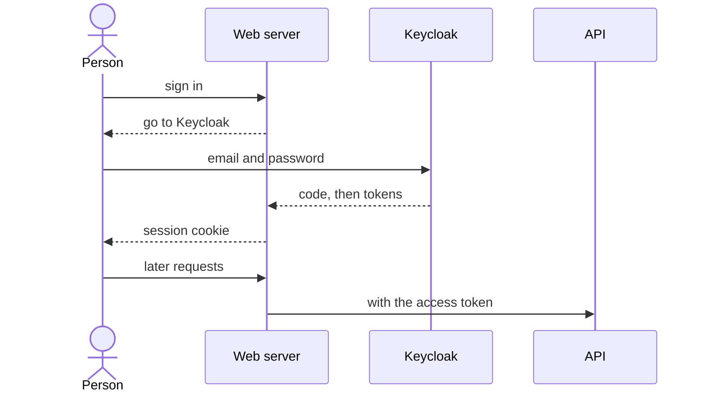

```yaml
id: UC-A1
type: use-case
name: Sign in
status: draft
actor: person (not yet signed in)
context: BC-ACCESS
satisfies:
  - id: NFR-1
  - id: FR-1
criteria:
  - id: AC-1
  - id: AC-32
  - id: AC-33
parameters: []
objects: [OBJ-A1]
rules: []
effects:
  - the web server holds the person's Keycloak tokens in a session
  - the browser holds only an opaque session cookie
evolved_from: [MK3 UC-A1]
```

# Sign in

<!-- vbench-uc:begin mirror (generated from the requirements files, do not edit here: change the row, then run sync) -->

<details>
<summary>The requirements and criteria it runs, copied from docs/requirements (2 requirements, 3 criteria). Do not edit.</summary>

## What this serves

**NFR-1**: The system shall check access on the server for every command and read.

**FR-1**: The system shall let a person sign in through the identity provider.

## Acceptance criteria it runs

**AC-1** (acceptance, proves FR-1)

- Given an approved person
- When they sign in through the identity provider
- Then they can use the product

**AC-32** (acceptance, proves NFR-1)

- Given any role, and a person who is not a member
- When each makes a command or read it may not, even if the screen hides it
- Then the server refuses it

**AC-33** (acceptance, proves NFR-1)

- Given a request with no token, an expired one, or one not from our identity provider
- When it reaches a protected route
- Then it is refused

## How it is verified

- acceptance: AC-1, AC-32, AC-33

Each criterion is run by a test tagged `Verifies AC-<n>`.

</details>

<!-- vbench-uc:end mirror -->

> Study copy. Rewritten from MK3's UC-A1 (login) for Keycloak. The requirement and criterion rows are in
> `docs/requirements/`. The front matter is not in the use case tool's format yet, so no review hashes are stamped.

## Description

A person proves who they are to Keycloak, and Playground trusts the signed answer. Playground never sees the password. It sends the person to Keycloak's login page, gets a one-time code back, and exchanges it for tokens on the web server. The tokens stay on the web server. The browser gets a random session cookie and nothing else. Signing in proves who the person is, not that they may use the product: that is decided by the account, on every request (see UC-A3).

## What changed from MK3

| MK3 UC-A1 | Playground UC-A1 |
|---|---|
| Our login form posts email and password to our API | Keycloak's login page. We never receive the password |
| `AuthService` checks the password with bcrypt | Keycloak checks it |
| Generic 401 and a dummy hash, so a wrong email and a wrong password look and time the same | Keycloak's job now. Nothing for us to build |
| We mint an access token and a refresh token, and whitelist the refresh token in Redis | Keycloak mints them. We keep no list |
| Both tokens go to the browser as httpOnly cookies | The browser never sees a token. It holds one opaque session id |
| Login is one request | A redirect, then a code, then a back-channel exchange (Authorization Code with PKCE) |

What is new in the design language: **a login attempt is a short-lived, single-use record** (state, nonce and PKCE verifier) that ties the redirect to the callback. MK3 had no such thing, because it had no redirect.

## Preconditions

- The person has a Keycloak account.
- The person is not signed in.

## Main flow

1. The person asks to sign in. (FR-1)
2. The system starts a login attempt: it makes a random state, nonce and PKCE verifier, keeps them for a short time, and sends the person to Keycloak. (FR-1)
3. The person gives their email and password to Keycloak. (FR-1)
4. Keycloak sends the person back with a one-time code. (FR-1)
5. The system finds the login attempt, uses it once, and checks the state. (FR-1)
6. The system exchanges the code for tokens directly with Keycloak. Keycloak checks the PKCE verifier. The system checks the nonce in the ID token. (FR-1)
7. The system keeps the tokens on the server under a new random session id and sets that id as the session cookie. (FR-1)
8. The person is sent to the page they first asked for. (FR-1)
9. On each later request, the web server adds the access token. The API checks its signature, expiry, issuer and audience, and then reads the account. (NFR-1, AC-1, AC-32, AC-33)

## Other flows

- The login attempt is missing, used already or expired: the person is sent back to the start with "login expired". (FR-1)
- The person cancels, or Keycloak refuses: the person is sent back with "login refused". (FR-1)
- The code exchange fails, or the state, nonce or PKCE check fails: no session is made, and the person is sent back with "login failed". (FR-1)
- A request reaches the API with no token, an expired token, a token from another issuer or a token for another audience: the API answers 401 and does nothing else. (AC-33)
- A request is sent straight to the API with the browser's role switch off: the API still checks the account's role and refuses. (AC-32)
- The `returnTo` address points to another site: it is replaced by the home page, so a sign-in link cannot send a person elsewhere. (FR-1)

## Postconditions

- A session exists on the web server. The browser holds its id and no token.
- Nothing is created in the API database yet. The account appears on the first API request (UC-A3).

## Open questions

For the product owner to decide.

1. An unverified email. Keycloak can require verification. Today the API only refuses to give the first administrator to an unverified email.

## Overview

The high level picture. The analysis sequence is in [UC-A1-sign-in-analysis-sequence.puml](diagrams/UC-A1-sign-in-analysis-sequence.puml) and the design sequence, with the routes, ports and adapters, in [UC-A1-sign-in-design-sequence.puml](diagrams/UC-A1-sign-in-design-sequence.puml). Both use the step numbers of the main flow.



## Analysis

### Revision 1

What the person and Playground say to each other, with no route, store, port or token. The diagram is
[UC-A1-sign-in-analysis-sequence.puml](diagrams/UC-A1-sign-in-analysis-sequence.puml). Not frozen yet: freeze it after the open gaps of this use case are settled.

- A1 (step): The person asks to sign in
- A2 (step): Playground sends the person to Keycloak
- A3 (step): The person proves who they are to Keycloak
- A4 (step): Keycloak sends the person back with proof
- A5 (step): Playground checks that the proof is genuine and belongs to this sign in
- A6 (step): Playground signs the person in and sends them to the page they asked for
- A7 (step): On each later request, Playground checks the proof and then the account
- A8 (rule): A sign in is single use and short lived
- A9 (rule): Signing in proves who the person is, not what they may do
- A10 (rule): The person is sent only to a page of our own
- A11 (refusal): The sign in is missing, used already or expired
- A12 (refusal): The person cancels, or Keycloak refuses
- A13 (refusal): The proof fails a check
- A14 (refusal): A request with no valid proof is refused
- A15 (outside system): Keycloak
- A16 (object): Account

## Design

The parts that do the work, drawn in [UC-A1-sign-in-design-sequence.puml](diagrams/UC-A1-sign-in-design-sequence.puml). The class diagram of the API side is [access-design.puml](../domain/diagrams/access-design.puml). The web server side (decision 5) has no class diagram yet (decision 9, still open).

- D1 (route): The login and callback routes, kept thin
- D2 (use case): The sign in use case of the web server
- D3 (port): IdentityProvider
- D4 (port): LoginAttemptStore
- D5 (port): SessionStore
- D6 (port): BackendApi
- D7 (adapter): Keycloak through openid-client, behind IdentityProvider
- D8 (adapter): In-memory login attempt and session stores, ElastiCache on AWS
- D9 (domain rule): safeReturnTo, and when a login attempt expires
- D10 (service): The API TokenVerifier
- D11 (aggregate): Account, read by the API on every request

## Changes from analysis to design

```
A1 became -> D1
A2 became -> D2, D3, D4
A3 dropped: Keycloak's own login page, nothing of ours is built for it
A4 became -> D1, D3
A5 became -> D2, D3, D4
A6 became -> D2, D5, D8
A7 became -> D6, D10, D11
A8 became -> D4, D8, D9
A9 became -> D10, D11
A10 became -> D9
A11 became -> D2, D4
A12 became -> D2
A13 became -> D2, D3
A14 became -> D10
A15 became -> D3, D7
A16 became -> D11
```

## Slices

1. TSK-A1.1: Send the person to Keycloak and handle the callback (AC-1)
2. TSK-A1.2: The API checks the token on every protected route (AC-32, AC-33)
