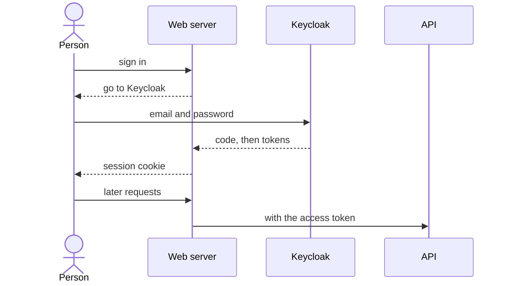

```yaml
id: UC-A10
type: use-case
name: Sign in
status: draft
actor: person (not yet signed in)
context: BC-ACCESS
satisfies:
  - id: FR-124
  - id: FR-127
  - id: NFR-1
criteria:
  - id: AC-78
  - id: AC-81
  - id: AC-9
parameters: []
objects: [OBJ-A1]
rules: []
effects:
  - the web server holds the person's Keycloak tokens in a session
  - the browser holds only an opaque session cookie
evolved_from: [MK3 UC-A1]
```

# Sign in

<!-- vbench-uc:begin mirror (generated from the requirements files, do not edit here: change the row, then run sync) -->

## What this serves

**FR-124**: The system shall let a person sign in through the identity provider.

**FR-127**: The system shall refuse a request that has no valid token from the identity provider.

**NFR-1**: The system shall check access on the server for every command and read.

## Acceptance criteria it runs

**AC-78** (acceptance, proves FR-124)

- Given an approved person with an identity provider account
- When they sign in through the identity provider
- Then they can use the product

**AC-81** (acceptance, proves FR-127)

- Given a request with no token, an expired token, or a token not issued by the identity provider
- When it is made to any protected route
- Then it is refused

**AC-9** (integration, proves NFR-1)

- Given a screen that hides a button the role may not use
- When the request is sent directly to the server
- Then the server still refuses it

## How it is verified

- acceptance: AC-78, AC-81
- integration: AC-9

Each criterion is run by a test tagged `Verifies AC-<n>`.

<!-- vbench-uc:end mirror -->

> Study copy. Rewritten from MK3's UC-A1 (login) for Keycloak. The requirement and criterion rows are in
> `docs/requirements/`. The front matter is not in the use case tool's format yet, so no review hashes are stamped.


## Description

A person proves who they are to Keycloak, and Playground trusts the signed answer. Playground never sees the password. It sends the person to Keycloak's login page, gets a one-time code back, and exchanges it for tokens on the web server. The tokens stay on the web server. The browser gets a random session cookie and nothing else. Signing in proves who the person is, not that they may use the product: that is decided by the account, on every request (see UC-A12).

## What changed from MK3

| MK3 UC-A1 | Playground UC-A10 |
|---|---|
| Our login form posts email and password to our API | Keycloak's login page. We never receive the password |
| `AuthService` checks the password with bcrypt | Keycloak checks it |
| Generic 401 and a dummy hash, so a wrong email and a wrong password look and time the same | Keycloak's job now. Nothing for us to build |
| We mint an access token and a refresh token, and whitelist the refresh token in Redis | Keycloak mints them. We keep no list |
| Both tokens go to the browser as httpOnly cookies | The browser never sees a token. It holds one opaque session id |
| Login is one request | A redirect, then a code, then a back-channel exchange (Authorization Code with PKCE) |

What is new in the design language: **a login attempt is a short-lived, single-use record** (state, nonce and PKCE verifier) that ties the redirect to the callback. MK3 had no such thing, because it had no redirect.

## Preconditions

- The person has a Keycloak account.
- The person is not signed in.

## Main flow

1. The person asks to sign in. (FR-124)
2. The system starts a login attempt: it makes a random state, nonce and PKCE verifier, keeps them for a short time, and sends the person to Keycloak. (FR-124)
3. The person gives their email and password to Keycloak. (FR-124)
4. Keycloak sends the person back with a one-time code. (FR-124)
5. The system finds the login attempt, uses it once, and checks the state. (FR-124)
6. The system exchanges the code for tokens directly with Keycloak. Keycloak checks the PKCE verifier. The system checks the nonce in the ID token. (FR-124)
7. The system keeps the tokens on the server under a new random session id and sets that id as the session cookie. (FR-124)
8. The person is sent to the page they first asked for. (FR-124)
9. On each later request, the web server adds the access token. The API checks its signature, expiry, issuer and audience, and then reads the account. (FR-127, NFR-1, AC-78, AC-81, AC-9)

## Other flows

- The login attempt is missing, used already or expired: the person is sent back to the start with "login expired". (FR-124)
- The person cancels, or Keycloak refuses: the person is sent back with "login refused". (FR-124)
- The code exchange fails, or the state, nonce or PKCE check fails: no session is made, and the person is sent back with "login failed". (FR-124)
- A request reaches the API with no token, an expired token, a token from another issuer or a token for another audience: the API answers 401 and does nothing else. (AC-81)
- A request is sent straight to the API with the browser's role switch off: the API still checks the account's role and refuses. (AC-9)
- The `returnTo` address points to another site: it is replaced by the home page, so a sign-in link cannot send a person elsewhere. (FR-124)
- Open: an unverified email. Keycloak can require verification. Today the API only refuses to give the first administrator to an unverified email.

## Postconditions

- A session exists on the web server. The browser holds its id and no token.
- Nothing is created in the API database yet. The account appears on the first API request (UC-A12).

## Overview

The high level picture. The detailed sequence, with step numbers that match the main flow, is in [UC-A10-sign-in-sequence.puml](diagrams/UC-A10-sign-in-sequence.puml).



## Slices

1. TSK-A10.1: Send the person to Keycloak and handle the callback (AC-78)
2. TSK-A10.2: The API checks the token on every protected route (AC-81, AC-9)
