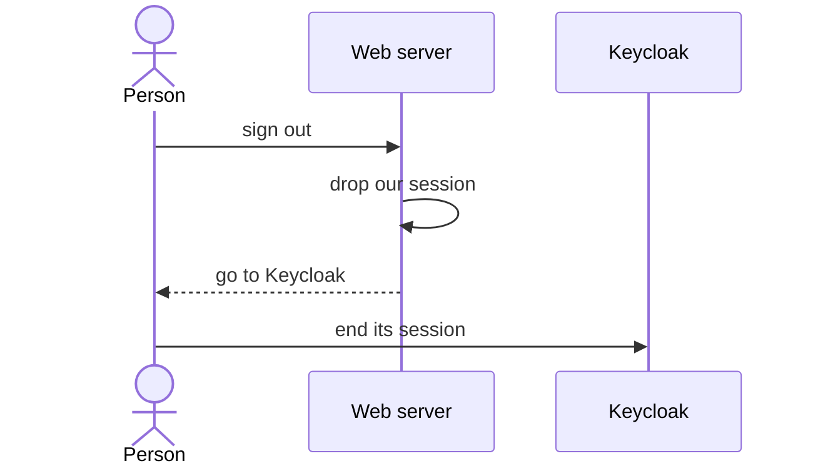

```yaml
id: UC-A11
type: use-case
name: Sign out
status: draft
actor: signed-in person
context: BC-ACCESS
satisfies: [FR-125]
criteria: [AC-79]
parameters: []
objects: []
rules: []
effects:
  - the web server forgets the session and its tokens
  - Keycloak ends its own session
  - the session cookie is removed
evolved_from: [MK3 UC-A2]
```

# Sign out

> Study copy. Rewritten from MK3's UC-A2 (logout) for Keycloak.

## What this serves

**FR-125**: The system shall let a person sign out.

## Acceptance criteria it runs

**AC-79** (proves FR-125): Given a signed-in person, when they sign out, then the product no longer accepts their session and asks them to sign in again.

## Description

Signing out has to end two sessions, not one: the product's own session and Keycloak's. If only ours ended, the next click on "Sign in" would log the person straight back in, because Keycloak still remembers them.

## What changed from MK3

| MK3 UC-A2 | Playground UC-A11 |
|---|---|
| Revoke the refresh token's `jti` in the Redis whitelist | Nothing to revoke: we keep no whitelist |
| Clear two cookies | Clear one session cookie, and drop the session on the server |
| One session to end | Two to end: ours, and Keycloak's, through its end-session address |
| `POST /auth/session/logout` | `POST /auth/logout` only. A link or an image on another site cannot sign a person out |

New in the design language: **the ID token is kept so it can be handed back to Keycloak as a hint** when ending its session. That is why the session holds an ID token and not just an access token.

## Preconditions

- The person is signed in.

## Main flow

1. The person asks to sign out, by a button that posts. (FR-125)
2. The system finds the session from the cookie and removes it, with its tokens, from the server. (FR-125)
3. The system sends the person to Keycloak's end-session address with the ID token as a hint and the home page as the place to return. (FR-125)
4. Keycloak ends its session and sends the person to the home page. (FR-125)
5. The system removes the session cookie. (FR-125)
6. The product asks the person to sign in again. (FR-125, AC-79)

## Other flows

- The person has no session, or the session has already gone: the system still removes the cookie and sends the person to the home page. (AC-79)
- Keycloak cannot be reached for its end-session address: our session is still removed and the person lands on the home page. Their Keycloak session ends by itself when it times out. Open: say so on screen.
- The request is a GET, for example from a link or an image on another site: it does nothing.
- Someone keeps a copy of the access token from before: it still passes the API's checks until it expires, which is short. The API reads the account on every request, but a signed-out person's account is still active. Open: to cut this to zero, the API would need to ask Keycloak whether the token is still live.

## Postconditions

- The server holds no tokens for this session.
- Keycloak has no session for the person in this browser.
- The browser holds no session cookie.

## Overview

The high level picture. The detailed sequence, with step numbers that match the main flow, is in [UC-A11-sign-out-sequence.puml](diagrams/UC-A11-sign-out-sequence.puml).



## Slices

1. Drop the session and clear the cookie.
2. End the Keycloak session too.
