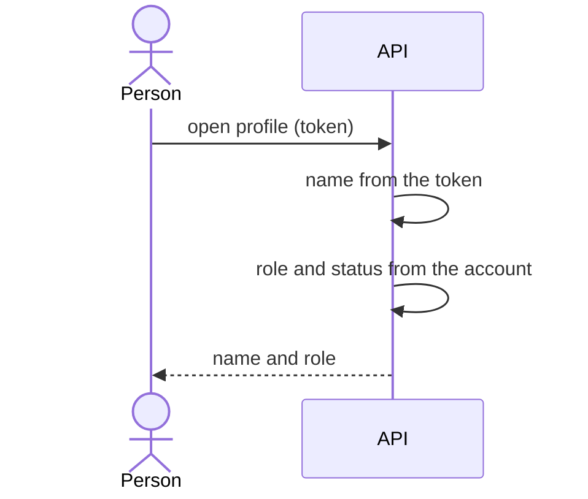

```yaml
id: UC-A13
type: use-case
name: View my name and role
status: draft
actor: signed-in person
context: BC-ACCESS
satisfies:
  - id: FR-5
criteria:
  - id: AC-8
parameters: []
objects: [OBJ-A1]
rules: []
effects:
  - nothing is changed, except that the copied name and email are refreshed from the token
evolved_from: [MK3 UC-A4]
```

# View my name and role

<!-- vbench-uc:begin mirror (generated from the requirements files, do not edit here: change the row, then run sync) -->

<details>
<summary>The requirements and criteria it runs, copied from docs/requirements (1 requirement, 1 criterion). Do not edit.</summary>

## What this serves

**FR-5**: The system shall show a signed-in person their name and account role.

## Acceptance criteria it runs

**AC-8** (acceptance, proves FR-5)

- Given a signed-in person
- When they open their profile
- Then it shows their name and role

## How it is verified

- acceptance: AC-8

Each criterion is run by a test tagged `Verifies AC-<n>`.

</details>

<!-- vbench-uc:end mirror -->

> Study copy. Rewritten from MK3's UC-A4 (view profile) for Keycloak.


## Description

The person sees who the product thinks they are. The name comes from the Keycloak token, and the role and status come from the Playground account. Changing the name, the email or the password is not done here: Keycloak has its own account page for that.

## What changed from MK3

| MK3 UC-A4 | Playground UC-A13 |
|---|---|
| `GET /auth/me` returns the id and email from our user table | `GET /me` returns the account: name, email, role, status |
| Our code could change the profile later | Not ours: Keycloak's account page |
| The user comes from our table | The name and email are copied from the token each time, the role and status come from our table |

This use case is a good one to learn from because it shows the **split in one response**: some fields are Keycloak's, copied in, and some are Playground's. The `/me` answer is allowed for a pending person, so it is the one read that skips the "active account" check (FR-3).

## Preconditions

- The person is signed in.

## Main flow

1. The person opens their profile. (FR-5)
2. The web server asks the API for `/me` with the access token. (FR-5)
3. The API checks the token. (NFR-1)
4. The API finds the account by the Keycloak id, and refreshes the name and email if they changed. (FR-5)
5. The API refuses a deactivated account. (RULE-A6)
6. The API answers with name, email, role and status. (FR-5)
7. The page shows the name and the role. (FR-5, AC-8)

## Other flows

- No valid token: 401, and the person is asked to sign in. (NFR-1)
- The account is pending: the answer is the same, with status pending, and the page shows "Waiting for approval". (AC-4)
- The account is deactivated: 403 "Your account is deactivated." (RULE-A6)
- The access token has expired: the web server refreshes it first (UC-A14). If Keycloak refuses, the session ends and the person signs in again.
- The person wants to change their password or email: the page links to Keycloak's account page. Nothing here changes them.

## Postconditions

- Nothing is changed, apart from the copied name and email if they differed.

## Overview

The high level picture. The detailed sequence, with step numbers that match the main flow, is in [UC-A13-view-my-name-and-role-sequence.puml](diagrams/UC-A13-view-my-name-and-role-sequence.puml).



## Slices

1. TSK-A13.1: Return the account for /me (AC-8)
2. TSK-A13.2: Show it on the page (AC-8)
