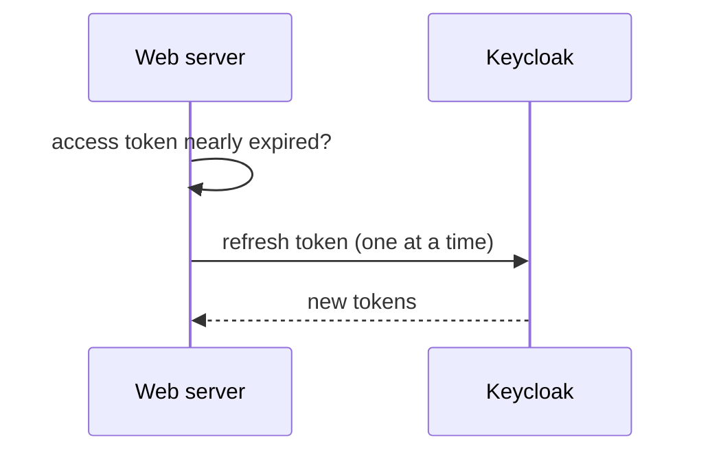

```yaml
id: UC-A14
type: use-case
name: Keep the session alive
status: draft
actor: signed-in person (the system acts for them)
context: BC-ACCESS
satisfies: []
criteria: []
parameters: []
objects: []
rules: []
effects:
  - the session holds a fresh access token, and a new refresh token if Keycloak rotated it
evolved_from: [MK3 UC-A3]
```

# Keep the session alive

> Study copy. Rewritten from MK3's UC-A3 (refresh) for Keycloak.
> **No requirement serves this yet.** The rows in `requirements-access.csv` have nothing for refreshing, because Keycloak does it. Hand this to vbench-req if a row is wanted, for example one that proves a person is not logged out when two requests arrive together.

## Description

Access tokens are short, a few minutes. So that the person is not asked to sign in again, the web server swaps the refresh token for a new access token shortly before the old one expires. The person never sees it.

## What changed from MK3

| MK3 UC-A3 | Playground UC-A14 |
|---|---|
| `POST /auth/session/refresh`, called by the browser, with a refresh cookie | No endpoint. The web server does it inside a request, before calling the API |
| We check the old refresh token against the Redis whitelist, rotate it, and whitelist the new one | Keycloak checks it and rotates it. We hold the latest one in the session |
| Two stages of validation, written by us | None of ours |
| A real bug: a race when the refresh token was replaced logged people out when they switched windows | Handled by **one refresh at a time for each session**. Two requests at once wait for the same answer |

This is the one with the clearest lesson. Refresh tokens rotate, so using the old one a second time looks like theft and Keycloak ends the session. The answer is not a whitelist, it is a lock: if a refresh is already running for this session, the next request waits for it.

## Preconditions

- The person is signed in, and the session holds a refresh token.

## Main flow

1. A request arrives from a signed-in person. The system finds their session.
2. The system sees that the access token expires in less than 30 seconds.
3. The system checks whether a refresh is already running for this session. If one is, it waits for that one and uses its result.
4. Otherwise the system sends the refresh token to Keycloak.
5. Keycloak answers with a new access token, and usually a new refresh token.
6. The system stores them in the session, and the request goes on with the new access token.

## Other flows

- Two requests arrive at once: only one refresh is sent, and both use its result. No log-out.
- Keycloak refuses the refresh token, because the session ended, the person was disabled or the token was already used: the system drops the session, and the person is asked to sign in again.
- Keycloak cannot be reached: the same as a refusal. Open: should the session be kept for a retry?
- The access token is still good for more than 30 seconds: nothing is refreshed.
- A deactivated person (UC-A2) has their sessions ended in Keycloak: the next refresh is refused, so the web session ends within one access token's life at most. The API also refuses them at once, on every request.
- Open: the sessions are kept in the web server's memory. A restart ends them all. A shared store such as Redis would fix that.

## Postconditions

- The session holds a token that is valid for several minutes.

## Overview

The high level picture. The detailed sequence, with step numbers that match the main flow, is in [UC-A14-keep-the-session-alive-sequence.puml](diagrams/UC-A14-keep-the-session-alive-sequence.puml).


